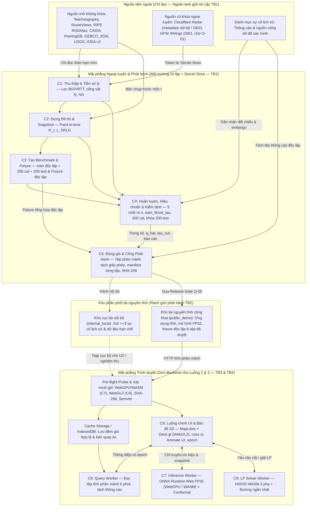
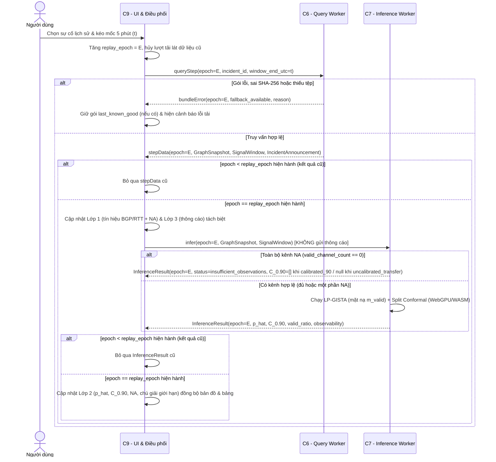
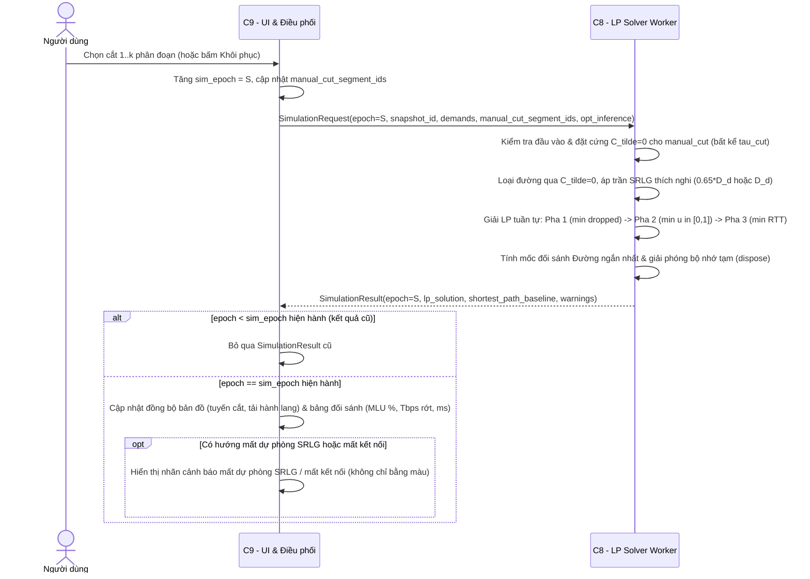
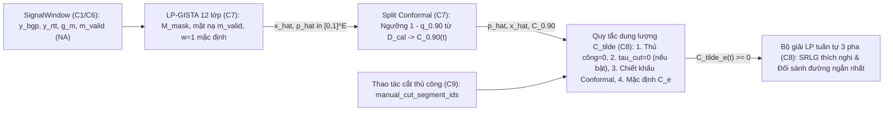

# Kiến trúc Hệ thống SubseaBGP-Tomography

Tài liệu này đặc tả kiến trúc đích của hệ thống nghiên cứu và mô phỏng **SubseaBGP-Tomography**, đủ chi tiết để các tác nhân triển khai độc lập từng thành phần và kiểm thử các điểm tích hợp. Đây là **đặc tả kiến trúc**, không phải kế hoạch triển khai hay lộ trình tiến độ.

- **Tài liệu căn cứ phạm vi và nghiệm thu:** [REQUIREMENTS.md](REQUIREMENTS.md) (đặc biệt Mục 3, Mục 7 và Mục 9 cùng các quyết định đã chốt `Q-01`–`Q-07`).
- **Tài liệu cơ sở thuật toán và nghiên cứu:** [RESEARCH.md](RESEARCH.md) (khi có điểm khác biệt đã chuẩn hóa trong `Q-01`–`Q-07`, áp dụng [REQUIREMENTS.md](REQUIREMENTS.md); các quyết định chi tiết hóa kiến trúc cho MVP được chốt tại Mục 1.6 và Mục 9.1, đồng thời giữ nguyên ba cổng giai đoạn sau `O-01`–`O-03`).
- **Quy tắc giao diện bắt buộc:** [DESIGN.md](DESIGN.md).
- **Quy tắc làm việc kho mã:** [AGENTS.md](../AGENTS.md) và chỉ mục [README.md](README.md).

> **Quy ước phân biệt trong tài liệu:**
> - **Bắt buộc (`Req`):** Ràng buộc cứng từ `REQUIREMENTS.md`, `DESIGN.md` và `AGENTS.md`.
> - **Đề xuất (`Prop`):** Lựa chọn kiến trúc, cấu trúc mô-đun hoặc ngăn xếp công nghệ tham chiếu nhằm đáp ứng yêu cầu; có thể thay bằng phương án khác nếu vượt qua cùng bộ tiêu chí kiểm chứng.
> - **Trạng thái triển khai:** Toàn bộ thành phần phần mềm, đường ống dữ liệu, mô hình, bộ giải và bài kiểm thử mô tả trong tài liệu này **chưa được triển khai và chưa được đo kiểm trong kho mã**.

---

## 1. Mục tiêu, phạm vi và trạng thái

### 1.1. Mục tiêu kiến trúc đích

Kiến trúc hướng tới hai mục tiêu kỹ thuật liên kết trong phạm vi **nghiên cứu và mô phỏng** (không phải hệ thống giám sát quang nội bộ hay điều khiển mạng sản xuất theo `AGENTS.md §1`):

1. **Đường ống thực nghiệm ngoại tuyến tái lập được:** Xây dựng đồ thị hạ tầng hai tầng đóng băng theo đúng thời điểm lịch sử, tiền xử lý chuỗi BGP 5 phút và bước nhảy $\Delta\mathrm{minRTT}$, cưỡng chế tự động 5 chốt chống rò rỉ dữ liệu, thiết lập **đường cơ sở thực nghiệm mới** trên bộ kiểm chuẩn bán tổng hợp (`Q-06`), hồi quy trên $\ge 3$ sự cố lịch sử độc lập và kiểm soát phát hành từng tệp qua cổng `manifest` (`Q-05`).
2. **Ứng dụng tương tác tĩnh không máy chủ thời gian thực cho MVP:** Chạy trực tiếp trên trình duyệt từ kho tài nguyên tĩnh đã qua cổng phát hành cho **Luồng 2** (phát lại sự cố lịch sử theo bước 5 phút, tách bạch 3 lớp thông tin) và **Luồng 3** (mô phỏng cắt/khôi phục phân đoạn cáp giả định và giải bài toán LP định tuyến dự phòng tuần tự 3 pha, đối sánh với định tuyến đường ngắn nhất mặc định).

Mọi tín hiệu đo từ xa và đầu ra của mô hình cắt lớp ($\hat{p}_e(t)$, $\mathcal{C}_{1-\alpha}(t)$) chỉ mang ý nghĩa **giả thuyết xác suất về vùng nghi suy giảm**, tuyệt đối không tự xác nhận sự cố đứt cáp vật lý dưới đáy biển (`REQUIREMENTS.md §1.2`).

### 1.2. Các ràng buộc đã chốt

| Quyết định / Nguồn | Ràng buộc kiến trúc cốt lõi |
| --- | --- |
| `Q-01` | MVP chỉ gồm đường ống thực nghiệm ngoại tuyến, **Luồng 2** (phát lại lịch sử 5 phút) và **Luồng 3** (cắt cáp giả định & giải LP). Loại khỏi MVP: BGP trực tiếp (Luồng 1), quy hoạch 2030 (Luồng 4). Loại khỏi mọi giai đoạn: điều khiển/đẩy cấu hình mạng thật. `U1`, `U2` là người dùng mục tiêu MVP; `U3`, `U4` giữ ở trạng thái `Đề xuất` cho Giai đoạn 2 (`O-03`). |
| `Q-02` | Áp dụng hoàn thiện `formula-24` ($\Psi_{\mathrm{SoL}}$), đặc tả thay thế `formula-33` ($\tilde{y}_m^{\mathrm{RTT}}$) và đặc tả thay thế `formula-6` ($\mathcal{L}_{\mathrm{prior}}$). Chuẩn hóa $\tilde{y}_m^{\mathrm{BGP}}=(W_m+P_m)/2$ và $(\Omega, \Phi_{\mathrm{PoP}})$ với chú giải chỉ là trọng số tiên nghiệm. Thiếu dữ liệu bắt buộc trả `NA`, không điền `0`. Cấm suy $(c_e,\varphi_e)$ từ GEBCO; hoãn số hạng Mohr–Coulomb trong MVP (`O-02`). |
| `Q-03` | Quét $\tau_{\mathrm{cut}} \in [0{,}50; 0{,}99]$ bước `0,01` trên tập validation tách theo sự cố bên trong `train` (recall đứt hoàn toàn cao nhất với `< 5%` kịch bản cắt nhầm; không đạt hoặc thiếu nhãn thì tắt cắt tự động). Chuẩn hóa LP tuần tự 3 bước có biến lưu lượng rớt $\ell_d$, $u \in [0, 1]$, trần SRLG thích nghi và ca kiểm thử bắt buộc `10 Tbps`. Công bố đồng thời `MLU (%)` và lưu lượng rớt (`Tbps`). |
| `Q-04` | Chốt cổng nghiệm thu trên tập `test` bán tổng hợp khóa trước, lịch sử ($\ge 3$ sự cố, 100% truy vết, 0 rò rỉ, không áp ngưỡng bán tổng hợp lên tập lịch sử nhỏ/thiếu nhãn), bộ giải LP và máy chuẩn `MacBook Pro M1, RAM 8 GB, macOS 27.0, Chrome 157.0.8103.79`. Dùng thuật ngữ **ngân sách bộ nhớ GPU logic cấp phát** (`< 150 MB`), kiểm chứng riêng độ đúng đường `WASM`. |
| `Q-05` | Cấm công bố tệp GeoParquet gộp nhiều nguồn dưới một giấy phép chung; không mặc định demo portfolio là phi thương mại. Áp dụng cổng phát hành theo `manifest` từng tệp; mặc định công bố công khai **fixture tổng hợp độc lập** và **trình tải nguồn gốc**; giữ gói dẫn xuất GFW 4Wings, RIPE RIS/Atlas, CAIDA, PeeringDB, IODA và gói lịch sử chưa duyệt ngoài bản demo công khai (`O-01`). |
| `Q-06` | Nguồn `[1]` trong `RESEARCH.md` là `unknown_url`, không còn mã/dữ liệu gốc để tái lập. Xây mới bộ kiểm chuẩn bán tổng hợp (24 phân đoạn, 48 kênh, 400 biến cố) khóa `seed`, phiên bản và chia tập để thiết lập **đường cơ sở mới**. |
| `Q-07` | Ở Giai đoạn 3, giám sát trôi dạt hàng tuần ($\mathrm{JSD} \ge 0{,}10$, `bin` cố định, $\ge 100$ cửa sổ hợp lệ và $\ge 80\%$ dữ liệu dự kiến); sau 2 tuần liên tiếp vượt ngưỡng hoặc có đổi tô-pô xác nhận thì sinh ứng viên $(\mathbf{R}_t, \hat{q}_{0{,}90})$ **duyệt thủ công qua Pull Request**, không tự động xuất bản. |
| `DESIGN.md` | Không gradient, màu phẳng, nhóm màu rời rạc kèm nhãn/biểu tượng, bố cục mở không lồng card hay bọc từng chỉ số trong card, bắt buộc dùng `coss ui` và `Animate UI`, hỗ trợ bàn phím và `prefers-reduced-motion`. |

### 1.3. Hiện trạng kho mã

Kiểm tra thực tế kho mã tại thời điểm lập tài liệu cho thấy:

- Kho Git chưa có commit khởi tạo trên nhánh `main`.
- Đã hiện diện các tệp quy tắc và đặc tả: `AGENTS.md`, `docs/README.md`, `docs/REQUIREMENTS.md`, `docs/DESIGN.md`, `docs/RESEARCH.md`, `docs/original-research.docx`, 4 ảnh minh họa trong `docs/images/`, và tệp kiến trúc này (`docs/ARCHITECTURE.md`).
- **Chưa có mã nguồn triển khai, kịch bản ETL, mô hình đã huấn luyện, bộ dữ liệu thực nghiệm, tệp `manifest` phát hành hay bộ kiểm thử tự động nào.** Do đó, toàn bộ các phép kiểm chứng và đo hiệu năng trong Mục 8 và Mục 10 hiện ở trạng thái **chưa xác minh**.

### 1.4. Phân định phạm vi MVP, giai đoạn sau và ngoài phạm vi

- **Trong đường chạy MVP (Giai đoạn 1):** Đường ống thu thập – tiền xử lý dữ liệu mở sơ cấp; dựng đồ thị và snapshot đóng băng theo thời điểm; trình tạo bộ kiểm chuẩn bán tổng hợp mới và fixture độc lập; bộ kiểm thử tự động 5 chốt chống rò rỉ; huấn luyện LP-GISTA 12 lớp kèm đối chứng `B1`, `B2`, `A1`, `A2`, quét $\tau_{\mathrm{cut}}$ trên validation thuộc `train`, hiệu chuẩn Split Conformal trên `cal` (tắt Mohr–Coulomb, hỗ trợ chạy không tiên nghiệm $w_e=1$); đóng gói tách giấy phép qua cổng `manifest`; ứng dụng trình duyệt tĩnh cho **Luồng 2** và **Luồng 3** với đường dự phòng `WASM`/`WebGL2`.
- **Dành cho giai đoạn sau (không nằm trong đường chạy MVP):**
  - *Giai đoạn 2:* Luồng 1 (WebSocket BGP trực tiếp gom đệm `250 ms` — `FR-004`, `FR-005`), Luồng 4 (quy hoạch hạ tầng 2027–2030, chuẩn 1+2, chỉ số IRI — `FR-013`), đường ống định kỳ GFW 4Wings AIS/SAR (chờ cổng pháp lý `O-01` — `DATA-009`, `FR-008`), kích hoạt số hạng phạt Mohr–Coulomb (chờ dữ liệu địa kỹ thuật phân đoạn `O-02` — `ML-008`) cùng Leave-One-Basin-Out cho bộ mã hóa tiên nghiệm (`ML-002`), đối chiếu sự kiện ngoại sinh trực tuyến IODA v2 / Cloudflare Radar lưu đệm (`FR-007`), và xác nhận người dùng vận hành `U3`, `U4` (`O-03`).
  - *Giai đoạn 3:* Giám sát trôi dạt hàng tuần bằng JSD và quy trình mở Pull Request cập nhật $(\mathbf{R}_t, \hat{q}_{0{,}90})$ có người duyệt (`ML-014`, `Q-07`).
- **Ngoài phạm vi mọi giai đoạn:** Can thiệp/đẩy cấu hình BGP/SRv6/MPLS/IGP lên thiết bị thật (`NFR-008`), phát đo chủ động trái phép, truy cập OTDR/PFE nội bộ, công bố GeoParquet gộp đa giấy phép, tự động xuất bản mô hình không qua duyệt PR, hay duy trì máy chủ ứng dụng thời gian thực.

### 1.5. Phân biệt yêu cầu bắt buộc và lựa chọn kiến trúc đề xuất

| Khía cạnh | Yêu cầu bắt buộc (`Req`) | Lựa chọn kiến trúc đã chọn cho MVP (`Prop`) |
| --- | --- | --- |
| Tách mặt phẳng thực thi | Luồng 2 và Luồng 3 chạy từ tài nguyên tĩnh, không máy chủ ứng dụng thời gian thực (`NFR-001`); bí mật chỉ ở môi trường ngoại tuyến (`NFR-007`). | Môi trường Python cục bộ/CI không dựng tracking server hay DVC remote (`ADR-06`); máy chủ tệp tĩnh công khai hoặc cục bộ cho trình duyệt. |
| Thực thi bất đồng bộ trình duyệt | Truy vấn lịch sử, suy luận, giải LP chạy trong Web Workers tách biệt và giải phóng bộ nhớ tường minh (`NFR-002`). | Chia 3 Worker chuyên trách (`Query`, `Inference`, `LP Solver`) giao tiếp bằng thông điệp có `epoch` và bộ đệm nhị phân chuyển giao (*Transferable*). |
| Ngăn xếp thực thi trên trình duyệt | Đạt 7 cổng hiệu năng/tài nguyên `Q-04` (`NFR-003`), có Pre-flight Probe, hạ cấp `WASM` và phục hồi khi mất thiết bị đồ họa (`NFR-004`). | `ADR-01`–`ADR-04`: đọc tệp tĩnh phân mảnh (`DuckDB-Wasm` làm đối chứng); ONNX Runtime Web FP32 ưu tiên WebGPU / dự phòng WASM; HiGHS WASM (`highs-js`, gói npm `highs`); bản đồ 2D màu phẳng MapLibre + Deck.gl chia sẻ WebGL2 (không Three.js, không địa cầu 3D, không 100.000 hạt). |
| Thư viện giao diện | **Bắt buộc** dùng `coss ui` cho component chuẩn và `Animate UI` cho chuyển động trạng thái; tuân thủ `DESIGN.md` (`UX-001`–`UX-007`). | React/TypeScript (tương thích trực tiếp `coss ui` và `Animate UI`) với design tokens màu phẳng rời rạc, phân biệt trạng thái bằng cả kiểu nét và nhãn. |
| Lưu trữ và đóng gói dữ liệu | Tách bạch tệp theo nguồn và giấy phép, cấm GeoParquet gộp đa giấy phép, chặn phát hành theo `manifest` từng tệp (`DATA-007`, `DATA-008`). | Tệp tĩnh phân mảnh theo sự cố và lát thời gian tách riêng theo nguồn, đóng gói theo thư mục phát hành bất biến kèm lockfile, SHA-256 và `run_provenance.json`. |

### 1.6. Các quyết định chi tiết hóa kiến trúc đã chốt

Ngoài 6 điểm chuẩn hóa khác biệt so với `RESEARCH.md` đã ghi tại `REQUIREMENTS.md §9.4`, 4 điểm chi tiết hóa thiết kế cho đường chạy MVP đã được chốt như sau (các cổng giai đoạn sau `O-01`, `O-02`, `O-03` trong `REQUIREMENTS.md §9.5 B` được giữ nguyên):

1. **Phân hoạch bộ kiểm chuẩn bán tổng hợp (`RESEARCH.md §6.2`, `ML-006`, `ML-010`, `Q-06`):** Giữ đúng `400` biến cố gồm `200 cal + 200 test` như `RESEARCH.md §6.2`; **không lấy bớt từ 400 biến cố này để huấn luyện**. Sinh thêm phần `train` bằng cùng quy trình nhưng **độc lập theo nhóm sự cố** (*mọi biến thể của cùng một sự cố phải nằm trong cùng một tập*). Bên trong `train`, tách cứng hai phần `train_fit` và `val_tau`: chỉ `train_fit` dùng để khớp mô hình, đóng băng đường cơ sở $b_m$ và tham số chuẩn hóa; `val_tau` chỉ dùng để chọn ngưỡng $\tau_{\mathrm{cut}}$. Khóa số lượng, `seed` và phân hoạch trước khi mở tập `test`.
2. **Mốc đối sánh định tuyến đường ngắn nhất mặc định (`FR-012`, `ML-012`):** Dùng **cùng tập đường ứng viên khả dụng và cùng dung lượng khả dụng** với bộ giải LP. Loại bỏ đường trùng, so sánh RTT ở độ phân giải cố định `µs` (micro-giây) và chia đều nhu cầu lên các đường có RTT nhỏ nhất bằng nhau. Khi xảy ra nghẽn liên kết, tăng lưu lượng thực chuyển trên từng đường theo tỷ lệ tải đã gán, rồi cố định các đường đi qua liên kết vừa đầy; các đường còn dư tiếp tục tăng đến giới hạn. Tuyệt đối **không ưu tiên theo ID, không chuyển sang đường dài hơn và không dồn lại phần rớt sang đường hòa khác**. Báo cáo tách riêng **tải danh nghĩa trước giới hạn** và **MLU thực chuyển**.
3. **Phạm vi trực quan hóa bản đồ MVP (`ADR-04`, `DESIGN.md`):** Dùng **MapLibre + Deck.gl** với **bản đồ 2D màu phẳng**, phân biệt trạng thái bằng cả kiểu nét và nhãn; ưu tiên **chia sẻ ngữ cảnh WebGL2**. Không đưa Three.js, địa cầu 3D hay hệ 100.000 hạt vào MVP. Đo FPS và ngân sách bộ nhớ GPU logic của **cả bản đồ lẫn suy luận** trên bản dựng tích hợp.
4. **Ranh giới `external_flags` của `FR-007` (IODA v2 / Cloudflare Radar):** Ở MVP, `external_flags` chỉ là **metadata tùy chọn cho bản chạy nội bộ**; thiếu cờ mang giá trị `null` (không mang nghĩa "không có sự kiện") và **không làm thay đổi đầu ra mô hình MVP**. Bản demo công khai mặc định bỏ trường này và không đóng gói bất kỳ dẫn xuất IODA/Radar chưa duyệt nào. Việc tích hợp đầy đủ bộ đệm và logic đối chiếu IODA/Radar thuộc Giai đoạn 2.

---

## 2. Bối cảnh hệ thống và hai mặt phẳng thực thi

Hệ thống được phân tách cứng thành hai mặt phẳng độc lập nhằm đáp ứng đồng thời `NFR-001` (không máy chủ ứng dụng thời gian thực cho Luồng 2 và Luồng 3), `NFR-007` (không lộ bí mật ra trình duyệt) và `DATA-008` (chặn phát hành tài nguyên chưa duyệt):

- **Mặt phẳng Ngoại tuyến & Phát hành (*Offline Research, Training & Release Plane*):** Thực thi trong môi trường cô lập (máy nghiên cứu cục bộ hoặc quy trình CI/CD). Đọc chỉ đọc các nguồn mở sơ cấp, bảo vệ khóa API (như Cloudflare Radar ở nội bộ, GFW ở GĐ2), thực thi 5 chốt chống rò rỉ, dựng bộ kiểm chuẩn đường cơ sở mới, huấn luyện/hiệu chuẩn/lượng tử hóa mô hình, chạy kiểm định và kiểm duyệt `manifest` từng tệp trước khi đóng gói.
- **Mặt phẳng Trình duyệt Tĩnh (*Static Browser Runtime Plane*):** Thực thi hoàn toàn trên máy khách từ các tệp tĩnh bất biến (mã ứng dụng, trọng số mô hình, gói fixture công khai hoặc gói lịch sử cục bộ). Luồng 2 và Luồng 3 hoạt động đầy đủ mà **không cần bất kỳ máy chủ ứng dụng thời gian thực nào**.



### Ranh giới tin cậy và vị trí thực thi

| Ranh giới | Phân định | Kiểm soát bắt buộc tại ranh giới |
| --- | --- | --- |
| **TB1** (Nguồn ngoài $\leftrightarrow$ Môi trường ngoại tuyến) | Dữ liệu bên ngoài chưa tin cậy đi vào đường ống ETL. | Chỉ đọc (`NFR-008`), giới hạn tốc độ (`DATA-004`), lọc Class A/B và `eventtype=earthquake` (`DATA-005`), xác thực lược đồ/đơn vị/UTC và gán `NA` (`DATA-006`). Bí mật chỉ đọc từ secret store cục bộ/CI (`NFR-007`). |
| **TB2** (Nội bộ $\leftrightarrow$ Kho công khai) | Ranh giới pháp lý và phát hành dữ liệu (`Q-05`). | `C5` chặn tuyệt đối mọi tệp thiếu mục duyệt hợp lệ trong `manifest`, cấm tệp GeoParquet gộp đa giấy phép (`DATA-007`), tách gói lịch sử/hạn chế ở kênh nội bộ (`DATA-008`). |
| **TB3** (Kho tĩnh $\leftrightarrow$ Trình duyệt) | Gói tài nguyên tĩnh truyền qua mạng hoặc nạp từ đĩa cục bộ. | Kiểm tra `schema_version` (`MAJOR` khớp) và mã băm SHA-256 từng tệp trước khi đưa vào `Query Worker` hoặc lưu đệm (`NFR-005`); giữ bản lưu đệm hợp lệ trước đó khi gói mới lỗi. |
| **TB4** (Luồng chính UI $\leftrightarrow$ Web Workers / GPU) | Ranh giới cô lập tính toán nặng và trạng thái hiển thị. | Mọi truy vấn, suy luận, giải LP chạy trong Web Worker (`NFR-002`); luồng chính chỉ gửi yêu cầu gắn `epoch` và từ chối kết quả cũ; không bao giờ gửi `IncidentAnnouncement` vào `Inference Worker` (`FR-010`). |

---

## 3. Thành phần và ranh giới

### 3.1. Bảng thành phần kiến trúc MVP

| Thành phần | Trách nhiệm | Đầu vào | Đầu ra | Phụ thuộc | ID yêu cầu |
| --- | --- | --- | --- | --- | --- |
| **`C1` Thu thập và Tiền xử lý Dữ liệu** | Tải chỉ đọc dữ liệu sơ cấp theo hạn mức; lọc BGP Class A/B, khử trùng và loại reset phiên; tính $\tilde{y}_m^{\mathrm{BGP}}=(W_m+P_m)/2$; trừ RTT chặng nội địa và tính $\tilde{y}_m^{\mathrm{RTT}}$ trên $(t-60\text{p},t]$ ($\ge 2$ mẫu, $b_m>0$); tính cổng $g_m(t)$ và hội chứng $y_m(t)$; lọc USGS `eventtype=earthquake`; gán `NA` tường minh và kiểm định lược đồ/đơn vị/UTC; gắn metadata tùy chọn `external_flags` cho bản nội bộ (`null` khi thiếu, không đổi đầu ra mô hình MVP). | Kho MRT RouteViews/RIPE RIS, RIPE Atlas built-in/anchoring, USGS FDSNWS, GEBCO_2026, metadata IODA/Radar nội bộ (tùy chọn), đường cơ sở $b_m$ đã đóng băng từ `train_fit`. | Các tệp `SignalWindow` theo cửa sổ 5 phút (tách theo nguồn), đặc trưng địa vật lý vùng đệm hành lang, báo cáo kiểm định đầu vào và tỷ lệ `NA`. | Kho nguồn mở sơ cấp (chỉ đọc), secret store ngoại tuyến (nếu đọc Radar nội bộ). | `FR-003`, `FR-006`, `FR-007`, `DATA-001`–`DATA-006`, `NFR-007`–`NFR-009` |
| **`C2` Dựng Đồ thị & Snapshot theo Thời điểm** | Dựng $\mathcal{G}_{\mathrm{phys}}$ từ Submarine Cable Map v3 kèm tuyến đất liền (VSTN, TEA) và tuyến mới; tính $\mathbf{A}^{\mathrm{SRLG}}$ ($r=25\ \mathrm{km}$, eo biển nghẽn) và $\mathbf{L}_{\mathrm{SRLG}}$; đóng băng vòng đời RFS và bản chụp CAIDA/PeeringDB có mốc xuất bản $< t$; kiểm tra chéo nhãn rDNS; tính $(\Omega, \Phi_{\mathrm{PoP}}, \Psi_{\mathrm{SoL}})$ và $\mathbf{R}_t$ (gán `NA` khi thiếu $b_m$/PoP); gắn chú giải bản chất trọng số. | Danh mục cáp & CLS, bổ sung tuyến đất liền, bản chụp CAIDA AS-Relationships & PeeringDB theo tháng, $b_m$ đã đóng băng, rDNS, mốc thời gian `effective_at_utc`. | Tệp `GraphSnapshot` đóng băng tại mốc $t$ kèm ma trận $\mathbf{L}_{\mathrm{SRLG}}$, $\mathbf{R}_t$ có cờ `NA` và tập đường ứng viên $\mathcal{K}_d$. | `C1` (cung cấp $b_m$ và dữ liệu địa vật lý hành lang). | `FR-001`, `FR-002`, `DATA-002`, `DATA-003`, `DATA-006`, `ML-004`, `NFR-009` |
| **`C3` Trình tạo Benchmark & Fixture Độc lập** | Xây dựng mới bộ kiểm chuẩn bán tổng hợp (`24` phân đoạn, `48` kênh, giữ nguyên `400` biến cố = `200 cal + 200 test` và sinh thêm tập `train` độc lập theo nhóm sự cố tách `train_fit` + `val_tau`, mọi biến thể của một sự cố ở cùng tập) làm đường cơ sở mới (`Q-06`); sinh gói fixture tổng hợp độc lập cho bản demo công khai; tạo bộ fixture chuẩn kiểm thử LP (gồm kịch bản `82,0 Tbps`, hai ca `10 Tbps` và ca nghẽn đường ngắn nhất `12 & 8 / 10 Tbps`). | Cấu hình kịch bản khóa số lượng, `random_seed`, tham số phân bổ kịch bản (đơn cáp, che khuất BGP, đa cáp SRLG, nhiễu BGP phi vật lý). | Bộ dữ liệu kiểm chuẩn bán tổng hợp (`train_fit`/`val_tau`/`200 cal`/`200 test`), gói fixture demo công khai độc lập, bộ fixture kiểm thử LP và hồ sơ `run_provenance.json`. | `C2` (dùng chung cấu trúc hợp đồng `GraphSnapshot` và `SignalWindow`). | `DATA-002`, `DATA-008`, `ML-010`, `ML-012`, `ML-013`, `NFR-009`, `NFR-010` |
| **`C4` Huấn luyện, Hiệu chuẩn & Kiểm định Chống rò rỉ** | Thực thi tự động 5 chốt chống rò rỉ; khóa tắt Mohr–Coulomb khi chưa có dữ liệu trầm tích; huấn luyện LP-GISTA 12 lớp (mặt nạ $\mathbf{M}_{\mathrm{mask}}$, chiếu $\Pi_\Delta$, đóng băng $b_m$ và chuẩn hóa chỉ trên `train_fit`) cùng các mốc `B1`, `B2`, `A1`, `A2`; quét $\tau_{\mathrm{cut}}$ độc quyền trên `val_tau`; ước lượng $\hat{q}_{0{,}90}$ độc quyền trên `200 cal`; xuất mô hình ONNX FP32 (và bản lượng tử hóa nếu phát hành đạt $\Delta\mathrm{PR\text{-}AUC} < 0{,}005$); đánh giá một lần trên `200 test` khóa trước và hồi quy $\ge 3$ sự cố lịch sử (kiểm chế độ $\Delta\mathbf{R}_\theta=0$ ngoài vùng huấn luyện); ghi vết bằng lockfile, SHA-256 và `run_provenance.json`. | `SignalWindow` và `GraphSnapshot` từ `C1`/`C2`/`C3`, danh mục sự cố lịch sử (có $(t_0, t_{\mathrm{repair}})$), cấu hình huấn luyện và `seed`. | Tệp mô hình ONNX FP32 (và bản lượng tử hóa nếu dùng), tham số $(\hat{q}_{0{,}90}, \tau_{\mathrm{cut}} / \mathrm{disabled})$, báo cáo đối sánh `B1`/`B2`/`A1`/`A2`/`Full`, báo cáo lịch sử, nhật ký 0 vi phạm rò rỉ và `run_provenance.json`. | `C1`, `C2`, `C3`, lõi `C7` và `C8` (để kiểm chứng tương đương và hồi quy LP). | `FR-008`, `FR-009`, `ML-001`, `ML-003`–`ML-007`, `ML-009`–`ML-013`, `NFR-009`, `NFR-010` |
| **`C5` Đóng gói, Cổng Phát hành & Kiểm định Toàn vẹn** | Đóng gói tệp tĩnh phân mảnh theo sự cố và lát thời gian, tách riêng theo nguồn và giấy phép (cấm gộp GeoParquet đa giấy phép); loại bỏ `external_flags` và mọi dẫn xuất chưa duyệt khỏi kênh `public_demo`; sinh và kiểm tra `ReleaseManifest` từng tệp; tính SHA-256, kiểm tra trần kích thước nén (`< 15 MB` thiết yếu, `< 65 MB` tổng), ghi con trỏ phiên bản tương thích trước đó để quay lui. | Đầu ra đã kiểm định từ `C2`, `C3`, `C4`, tệp thông cáo sự cố tách riêng (`IncidentAnnouncement`), bảng khai báo giấy phép và bản duyệt `manifest` của người phụ trách. | Gói phát hành tĩnh bất biến (`public_demo` hoặc `internal_local`), tệp `release_manifest.json`, tệp chỉ mục `current_release.json`, báo cáo kiểm tra phát hành. | `C2`, `C3`, `C4`, bản phê duyệt thủ công của người phụ trách dự án. | `DATA-002`, `DATA-007`, `DATA-008`, `DATA-009`, `NFR-001`, `NFR-003`, `NFR-007`, `NFR-010` |
| **`C6` Truy vấn Lịch sử & Quản lý Gói Dữ liệu Trình duyệt** *(Query Worker)* | Tải `release_manifest.json`, kiểm tra SemVer và xác minh SHA-256 từng tệp; quản lý bộ đệm bền vững (Cache Storage/IndexedDB) và quay lui về bản đệm hợp lệ khi mạng/gói lỗi; đọc trực tiếp các tệp tĩnh phân mảnh theo sự cố và lát thời gian 5 phút (`ADR-01`; `DuckDB-Wasm` làm phương án đối chứng) trả về tách biệt `GraphSnapshot`, `SignalWindow` (kèm cờ `NA`) và `IncidentAnnouncement` (không gộp thông cáo vào đầu vào suy luận). | Gói tài nguyên tĩnh phân mảnh từ kho công khai hoặc tệp gói cục bộ; yêu cầu truy vấn có `epoch`, `incident_id`/`scenario_id`, `window_end_utc`. | `GraphSnapshot`, `SignalWindow`, `IncidentAnnouncement` (tách riêng), trạng thái tải gói và cảnh báo nguồn ngoại tuyến. | Kho tài nguyên tĩnh (`C5`), Cache Storage/IndexedDB. | `FR-010`, `DATA-002`, `DATA-006`, `NFR-001`, `NFR-002`, `NFR-005` |
| **`C7` Động cơ Suy luận Cắt lớp & Hiệu chuẩn Tập nghi vấn** *(Inference Worker + Lõi thuần)* | Thực thi LP-GISTA 12 lớp qua ONNX Runtime Web FP32 trước (`WebGPU` ưu tiên, hạ cấp `WASM` dự phòng theo `ADR-02`) với mặt nạ kênh hợp lệ `m_valid` loại tường minh kênh `NA` khỏi phần dư; hỗ trợ $w_e=1$ khi chưa có lớp tiên nghiệm duyệt; áp chế độ chuyển giao $\Delta\mathbf{R}_\theta=\mathbf{0}$ (giữ mặt nạ và chiếu $\Pi_\Delta$, không gán bảo chứng độ phủ 90% khi chưa hiệu chuẩn phù hợp theo `ADR-05`); xuất $\hat{p}_e(t)$, $\mathcal{C}_{0{,}90}(t)$ (khi đã hiệu chuẩn), tỷ lệ kênh hợp lệ và trạng thái khả kiến. | Mô hình ONNX FP32 & siêu dữ liệu hiệu chuẩn, `GraphSnapshot` ($\mathbf{R}_t, \mathbf{L}_{\mathrm{SRLG}}$), `SignalWindow` ($\mathbf{y}, \mathbf{m}_{\mathrm{valid}}, \mathbf{w}$), `epoch`. | `InferenceResult` ($\hat{\mathbf{x}}, \hat{\mathbf{p}}$, chế độ suy luận/hiệu chuẩn, $\mathcal{C}_{0{,}90}$, trạng thái `NA`/khả kiến, chính sách `auto_cut`, chú giải giới hạn suy luận). | `C6` (dữ liệu), trọng số từ `C5`, Pre-flight Probe từ `C9`. | `FR-008`, `FR-009`, `ML-009`, `NFR-001`–`NFR-004`, `NFR-009` |
| **`C8` Bộ giải Định tuyến Dự phòng LP & Đối sánh Đường ngắn nhất** *(LP Solver Worker + Lõi thuần)* | Áp quy tắc chuyển đổi dung lượng $\tilde{C}_e(t)$ (ưu tiên tuyệt đối cắt thủ công $\tilde{C}_e=0$ bất kể trạng thái $\tau_{\mathrm{cut}}$); loại bỏ đường chứa liên kết $\tilde{C}_e=0$; áp trần SRLG thích nghi (`0,65 D_d` vs `D_d` + cảnh báo mất dự phòng SRLG); giải LP tuần tự 3 pha bằng HiGHS WASM (`highs-js`, gói npm `highs`) và giải phóng tường minh (`model.dispose()` nếu giữ mô hình qua 3 pha theo `ADR-03`); tính mốc đối sánh đường ngắn nhất theo quy tắc `FR-012` đã chốt (khử trùng, so `µs`, chia đều hòa, cắt nghẽn theo tỷ lệ tải đã gán). | `SimulationRequest` (`GraphSnapshot`, `demands`, `manual_cut_segment_ids`, tùy chọn `InferenceResult`), `epoch`. | `SimulationResult` (nghiệm LP: `total_dropped_tbps`, `mlu_pct`, `weighted_rtt_ms`, tải từng phân đoạn/hành lang, cờ `srlg_redundancy_lost`, `disconnected`; đối sánh đường ngắn nhất gồm cả tải danh nghĩa trước giới hạn và MLU thực chuyển). | `C6` (tô-pô/kịch bản), tùy chọn `C7` (khi bật chiết khấu theo suy luận). | `FR-011`, `FR-012`, `ML-012`, `NFR-001`–`NFR-004`, `NFR-009` |
| **`C9` Giao diện Trực quan & Điều phối Trạng thái** *(Main UI Thread)* | Thực thi Pre-flight Probe (WebGPU/WASM cho `C7`, WebGL2 dùng chung cho bản đồ `C9`) và phục hồi mất ngữ cảnh đồ họa (`device.lost` / `webglcontextlost`); quản lý `replay_epoch`/`sim_epoch` để hủy kết quả cũ; hiển thị **bản đồ 2D màu phẳng MapLibre + Deck.gl** (không Three.js, không địa cầu 3D, không 100.000 hạt theo `ADR-04`) đồng bộ với bảng số liệu (`FR-014`); trình bày tách 3 lớp Luồng 2 (`FR-010`) và điều khiển cắt/khôi phục Luồng 3 (`FR-011`); tuân thủ `DESIGN.md` (`coss ui`, `Animate UI`, phân biệt trạng thái bằng cả kiểu nét và nhãn, bàn phím, `prefers-reduced-motion`). | Tương tác chuột/bàn phím người dùng; phản hồi có `epoch` từ `C6`, `C7`, `C8`; thiết lập `prefers-reduced-motion` và năng lực phần cứng trình duyệt. | Màn hình Luồng 2 và Luồng 3 đồng bộ bản đồ 2D – bảng số liệu, cảnh báo `NA`/mất dự phòng SRLG/mất kết nối/lỗi gói và sự kiện gửi tới Workers. | `C6`, `C7`, `C8`, `coss ui`, `Animate UI`, MapLibre + Deck.gl. | `FR-010`–`FR-012`, `FR-014`, `DATA-002`, `NFR-001`–`NFR-006`, `UX-001`–`UX-007` |

> **Thành phần mở rộng (ngoài đường chạy MVP, mô tả tại Mục 9.3):** `E1` *Live BGP Stream Worker* (`FR-004`, `FR-005`), `E2` *Planning 2030 & IRI Analyzer* (`FR-013`), `E3` *Maritime Prior / GFW, IODA/Radar & Mohr–Coulomb Pipeline* (`FR-007`, `FR-008`, `ML-002`, `ML-008`), và `E4` *Weekly Drift Monitor & PR Generator* (`ML-014`).

### 3.2. Phần logic kiểm thử được không cần trình duyệt hay mạng (`NFR-009`)

Để tách biệt tuyệt đối đọc/ghi dữ liệu và giao diện khỏi thuật toán lõi (`AGENTS.md §5`, `NFR-009`), toàn bộ các mô-đun dưới đây được thiết kế như thư viện thuần tất định (*deterministic pure modules*) chạy kiểm thử tự động trong môi trường ngoại tuyến hoàn toàn không có DOM, WebGPU/WebGL2 hay kết nối Internet:

- **Lõi tiền xử lý và kiểm định (`C1`):** Hàm lọc Class A/B, khử trùng và lọc reset phiên BGP, tính $\tilde{y}_m^{\mathrm{BGP}}=(W_m+P_m)/2$, lọc $\widehat{\mathrm{minRTT}}_m(t)$ và $\tilde{y}_m^{\mathrm{RTT}}(t)$ theo `formula-33`, cổng $g_m(t)$, bộ kiểm định lược đồ/đơn vị/UTC và sinh cờ `NA` trên tệp fixture nhỏ cục bộ.
- **Lõi dựng đồ thị và liên thuộc (`C2`):** Tính $\mathbf{A}^{\mathrm{SRLG}}$ ($r = 25\ \mathrm{km}$, eo biển nghẽn), $\mathbf{L}_{\mathrm{SRLG}}$, lọc vòng đời RFS và bản chụp $< t$, tính $(\Omega, \Phi_{\mathrm{PoP}}, \Psi_{\mathrm{SoL}})$ và kiểm tra `NA` khi thiếu $b_m$/PoP.
- **Lõi sinh dữ liệu và chống rò rỉ (`C3`, `C4`):** Sinh bộ kiểm chuẩn bán tổng hợp theo `seed` (`train_fit`/`val_tau` độc lập nhóm sự cố + `200 cal` + `200 test`), 5 hàm kiểm tra chốt chống rò rỉ, bộ quét $\tau_{\mathrm{cut}}$ độc quyền trên `val_tau`, bộ hiệu chuẩn Split Conformal trên `200 cal`, hàm kiểm tra khóa tắt Mohr–Coulomb và tính toàn bộ bộ chỉ số (`Hit@1`, `Hit@3`, `MRR`, `PR-AUC`, `F1`, `Distractor FAR`, độ phủ + khoảng tin cậy, kích thước tập).
- **Lõi đóng gói và cổng phát hành (`C5`):** Trình xác thực `ReleaseManifest`, kiểm tra quy tắc cấm gộp giấy phép GeoParquet, kiểm tra lược bỏ `external_flags` ở kênh công khai, kiểm tra SHA-256 và bộ kiểm tra chặn tệp chưa duyệt.
- **Lõi toán học suy luận và bộ giải LP (`C7`, `C8`):** Chạy LP-GISTA 12 lớp (so khớp đầu ra Python tham chiếu với ONNX CPU/WASM trên Node.js, kiểm tra chế độ $\Delta\mathbf{R}_\theta=\mathbf{0}$), quy tắc chiết khấu/cắt dung lượng $\tilde{C}_e(t)$ và bộ giải LP tuần tự 3 pha + đối sánh đường ngắn nhất theo `FR-012` trên bộ fixture (gồm ca `82,0 Tbps`, hai ca `10 Tbps` và ca nghẽn `12 & 8 / 10 Tbps`).
- **Phần cần môi trường trình duyệt thực:** Lớp kết xuất bản đồ 2D MapLibre + Deck.gl (chia sẻ WebGL2) và DOM (`C9`), Pre-flight Probe WebGPU/WASM cho `C7` và WebGL2 cho `C9`, phục hồi `device.lost`/`webglcontextlost`, kiểm tra thao tác bàn phím/`prefers-reduced-motion`/thang xám và đo 7 ngưỡng hiệu năng/bộ nhớ tích hợp trên máy chuẩn M1 (`NFR-003`, `NFR-004`, `NFR-006`).

---

## 4. Hợp đồng dữ liệu và phiên bản

### 4.1. Quy tắc chung cho mọi hợp đồng

1. **Phiên bản hóa (`schema_version`):** Dùng chuẩn `MAJOR.MINOR.PATCH` (ví dụ `"1.0.0"`).
   - Khác `MAJOR`: **không tương thích** — bên đọc từ chối nạp và trả lỗi tường minh nêu rõ phiên bản kỳ vọng và phiên bản thực tế.
   - `MINOR` của dữ liệu lớn hơn bên đọc: cảnh báo thiếu hỗ trợ trường mở rộng (nếu trường mới tùy chọn thì vẫn đọc phần lõi; nếu có cờ `requires_min_reader_version` cao hơn thì từ chối nạp).
   - `PATCH`: sửa chú thích/sửa lỗi không thay đổi cấu trúc trường hay ngữ nghĩa đơn vị.
2. **Định danh liên kết ổn định:** Mọi hợp đồng liên kết với nhau qua bộ khóa chuẩn hóa: `release_id`, `bundle_id`, `snapshot_id`, `segment_id`, `cls_id`, `channel_id`, `srlg_group_id`, `demand_id`, `path_id`, `incident_id`, `model_version`, `run_id`.
3. **Mốc thời gian và đơn vị (`DATA-006`, `NFR-009`):** Mọi dấu thời gian bắt buộc theo định dạng chuỗi `ISO-8601 UTC` kết thúc bằng `Z` (ví dụ `2026-08-25T08:05:00Z`); bất kỳ chuỗi nào không có hậu tố `Z` hoặc lệch múi giờ đều bị từ chối. Mọi trường đại lượng vật lý đều mang hậu tố đơn vị tường minh: `_km`, `_m`, `_ms`, `_tbps`, `_pct`, `_mw`, `_kpa`, `_rad`.
4. **Ngữ nghĩa `NA` bắt buộc (`FR-002`, `FR-003`, `FR-006`, `FR-009`, `DATA-006`):** Giá trị không đủ điều kiện tính toán được biểu diễn bằng `null` kèm mã nguyên nhân chuẩn hóa `na_reason` (thuộc tập đóng: `MISSING_BM`, `MISSING_POP`, `INSUFFICIENT_RTT_SAMPLES`, `NON_POSITIVE_BM`, `ZERO_BGP_DENOMINATOR`, `COLLECTOR_GAP`, `OUT_OF_SERVICE`, `NO_APPROVED_PRIOR`, `EXTERNAL_SOURCE_UNAVAILABLE`) và cờ boolean `is_valid` / `is_scorable`. **Tuyệt đối không chuyển `NA` thành `0`, không coi kênh `NA` là bằng chứng không có sự cố và không coi ứng viên thiếu dữ liệu là đã qua cổng $\Psi_{\mathrm{SoL}}$.**
5. **Nhãn bản chất dữ liệu (`DATA-002`):** Mọi gói dữ liệu và kết quả đều mang trường `data_provenance_class` thuộc đúng 4 giá trị:
   - `observed_measurement` (*đo thực tế*)
   - `stylized_derived` (*sơ đồ hóa dẫn xuất*)
   - `synthetic_calibrated_baseline` (*bán tổng hợp — đường cơ sở mới*)
   - `simulated_assumption` (*mô phỏng / giả định*)

### 4.2. Đặc tả chi tiết các hợp đồng tối thiểu

#### Hợp đồng 1: `GraphSnapshot` (`graph_snapshot`, phiên bản khởi đầu `1.0.0`)

- **Bên tạo:** `C2` (lịch sử/nội bộ) hoặc `C3` (bán tổng hợp/fixture), đóng gói qua `C5`.
- **Bên đọc:** `C4`, `C6`, `C7`, `C8`, `C9`.
- **Liên kết chính:** `snapshot_id`, `segment_id`, `cls_id`, `channel_id`, `srlg_group_id`, `demand_id`, `path_id`.
- **Cấu trúc tối thiểu:**
  - Siêu dữ liệu: `schema_version`, `snapshot_id`, `graph_profile_id`, `effective_at_utc`, `data_provenance_class`, `source_cutoffs_utc` (bản đồ `source_name -> published_at_utc`, bắt buộc mọi mốc `< effective_at_utc` theo `ML-004`), `routing_weight_disclaimer` (bắt buộc khẳng định $\Omega, \Phi_{\mathrm{PoP}}$ chỉ là trọng số tiên nghiệm theo `FR-002`).
  - Hạ tầng vật lý (`nodes_cls[]`, `segments[]`): `cls_id`, tọa độ hiển thị, `segment_id`, `system_name`, `medium` (`subsea | terrestrial`), `in_service` (`bool`), `rfs_date_utc`, `retired_date_utc | null`, `length_km`, `capacity_tbps`, `chokepoint_ids[]`, `srlg_group_ids[]`.
  - Cấu trúc rủi ro chung (`srlg_laplacian`): biểu diễn thưa `(row_segment_id, col_segment_id, a_srlg, l_srlg)` cùng siêu dữ liệu bán kính `coastal_radius_km = 25`.
  - Ma trận liên thuộc (`routing_matrix_R[]`): bản ghi theo cặp `(channel_id, segment_id)` gồm `omega_score | null`, `phi_pop_score | null`, `psi_sol_pass: bool | null`, `r_weight | null`, `is_scorable: bool`, `na_reason | null`.
  - Tập đường ứng viên (`candidate_paths[]`): `path_id`, `demand_id`, `segment_ids[]`, `srlg_group_id`, `rtt_ms`.
- **Xử lý `NA` và lỗi không tương thích:** Tuyến ngoài vòng đời (`in_service = false`) có `omega_score = 0`, `r_weight = 0`; cặp không qua cổng tốc độ ánh sáng có `psi_sol_pass = false`, `r_weight = 0`; cặp thiếu $b_m$ hoặc PoP có `is_scorable = false`, `r_weight = null`, `na_reason = MISSING_BM | MISSING_POP`. Nếu bất kỳ mốc nào trong `source_cutoffs_utc` $\ge$ `effective_at_utc`, hoặc `length_km <= 0`, hoặc `capacity_tbps < 0`, hoặc lệch `MAJOR` thì bên đọc/kiểm định **chặn nạp ngay lập tức**.

#### Hợp đồng 2: `SignalWindow` (`signal_window`, phiên bản khởi đầu `1.0.0`) và tệp tách riêng `IncidentAnnouncement` (`incident_announcement`, `1.0.0`)

- **Bên tạo:** `C1` (lịch sử/nội bộ) hoặc `C3` (bán tổng hợp/fixture), đọc bởi `C6`.
- **Bên đọc:** `C4`, `C7`, `C9` (hiển thị tại **Lớp 1 — Dữ liệu quan sát**).
- **Liên kết chính:** `window_id`, `snapshot_id`, `channel_id`, `segment_id`.
- **Cấu trúc tối thiểu (`SignalWindow`):**
  - Siêu dữ liệu: `schema_version`, `window_id`, `snapshot_id`, `window_start_utc`, `window_end_utc` (bắt buộc `window_end_utc - window_start_utc == 300s`), `data_provenance_class`.
  - Tín hiệu theo kênh (`channels[]`): `channel_id`, `y_bgp` (`[0,1] | null`), `bgp_active_pairs_count`, `bgp_na_reason | null`, `y_rtt` (`>=0 | null`), `rtt_sample_count`, `min_rtt_base_ms` (`>0 | null`), `rtt_window_minutes = 60`, `rtt_na_reason | null`, `gate_g` (`[0,1] | null`), `syndrome_y` (`>=0 | null`), `is_valid: bool`, `na_reason | null`.
  - Tiên nghiệm phân đoạn (`prior_mode` thuộc `uniform_w1 | open_geophysical_only | synthetic_benchmark_prior | full_approved_prior`, `segment_priors[]`: `segment_id`, `hazard_prob | null`, `weight_w` `>0`, `prior_na_reason | null`).
  - Metadata ngoại sinh tùy chọn (`external_flags` — **chỉ dùng cho bản nội bộ `internal_local`; bản `public_demo` mặc định bỏ hoàn toàn trường này**): `ioda_status | null`, `radar_hijack_flagged: bool | null`, `na_reason | null`. Thiếu cờ bắt buộc là `null` (không được diễn giải là "không có sự kiện") và **tuyệt đối không thay đổi đầu ra mô hình MVP** (`FR-007` tích hợp đầy đủ bộ đệm và logic đối chiếu ở Giai đoạn 2).
- **Tách tệp thông cáo (`IncidentAnnouncement` — Lớp 3 của Luồng 2):** Lưu ở tệp riêng gồm `schema_version`, `incident_id`, `snapshot_id`, `event_start_utc`, `announced_at_utc`, `repair_completed_utc | null`, `source_citation`, `label_granularity` (`system | segment`), `confirmed_cable_names[]`, `confirmed_segment_ids[] | null`, `notes`. `C6` đọc tệp này trực tiếp cho Lớp 3 của `C9` và **tuyệt đối không truyền sang `C7`**.
- **Xử lý `NA` và lỗi không tương thích:** Khi `bgp_active_pairs_count == 0` thì `y_bgp = null`, `bgp_na_reason = ZERO_BGP_DENOMINATOR`; khi `rtt_sample_count < 2` hoặc `min_rtt_base_ms <= 0` thì `y_rtt = null`, `rtt_na_reason = INSUFFICIENT_RTT_SAMPLES | NON_POSITIVE_BM`. Nếu thiếu `y_bgp` hoặc `y_rtt` thì đặt `is_valid = false`, `syndrome_y = null` — không điền `0`. Cửa sổ khác bước `300s`, lệch `snapshot_id` hoặc lệch `MAJOR` bị từ chối.

#### Hợp đồng 3: `InferenceResult` (`inference_result`, phiên bản khởi đầu `1.0.0`)

- **Bên tạo:** `C7` (trên trình duyệt hoặc bước đánh giá `C4`).
- **Bên đọc:** `C8` (tùy chọn khi bật chiết khấu theo suy luận), `C9` (hiển thị tại **Lớp 2 — Kết quả suy luận**).
- **Liên kết chính:** `request_id`, `epoch`, `snapshot_id`, `window_id`, `model_version`, `segment_id`.
- **Cấu trúc tối thiểu:**
  - Siêu dữ liệu: `schema_version`, `request_id`, `epoch`, `snapshot_id`, `window_id`, `window_end_utc`, `model_version`, `execution_backend` (`webgpu | wasm_cpu | offline_ref`), `inference_mode` (`in_profile | zero_delta_r_transfer`), `prior_mode`, `conformal_calibration_status` (`calibrated_90 | uncalibrated_transfer`), `calibration_quantile_q | null`, `nominal_coverage_target` (`0.90 | null`), `valid_channel_count`, `total_channel_count`, `valid_channel_ratio`.
  - Chính sách cắt tự động: `auto_cut_policy` (`enabled: bool`, `tau_cut: number | null`, `disabled_reason | null`).
  - Trạng thái tổng thể: `status` (`ok | degraded_partial_na | insufficient_observations`).
  - Kết quả theo phân đoạn (`segment_scores[]`): `segment_id`, `x_hat` (`[0,1] | null`), `p_hat` (`[0,1] | null`), `in_conformal_set: bool | null`, `observing_valid_channels`, `observability_status` (`observable | unobservable_na`).
  - Danh sách tóm tắt: `conformal_set_segment_ids[] | null` và `interpretation_disclaimer` (bắt buộc nêu rõ đầu ra xác suất không tự xác nhận sự cố đứt cáp vật lý).
- **Xử lý `NA`, chuyển giao và lỗi không tương thích:** Khi `valid_channel_count == 0` (quyết định `D-01`), trả `status = insufficient_observations`, `conformal_set_segment_ids = []` cho `calibrated_90` và `null` cho `uncalibrated_transfer`, mọi phân đoạn mang `observability_status = unobservable_na` và không được tính là âm tính đúng trong `Distractor FAR` (`null` nghĩa là không có tập Conformal được hiệu chuẩn; `[]` trong trường hợp này không mang nghĩa "an toàn"). Khi chỉ khuyết một phần kênh, trả `status = degraded_partial_na` và chỉ chấm điểm phân đoạn có `observing_valid_channels >= 1`; phân đoạn có `observing_valid_channels == 0` mang `x_hat = null`, `p_hat = null`, `observability_status = unobservable_na`. Khi chạy ngoài lưu vực huấn luyện hoặc `graph_profile_id` không khớp (`ADR-05`), `C7` áp chế độ `inference_mode = zero_delta_r_transfer` ($\Delta\mathbf{R}_\theta = \mathbf{0}$, giữ mặt nạ $\mathbf{M}_{\mathrm{mask}}$ và phép chiếu $\Pi_\Delta$); nếu chưa có tập hiệu chuẩn phù hợp thì đặt `conformal_calibration_status = uncalibrated_transfer`, `nominal_coverage_target = null` và **tuyệt đối không gán bảo chứng độ phủ 90%**.

#### Hợp đồng 4: `SimulationRequest` (`simulation_request`, `1.0.0`) và `SimulationResult` (`simulation_result`, `1.0.0`)

- **Bên tạo `SimulationRequest`:** `C9` (Luồng 3) hoặc `C4` (hồi quy LP). **Bên đọc:** `C8`.
- **Bên tạo `SimulationResult`:** `C8`. **Bên đọc:** `C9`, `C4`.
- **Liên kết chính:** `request_id`, `epoch`, `snapshot_id`, `scenario_id`, `segment_id`, `demand_id`, `path_id`, `srlg_group_id`.
- **Cấu trúc tối thiểu `SimulationRequest`:**
  - `schema_version`, `request_id`, `epoch`, `snapshot_id`, `scenario_id`, `data_provenance_class` (`simulated_assumption`), `demands[]` (`demand_id`, `src_region`, `dst_region`, `demand_tbps`), `manual_cut_segment_ids[]`, `apply_inference_discount: bool`, `inference_ref | null` (`p_hat` theo `segment_id`, `x_hat`, `conformal_set_segment_ids[]`, `auto_cut_policy`), `srlg_cap_ratio = 0.65`, `compute_shortest_path_baseline: bool`.
- **Cấu trúc tối thiểu `SimulationResult`:**
  - Siêu dữ liệu: `schema_version`, `request_id`, `epoch`, `snapshot_id`, `scenario_id`, `solver_version`, `solve_time_ms` (tổng thời gian cả ba pha), `status` (`optimal | all_paths_unavailable | invalid_input`), `interpretation_warning` (bắt buộc nhấn mạnh phải đọc đồng thời `total_dropped_tbps` và `mlu_pct`).
  - Dung lượng hiệu dụng áp dụng (`effective_capacities[]`): `segment_id`, `base_capacity_tbps`, `effective_capacity_tbps`, `capacity_reason` (`normal | conformal_discount | auto_cut_tau | manual_cut`).
  - Nghiệm LP (`lp_solution`): `total_demand_tbps`, `total_served_tbps`, `total_dropped_tbps`, `mlu_pct` (`[0, 100]`), `weighted_rtt_ms | null`, `demands[]` (`demand_id`, `demand_tbps`, `served_tbps`, `dropped_tbps`, `available_srlg_corridor_count`, `applied_srlg_cap_tbps`, `srlg_redundancy_lost: bool`, `disconnected: bool`), `path_flows[]` (`path_id`, `demand_id`, `flow_tbps`, `rtt_ms`), `segment_loads[]` (`segment_id`, `load_tbps`, `effective_capacity_tbps`, `utilization_pct`).
  - Đối sánh đường ngắn nhất (`shortest_path_baseline` — báo tách biệt tải danh nghĩa trước giới hạn và MLU thực chuyển theo `FR-012`): `total_served_tbps`, `total_dropped_tbps`, `mlu_pct` (`[0, 100]`, MLU thực chuyển sau giới hạn), `raw_unconstrained_overload_pct` (tải danh nghĩa cực đại trước giới hạn), `weighted_rtt_ms | null`, `demands[]` (`demand_id`, `assigned_tbps`, `served_tbps`, `dropped_tbps`), `segment_loads[]` (`segment_id`, `raw_assigned_load_tbps`, `served_load_tbps`, `effective_capacity_tbps`, `raw_utilization_pct`, `served_utilization_pct`).
- **Xử lý `NA` và lỗi không tương thích:** Khi `total_served_tbps == 0` (toàn bộ hướng mất kết nối), `weighted_rtt_ms = null` kèm `na_reason = NO_SERVED_FLOW` (không gán `0 ms`), `total_dropped_tbps = total_demand_tbps`, `mlu_pct = 0` và `disconnected = true`. Nếu `demand_tbps < 0`, `manual_cut_segment_ids` chứa ID không có trong `snapshot_id`, hoặc `srlg_cap_ratio` ngoài `(0, 1]`, trả `status = invalid_input` kèm chi tiết trường lỗi.

#### Hợp đồng 5: `ReleaseManifest` (`release_manifest`, phiên bản khởi đầu `1.0.0`)

- **Bên tạo:** `C5` (kèm phê duyệt của người phụ trách dự án theo `Q-05`).
- **Bên đọc:** Quy trình cổng phát hành CI/CD, `C6`, `C4`.
- **Liên kết chính:** `release_id`, `previous_compatible_release_id`, `file_path`, `sha256`, `model_version`, `snapshot_id`.
- **Cấu trúc tối thiểu:**
  - Siêu dữ liệu phát hành: `schema_version`, `release_id`, `published_at_utc`, `distribution_channel` (`public_demo | internal_local`), `git_commit`, `app_min_version`, `app_max_compatible_version`, `previous_compatible_release_id | null`.
  - Khối mô hình (`model_artifact`): `model_version`, `graph_profile_id`, `file_path`, `sha256`, `quantization` (`fp32` mặc định ở MVP theo `ADR-02`; `fp16 | int8_mixed` chỉ phát hành khi có `delta_pr_auc_vs_fp32 < 0.005`), `delta_pr_auc_vs_fp32 | null`, `calibration_quantile_q`, `auto_cut_policy`, `compressed_bytes`.
  - Bảng kê từng tệp (`files[]` — **mỗi tệp tương ứng đúng một nguồn và một giấy phép**): `file_path`, `artifact_role` (`essential_boot | topology | signals_shard | announcements | scenarios | model | basemap`), `contract_schema_version`, `data_provenance_class`, `source_name`, `source_version_or_fetched_at_utc`, `transformations_summary`, `license_id`, `license_terms_ref`, `attribution_text`, `modifications_notice`, `redistribution_approved: bool`, `approved_by | null`, `approved_at_utc | null`, `sha256`, `compressed_bytes`, `uncompressed_bytes`.
- **Xử lý thiếu và không tương thích:**
  - Tại `C5` (kênh `public_demo`): chặn phát hành ngay nếu tồn tại bất kỳ tệp nào thiếu `license_id`/`attribution_text`/`sha256`, có `redistribution_approved != true`, thiếu `approved_by`/`approved_at_utc`, trộn nhiều nguồn khác giấy phép trong một tệp, chứa `external_flags` hay dẫn xuất IODA/Radar chưa duyệt, hoặc thuộc nhóm nguồn bị chặn khi chưa duyệt (`gfw_4wings`, `ripe_ris`, `ripe_atlas`, `caida`, `peeringdb`, `ioda`, `historical_fault_pack`).
  - Tại `C6`: nếu `sha256` thực tải khác `manifest`, thiếu tệp `essential_boot`, hoặc `schema_version` lệch `MAJOR` -> hủy chuyển phiên bản, giữ nguyên gói đã lưu đệm hợp lệ gần nhất và báo lỗi tường minh.

---

## 5. Đường ống ngoại tuyến và phát hành

### 5.1. Luồng xử lý từ dữ liệu gốc đến gói tài nguyên phát hành

```mermaid
flowchart LR
    RAW["Dữ liệu gốc sơ cấp (chỉ đọc DATA-004)"] --> ING["C1: Tiền xử lý & Kiểm định — BGP/RTT, USGS, NA, UTC"]
    ING --> G3["Chốt 3 (ML-003): Trễ AIS 96h / SAR 120h & lọc tàu sửa cáp"]
    ING --> GRAPH["C2: GraphSnapshot — Chốt 4 (ML-004): RFS & bản chụp < t"]
    GRAPH --> BENCH["C3: Benchmark mới (train độc lập + 200 cal + 200 test) & Fixture"]

    G3 --> SPLIT["C4.1: Chia tập — Chốt 1 (ML-001 +-72h), nhóm sự cố & Chốt 2 (GĐ2)"]
    GRAPH --> SPLIT
    BENCH --> SPLIT

    SPLIT --> TRAIN["C4.2: Khớp LP-GISTA & b_m trên train_fit, quét tau_cut trên val_tau (tắt Mohr-Coulomb)"]
    TRAIN --> CAL["C4.3: Hiệu chuẩn q_0.90 độc quyền trên 200 cal (Chốt 5)"]
    CAL --> EVAL["C4.4: Đánh giá 1 lần 200 test khóa trước + >=3 sự cố lịch sử + LP"]

    EVAL --> PKG["C5.1: Đóng gói tệp phân mảnh tách giấy phép (DATA-007), SHA-256"]
    BENCH -->|"Fixture độc lập"| PKG
    PKG --> GATE{"C5.2: Cổng phát hành manifest từng tệp (Q-05)"}

    GATE -->|"Chưa duyệt công khai (lịch sử / nguồn hạn chế)"| INT["Kho cục bộ nội bộ (internal_local)"]
    GATE -->|"Đạt 100% duyệt manifest (mặc định: Fixture + trình tải)"| PUB["Kho tài nguyên tĩnh công khai (public_demo)"]
```



### 5.2. Điểm thực thi 5 chốt chống rò rỉ và khóa tập kiểm thử

| Chốt | Yêu cầu | Điểm thực thi bắt buộc trong đường ống | Cách kiểm chứng tự động |
| --- | --- | --- | --- |
| **Chốt 1** | `ML-001` | Bộ chia tập `C4.1` (ngay sau `C1`/`C2`, trước khi khớp bất kỳ tham số nào). Trên dữ liệu lịch sử, cắt cứng theo `UTC`: `train` (`2021-01-01..2024-06-30`), `cal` (`2024-07-01..2025-06-30`), `test` (`2025-07-01..2026-11-15`) và loại toàn bộ mẫu âm trong $[t_0 - 72\text{h}, t_0 + 72\text{h}]$ và $[t_{\mathrm{repair}} - 72\text{h}, t_{\mathrm{repair}} + 72\text{h}]$. Trên bộ kiểm chuẩn bán tổng hợp, mọi biến thể của một sự cố bắt buộc ở cùng một tập và không lấy bớt 400 biến cố (`200 cal + 200 test`) để huấn luyện. | Kiểm tra $\max(t_{\mathrm{train}}) < \min(t_{\mathrm{cal}})$, $\max(t_{\mathrm{cal}}) < \min(t_{\mathrm{test}})$, 0 mẫu âm trong vùng đệm $\pm 72$ giờ và 0 trùng lặp nhóm sự cố giữa `train_fit`, `val_tau`, `cal`, `test`. |
| **Chốt 2** | `ML-002` | Bộ chia lưu vực của đường ống tiên nghiệm rủi ro (Giai đoạn 2, `E3`): tách 4 lưu vực đại dương không giao nhau (*Leave-One-Basin-Out*) và bộ lọc lược đồ loại cột kinh/vĩ độ thô khỏi $\mathbf{z}_e$. | Kiểm tra 0 giao cắt `segment_id` giữa train/val trong từng lượt và lược đồ $\mathbf{z}_e$ không có trường tọa độ thô. |
| **Chốt 3** | `ML-003` | Bộ trích xuất đặc trưng hàng hải trong `C1`/`E3` (cưỡng chế sẵn bằng bài kiểm thử đơn vị ở MVP dù lớp GFW chưa đưa vào demo công khai): khóa dấu thời gian AIS $\le \min(t, t_0) - 96\text{h}$, SAR $\le \min(t, t_0) - 120\text{h}$ và lọc bỏ phân lớp tàu sửa cáp/dịch vụ công trình ngầm. | Chạy fixture chứa tàu sửa cáp xuất hiện sau $t_0$ và xác nhận 100% bản ghi hợp lệ thỏa ràng buộc trễ nhân quả và 0 tàu sửa cáp còn lại. |
| **Chốt 4** | `ML-004` | Bộ dựng đồ thị `C2`: khi tạo `GraphSnapshot` cho mốc $t$, chỉ giữ tuyến cáp thỏa `in_service = true` tại $t$ và chỉ nạp bản chụp CAIDA/PeeringDB có `published_at_utc < t`. | Chạy hai ca cố định `2023-02` (SMW-3 bật; ADC/SJC2/VSTN khóa `0`) và `2026-08-25` (SMW-3 khóa `0`; ADC/SJC2/VSTN bật) cùng kiểm tra `source_cutoffs_utc < effective_at_utc`. |
| **Chốt 5** | `ML-005`, `ML-006` | **Cô lập ở cấp tiến trình/quyền tệp trong `C4`:** (a) Tiến trình `train_and_calibrate` chỉ gắn `train_fit` (duy nhất dùng khớp mô hình, đóng băng đường cơ sở $b_m$ và chuẩn hóa), `val_tau` (duy nhất dùng chọn $\tau_{\mathrm{cut}}$, tách nhóm sự cố bên trong `train`) và `cal` (`200 cal` dùng độc quyền ước lượng $\hat{q}_{0{,}90}$), **không gắn tệp `D_test` trong môi trường chạy**; (b) tiến trình `evaluate_locked_test` chạy riêng ở chế độ chỉ đọc đúng một lần trên `200 test` khóa trước bằng bộ tham số đã khóa; (c) tuyệt đối **không dùng `D_test` để chọn runtime** trong `ADR-01`–`ADR-04`. | Kiểm thử chứng minh `train_and_calibrate` chạy thành công hoàn toàn khi tệp `D_test` không tồn tại trên đĩa; xác nhận `run_provenance.json` ghi khóa số lượng/phân hoạch trước khi mở `D_test` đúng một lần. |

### 5.3. Lưu nguồn gốc và tái lập đường cơ sở mới (`Q-06`, `ADR-06`)

Theo `Q-06`, các số liệu trong `RESEARCH.md §6.2` thuộc nguồn `[1]` (`unknown_url`) không có mã gốc để tái lập. Theo `ADR-06`, MVP **không bắt buộc DVC hay MLflow** (không dựng tracking server hay DVC remote); mọi lượt chạy tạo bộ kiểm chuẩn bán tổng hợp mới, huấn luyện, quét $\tau_{\mathrm{cut}}$, hiệu chuẩn, xuất ONNX và đánh giá phải lưu vết tái lập đầy đủ bằng **lockfile, mã băm SHA-256, `run_provenance.json` và câu lệnh tái lập**, bao gồm:

- `git_commit` (mã băm đầy đủ và trạng thái cây làm việc sạch),
- mã băm lockfile phụ thuộc (`uv.lock` / lockfile JS),
- danh sách tệp đầu vào kèm `sha256` và mốc lấy dữ liệu `UTC`,
- cấu hình phân hoạch khóa trước (`n_train_fit`, `n_val_tau`, `n_cal = 200`, `n_test = 200`, quy tắc gom nhóm sự cố, `random_seed` cho từng thư viện),
- câu lệnh CLI đầy đủ, phiên bản trình thông dịch/phần cứng và toàn bộ chỉ số đầu ra kèm nhãn tường minh `"new_experimental_baseline"` (`ML-013`, `DATA-002`).

### 5.4. Tách bản chạy nội bộ khỏi bản demo công khai (`Q-05`)

| Tiêu chí | Bản chạy nội bộ / cục bộ (`internal_local`) | Bản demo tĩnh công khai (`public_demo`) |
| --- | --- | --- |
| **Đối tượng phục vụ** | `U2` (nhà nghiên cứu/tái lập thực nghiệm) và nghiệm thu nội bộ (`ML-011`). | `U1` (người đánh giá demo/hội đồng kỹ thuật) và truy cập công khai. |
| **Tài sản dữ liệu mặc định** | Dữ liệu sơ cấp tải qua trình tải nguồn gốc theo hạn mức + gói $\ge 3$ sự cố lịch sử độc lập tạo cục bộ + bộ kiểm chuẩn đường cơ sở mới. | **Mặc định chỉ gồm fixture tổng hợp độc lập** (không chứa dữ liệu thô bị hạn chế tái phân phối), trọng số mô hình FP32 đã duyệt và mã/hướng dẫn trình tải nguồn gốc. |
| **Metadata `external_flags` (`FR-007`)** | Tùy chọn trong `SignalWindow` (`null` khi thiếu, không thay đổi đầu ra mô hình MVP). | **Mặc định bỏ trường này** và chặn mọi dẫn xuất IODA/Radar chưa duyệt. |
| **Gói dẫn xuất GFW 4Wings, RIPE RIS/Atlas, CAIDA, PeeringDB, IODA, lịch sử** | Được phép tạo và chạy cục bộ trên máy nghiên cứu (không đẩy lên kho công khai). | **Bị chặn tự động bởi `C5`** cho đến khi từng tệp vượt cổng pháp lý `O-01` (`DATA-009`) và có chữ ký duyệt hợp lệ trong `manifest`. |
| **Quy tắc giấy phép** | Ghi nhận đủ nguồn gốc, mốc `UTC` và không vi phạm điều khoản API/rate limits (`DATA-004`). | Cấm GeoParquet gộp đa giấy phép (`DATA-007`); không mặc định demo portfolio là phi thương mại; tách từng tệp kèm ghi công, danh sách sửa đổi (như bổ sung VSTN/ALC/VTS) và điều khoản đúng nguồn. |

### 5.5. Kiểm tra toàn vẹn và cơ chế quay lui (*Rollback*)

1. **Đóng gói bất biến theo phiên bản:** Mỗi bản phát hành được xuất vào thư mục riêng `releases/<release_id>/` (không ghi đè bản cũ). Tệp con trỏ `current_release.json` ở gốc kho tĩnh lưu `active_release_id`, `manifest_path`, `manifest_sha256` và `previous_compatible_release_id`.
2. **Kiểm tra toàn vẹn hai đầu:**
   - *Trước xuất bản (`C5`):* Kiểm tra 100% tệp trong `files[]` tồn tại, khớp `sha256`, tách giấy phép, vượt cổng `manifest`, tổng tải khởi tạo thiết yếu nén `< 15 MB` và tổng tài nguyên nén `< 65 MB` (`NFR-003`).
   - *Khi nạp trên trình duyệt (`C6`):* Kiểm tra `schema_version` (`MAJOR` tương thích) và đối chiếu `SubtleCrypto.digest("SHA-256", ...)` với `release_manifest.json` trước khi ghi vào Cache Storage/IndexedDB.
3. **Quy trình quay lui:**
   - *Phía kho tĩnh:* Nếu phát hiện lỗi tương thích, sai lệch số liệu hoặc vi phạm pháp lý sau khi xuất bản, chỉ cần cập nhật `current_release.json` (thông qua PR/revert) trỏ ngược về `previous_compatible_release_id` mà không cần dựng lại gói cũ.
   - *Phía trình duyệt:* `C6` duy trì hai khe lưu đệm (`active` và `last_known_good`). Nếu bản mới tải thất bại, lệch `MAJOR` hoặc sai SHA-256, `C6` không ghi đè `last_known_good`, tự động tiếp tục phục vụ Luồng 2/3 từ bản tương thích đã xác minh trước đó và hiển thị thông báo rõ nguyên nhân (`NFR-005`).

---

## 6. Luồng tương tác trên trình duyệt

### 6.1. Phân công Web Workers và quản lý kết quả cũ

Để không bao giờ khóa luồng giao diện chính (`NFR-002`) và giữ độ trễ thao tác $\rightarrow$ hiển thị `p95 ≤ 100 ms` (`NFR-003`), ứng dụng trình duyệt MVP tách thành luồng chính `C9` (UI `coss ui`/`Animate UI` + bản đồ 2D MapLibre & Deck.gl chia sẻ ngữ cảnh WebGL2) và **3 Web Workers**:

- **`C6` (Query Worker):** Xác minh `manifest`/SHA-256, thao tác Cache Storage/IndexedDB, đọc trực tiếp các tệp tĩnh phân mảnh theo sự cố và lát thời gian 5 phút (`ADR-01`; `DuckDB-Wasm` làm phương án đối chứng) và cấp dữ liệu đã tách 3 lớp.
- **`C7` (Inference Worker):** Tải mô hình ONNX FP32 đã duyệt, chạy LP-GISTA 12 lớp + Split Conformal qua ONNX Runtime Web (`WebGPU` ưu tiên, `WASM` dự phòng theo `ADR-02`), áp mặt nạ `m_valid` cho kênh `NA`.
- **`C8` (LP Solver Worker):** Thực thi HiGHS WASM (`highs-js`, gói npm `highs` theo `ADR-03`), áp ghi đè cắt thủ công và chiết khấu, giải tuần tự 3 pha + tính mốc đối sánh đường ngắn nhất, gọi giải phóng bộ nhớ tường minh (`model.dispose()` theo API đã khóa phiên bản nếu giữ mô hình qua 3 pha).

**Cơ chế xử lý kết quả cũ (*Stale Result Guard*):**

- `C9` quản lý hai bộ đếm đơn điệu: `replay_epoch` (tăng mỗi lần đổi sự cố hoặc kéo mốc 5 phút) và `sim_epoch` (tăng mỗi lần cắt/khôi phục phân đoạn, đổi nhu cầu hoặc bật/tắt chiết khấu suy luận).
- Mọi yêu cầu gửi xuống Worker đều kèm `epoch` và `request_id`. Trong mỗi Worker có hàng đợi **mới nhất thắng (*latest-wins coalescing*)**: nếu nhiều yêu cầu mới xếp hàng trong lúc Worker đang tính, các yêu cầu trung gian bị loại bỏ trước khi thực thi. Với lượt tải lát dữ liệu tĩnh trong `C6`, dùng `AbortController` để hủy yêu cầu tải của mốc thời gian cũ.
- Khi nhận phản hồi từ Worker, `C9` kiểm tra `msg.epoch === active_epoch`. Mọi phản hồi có `msg.epoch < active_epoch` bị **bỏ qua hoàn toàn**, bảo đảm bản đồ 2D và bảng số liệu luôn đồng bộ đúng với trạng thái tương tác cuối cùng của người dùng (`FR-014`).

### 6.2. Sơ đồ trình tự — Luồng 2: Phát lại sự cố lịch sử theo bước 5 phút



### 6.3. Sơ đồ trình tự — Luồng 3: Cắt và khôi phục phân đoạn giả định



### 6.4. Phân tách 3 lớp thông tin, xử lý `NA`, lỗi tải và hạ cấp WebGPU $\rightarrow$ WASM

- **Tách bạch 3 lớp thông tin tại Luồng 2 (`FR-010`, `DATA-002`):** Giao diện bố trí ba khu vực tách biệt bằng đường phân cách (không trộn trường dữ liệu):
  1. **Lớp 1 — Dữ liệu quan sát:** chuỗi $\tilde{y}_m^{\mathrm{BGP}}$, $\tilde{y}_m^{\mathrm{RTT}}$, cổng $g_m$, tỷ lệ kênh hợp lệ và bảng liệt kê kênh `NA` kèm `na_reason` (ở bản nội bộ có thể hiển thị thêm metadata `external_flags` tách riêng khi không `null`; bản công khai bỏ trường này).
  2. **Lớp 2 — Kết quả suy luận mô hình:** xác suất $\hat{p}_e(t)$, tập nghi vấn $\mathcal{C}_{0{,}90}(t)$ (chỉ hiển thị nhãn độ phủ 90% khi `conformal_calibration_status == calibrated_90`), phân đoạn mất khả kiến (`unobservable_na`), nhãn phương thức thực thi (`WebGPU` hoặc `WASM`) và chú giải bắt buộc khẳng định không tự xác nhận đứt cáp vật lý.
  3. **Lớp 3 — Thông cáo xác nhận sự cố:** nguồn công bố, mốc thời gian `UTC` và độ chi tiết nhãn (cấp hệ thống hay cấp phân đoạn), không bao giờ đi ngược vào đầu vào của `C7`.
- **Hiển thị `NA` và lỗi tải gói:** Mọi chỉ số thiếu hiển thị ký hiệu `NA` cùng nguyên nhân ngắn gọn (không hiển thị `0` hay ẩn dòng). Phân đoạn không có kênh quan sát hợp lệ mang trạng thái riêng "Không đủ dữ liệu quan sát (`NA`)" tách khỏi trạng thái bình thường. Khi lỗi mạng/lỗi SHA-256, giao diện giữ bản đệm hợp lệ trước đó (`NFR-005`) và hiển thị thanh thông báo lỗi nguồn cụ thể.
- **Điều kiện Pre-flight Probe, hạ cấp WebGPU $\rightarrow$ WASM và phục hồi mất thiết bị đồ họa (`NFR-004`, `ADR-02`, `ADR-04`):**
  1. *Khởi tạo:* `C9` kiểm tra độc lập hai năng lực: (a) cho suy luận `C7`: `navigator.gpu` $\rightarrow$ `requestAdapter()` $\rightarrow$ `requestDevice()` và `limits.maxBufferSize` (mọi buffer thiết kế `≤ 256 MB`, tổng ngân sách GPU logic cả bản đồ + suy luận `< 150 MB`); (b) cho bản đồ 2D `C9`: hỗ trợ ngữ cảnh **WebGL2 dùng chung** giữa MapLibre và Deck.gl.
  2. *Quy tắc hạ cấp tự động cho suy luận (`ADR-02`):* Thiếu WebGPU, `requestAdapter()` trả `null` hoặc lỗi biên dịch đồ thị trên WebGPU $\Rightarrow$ `C7` tự động chuyển ONNX Runtime Web FP32 sang **`WASM` dự phòng**, gắn nhãn chế độ dự phòng trên giao diện và giữ nguyên toàn bộ trải nghiệm bản đồ 2D WebGL2.
  3. *Phục hồi mất thiết bị đồ họa (`device.lost` và `webglcontextlost`):* Đăng ký trình lắng nghe `device.lost` ở `C7` (tái khởi tạo phiên WebGPU hoặc hạ cấp sang `WASM` nếu lặp lỗi) và sự kiện `webglcontextlost`/`webglcontextrestored` ở bản đồ 2D `C9`, khôi phục nguyên vẹn mốc thời gian và danh sách phân đoạn đang cắt từ trạng thái bộ nhớ/IndexedDB mà không làm mất ngữ cảnh người dùng.

---

## 7. Suy luận và định tuyến dự phòng

### 7.1. Giao diện giữa LP-GISTA, Split Conformal, cắt tự động và cắt giả định

Chuỗi biến đổi từ tín hiệu quan sát sang dung lượng hiệu dụng cho bộ giải LP được tách thành bốn giao diện kế tiếp có hợp đồng rõ ràng:



#### Quy tắc xử lý toán học và nghiệp vụ tại từng giao diện

1. **Lớp LP-GISTA 12 lớp (`C7`, `ML-009`, `FR-009`, `ADR-05`):**
   - Ma trận liên thuộc hiệu chỉnh khóa cứng hỗ trợ dương: $\tilde{\mathbf{R}}_t = \Pi_\Delta(\mathbf{R}_t + \mathbf{M}_{\mathrm{mask}} \odot \Delta\mathbf{R}_\theta)$ với $\mathbf{M}_{\mathrm{mask}} = \mathbb{I}(\mathbf{R}_t > 0)$, bảo đảm mọi vị trí $R_{me}(t) = 0$ giữ nguyên $\tilde{R}_{me}(t) = 0$. Khi chạy ngoài lưu vực huấn luyện hoặc khi `graph_profile_id` không khớp (`ADR-05`), đặt **$\Delta\mathbf{R}_\theta = \mathbf{0}$** nhưng vẫn **giữ nguyên mặt nạ $\mathbf{M}_{\mathrm{mask}}$ và phép chiếu đơn hình $\Pi_\Delta$**.
   - Mặt nạ chống diễn giải sai `NA`: thay vì gán $y_m = 0$ cho kênh thiếu, bước cập nhật tầng $k \in \{0,\ldots,11\}$ tính phần dư có mặt nạ:
     $$\mathbf{r}^{(k)} = \mathbf{m}_{\mathrm{valid}}(t) \odot \left(\tilde{\mathbf{R}}_t \mathbf{x}^{(k)} - \mathbf{y}_{\mathrm{filled}}(t)\right), \qquad \mathbf{z}^{(k)} = \mathbf{x}^{(k)} - \eta_k \tilde{\mathbf{R}}_t^\top \mathbf{r}^{(k)} - \eta_k \gamma_k \mathbf{L}_{\mathrm{SRLG}} \mathbf{x}^{(k)}$$
     $$\mathbf{x}^{(k+1)} = \Pi_{[0,1]}\left(\max\left(\mathbf{0},\, \mathbf{z}^{(k)} - \eta_k \lambda_k \mathbf{w}(t)\right)\right), \qquad \hat{p}_e(t) = \sigma\left(a_{\mathrm{cal}} x_e^{(12)} - b_{\mathrm{cal}}\right)$$
     trong đó `m_valid[m] = 0` với mọi kênh `NA`, bảo đảm kênh thiếu đóng góp gradient bằng `0` thay vì kéo nghiệm về `0`. Khi chưa có lớp tiên nghiệm ngoại sinh đã duyệt (`FR-008`), đặt đồng nhất $w_e(t) = 1$.
2. **Split Conformal (`C7`, `ML-005`, `FR-009`, `ADR-05`):**
   - Dùng phân vị $\hat{q}_{0{,}90}$ đã khóa độc quyền từ tập hiệu chuẩn `200 cal` ($\alpha = 0{,}10$, $s_i = 1 - \min_{e \in \mathcal{F}_i} \hat{p}_{i,e}$) để lập tập nghi vấn $\mathcal{C}_{0{,}90}(t) = \{e \in \mathcal{E}_{\mathrm{seg}} : \hat{p}_e(t) \ge 1 - \hat{q}_{0{,}90}\}$.
   - **Ràng buộc nghiệp vụ và chuyển giao:** Tập $\mathcal{C}_{0{,}90}(t)$ không bao giờ được hiển thị hay sử dụng như xác nhận đứt cáp vật lý; nó chỉ khoanh vùng giả thuyết có hiệu chuẩn bất định. Ở chế độ chuyển giao $\Delta\mathbf{R}_\theta = \mathbf{0}$ ngoài lưu vực huấn luyện, **không gán bảo chứng độ phủ 90%** nếu chưa có tập hiệu chuẩn phù hợp (`conformal_calibration_status = uncalibrated_transfer`).
3. **Quy tắc cắt tự động $\tau_{\mathrm{cut}}$ và ưu tiên tuyệt đối của cắt giả định thủ công (`ML-006`, `FR-011`, `Q-03`):**
   - Trong pha ngoại tuyến (`C4`), mô hình, đường cơ sở $b_m$ và tham số chuẩn hóa chỉ khớp trên `train_fit`; còn $\tau_{\mathrm{cut}}$ được quét trên lưới `[0,50; 0,99]` bước `0,01` **độc quyền trên `val_tau`** (tách theo nhóm sự cố bên trong `train`, tuyệt đối không chạm `cal` hay `test`), chọn ngưỡng cho recall đứt hoàn toàn cao nhất thỏa `< 5%` kịch bản có ít nhất một liên kết không đứt bị cắt nhầm (nếu hòa chọn ngưỡng lớn hơn). Nếu thiếu nhãn đứt hoàn toàn hoặc không có ngưỡng nào thỏa trần `< 5%`, đặt `auto_cut_policy.enabled = false`.
   - Khi chuyển đổi sang dung lượng hiệu dụng $\tilde{C}_e(t)$ tại `C8`, áp dụng **thứ tự ưu tiên nghiêm ngặt** sau cho từng phân đoạn $e$:
     1. Nếu $e \in \text{manual\_cut\_segment\_ids}$: đặt cứng **$\tilde{C}_e(t) = 0$** (`capacity_reason = manual_cut`) — **luôn có hiệu lực kể cả khi `auto_cut_policy.enabled == false` hay `apply_inference_discount == false`** (`FR-011`).
     2. Ngược lại, nếu `apply_inference_discount == true`, `auto_cut_policy.enabled == true` và $\hat{p}_e(t) \ge \tau_{\mathrm{cut}}$: đặt $\tilde{C}_e(t) = 0$ (`capacity_reason = auto_cut_tau`).
     3. Ngược lại, nếu `apply_inference_discount == true` và $e \in \mathcal{C}_{0{,}90}(t)$: đặt $\tilde{C}_e(t) = C_e \cdot (1 - \hat{x}_e(t))$ (`capacity_reason = conformal_discount`).
     4. Ngược lại (gồm cả phân đoạn `unobservable_na`): giữ $\tilde{C}_e(t) = C_e$ (`capacity_reason = normal`).

### 7.2. Bài toán quy hoạch tuyến tính tuần tự 3 pha và đối sánh đường ngắn nhất

Từ vector dung lượng hiệu dụng $\tilde{C}_e(t)$ và ma trận nhu cầu giả định $\{D_d\}_{d \in \mathcal{D}}$ (`Tbps`), `C8` thực thi:

1. **Lọc đường khả dụng và xác định trần SRLG thích nghi:**
   - Tập đường khả dụng cho hướng $d$: $\mathcal{K}_d^{\mathrm{avail}}(t) = \{k \in \mathcal{K}_d : \forall e \in k,\, \tilde{C}_e(t) > 0\}$.
   - Tập nhóm SRLG độc lập khả dụng của hướng $d$: $G_d^{\mathrm{avail}}(t) = \{\mathrm{srlg}(k) : k \in \mathcal{K}_d^{\mathrm{avail}}(t)\}$.
   - Chính sách trần SRLG theo `FR-012` / `Q-03`:
     - $\lvert G_d^{\mathrm{avail}}(t) \rvert \ge 2 \Rightarrow \Theta_d = 0{,}65\, D_d$, `srlg_redundancy_lost = false`.
     - $\lvert G_d^{\mathrm{avail}}(t) \rvert = 1 \Rightarrow \Theta_d = D_d$, **`srlg_redundancy_lost = true`** (phát cảnh báo mất dự phòng SRLG).
     - $\lvert G_d^{\mathrm{avail}}(t) \rvert = 0 \Rightarrow$ cố định $\ell_d = D_d$, $f_k = 0$, **`disconnected = true`**.
2. **Hệ ràng buộc chung của cả 3 pha:**
   $$\sum_{k \in \mathcal{K}_d^{\mathrm{avail}}(t)} f_k + \ell_d = D_d, \quad f_k \ge 0,\quad 0 \le \ell_d \le D_d \qquad (\forall d \in \mathcal{D})$$
   $$\sum_{d \in \mathcal{D}} \sum_{k \in \mathcal{K}_d^{\mathrm{avail}}(t):\, e \in k} f_k \le \tilde{C}_e(t)\cdot u, \quad 0 \le u \le 1 \qquad (\forall e:\, \tilde{C}_e(t) > 0)$$
   $$\sum_{k \in \mathcal{K}_d^{\mathrm{avail}}(t):\, \mathrm{srlg}(k) = g} f_k \le \Theta_d \qquad (\forall d \in \mathcal{D},\; \forall g \in G_d^{\mathrm{avail}}(t))$$
3. **Giải tuần tự theo thứ tự từ điển 3 pha** (với dung sai số học nhỏ $\varepsilon_{\mathrm{lex}} = 10^{-9}$ giữ tính khả thi giữa các pha):
   - **Pha 1 (Cực tiểu hóa lưu lượng rớt):** $L^* = \min \sum_{d \in \mathcal{D}} \ell_d$.
   - **Pha 2 (Cực tiểu hóa MLU trên tập nghiệm tối ưu Pha 1):** bổ sung $\sum_{d \in \mathcal{D}} \ell_d \le L^* + \varepsilon_{\mathrm{lex}}$, giải $u^* = \min u \in [0, 1]$ (nếu $L^* = \sum_d D_d$ thì đặt trực tiếp $u^* = 0$).
   - **Pha 3 (Cực tiểu hóa tổng độ trễ gia quyền):** giữ $\sum_{d \in \mathcal{D}} \ell_d \le L^* + \varepsilon_{\mathrm{lex}}$ và $u \le \min(1,\, u^* + \varepsilon_{\mathrm{lex}})$, giải $\min \sum_{d \in \mathcal{D}} \sum_{k \in \mathcal{K}_d^{\mathrm{avail}}(t)} \tau_k^{\mathrm{RTT}} f_k$.
4. **Đối sánh với định tuyến đường ngắn nhất mặc định (quy tắc đã chốt theo `FR-012`):**
   - **Đầu vào đồng nhất:** Dùng đúng cùng tập đường ứng viên khả dụng $\mathcal{K}_d^{\mathrm{avail}}(t)$ và cùng dung lượng khả dụng $\tilde{C}_e(t)$ với bộ giải LP.
   - **Chọn đường ngắn nhất và chia tải hòa:** Loại bỏ các đường trùng tập phân đoạn, quy đổi và so sánh $\tau_k^{\mathrm{RTT}}$ ở **độ phân giải cố định `µs` (micro-giây)**; gọi $\mathcal{K}_d^{\min}$ là tập các đường có RTT nhỏ nhất bằng nhau. Nếu $\mathcal{K}_d^{\min} = \varnothing$ thì toàn bộ $D_d$ bị rớt; ngược lại, **chia đều nhu cầu $D_d$** cho mọi đường $k \in \mathcal{K}_d^{\min}$ với tải đã gán $a_k = D_d / \lvert \mathcal{K}_d^{\min} \rvert$.
   - **Phân bổ lưu lượng thực chuyển khi nghẽn (*tăng theo tỷ lệ tải đã gán và cố định tại nút cổ chai*):** Khởi tạo tập đường hoạt động $\mathcal{A} = \bigcup_d \mathcal{K}_d^{\min}$, lưu lượng thực chuyển $f_k^{\mathrm{sp}} = 0$ và dung lượng còn dư $C_e^{\mathrm{rem}} = \tilde{C}_e(t)$. Lặp cho tới khi $\mathcal{A} = \varnothing$:
     1. Với mỗi đường $k \in \mathcal{A}$, tính phần tải chưa cấp $r_k = a_k - f_k^{\mathrm{sp}} > 0$ và bước tăng cực đại cho phép sao cho không đường nào vượt $a_k$ và không liên kết nào vượt $C_e^{\mathrm{rem}}$:
        $$\delta^* = \min\left(\min_{k \in \mathcal{A}} \frac{r_k}{a_k},\; \min_{e:\, \sum_{k \in \mathcal{A}:\, e \in k} a_k > 0} \frac{C_e^{\mathrm{rem}}}{\sum_{k \in \mathcal{A}:\, e \in k} a_k}\right)$$
     2. Tăng $f_k^{\mathrm{sp}} \leftarrow f_k^{\mathrm{sp}} + \delta^* a_k$ cho mọi $k \in \mathcal{A}$ và cập nhật $C_e^{\mathrm{rem}} \leftarrow C_e^{\mathrm{rem}} - \delta^* \sum_{k \in \mathcal{A}:\, e \in k} a_k$.
     3. Cố định và loại khỏi $\mathcal{A}$ mọi đường đã đạt đủ $a_k$ hoặc đi qua ít nhất một liên kết vừa chạm $C_e^{\mathrm{rem}} = 0$; các đường còn dư trong $\mathcal{A}$ tiếp tục lặp sang vòng sau.
   - **Bất biến bắt buộc:** **Không ưu tiên theo ID, không chuyển sang đường dài hơn, và không dồn lại phần rớt của đường bị nghẽn sang một đường hòa khác.** Lưu lượng rớt của hướng $d$ là $\ell_d^{\mathrm{sp}} = D_d - \sum_{k \in \mathcal{K}_d^{\min}} f_k^{\mathrm{sp}}$.
   - **Ví dụ kiểm chuẩn bắt buộc:** Hai hướng gửi `12 Tbps` và `8 Tbps` qua cùng một liên kết dung lượng `10 Tbps` $\Rightarrow$ tỷ lệ tải đã gán là `12 : 8`, nên $\delta^* = 10 / 20 = 0{,}5$, thực chuyển đúng **`6 Tbps` và `4 Tbps`**, rớt đúng **`6 Tbps` và `4 Tbps`**.
   - **Tách bạch báo cáo:** Xuất riêng **tải danh nghĩa trước giới hạn** (`raw_unconstrained_overload_pct` từ $\sum a_k / \tilde{C}_e$, như mốc `120,0%` ở kịch bản `82,0 Tbps` trong `RESEARCH.md §3.6`) và **MLU thực chuyển** (`mlu_pct` $\in [0, 100\%]$ từ $\sum f_k^{\mathrm{sp}} / \tilde{C}_e$), đặt cạnh **lưu lượng rớt (`Tbps`)** và **độ trễ gia quyền (`ms`)** của cả hai phương án; tuyệt đối không dùng `MLU` thấp để kết luận mạng phục vụ tốt (`FR-012`, `UX-004`).

### 7.3. Dẫn chiếu ca nghiệm thu bắt buộc nhu cầu `10 Tbps` (`FR-012`, `ML-012`, `Q-03`)

| Ca kiểm thử bắt buộc | Đầu vào mạng khả dụng | Diễn biến trong bộ giải LP 3 pha (`C8`) | Đầu ra kỳ vọng bắt buộc |
| --- | --- | --- | --- |
| **Ca A — Còn 1 hành lang `8 Tbps`** | $D_d = 10\ \mathrm{Tbps}$; chỉ còn duy nhất 1 hành lang SRLG khả dụng có $\tilde{C} = 8\ \mathrm{Tbps}$. | $\lvert G_d^{\mathrm{avail}} \rvert = 1 \Rightarrow$ nâng trần SRLG từ `6,5 Tbps` lên `10 Tbps` và bật `srlg_redundancy_lost = true`. Pha 1 chuyển tối đa `8 Tbps` ($L^* = 2\ \mathrm{Tbps}$); Pha 2 cho $u^* = 1{,}0$; Pha 3 chọn phân bổ trễ nhỏ nhất trên hành lang còn lại. | Chuyển hướng đúng **`8 Tbps`**, **`MLU = 100%`**, báo lưu lượng rớt **`2 Tbps`** và hiển thị **cảnh báo mất dự phòng SRLG** cạnh kết quả đường ngắn nhất. |
| **Ca B — Không còn đường khả dụng** | $D_d = 10\ \mathrm{Tbps}$; mọi đường khả dụng đều có liên kết $\tilde{C}_e = 0$ ($\mathcal{K}_d^{\mathrm{avail}} = \varnothing$). | $\lvert G_d^{\mathrm{avail}} \rvert = 0 \Rightarrow$ bỏ qua biến đường đi, cố định $\ell_d = 10\ \mathrm{Tbps}$, $u^* = 0$, `weighted_rtt_ms = null`, bật `disconnected = true`. | Báo lưu lượng rớt **`10 Tbps`**, hiển thị rõ **trạng thái mất kết nối hướng đích** dù **`MLU = 0%`** (không được diễn giải `MLU = 0%` là mạng tốt). |

---

## 8. Bảo mật, hiệu năng và khả năng tiếp cận

### 8.1. Bảo mật, quyền riêng tư và phạm vi chỉ đọc (`NFR-007`, `NFR-008`, `DATA-004`)

- **Cô lập bí mật tuyệt đối ở mặt phẳng ngoại tuyến:** Mọi khóa API hoặc Bearer Token (như Cloudflare Radar khi chạy nội bộ, hay GFW 4Wings ở Giai đoạn 2) chỉ được nạp qua biến môi trường / kho bí mật của môi trường chạy ngoại tuyến. Tuyệt đối không đưa khóa thật vào mã trình duyệt, kho Git, tệp cấu hình mẫu (chỉ chứa giá trị giả dạng `REPLACE_ME_LOCAL_ONLY`), nhật ký thực nghiệm hay báo cáo đầu ra (`NFR-007`).
- **Kiến trúc chỉ đọc và tôn trọng hạn mức (`DATA-004`, `NFR-008`):**
  - Toàn bộ hệ thống không chứa bất kỳ mô-đun giao tiếp cấu hình thiết bị mạng nào (không BGP speaker, không NETCONF/gNMI/SSH) và không tạo phép đo chủ động mới tốn credit trên RIPE Atlas (chỉ đọc dữ liệu *built-in* và *anchoring*).
  - Trình duyệt ở MVP **không gửi truy vấn trực tiếp** tới PeeringDB, GFW hay Cloudflare Radar; chỉ đọc tài nguyên tĩnh từ kho đã công bố (hoặc tệp cục bộ người dùng nạp).
  - Bộ thu thập ngoại tuyến (`C1`) áp bộ giới hạn tốc độ và kích thước truy vấn cứng cho từng nguồn (ví dụ USGS `eventtype=earthquake` với `limit <= 20000`, GFW `< 50.000 req/ngày` ở GĐ2).
- **Bảo vệ toàn vẹn phía trình duyệt:** Xác minh SHA-256 của từng tệp theo `release_manifest.json` tại `C6` và khuyến nghị áp dụng chính sách Content Security Policy (CSP) chỉ cho phép tài nguyên cùng nguồn và các máy chủ tĩnh đã cấu hình. Không thu thập dữ liệu cá nhân hay telemetry theo dõi người dùng.

### 8.2. Giao thức đo hiệu năng, ngân sách tài nguyên và xác minh đường dự phòng (`Q-04`)

Toàn bộ các phép đo hiệu năng trình duyệt và benchmark khóa `ADR-01`–`ADR-04` phải thực hiện trên **cấu hình máy chuẩn đã chốt (`Q-04`)**:

- **Máy chuẩn:** `MacBook Pro M1, RAM 8 GB, macOS 27.0, Chrome 157.0.8103.79`, cắm nguồn, bật tăng tốc phần cứng, khung nhìn `1280×800`, màn hình `60 Hz`. Máy phát triển hiện tại khớp cấu hình chuẩn này, nhưng **chưa có số đo thực tế** do chưa có bản dựng triển khai.
- **Kịch bản đo lặp chuẩn hóa cho nghiệm thu và khóa `ADR-01`–`ADR-04`:** Dùng **cùng bản dựng tích hợp, gói dữ liệu và workload phát triển** (tuyệt đối **không dùng tập `test` khóa để chọn runtime**): `3` lượt tải lạnh (xóa toàn bộ cache trình duyệt) $\rightarrow$ `5` lượt làm nóng $\rightarrow$ `50` thao tác (đổi bước 5 phút / mô phỏng cắt cáp) $\rightarrow$ `30 giây` tương tác bản đồ liên tục, đối chiếu **đủ 7 cổng `Q-04`**.

| Chỉ số (`NFR-003`) | Cổng đã chốt (`Q-04`) | Cách đo chuẩn hóa trong kiến trúc | Trạng thái hiện tại |
| --- | --- | --- | --- |
| Thời gian giải LP (cả 3 pha) | **`p95 < 15 ms`** | Đo `performance.now()` trong `C8` cho **cả ba pha** trên 50 lượt sau làm nóng (lưu riêng thời gian giải thuần và tổng thời gian khứ hồi Worker). | Chưa có số đo |
| Độ trễ thao tác $\rightarrow$ hiển thị | **`p95 ≤ 100 ms`** | Đo từ dấu thời gian sự kiện người dùng (`pointerdown`/`keydown`) đến callback `requestAnimationFrame` sau khi hoàn tất vẽ bảng + bản đồ 2D trên 50 lượt. | Chưa có số đo |
| Tốc độ khung hình tương tác | **Trung vị `≥ 55 FPS`** | Ghi khoảng thời gian khung hình (`rAF` delta / Chrome DevTools Performance trace) trên **bản dựng tích hợp cả bản đồ 2D lẫn suy luận** suốt `30 giây` tương tác bản đồ liên tục ở `60 Hz`. | Chưa có số đo |
| Ngân sách bộ nhớ GPU logic cấp phát | **`< 150 MB`** *(mỗi buffer `≤ 256 MB`)* | Bộ đếm cấp phát buffer ứng dụng cộng tổng bộ nhớ GPU logic của **cả bản đồ 2D WebGL2 (`C9`) lẫn suy luận WebGPU (`C7`)** đang sống trên bản dựng tích hợp; **không gọi là VRAM vật lý rời** trên Apple M1. | Chưa có số đo |
| Bộ nhớ tuyến tính `WASM` | **`≤ 210 MB`** | Cộng đỉnh `WebAssembly.Memory.buffer.byteLength` của các Worker WASM (`C6`, `C8`, và `C7` khi ở chế độ WASM) qua 50 lượt để kiểm tra đồng thời không rò rỉ bộ nhớ (`NFR-002`). | Chưa có số đo |
| Gói tải khởi tạo thiết yếu (nén) | **`< 15 MB`** | Đo tổng `transferSize` nén Brotli/ZSTD của nhóm `essential_boot` qua Chrome DevTools Network trong 3 lượt tải lạnh. | Chưa có số đo |
| Tổng tài nguyên tải (nén) | **`< 65 MB`** | Đo tổng `transferSize` nén Brotli/ZSTD của toàn bộ tài nguyên ứng dụng + gói dữ liệu chuẩn qua 3 lượt tải lạnh. | Chưa có số đo |

*(Lưu ý: Các giá trị như `7,82 ms`, `~12 ms`, `~140 MB` trong `RESEARCH.md §3.6, §5.1` là số liệu thiết kế/nguyên mẫu cũ, chưa phải kết quả đo thực tế trên kho mã này.)*

**Xác minh riêng đường chạy dự phòng `WASM` (`NFR-004`, `ADR-02`):** Thực hiện một phiên kiểm thử tách biệt trong đó ép tắt WebGPU để `C7` chạy ONNX Runtime Web FP32 trên đường **`WASM` dự phòng** (trong khi bản đồ 2D `C9` vẫn chạy trên WebGL2 dùng chung), đối chiếu toàn bộ đầu ra $(\hat{p}_e, \mathcal{C}_{0{,}90}, \ell_d, u, f_k)$ của **cả hai đường (`WebGPU` và `WASM`)** với bản tham chiếu ngoại tuyến trong sai số số học cho phép, kết hợp bài kiểm thử giả lập mất thiết bị đồ họa (`device.lost` và `webglcontextlost`) để xác minh ứng dụng tự khôi phục không mất ngữ cảnh.

### 8.3. Khả năng tiếp cận và ràng buộc thiết kế giao diện (`DESIGN.md`, `NFR-006`, `UX-001`–`UX-007`)

- **Hệ thống màu phẳng và mã hóa đa kênh (`UX-001`, `UX-002`, `ADR-04`):** Design tokens và bản đồ 2D MapLibre + Deck.gl chỉ dùng màu phẳng (cấm hoàn toàn `linear-gradient`, `radial-gradient`, `conic-gradient` trên CSS, SVG, Canvas hay shader; không đưa Three.js, địa cầu 3D hay 100.000 hạt vào MVP). Các mức trạng thái (bình thường, nghi vấn $\mathcal{C}_{0{,}90}$, cắt thủ công/tự động, quá tải/rớt lưu lượng, `NA`) sử dụng bảng màu rời rạc nhất quán và **luôn phân biệt bằng cả kiểu nét (nét liền/nét đứt/gạch chéo) và nhãn/biểu tượng**, bảo đảm phân biệt đầy đủ dưới bộ lọc thang xám.
- **Bố cục mở và quy tắc card (`UX-003`):** Màn hình chính dùng bố cục mở chia vùng bằng khoảng trắng, đường phân cách mảnh, bảng đối sánh và danh sách. Các chỉ số trọng tâm (`MLU %`, lưu lượng rớt `Tbps`, độ trễ `ms`, độ phủ Conformal) đặt trực tiếp trong dải chỉ số phẳng hoặc bảng có đường phân cách — không bọc toàn màn hình hay từng chỉ số đơn lẻ trong card; chỉ dùng card cho mục lặp độc lập có thao tác riêng (nếu cần) và tuyệt đối không lồng card trong card.
- **Component và chuyển động (`UX-006`, `UX-007`):** Mọi thành phần điều khiển (chuyển chế độ Luồng 2/3, thanh trượt mốc 5 phút, bảng phân đoạn, nút cắt/khôi phục, hộp chọn kịch bản, thanh cảnh báo) phải tái sử dụng và tổ hợp từ **`coss ui`** (kiểm tra thành phần đã có trong repo trước khi thêm mới, không tự viết trùng). Chuyển động phản ánh đổi trạng thái dùng **`Animate UI`**; bỏ chuyển động nếu không có hiệu ứng phù hợp hoặc chỉ mang tính trang trí.
- **Bàn phím và giảm chuyển động (`NFR-006`, `UX-007`):**
  - Toàn bộ Luồng 2 (chọn sự cố, tua tiến/lùi bước 5 phút bằng phím mũi tên, đọc đủ 3 lớp thông tin) và Luồng 3 (chọn, cắt và khôi phục bất kỳ phân đoạn nào ngay trong bảng danh sách phân đoạn mà không bắt buộc phải thao tác chuột trên bản đồ) đều kích hoạt được 100% bằng bàn phím với viền tiêu điểm (`focus-visible`) rõ ràng.
  - Bắt buộc tôn trọng `prefers-reduced-motion: reduce` ở cả CSS, `Animate UI` và lớp đồ họa bản đồ 2D: tắt hoặc giảm toàn bộ chuyển tiếp động trong khi giữ nguyên đầy đủ số liệu, trạng thái và khả năng thao tác.
  - Dùng `aria-live="polite"` cho cảnh báo thay đổi trạng thái (mất dự phòng SRLG, mất kết nối hướng đích, chuyển đường dự phòng `WASM`, lỗi tải gói).
- **Kỷ luật nội dung văn bản (`UX-004`, `UX-005`):** Không dùng slogan, lời trích dẫn hay dòng subtext lặp lại tiêu đề/giá trị; luôn giữ đủ đơn vị đo, tử số/mẫu số/khoảng tin cậy độ phủ và chú giải chống hiểu nhầm.

---

## 9. Quyết định kiến trúc và hướng mở rộng

### 9.1. Bảng các quyết định kiến trúc đã chọn (`ADR-01`–`ADR-06`) và điều kiện khóa

Theo nguyên tắc tách bạch yêu cầu và công nghệ trong `REQUIREMENTS.md` (các thư viện nêu trong `RESEARCH.md` là kiến trúc tham chiếu, ngoại trừ `coss ui` và `Animate UI` là ràng buộc bắt buộc từ `DESIGN.md`), bảng dưới đây chốt phương án mặc định cho MVP, phương án đối chứng/thay thế và **điều kiện khóa bằng chứng**. Riêng `ADR-01`–`ADR-04` được benchmark chung trên **cùng bản dựng, gói dữ liệu và workload phát triển** (`3` tải lạnh, `5` làm nóng, `50` thao tác, `30 giây` tương tác bản đồ) so với **đủ 7 cổng `Q-04`** và **không dùng tập `test` khóa để chọn runtime**:

| Mã | Chủ đề kiến trúc | Phương án đã chọn cho MVP (`Prop`) | Phương án đối chứng / thay thế | Lý do lựa chọn | Điều kiện khóa bằng chứng |
| --- | --- | --- | --- | --- | --- |
| `ADR-01` | **Nạp và truy vấn dữ liệu trình duyệt (`C6`)** | **Đọc tệp tĩnh phân mảnh theo sự cố và lát thời gian** trong MVP (không cần động cơ SQL WASM ở tải khởi tạo). | **[DuckDB-Wasm](https://duckdb.org/docs/2.0/clients/wasm/overview)** làm phương án đối chứng khi cần truy vấn linh hoạt hơn (tham chiếu `RESEARCH.md`). | Tránh gánh nặng ~5,5 MB nén và ~115 MB WASM heap ở MVP khi Luồng 2/3 chỉ truy cập theo sự cố và lát cắt 5 phút; đồng thời vẫn giữ khả năng đối chứng với `DuckDB-Wasm`. | So sánh dung lượng tải nén, bộ nhớ `WASM` đỉnh và `p95` khi đổi bước 5 phút trên cùng dữ liệu (workload phát triển, đủ 7 cổng `Q-04`). |
| `ADR-02` | **Runtime suy luận LP-GISTA trên trình duyệt (`C7`)** | **[ONNX Runtime Web](https://onnxruntime.ai/docs/get-started/with-javascript/web.html) FP32 trước**, ưu tiên **`WebGPU`** và dự phòng **`WASM`**. | Chỉ thử nghiệm **nhân WASM/WGSL riêng** nếu ONNX Runtime Web không đạt ngân sách tài nguyên/hiệu năng hoặc không chạy được đồ thị cần thiết. | Dùng FP32 trước loại trừ rủi ro sai số lượng tử hóa ở mốc đầu, chuẩn hóa luồng xuất từ PyTorch và sẵn sàng hạ cấp `WASM` khi thiếu WebGPU. | Đối chiếu đầu ra **cả hai đường (`WebGPU` và `WASM`)** với tham chiếu ngoại tuyến; đạt đủ 7 cổng `Q-04` trên workload phát triển. Nếu phát hành bản lượng tử hóa sau này, giữ cổng giảm `PR-AUC < 0,005` (`ML-010`). |
| `ADR-03` | **Bộ giải LP trong trình duyệt (`C8`)** | **HiGHS WASM ([`highs-js`](https://github.com/lovasoa/highs-js), gói npm `highs`)** trong `LP Worker`. Nếu dùng mô hình giữ qua ba pha, giải phóng bằng `model.dispose()` theo API đã khóa phiên bản. | `glpk.js` (WASM) hoặc bộ giải simplex Rust biên dịch sang WASM. | HiGHS có độ ổn định số học cao cho LP tuần tự 3 pha, giấy phép MIT và hỗ trợ chạy trực tiếp trong Web Worker. | Pass 100% fixture bảo toàn luồng, hai ca `10 Tbps`, ca nghẽn đường ngắn nhất `12 & 8 / 10`, đạt `LP p95 < 15 ms` **cho cả ba pha** và vượt kiểm tra vòng đời bộ nhớ (`NFR-002`, `ML-012`). |
| `ADR-04` | **Ngăn xếp bản đồ và trực quan hóa (`C9`)** | **[MapLibre + Deck.gl](https://deck.gl/docs/developer-guide/base-maps/using-with-maplibre)**, **bản đồ 2D màu phẳng**, phân biệt trạng thái bằng cả kiểu nét và nhãn; ưu tiên **chia sẻ ngữ cảnh WebGL2**. Không đưa Three.js, địa cầu 3D hay 100.000 hạt vào MVP. | Kết hợp Three.js WebGPURenderer dựng địa cầu 3D / hệ hạt (chỉ xem xét ngoài MVP nếu không vi phạm `DESIGN.md`). | Tuân thủ chặt `DESIGN.md` (không trang trí/gradient), giảm số ngữ cảnh đồ họa nhờ chia sẻ WebGL2 giữa MapLibre và Deck.gl, tối ưu đọc dữ liệu và ngân sách GPU logic `< 150 MB`. | Đo `FPS` trung vị 30 giây và ngân sách bộ nhớ GPU logic của **cả bản đồ lẫn suy luận** trên bản dựng tích hợp (workload phát triển, đủ 7 cổng `Q-04`), đạt checklist `DESIGN.md` và `NFR-006`. |
| `ADR-05` | **Chế độ chuyển giao $\Delta\mathbf{R}_\theta$ ngoài lưu vực (`C4`, `C7`)** | Đặt **$\Delta\mathbf{R}_\theta = \mathbf{0}$** ngoài lưu vực huấn luyện hoặc khi `graph_profile_id` không khớp; **giữ nguyên mặt nạ $\mathbf{M}_{\mathrm{mask}}$ và phép chiếu đơn hình $\Pi_\Delta$**. | Học mạng hiệu chỉnh cạnh (edge-level MLP) độc lập chỉ số cố định $(m, e)$. | Giữ đúng công thức `ML-009` khi tô-pô đổi theo thời điểm (`ML-004`) và ngăn sinh cạnh phi vật lý khi áp sang lưu vực/sự cố lịch sử ngoài vùng huấn luyện. | **Khóa bằng kiểm thử hỗ trợ dương (`ML-009`) và hồi quy lịch sử (`ML-011`) — không khóa bằng tốc độ M1.** Tuyệt đối **không gán bảo chứng độ phủ 90%** cho chế độ chuyển giao nếu chưa có hiệu chuẩn phù hợp. |
| `ADR-06` | **Quản lý tái lập và vết thực nghiệm ngoại tuyến (`C1`–`C5`)** | **Không bắt buộc DVC/MLflow ở MVP.** Dùng **lockfile, SHA-256, `run_provenance.json` và câu lệnh tái lập**; không dựng tracking server hay DVC remote. | Bổ sung MLflow Tracking Server hoặc DVC remote ở giai đoạn mở rộng nếu quy mô thực nghiệm tăng lớn. | Giảm tối đa độ phức tạp hạ tầng vận hành trong MVP mà vẫn thỏa mãn chặt `ML-013` và tái lập sạch `NFR-010`. | Khóa khi chạy lại từ **bản sao kho mã sạch (*clean clone*)** và tái tạo kết quả khớp trong sai số dấu phẩy động đã định (`NFR-010`, `ML-013`). |

### 9.2. Cấu trúc thư mục đích đề xuất *(Chưa hiện diện trong repo)*

Cấu trúc dưới đây là **sơ đồ đích đề xuất** nhằm tách rõ mã xử lý dữ liệu, lõi thuật toán, bộ giải LP, giao diện và kiểm thử theo `AGENTS.md §4`; **các thư mục mã nguồn này chưa được tạo trong kho mã hiện tại**:

```text
SubseaBGP-Tomography/
├── AGENTS.md
├── docs/                          # Tài liệu hiện có + ARCHITECTURE.md
├── manifests/                     # ReleaseManifest công khai & mẫu nội bộ (C5)
├── pipeline/                      # Mặt phẳng ngoại tuyến (Python, lockfile + SHA-256, không DVC/MLflow)
│   ├── ingestion/                 # C1: Trình tải nguồn gốc & tiền xử lý BGP/RTT/USGS
│   ├── graph_builder/             # C2: Dựng G_phys, L_SRLG và point-in-time R_t
│   ├── benchmark/                 # C3: Bộ sinh train độc lập + 200 cal + 200 test & fixture công khai
│   ├── modeling/                  # C4: 5 chốt chống rò rỉ, LP-GISTA, Conformal, evals, run_provenance
│   └── release/                   # C5: Đóng gói tệp phân mảnh tách giấy phép & cổng chặn manifest
├── packages/                      # Lõi TypeScript dùng chung (chạy không cần trình duyệt)
│   ├── contracts/                 # Lược đồ & bộ xác thực 5 hợp đồng dữ liệu
│   ├── inference-core/            # C7: Tiền/hậu xử lý LP-GISTA, mặt nạ NA, chuyển giao delta_R=0, Conformal
│   └── routing-lp/                # C8: Quy tắc C_tilde, LP tuần tự 3 pha & đường ngắn nhất FR-012
├── web/                           # Mặt phẳng trình duyệt tĩnh (C9 + Web Workers)
│   ├── workers/                   # Query Worker (C6), Inference Worker (C7), LP Worker (C8)
│   ├── ui/                        # Component tổ hợp từ coss ui & hiệu ứng Animate UI
│   └── map/                       # Bản đồ 2D MapLibre + Deck.gl (WebGL2), Pre-flight Probe & phục hồi ngữ cảnh
└── tests/                         # Bộ kiểm chứng phân nhóm (chưa triển khai)
    ├── contracts/                 # V-CONTRACT
    ├── lp_regression/             # V-LP
    ├── anti_leakage/              # V-LEAKAGE (5 chốt chống rò rỉ & đánh giá ML)
    ├── release_gate/              # V-RELEASE
    ├── wasm_parity/               # V-FALLBACK
    └── browser_e2e_perf/          # V-PERF-UX (giao thức máy chuẩn M1 & tiếp cận)
```

### 9.3. Điểm mở rộng cho Giai đoạn 2 và Giai đoạn 3

Kiến trúc mở rộng theo cơ chế gắn thêm mô-đun mà không làm thay đổi hợp đồng lõi của MVP, đồng thời **giữ nguyên ba cổng xác minh `O-01`, `O-02` và `O-03`** trong `REQUIREMENTS.md §9.5 B`:

1. **Giai đoạn 2 — Luồng 1 Giám sát BGP trực tiếp (`E1`, `FR-004`, `FR-005`):**
   - Bổ sung `LiveBgpWorker` thứ tư kết nối WebSocket (`?client=` và bộ lọc `ris_subscribe` hẹp cho cụm ASN trọng điểm), gom đệm vòng chu kỳ `250 ms` để không bị máy chủ đóng kết nối vì đọc chậm, tổng hợp thành `SignalWindow` 5 phút và đẩy trực tiếp vào `C7` qua đúng hợp đồng hiện có.
   - Khi mất kết nối hoặc nhận `ris_error`, phát trạng thái mất kết nối kèm dấu thời gian hợp lệ cuối cùng, giữ nguyên cửa sổ xác thực gần nhất, gắn cờ `NA` cho cửa sổ khuyết (không điền `0`) và cho phép chuyển sang Luồng 2 hoặc Luồng 3.
2. **Giai đoạn 2 — Luồng 4 Phân tích quy hoạch hạ tầng 2030 (`E2`, `FR-013`, cổng `O-03`):**
   - Bổ sung lớp phủ cấu hình tuyến cáp quy hoạch (ALC, VTS, MViSTA, cáp đất liền thứ hai) trên `GraphSnapshot` để tạo `GraphSnapshot` biến thể, tái tính nhóm SRLG, gọi lại `C8` và tính bổ sung tỷ số đáp ứng nguyên tắc dự phòng 1+2 cùng chỉ số chống chịu ảo IRI; chỉ chuyển chân dung `U3`/`U4` sang xác nhận khi vượt cổng `O-03`.
3. **Giai đoạn 2 — Tiên nghiệm rủi ro GFW 4Wings, đối chiếu đầy đủ IODA/Radar và Mohr–Coulomb (`E3`, `FR-007`, `FR-008`, `ML-002`, `ML-008`, cổng `O-01`, `O-02`):**
   - Tích hợp đầy đủ bộ đệm ngoại tuyến và logic đối chiếu loại trừ BGP hijack từ IODA v2 / Cloudflare Radar (`FR-007`); chỉ công bố công khai bất kỳ gói dẫn xuất nào từ GFW 4Wings, RIPE RIS/Atlas, CAIDA, PeeringDB, IODA hay gói sự cố lịch sử sau khi từng tệp vượt cổng pháp lý `O-01` (`DATA-009`).
   - Chỉ kích hoạt số hạng phạt vật lý Mohr–Coulomb theo `formula-6` sau khi vượt cổng `O-02` (xác minh dữ liệu thí nghiệm cắt trực tiếp thoát nước theo phân đoạn bằng `kPa`, `radian`, $\ge 3$ mức ứng suất hữu hiệu và mô hình $\sigma'_{n,e}$); bắt buộc huấn luyện dưới Chốt 2 Leave-One-Basin-Out (`ML-002`) và Chốt 3 mặt nạ trễ 96h/120h (`ML-003`).
4. **Giai đoạn 3 — Giám sát trôi dạt hàng tuần và cập nhật qua Pull Request (`E4`, `ML-014`, `Q-07`):**
   - Tác vụ ngoại tuyến chạy định kỳ hàng tuần tính khoảng cách Jensen–Shannon ($\mathrm{JSD}$) trên chuỗi BGP/RRC, $\mathrm{minRTT}$ và phần dư tái tạo $\lVert \mathbf{m}_{\mathrm{valid}} \odot (\mathbf{y} - \mathbf{R}_t \hat{\mathbf{x}}) \rVert_2$ so với bản mốc đã duyệt bằng các `bin` cố định từ bản mốc.
   - Chỉ đánh giá những tuần hợp lệ có **$\ge 100$ cửa sổ hợp lệ và $\ge 80\%$ dữ liệu dự kiến**; dưới ngưỡng này chỉ báo thiếu dữ liệu đánh giá trôi dạt.
   - 1 tuần có $\mathrm{JSD} \ge 0{,}10$ $\Rightarrow$ phát cảnh báo theo dõi (ghi rõ trôi dạt đầu vào không tự chứng minh chất lượng mô hình giảm).
   - **2 tuần hợp lệ liên tiếp** có $\mathrm{JSD} \ge 0{,}10$ hoặc có **thay đổi tô-pô đã xác nhận** (như tuyến cáp mới RFS) $\Rightarrow$ tự động dựng gói ứng viên $(\mathbf{R}_t, \hat{q}_{0{,}90})$ mới, chạy toàn bộ 5 chốt chống rò rỉ và kiểm định hiệu chuẩn trên nhãn độc lập, sau đó **tạo Pull Request chờ người phụ trách dự án duyệt thủ công**; **tuyệt đối không tự động xuất bản đè lên bản công khai**.

---

## 10. Truy vết và kiểm chứng

Xem [EVALUATION.md](EVALUATION.md) để thực hiện các nhóm kiểm chứng bên dưới, tra trạng thái nghiệm thu, điều kiện gỡ chặn và bằng chứng cần lưu.

### 10.1. Phân loại các nhóm phép kiểm chứng

Toàn bộ 6 nhóm kiểm chứng dưới đây hiện ở trạng thái **chưa chạy thực tế** do kho mã chưa có mã triển khai và bộ dữ liệu:

| Mã nhóm | Tên nhóm kiểm chứng | Môi trường chạy | Phạm vi xác minh chính |
| --- | --- | --- | --- |
| **`V-CONTRACT`** | Kiểm thử hợp đồng dữ liệu | Ngoại tuyến (không trình duyệt/mạng) | Xác thực lược đồ 5 hợp đồng + `IncidentAnnouncement`, SemVer, chuẩn `UTC`, hậu tố đơn vị, ngữ nghĩa `NA` (không biến `NA` thành `0`), `external_flags` nội bộ `null` khi thiếu & bỏ ở kênh công khai, 4 nhãn bản chất dữ liệu và tính cô lập của thông cáo khỏi `C7`. |
| **`V-LP`** | Kiểm thử hồi quy bộ giải LP | Ngoại tuyến (Node/HiGHS WASM hoặc Python/HiGHS) | Bảo toàn luồng $\sum f_k + \ell_d = D_d$, $0 \le u \le 1$, ưu tiên cắt thủ công $\tilde{C}_e=0$ khi tắt $\tau_{\mathrm{cut}}$, trần SRLG thích nghi, kịch bản `82,0 Tbps`, hai ca bắt buộc `10 Tbps` (`8/2` và `0/10`), đối sánh đường ngắn nhất theo `FR-012` (khử trùng, hòa theo `µs`, chia đều, ca nghẽn `12 & 8 / 10 -> 6 & 4`, tách tải danh nghĩa & MLU thực chuyển) và kiểm tra vòng đời `model.dispose()`. |
| **`V-LEAKAGE`** | Kiểm thử 5 chốt chống rò rỉ & tính toàn vẹn ML | Ngoại tuyến (cô lập `D_test`) | Kiểm thử đơn vị 5 chốt `ML-001`–`ML-005`, độc lập nhóm sự cố `train_fit`/`val_tau` với `200 cal + 200 test` (không lấy bớt 400 biến cố vào `train`), quét $\tau_{\mathrm{cut}}$ độc quyền trên `val_tau` (`ML-006`), khóa tắt Mohr–Coulomb (`ML-007`), mặt nạ $\mathbf{M}_{\mathrm{mask}}$ & chế độ chuyển giao $\Delta\mathbf{R}_\theta=\mathbf{0}$ không gán độ phủ 90% khi chưa hiệu chuẩn (`ML-009`, `ADR-05`), cổng `Q-04` trên đường cơ sở mới (`ML-010`), hồi quy $\ge 3$ sự cố lịch sử (`ML-011`) và tái lập khớp theo `seed` (`ML-013`). |
| **`V-RELEASE`** | Kiểm thử cổng phát hành, giấy phép & bảo mật | Ngoại tuyến / CI | Chặn phát hành công khai nếu thiếu duyệt `manifest` từng tệp, có GeoParquet gộp đa giấy phép hoặc có dẫn xuất IODA/Radar/4Wings/lịch sử chưa duyệt (`DATA-007`, `DATA-008`); kiểm tra SHA-256 và quay lui về `previous_compatible_release_id`; quét lộ bí mật (`NFR-007`); rà soát chỉ đọc (`DATA-004`, `NFR-008`); dựng sạch từ clean clone không cần DVC/MLflow (`NFR-010`, `ADR-06`). |
| **`V-FALLBACK`** | Kiểm thử đường dự phòng & phục hồi | Trình duyệt (ép tắt WebGPU) + so khớp ngoại tuyến | So khớp $(\hat{p}_e, \mathcal{C}_{0{,}90}, \ell_d, u, f_k)$ của **cả hai đường ONNX FP32 (`WebGPU` và `WASM`)** với bản tham chiếu ngoại tuyến (`ADR-02`); mô phỏng `device.lost` và `webglcontextlost`; mô phỏng lỗi tải gói/ngắt mạng kiểm tra giữ gói `last_known_good` (`NFR-004`, `NFR-005`). |
| **`V-PERF-UX`** | Benchmark trình duyệt M1 & kiểm tra giao diện/tiếp cận | Máy chuẩn M1 (`Q-04`, workload phát triển, không dùng `test` khóa) + kiểm tra tĩnh CSS/DOM | Chạy giao thức chuẩn (`3` tải lạnh + `5` làm nóng + `50` thao tác + `30s` tương tác bản đồ) đo đủ 7 cổng `NFR-003` cho `ADR-01`–`ADR-04` (LP `p95 < 15 ms` cả 3 pha, GPU logic `< 150 MB` cả bản đồ WebGL2 lẫn suy luận WebGPU, 0 rò rỉ WASM); kiểm tra bản đồ 2D phẳng MapLibre + Deck.gl (không Three.js/3D/hạt), checklist `DESIGN.md` (0 gradient, 0 lồng card, đúng `coss ui` & `Animate UI`), thang xám, bàn phím và `prefers-reduced-motion` (`NFR-002`, `NFR-006`, `UX-001`–`UX-007`). |

### 10.2. Ma trận truy vết đầy đủ

Ma trận dưới đây bao phủ **100% các yêu cầu trong `REQUIREMENTS.md`** (tất cả 44 yêu cầu `Must` của MVP cùng toàn bộ 10 yêu cầu `Should`/`Could` và cổng duyệt tương ứng):

| ID yêu cầu | Thành phần | Phép kiểm chứng | Giai đoạn |
| --- | --- | --- | --- |
| `FR-001` | `C2` | `V-CONTRACT` (lược đồ $\mathcal{G}_{\mathrm{phys}}$, $\mathbf{A}^{\mathrm{SRLG}}$ đối xứng, eo biển nghẽn $=1$, $\le 25\ \mathrm{km} > 0$) | GĐ1 (MVP — `Must`) |
| `FR-002` | `C2` | `V-CONTRACT`, `V-LEAKAGE` (kiểm thử $\Omega, \Phi_{\mathrm{PoP}}, \Psi_{\mathrm{SoL}}$, `NA` khi thiếu $b_m$/PoP, chú giải trọng số) | GĐ1 (MVP — `Must`) |
| `FR-003` | `C1` | `V-CONTRACT` (khử trùng, lọc reset phiên, công thức $(W_m+P_m)/2$, trả `NA` khi mẫu số $=0$ hoặc mất dữ liệu) | GĐ1 (MVP — `Must`) |
| `FR-004` | `E1`, `C1` | `V-CONTRACT`, `V-PERF-UX` (kết nối WebSocket `?client=`, đệm `250 ms` ổn định $\ge 5$ phút) | Hoãn — GĐ2 (`Should`, `Q-01`) |
| `FR-005` | `E1`, `C9` | `V-FALLBACK` (giả lập mất mạng/`ris_error`, giữ cửa sổ cuối, gắn `NA`, chuyển Luồng 2/3) | Hoãn — GĐ2 (`Should`, `Đề xuất`) |
| `FR-006` | `C1` | `V-CONTRACT` (đặc tả thay thế `formula-33`, $\ge 2$ mẫu trong $(t-60\text{p},t]$, $b_m>0$, cổng $g_m(t)$, trả `NA`) | GĐ1 (MVP — `Must`) |
| `FR-007` | `C1`, `C5`, `E3` | `V-CONTRACT`, `V-RELEASE` (MVP nội bộ: `external_flags` tùy chọn, `null` khi thiếu, không đổi đầu ra mô hình; công khai bỏ trường này; GĐ2 tích hợp đầy đủ bộ đệm & logic IODA/Radar) | Tùy chọn metadata nội bộ ở MVP; tích hợp đầy đủ ở GĐ2 (`Should`, cổng `O-01`) |
| `FR-008` | `C4`, `C7`, `E3` | `V-CONTRACT`, `V-LEAKAGE` (chạy hợp lệ với $w_e=1$ khi chưa có tiên nghiệm duyệt; đúng công thức khi đủ $h_e(t)$) | Hoãn — GĐ2 (`Should`, cổng `O-01`; chế độ $w_e=1$ hỗ trợ sẵn ở MVP) |
| `FR-009` | `C7`, `C9` | `V-CONTRACT`, `V-FALLBACK` (loại kênh `NA` khỏi phần dư qua `m_valid`, xuất $\hat{p}_e$, $\mathcal{C}_{0{,}90}$ khi đã hiệu chuẩn, tỷ lệ hợp lệ và chú giải) | GĐ1 (MVP — `Must`) |
| `FR-010` | `C6`, `C7`, `C9` | `V-CONTRACT`, `V-LEAKAGE`, `V-PERF-UX` (phát lại 5 phút $\ge 3$ sự cố trên tô-pô đóng băng, tách bạch 3 lớp thông tin) | GĐ1 (MVP — `Must`) |
| `FR-011` | `C8`, `C9` | `V-LP`, `V-PERF-UX` (cắt thủ công đặt $\tilde{C}_e=0$ kể cả khi tắt $\tau_{\mathrm{cut}}$, giải lại LP và khôi phục) | GĐ1 (MVP — `Must`) |
| `FR-012` | `C8`, `C9` | `V-LP`, `V-PERF-UX` (LP tuần tự 3 pha, SRLG thích nghi, ca `10 Tbps`, đối sánh đường ngắn nhất hòa `µs` & nghẽn `12 & 8 / 10 -> 6 & 4`, tách tải danh nghĩa và MLU thực chuyển) | GĐ1 (MVP — `Must`) |
| `FR-013` | `E2`, `C2`, `C8`, `C9` | `V-LP`, `V-PERF-UX` (bật/tắt tuyến quy hoạch 2030, đối sánh `Tbps` rớt, `MLU`, chuẩn 1+2 và IRI) | Hoãn — GĐ2 (`Could`, `Q-01`, `O-03`) |
| `FR-014` | `C9` | `V-PERF-UX` (đồng bộ bản đồ 2D màu phẳng MapLibre + Deck.gl và bảng số liệu khi đổi mốc 5 phút hoặc cắt/khôi phục phân đoạn) | GĐ1 (MVP — `Must`) |
| `DATA-001` | `C1`, `C5` | `V-RELEASE` (kiểm tra 100% dữ liệu gốc truy vết nguồn mở sơ cấp, không dùng tập synthetic cộng đồng/gated) | GĐ1 (MVP — `Must`) |
| `DATA-002` | `C1`–`C6`, `C9` | `V-CONTRACT`, `V-PERF-UX` (kiểm tra nhãn 4 bản chất dữ liệu trên gói dữ liệu, báo cáo và màn hình Luồng 2/3) | GĐ1 (MVP — `Must`) |
| `DATA-003` | `C1`, `C2` | `V-CONTRACT` (đặc trưng trên vùng đệm hành lang, bổ sung VSTN/TEA, kiểm tra rDNS trước $\Psi_{\mathrm{SoL}}$) | GĐ1 (MVP — `Must`) |
| `DATA-004` | `C1`, `C6`, `C9` | `V-RELEASE` (kiểm tra tĩnh/động hạn mức nguồn, không gọi PeeringDB/GFW/Radar từ trình duyệt, chỉ built-in Atlas) | GĐ1 (MVP — `Must`) |
| `DATA-005` | `C1` | `V-CONTRACT` (lọc Class A/B, khử trùng, lọc reset phiên, `eventtype=earthquake`, $\mathrm{Mw}\ge 4{,}0$, $\le 20.000$ sự kiện) | GĐ1 (MVP — `Must`) |
| `DATA-006` | `C1`, `C2`, `C5`, `C6` | `V-CONTRACT` (chặn sai lược đồ/đơn vị/UTC, gán `NA` tường minh thay vì `0` hay mặc định) | GĐ1 (MVP — `Must`) |
| `DATA-007` | `C5` | `V-RELEASE` (cấm GeoParquet gộp đa giấy phép, tách tệp theo nguồn, ghi công & danh sách sửa đổi) | GĐ1 (MVP — `Must`) |
| `DATA-008` | `C5` | `V-RELEASE` (chặn đóng gói công khai nếu thiếu duyệt `manifest` từng tệp hoặc có gói hạn chế/IODA/Radar chưa duyệt) | GĐ1 (MVP — `Must`) |
| `DATA-009` | `C5` | `V-RELEASE` (kiểm tra trích dẫn điều khoản tái phân phối và chữ ký người phụ trách trước khi mở công khai) | Cổng duyệt `O-01` (`Should`, `Cần xác nhận`) |
| `ML-001` | `C4` | `V-LEAKAGE` (Chốt 1: chia thời gian tiến bước `train`/`cal`/`test` + vùng đệm $\pm 72$ giờ; gom nhóm sự cố độc lập cho bán tổng hợp) | GĐ1 (MVP — `Must`) |
| `ML-002` | `C4`, `E3` | `V-LEAKAGE` (Chốt 2: Leave-One-Basin-Out 4 lưu vực, không có kinh/vĩ độ thô trong $\mathbf{z}_e$) | Hoãn — GĐ2 (`Should`, đường ống tiên nghiệm) |
| `ML-003` | `C1`, `C4`, `E3` | `V-LEAKAGE` (Chốt 3: mặt nạ trễ AIS 96h / SAR 120h trước $\min(t,t_0)$ và lọc bỏ tàu sửa cáp) | GĐ1 (MVP — `Must`, kiểm thử 5 chốt) |
| `ML-004` | `C2`, `C4` | `V-LEAKAGE` (Chốt 4: đóng băng vòng đời RFS và bản chụp $< t$, kiểm ca `2023-02` và `2026-08-25`) | GĐ1 (MVP — `Must`) |
| `ML-005` | `C4` | `V-LEAKAGE` (Chốt 5: khớp mô hình & đóng băng $b_m$ chỉ trên `train_fit`, ước lượng $\hat{q}_{0{,}90}$ trên `200 cal`, tháo `D_test` khi huấn luyện và không dùng `D_test` chọn runtime) | GĐ1 (MVP — `Must`) |
| `ML-006` | `C4`, `C7` | `V-LEAKAGE` (quét $\tau_{\mathrm{cut}}\in[0{,}50;0{,}99]$ bước `0,01` độc quyền trên `val_tau` tách nhóm sự cố trong `train`, hòa chọn cao hơn, tắt nếu không đạt) | GĐ1 (MVP — `Must`) |
| `ML-007` | `C4` | `V-LEAKAGE` (khóa tắt Mohr–Coulomb khi thiếu dữ liệu trầm tích, cấm suy từ GEBCO hoặc gán $S_e=1$ từ không báo sự cố) | GĐ1 (MVP — `Must`) |
| `ML-008` | `C4`, `E3` | `V-LEAKAGE` (chỉ bật `formula-6` khi có dữ liệu cắt trực tiếp $\ge 3$ mức `kPa`, `radian` và $\sigma'_{n,e}$ được duyệt) | Hoãn — GĐ2 (`Could`, cổng `O-02` `Cần xác nhận`) |
| `ML-009` | `C4`, `C7` | `V-LEAKAGE` (LP-GISTA 12 lớp bảo toàn hỗ trợ dương $\mathbf{M}_{\mathrm{mask}}$, chiếu $\Pi_\Delta$, đầu ra trong $[0,1]^E$, kể cả chế độ chuyển giao $\Delta\mathbf{R}_\theta=\mathbf{0}$) | GĐ1 (MVP — `Must`) |
| `ML-010` | `C3`, `C4` | `V-LEAKAGE` (đường cơ sở mới 24/48 với `train` độc lập + `200 cal + 200 test` khóa trước đạt cổng `Q-04`, đối sánh `B1`/`B2`/`A1`/`A2`/`Full`, $\Delta\mathrm{PR\text{-}AUC}_{\mathrm{quant}}<0{,}005$ nếu lượng tử hóa) | GĐ1 (MVP — `Must`) |
| `ML-011` | `C1`, `C2`, `C4` | `V-LEAKAGE` ($\ge 3$ sự cố lịch sử độc lập, 100% truy vết nguồn/`UTC`/`snapshot`/`NA`, 0 rò rỉ, khóa `ADR-05` không gán độ phủ 90% khi chưa hiệu chuẩn, không áp ngưỡng bán tổng hợp) | GĐ1 (MVP — `Must`) |
| `ML-012` | `C3`, `C8` | `V-LP` (100% fixture bảo toàn luồng & $0\le u\le 1$, 0 rớt khi đủ dung lượng, ca `82,0 Tbps`, hai ca `10 Tbps` và ca nghẽn đường ngắn nhất `12 & 8 / 10`) | GĐ1 (MVP — `Must`) |
| `ML-013` | `C3`, `C4`, `C5` | `V-LEAKAGE`, `V-RELEASE` (lưu lockfile, SHA-256, `run_provenance.json` và lệnh tái lập không cần DVC/MLflow; chạy lại khớp kết quả) | GĐ1 (MVP — `Must`) |
| `ML-014` | `E4`, `C4`, `C5` | `V-LEAKAGE`, `V-RELEASE` (giám sát $\mathrm{JSD}\ge 0{,}10$, $\ge 100$ cửa sổ & $\ge 80\%$ dữ liệu/tuần, 2 tuần liên tiếp/đổi tô-pô mở PR duyệt thủ công) | Hoãn — GĐ3 (`Could`, `Q-07`) |
| `NFR-001` | `C5`, `C6`, `C7`, `C8`, `C9` | `V-RELEASE`, `V-PERF-UX` (chạy đầy đủ Luồng 2 & 3 từ máy chủ tệp tĩnh thuần túy không có backend API) | GĐ1 (MVP — `Must`) |
| `NFR-002` | `C6`, `C7`, `C8`, `C9` | `V-PERF-UX` (Web Workers tách biệt, luồng chính không nghẽn và kiểm tra vòng đời `model.dispose()` / 0 rò rỉ WASM qua 50 lượt) | GĐ1 (MVP — `Must`) |
| `NFR-003` | `C5`, `C6`, `C7`, `C8`, `C9` | `V-PERF-UX` (đạt đồng thời 7 cổng `Q-04` trên máy chuẩn M1 với workload phát triển, đo LP cả 3 pha và GPU logic cả bản đồ WebGL2 lẫn suy luận WebGPU) | GĐ1 (MVP — `Must`) |
| `NFR-004` | `C7`, `C8`, `C9` | `V-FALLBACK` (Pre-flight Probe hạ cấp ONNX WebGPU $\rightarrow$ WASM, so khớp cả hai đường với tham chiếu ngoại tuyến, phục hồi `device.lost`/`webglcontextlost`) | GĐ1 (MVP — `Must`) |
| `NFR-005` | `C6`, `C9` | `V-FALLBACK` (ngắt mạng bên ngoài vẫn chạy Luồng 2 & 3 từ gói lưu đệm có SHA-256, báo nguồn gián đoạn, không điền giả) | GĐ1–GĐ2 (`Should`) |
| `NFR-006` | `C9` | `V-PERF-UX` (tương phản nền phẳng, 100% thao tác bàn phím kèm viền tiêu điểm, kiểm thang xám, `prefers-reduced-motion`) | GĐ1 (MVP — `Must`) |
| `NFR-007` | `C1`, `C5`, `C9` | `V-RELEASE` (quét lộ bí mật trên repo, gói build tĩnh, log và mạng trình duyệt; cấu hình mẫu chỉ chứa giá trị giả) | GĐ1 (MVP — `Must`) |
| `NFR-008` | `C1`, `C9` | `V-RELEASE` (rà soát mã nguồn chỉ chứa truy vấn đọc hợp lệ, không có đo chủ động trái phép hay giao thức cấu hình mạng) | GĐ1 (MVP — `Must`) |
| `NFR-009` | `C1`–`C8` | `V-CONTRACT`, `V-LP`, `V-LEAKAGE` (kiểm kiểu tĩnh, lint, hậu tố đơn vị và chạy bộ test lõi không cần trình duyệt/mạng) | GĐ1 (MVP — `Must`) |
| `NFR-010` | Toàn hệ thống | `V-RELEASE` (sao chép kho sạch vào thư mục trống, cài từ lockfile, chạy toàn bộ kiểm thử và dựng bản tĩnh thành công theo `ADR-06`) | GĐ1 (MVP — `Must`) |
| `UX-001` | `C9` | `V-PERF-UX` (kiểm tra tĩnh CSS/bản đồ 2D 0 gradient, màu phẳng, đủ độ tương phản) | GĐ1 (MVP — `Must`) |
| `UX-002` | `C9` | `V-PERF-UX` (nhóm màu rời rạc kèm cả kiểu nét và nhãn/biểu tượng, phân biệt đầy đủ ở bộ lọc thang xám) | GĐ1 (MVP — `Must`) |
| `UX-003` | `C9` | `V-PERF-UX` (kiểm tra DOM bố cục mở, không bọc từng chỉ số đơn lẻ trong card, 0 lồng card) | GĐ1 (MVP — `Must`) |
| `UX-004` | `C9` | `V-PERF-UX` (rà soát nhãn ngắn đủ đơn vị/độ bất định/cảnh báo diễn giải, bỏ subtext lặp lại) | GĐ1 (MVP — `Must`) |
| `UX-005` | `C9` | `V-PERF-UX` (rà soát chuỗi văn bản 0 slogan, 0 trích dẫn hay câu dẫn trang trí) | GĐ1 (MVP — `Must`) |
| `UX-006` | `C9` | `V-PERF-UX` (kiểm tra toàn bộ component điều khiển dùng từ `coss ui`, không tự viết trùng) | GĐ1 (MVP — `Must`) |
| `UX-007` | `C9` | `V-PERF-UX` (hiệu ứng trạng thái từ `Animate UI`, không trang trí/hạt 3D, dùng đủ chức năng khi `prefers-reduced-motion: reduce`) | GĐ1 (MVP — `Must`) |
