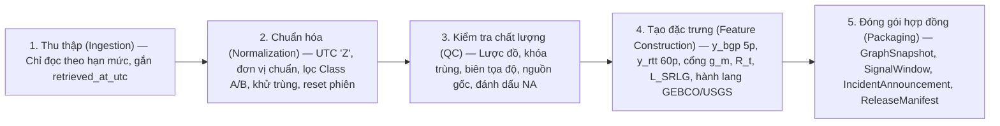

# Đặc tả Dữ liệu SubseaBGP-Tomography

Tài liệu này là nguồn đặc tả trung tâm về **nguồn dữ liệu, đường ống biến đổi, mô hình đồ thị địa không gian, hợp đồng dữ liệu, phân hoạch thực nghiệm, chống rò rỉ và cổng phát hành** cho dự án nghiên cứu – mô phỏng **SubseaBGP-Tomography**. Phần mô hình suy luận, hiệu chuẩn, mô phỏng định tuyến và đánh giá dẫn chiếu trực tiếp các định nghĩa nguồn, lược đồ, phân hoạch và quy tắc `NA` tại đây (xem [MODEL.md](MODEL.md)).

- **Căn cứ phạm vi và nghiệm thu:** [REQUIREMENTS.md](REQUIREMENTS.md) (đặc biệt Mục 3, Mục 5, Mục 6 và các quyết định đã chốt `Q-01`–`Q-07`).
- **Căn cứ kiến trúc và hợp đồng MVP:** [ARCHITECTURE.md](ARCHITECTURE.md) (đặc biệt §1.6, §4, §5, §7 và §9.1).
- **Cơ sở nghiên cứu tham chiếu:** [RESEARCH.md](RESEARCH.md) (khi có điểm khác biệt đã chuẩn hóa trong `Q-01`–`Q-07`, áp dụng [REQUIREMENTS.md](REQUIREMENTS.md); các khác biệt chưa xử lý được ghi tường minh tại Mục 6.2).
- **Quy tắc chung kho mã:** [AGENTS.md](../AGENTS.md).

> **Quy ước phân biệt và hiện trạng kho mã:**
> - **Bắt buộc (`Req`):** Ràng buộc trực tiếp từ `REQUIREMENTS.md`, `ARCHITECTURE.md` và `AGENTS.md`.
> - **Đề xuất (`Prop`):** Chi tiết kỹ thuật hóa đường ống hoặc trường siêu dữ liệu phụ trợ giúp đáp ứng yêu cầu và các skill chuyên môn mà không tạo bộ lược đồ song song.
> - **Cần xác nhận / Hoãn:** Hạng mục bị chặn bởi cổng giai đoạn sau (`O-01`, `O-02`) hoặc cần người phụ trách chốt trước khi sinh dữ liệu/phát hành.
> - **Hiện trạng thực tế (kiểm tra kho mã ngày lập đặc tả):** Kho Git chưa có commit khởi tạo trên `main`; mới có tài liệu đặc tả dưới `docs/`, quy tắc `AGENTS.md` và skill dưới `.agents/skills/`. **Chưa có mã thu thập/tiền xử lý, chưa tải dữ liệu thô, chưa sinh bộ kiểm chuẩn bán tổng hợp, chưa có tệp `ReleaseManifest` hay bộ kiểm thử chạy thực tế.** Toàn bộ phép kiểm chứng dữ liệu trong tài liệu này đang ở trạng thái **Chưa chạy**.
> - **Khóa phạm vi MVP (`Q-01`):** Đường chạy MVP chỉ gồm nghiên cứu ngoại tuyến, phát lại lịch sử theo bước `5 phút` (Luồng 2) và mô phỏng cắt cáp/định tuyến LP (Luồng 3). **Không** đưa luồng BGP trực tiếp (Luồng 1), quy hoạch 2030 (Luồng 4), đường ống GFW 4Wings, số hạng phạt Mohr–Coulomb hay giám sát trôi dạt (Giai đoạn 3) vào đường chạy MVP; **không** thiết kế đo chủ động hay can thiệp mạng sản xuất.

---

## 1. Danh mục nguồn dữ liệu và mục đích sử dụng

Mọi nguồn dữ liệu được phân loại theo bốn nhãn bản chất bắt buộc (`DATA-002`, `ARCHITECTURE.md §4.1`): `observed_measurement` (*đo thực tế*), `stylized_derived` (*sơ đồ hóa dẫn xuất*), `synthetic_calibrated_baseline` (*bán tổng hợp — đường cơ sở mới*) và `simulated_assumption` (*mô phỏng / giả định*).

**Quy tắc bản quyền và thời gian bắt buộc (`DATA-001`, `DATA-007`, `DATA-008`, `Q-05`):**
- Chỉ ghi giấy phép đã có căn cứ trong tài liệu dự án hoặc nguồn sơ cấp; **tuyệt đối không suy ra quyền tái phân phối công khai từ việc nguồn có thể truy cập hoặc tải miễn phí**.
- Mọi bản ghi thu thập phải giữ tách bạch **thời gian sự kiện (`event_time_utc` / `source_timestamp_utc`)** với **thời gian truy xuất (`retrieved_at_utc`)**, đều ở định dạng `ISO-8601 UTC` có hậu tố `Z`.

### 1.1. Nguồn cốt lõi trong đường chạy MVP (Ngoại tuyến, phát lại lịch sử và dựng đường cơ sở mới)

| Mã nguồn | Nguồn dữ liệu, Tổ chức & Địa chỉ / DOI | Vai trò trong MVP | Bản chất (`data_provenance_class`) | Phiên bản / Mốc lấy (`retrieved_at_utc`) | Thời gian sự kiện vs Thời gian truy xuất | Đơn vị & Độ phân giải | Giấy phép có căn cứ | Hạn mức truy cập (`DATA-004`) | Quyền tái phân phối (`Q-05`) |
| --- | --- | --- | --- | --- | --- | --- | --- | --- | --- |
| `SRC-SCM` | **Submarine Cable Map v3** (*Tristan-Hotham / TeleGeography*, `github.com/Tristan-Hotham/submarine-cables`, `DOI: 10.5281/zenodo.23856607`) + bổ sung thủ công tuyến đất liền (`VSTN`, `TEA`) & thông tin RFS/retired | Dựng đồ thị vật lý $\mathcal{G}_{\mathrm{phys}}$ (cáp vận hành, CLS, 9 eo biển nghẽn), vòng đời RFS và thành phần sở hữu $O$ trong $\mathbf{R}_t$. | `stylized_derived` | Bản phát hành v3 (`cables.geojson` ~292 KB; trạng thái tuyến tới 11/2026); **chưa tải trong repo** (`retrieved_at_utc` ghi khi chạy `C1`). | Sự kiện: `rfs_date_utc`, `retired_date_utc` (ngày/tháng vận hành); Truy xuất: `retrieved_at_utc` + commit/DOI. | Hình học tuyến sơ đồ hóa (`lat_deg`, `lon_deg` `EPSG:4326`), chiều dài `length_km`, dung lượng `capacity_tbps`. | Mã: `MIT`; Dữ liệu dẫn xuất: `CC BY-NC-SA 4.0`; Dữ liệu nền: `TeleGeography 3.0` (`REQUIREMENTS.md §5.1`, `Q-05`). | Tải tĩnh trọn gói, chỉ đọc. | **Hạn chế:** Phải giữ ghi công, ghi rõ sửa đổi (VSTN/TEA), ShareAlike; **không mặc định portfolio là phi thương mại**; cấm gộp chung giấy phép với nguồn khác; vào `public_demo` chỉ khi duyệt từng tệp trong `manifest`. |
| `SRC-RV` | **RouteViews MRT Archives** (*University of Oregon*, `archive.routeviews.org`, `DOI: 10.7264/1y7v-2d90`) | Tính $\tilde{y}_m^{\mathrm{BGP}}(t)$ lịch sử cho thực nghiệm ngoại tuyến và phát lại Luồng 2 (kênh nội bộ). | `observed_measurement` | Lưu trữ MRT `.bz2`/`.gz` đọc qua `BGPKIT`; **chưa tải trong repo** (khóa `fetched_at_utc` và tên tệp MRT khi chạy). | Sự kiện: dấu thời gian bản tin MRT (`UTC`); Truy xuất: `retrieved_at_utc` từ máy chủ lưu trữ. | Lô RIB mỗi `2 giờ`, UPDATE mỗi `15 phút`; tổng hợp về cửa sổ trượt `5 phút` (`300s`), tỷ số không thứ nguyên `[0,1]`. | **`CC BY 4.0`** (đã xác nhận trên trang Licenses và `DOI: 10.7264/1y7v-2d90` theo `Q-05`). | Tải chỉ đọc qua kho lưu trữ / `bgpkit-broker`; tuân thủ lọc Class A/B trên `route-views.sg`. | Khai báo riêng trong `manifest` từng tệp, không gộp giấy phép; gói sự cố lịch sử mặc định ở `internal_local`, chỉ mở `public_demo` khi duyệt `manifest` (`DATA-008`). |
| `SRC-RIS-MRT` | **RIPE RIS MRT Archives** (*RIPE NCC*, `data.ris.ripe.net`, các bộ thu `rrc23`, `rrc06`, `rrc11`, `rrc21`...) | Tính $\tilde{y}_m^{\mathrm{BGP}}(t)$ lịch sử và bổ sung góc nhìn đa bộ thu RRC. | `observed_measurement` | Lưu trữ MRT `.bz2`/`.gz`; **chưa tải trong repo**. | Sự kiện: dấu thời gian bản tin MRT (`UTC`); Truy xuất: `retrieved_at_utc`. | Lô RIB mỗi `8 giờ`, UPDATE mỗi `5 phút`; tổng hợp về cửa sổ `5 phút` (`300s`). | Điều khoản dịch vụ RIPE NCC; **chưa xác minh giấy phép tái phân phối theo lô cho gói dẫn xuất công khai**. | Tải chỉ đọc theo lô từ kho lưu trữ công cộng. | **Chặn tái phân phối theo lô trên `public_demo`** cho tới khi vượt cổng pháp lý `O-01` (`DATA-008`, `DATA-009`); dùng cục bộ ở `internal_local`. |
| `SRC-ATLAS` | **RIPE Atlas Probes & Anchor Mesh** (*RIPE NCC*, `atlas.ripe.net`, `ftp.ripe.net/ripe/atlas/probes/archive/`) | Trích xuất $b_m = \mathrm{minRTT}_m^{\mathrm{base}}$ (chỉ trên `train_fit`) và chuỗi $\widehat{\mathrm{minRTT}}_m(t)$ tính $\tilde{y}_m^{\mathrm{RTT}}(t)$. | `observed_measurement` | Kho lưu trữ phép đo *built-in* & *anchoring*; **chưa tải trong repo**. | Sự kiện: mốc thực hiện traceroute ICMP (`UTC`); Truy xuất: `retrieved_at_utc`. | Chu kỳ mẫu ~`15 phút` trên ~800 anchors / >14.000 probes; cửa sổ $(t-60\ \mathrm{phút}, t]$; đơn vị `ms`. | Điều khoản dữ liệu mở RIPE Atlas; **chưa xác minh điều khoản tái phân phối theo lô cho gói dẫn xuất công khai**. | **Bắt buộc chỉ đọc phép đo *built-in* và *anchoring* miễn phí** (không tạo phép đo mới tốn credit, tránh trần `1.000.000 credits/ngày`, `50 kết quả/giây`). | **Chặn tái phân phối theo lô trên `public_demo`** cho tới khi vượt `O-01`; dùng ở `internal_local` và trình tải nguồn gốc. |
| `SRC-CAIDA-PDB` | **CAIDA AS-Relationships & PeeringDB** (*CAIDA* bản chụp hàng tháng; `peeringdb.com`) | Tính đồng hiện diện cơ sở $J$ (bán kính `100 km`), khoảng cách PoP–CLS $d_m(e)$ (`km`) cho $\mathbf{R}_t$ đóng băng theo thời điểm. | `observed_measurement` *(khảo sát & đăng ký hạ tầng)* | Bản chụp định kỳ có `published_at_utc < t`; **chưa tải trong repo**. | Sự kiện/hiệu lực: `published_at_utc` của bản chụp (`< effective_at_utc`); Truy xuất: `retrieved_at_utc`. | Bản chụp hàng tháng (CAIDA) & định kỳ (PeeringDB); khoảng cách `km`, tỷ số `[0,1]`. | Mở cho nghiên cứu; **chưa xác minh văn bản cấp phép tái phân phối theo lô công khai**. | **Cấm trình duyệt truy vấn trực tiếp PeeringDB**; chỉ đồng bộ bản chụp tĩnh ngoại tuyến theo hạn mức. | **Chặn tái phân phối theo lô trên `public_demo`** cho tới khi vượt `O-01`; dùng ở `internal_local`. |
| `SRC-GEBCO` | **GEBCO_2026 Global Bathymetry Grid** (*GEBCO Bathymetric Compilation Group 2026*, `doi:10.5285/4f68d5c7-45eb-f999-e063-7086abc036fa`) | Trích xuất độ sâu tối thiểu $d_e$ (`m`), hệ số thềm lục địa $\psi_{\mathrm{shelf}}(d_e)$ và độ dốc $s_e$ trên vùng đệm hành lang cáp. | `observed_measurement` *(đo đạc & biên tập địa vật lý)* | Bản tĩnh `GEBCO_2026` (NetCDF / GeoTIFF / OPeNDAP); **chưa tải trong repo**. | Sự kiện/phiên bản: năm phát hành `2026`; Truy xuất: `retrieved_at_utc`. | Lưới toàn cầu `15 giây cung` (~`450 m` tại xích đạo) + lưới TID; độ sâu `depth_m` (`m`). | **Public Domain** (yêu cầu ghi công *GEBCO Bathymetric Compilation Group 2026*). | Tải tĩnh theo vùng cắt hoặc OPeNDAP, chỉ đọc. | Tách tệp riêng theo nguồn, giữ ghi công; duyệt vào `manifest` trước khi đưa lên `public_demo`. **Nghiêm cấm suy $(c_e,\varphi_e)$ từ GEBCO (`ML-007`).** |
| `SRC-USGS` | **USGS Earthquake Catalog FDSNWS API** (`earthquake.usgs.gov/fdsnws/event/1/query`) | Tính gia tốc nền cực đại $\mathrm{PGA}_e(t)$ trên vùng đệm hành lang từ động đất $\mathrm{Mw}\ge 4{,}0$. | `observed_measurement` | Truy vấn lịch sử FDSNWS; **chưa tải trong repo**. | Sự kiện: `origin_time_utc` của trận động đất; Truy xuất: `retrieved_at_utc`. | Độ lớn `magnitude_mw` (`Mw >= 4.0`), tọa độ chấn tâm (`lat_deg`, `lon_deg`), độ sâu `depth_km`; feed cập nhật `60s`. | **U.S. Public Domain** (ghi công *"U.S. Geological Survey"*). | Tối đa `20.000 sự kiện/truy vấn` (vượt trả HTTP 400); **bắt buộc truyền `eventtype=earthquake` (`DATA-005`)**. | Tách tệp riêng, giữ ghi công; duyệt vào `manifest` trước khi đưa lên `public_demo`. |
| `SRC-HIST-CAT` | **Danh mục Sự cố Lịch sử Đã Xác minh** (*Thông cáo vận hành, MODA Đài Loan, Sahoo et al. 2024, `geocables/internet-latency-and-routing-events`, báo chí chính thống*) | Đối chiếu Lớp 3 ở Luồng 2 (`IncidentAnnouncement`), đặt vùng đệm $\pm 72\text{h}$ (`ML-001`) và kiểm chứng hồi quy $\ge 3$ sự cố (`ML-011`). | `observed_measurement` *(nhãn sự kiện từ nguồn công bố)* | Tập hợp tĩnh có kiểm duyệt; **chưa đóng gói trong repo**. | Sự kiện: `event_start_utc`, `announced_at_utc`, `repair_completed_utc`; Truy xuất: `retrieved_at_utc` + trích dẫn nguồn. | Mốc thời gian `UTC`, độ chi tiết nhãn `system` hoặc `segment`. | Nhiều nguồn với điều khoản khác nhau; **chưa xác minh và chưa duyệt tái phân phối công khai**. | Đọc/biên tập ngoại tuyến, lưu trích dẫn nguồn sơ cấp cho `100%` ca. | **Chặn tái phân phối theo lô trên `public_demo`** khi chưa duyệt từng tệp qua `O-01`; mặc định chỉ nằm ở `internal_local`. |
| `SRC-SYNTH` | **Bộ Kiểm chuẩn Bán tổng hợp Xây mới & Fixture Demo / LP Độc lập** (*Tự sinh bởi `C3` trong dự án*) | Thiết lập **đường cơ sở thực nghiệm mới** (`24` phân đoạn, `48` kênh, `train` độc lập + `200 cal + 200 test`), kiểm thử LP (`ML-012`) và cung cấp dữ liệu mặc định cho `public_demo`. | `synthetic_calibrated_baseline` và `simulated_assumption` | Khóa theo `git_commit`, `seed` và `run_provenance.json`; **chưa sinh trong repo**. | Mốc thời gian tổng hợp `ISO-8601 UTC` cố định theo kịch bản; Truy xuất/tạo: `generated_at_utc`. | `24` phân đoạn, `48` kênh, bước `5 phút` (`300s`), đơn vị chuẩn (`km`, `ms`, `Tbps`, `%`). | Do dự án tự sinh độc lập, **không nhúng dữ liệu thô bị hạn chế tái phân phối** (`Q-05`, `Q-06`). | Không phụ thuộc hạn mức API ngoài. | **Được phép công bố mặc định trên `public_demo`** kèm mã sinh và hồ sơ tái lập (`DATA-008`), gắn nhãn rõ là bán tổng hợp / giả định (**không gọi là tái lập `[1]`**). |

### 1.2. Nguồn metadata nội bộ tùy chọn ở MVP (tích hợp đầy đủ ở Giai đoạn 2)

Theo `ARCHITECTURE.md §1.6 (điểm 4)`, các nguồn dưới đây **không tham gia tính toán đầu ra mô hình MVP**; ở bản chạy nội bộ (`internal_local`) chỉ có thể gắn làm trường tùy chọn `external_flags` trong `SignalWindow` (khi thiếu mang `null`, không được diễn giải là "không có sự kiện"), còn bản `public_demo` mặc định **bỏ hoàn toàn trường này**.

| Mã nguồn | Nguồn dữ liệu, Tổ chức & Điểm cuối | Vai trò MVP vs Giai đoạn 2 | Bản chất (`data_provenance_class`) | Phiên bản / Mốc lấy | Thời gian sự kiện vs Truy xuất | Đơn vị & Độ phân giải | Giấy phép có căn cứ | Hạn mức truy cập | Quyền tái phân phối (`Q-05`) |
| --- | --- | --- | --- | --- | --- | --- | --- | --- | --- |
| `SRC-IODA` | **IODA v2 Outage API** (*Georgia Tech / CAIDA*, `api.ioda.inetintel.cc.gatech.edu/v2`) | **MVP nội bộ:** metadata tùy chọn `ioda_status` (không đổi đầu ra mô hình). **GĐ2 (`FR-007`):** đối chiếu đa tín hiệu tách lỗi nội địa (`ping-slash24`). | `observed_measurement` *(kèm chỉ báo tổng hợp)* | REST API v2; **chưa tải trong repo**. | Sự kiện: mốc cửa sổ `UTC` của chuỗi BGP/ping; Truy xuất: `retrieved_at_utc`. | BGP `/24` mỗi `5 phút`, `ping-slash24` mỗi `10 phút`, Merit telescope. | Mở cho nghiên cứu, không cần khóa; **chưa xác minh giấy phép tái phân phối công khai theo lô**. | Chu kỳ gọi $\ge 2\ \mathrm{phút/lần}$, chỉ đọc ngoại tuyến. | **Chặn tuyệt đối khỏi `public_demo`** cho tới khi vượt `O-01` (`DATA-008`, `DATA-009`). |
| `SRC-RADAR` | **Cloudflare Radar API v4** (*Cloudflare*, `/client/v4/radar/bgp/` & `/annotations/outages`) | **MVP nội bộ:** metadata tùy chọn `radar_hijack_flagged` (không đổi đầu ra mô hình). **GĐ2 (`FR-007`):** bộ đệm ngoại sinh loại trừ BGP hijack / route leak. | `observed_measurement` *(kèm sự kiện gán nhãn)* | REST API v4; **chưa tải trong repo**. | Sự kiện: khoảng thời gian bất thường/outage (`UTC`); Truy xuất: `retrieved_at_utc`. | Sự kiện bất thường BGP & thông báo mất kết nối theo mốc `UTC`. | [Tài liệu Cloudflare Radar](https://developers.cloudflare.com/radar/) nêu **dữ liệu API là `CC BY-NC 4.0`**. Với dữ liệu tải trực tiếp và biểu đồ/ảnh, xem Mục 6.2 và kiểm tra điều khoản của từng tài sản trước khi duyệt. | Yêu cầu **Bearer Token miễn phí** lưu trong secret store ngoại tuyến; **cấm gọi từ trình duyệt** (`NFR-007`), bắt buộc lưu đệm. | **Chặn khỏi `public_demo` ở MVP**; chỉ xét mở khi vượt `O-01` (`manifest` duyệt từng tệp, không mặc định portfolio là phi thương mại theo `Q-05`). |

### 1.3. Nguồn hoãn sang Giai đoạn 2 / 3 và nguồn bị cấm

| Mã nguồn | Nguồn dữ liệu / Thành phần | Lý do hoãn hoặc loại trừ | Cổng phụ thuộc / Căn cứ | Trạng thái pháp lý & tái phân phối |
| --- | --- | --- | --- | --- |
| `SRC-RIS-LIVE` | **RIPE RIS Live WebSocket** (`wss://ris-live.ripe.net/v1/ws/`) | Phục vụ Luồng 1 giám sát BGP trực tiếp (`FR-004`, `FR-005`) — **ngoài phạm vi MVP** (`Q-01`). | Giai đoạn 2 (`E1`); yêu cầu `?client=`, lọc hẹp `ris_subscribe`, đệm `250 ms`. | Điều khoản RIPE NCC; chỉ đọc trực tuyến khi bật GĐ2. |
| `SRC-PLAN-2030` | **Tuyến quy hoạch 2027–2030** (`ALC`, `VTS`, `MViSTA`, tuyến đất liền thứ hai) | Phục vụ Luồng 4 phân tích quy hoạch 2030 (`FR-013`) — **ngoài phạm vi MVP** (`Q-01`). Tuyến chưa đến RFS trong lịch sử MVP bị khóa `in_service = false`. | Giai đoạn 2 (`E2`, cổng chân dung `O-03`). | Dẫn xuất tổng hợp từ nguồn công bố + Submarine Cable Map v3 (`CC BY-NC-SA 4.0` / `TeleGeography 3.0`). |
| `SRC-GFW` | **Global Fishing Watch 4Wings API v3** (`presence`, `fishing-effort`, `sar-presence`) | Hoãn tích hợp đường ống định kỳ sang Giai đoạn 2 (`E3`, `FR-008`); riêng **logic mặt nạ trễ 96h/120h & lọc tàu sửa cáp (`ML-003`) được kiểm thử đơn vị sẵn trong MVP**. | Cổng pháp lý `O-01` (`DATA-009`, `Q-05`). Hạn mức `50.000 req/ngày`, `1.500.000 req/tháng`; cấm lộ token (`NFR-007`). | Trang chung nêu `CC BY-NC 4.0` + `"Powered by Global Fishing Watch"`, nhưng điều khoản API & metadata từng dataset chưa xác minh — **chưa duyệt công bố gói dẫn xuất**. |
| `SRC-GEOTECH` | **Dữ liệu Địa kỹ thuật Trầm tích Đáy biển** $(c_e, \varphi_e)$ theo phân đoạn | Chưa xác minh được nguồn mở đạt chuẩn (thí nghiệm cắt trực tiếp thoát nước, $\ge 3$ mức ứng suất hữu hiệu `kPa`, $\varphi_e = \arctan b_e$ bằng `radian`) và mô hình $\sigma'_{n,e}$. **Hoãn toàn bộ số hạng phạt Mohr–Coulomb trong MVP (`ML-007`).** | Cổng địa kỹ thuật `O-02` (`ML-008`, `Q-02`). | Chưa xác định nguồn và giấy phép. |
| `SRC-BANNED` | **Bộ dữ liệu bị cấm làm dữ liệu gốc:** Kaggle `undersea-cables-and-global-digital-infrastructure` (100% synthetic thủ tục) và Hugging Face `alerterra/subsea_infrastructure` (thương mại bị khóa / gated) | Vi phạm trực tiếp nguyên tắc nguồn mở sơ cấp (`DATA-001`, `RESEARCH.md §4.1`). | Loại trừ tuyệt đối ở mọi giai đoạn (`V-RELEASE`). | **Cấm sử dụng.** |

---

## 2. Đường ống từ nguồn đến đầu vào mô hình

Đường ống dữ liệu tách rạch ròi 5 bước tuần tự để phần đọc/ghi dữ liệu tách khỏi thuật toán lõi (`AGENTS.md §5`, `NFR-009`), bảo đảm mọi hàm biến đổi lõi chạy kiểm thử tất định không cần mạng hay trình duyệt.

### 2.1. Tách bạch năm giai đoạn và lớp trung gian bảo toàn nguồn gốc (`Prop`)

1. **Giai đoạn 1 — Thu thập (`Ingestion`, `C1`):**
   - Thực hiện hoàn toàn ở mặt phẳng ngoại tuyến (`TB1`), chế độ chỉ đọc (`NFR-008`), có bộ giới hạn tốc độ theo từng nguồn (`DATA-004`).
   - Lưu nguyên trạng siêu dữ liệu truy xuất: `source_name`, `source_endpoint_or_doi`, `source_version`, `retrieved_at_utc` (tách khỏi `source_timestamp_utc`), mã băm `raw_sha256` và `parser_version`.
   - Với USGS FDSNWS: bắt buộc tham số `eventtype=earthquake`, `minmagnitude=4.0`, chia cửa sổ truy vấn sao cho không bao giờ chạm trần `20.000` sự kiện (`DATA-005`).
   - Với RIPE Atlas: chỉ gọi endpoint phép đo *built-in* và *anchoring* có sẵn; cấm gọi API tạo phép đo chủ động mới (`DATA-004`, `NFR-008`).
2. **Giai đoạn 2 — Chuẩn hóa (`Normalization`, `C1`):**
   - Quy đổi mọi dấu thời gian về `ISO-8601 UTC` có hậu tố `Z`; từ chối bản ghi thiếu múi giờ hoặc không phân tích được.
   - Chuẩn hóa tên trường gắn hậu tố đơn vị (`_km`, `_m`, `_ms`, `_tbps`, `_pct`, `_mw`, `_kpa`, `_rad`, `_deg`).
   - **Lớp bản ghi chuẩn hóa BGP trung gian (`Prop` theo `subsea-bgp-data-pipeline`):** trước khi tổng hợp theo cửa sổ 5 phút, mỗi bản ghi MRT giữ đủ `source_timestamp_utc`, `retrieved_at_utc`, `collector_id`, `peer_asn`, `peer_ip`, `prefix`, `as_path`, `message_type` (`ANNOUNCE | WITHDRAW | STATE_CHANGE`), `protocol` (`ipv4 | ipv6`), `source_name`, `snapshot_id`, `parser_version` để tái lập ngược từng cửa sổ.
   - **Lớp bản ghi chuẩn hóa RTT trung gian (`Prop`):** giữ đủ `source_timestamp_utc`, `retrieved_at_utc`, `measurement_id`, `probe_id`, `anchor_id`, `channel_id`, `ingress_rtt_ms`, `egress_rtt_ms`, `path_signature`, `is_valid_sample`, `invalid_reason`, `parser_version`.
3. **Giai đoạn 3 — Kiểm tra chất lượng (`Quality Checks`, `C1` & `C2`):**
   - Chặn lỗi cấu trúc cứng (sai kiểu, sai đơn vị, thiếu `Z`, khóa chính trùng, `length_km <= 0`, `capacity_tbps < 0`, tọa độ ngoài $[-90,90]\times[-180,180]$).
   - Không âm thầm xóa bản ghi bất thường, trùng lặp hay lỗi phân tích: ghi nhận tường minh số lượng (`duplicate_count`, `malformed_count`, `class_ab_filtered_count`, `session_reset_filtered_count`, `collector_gap_windows`, `invalid_rtt_sample_count`) vào báo cáo kiểm định đầu vào.
   - Gán `null` kèm `na_reason` cho mọi trường/kênh không đủ điều kiện tính toán (`DATA-006`).
4. **Giai đoạn 4 — Tạo đặc trưng (`Feature Construction`, `C1` & `C2`):**
   - Tính $\tilde{y}_m^{\mathrm{BGP}}(t)$, $\tilde{y}_m^{\mathrm{RTT}}(t)$, cổng $g_m(t)$, hội chứng $y_m(t)$ và cờ `is_valid` / `na_reason`.
   - Tính đặc trưng địa vật lý trên vùng đệm hành lang cáp (GEBCO_2026, USGS), ma trận $\mathbf{L}_{\mathrm{SRLG}}$ và ma trận liên thuộc đóng băng $\mathbf{R}_t$.
   - Áp dụng nghiêm quy tắc chống rò rỉ (`ML-001`–`ML-005`) trước khi khớp hoặc đóng băng bất kỳ thống kê nào (như $b_m$).
5. **Giai đoạn 5 — Đóng gói hợp đồng (`Packaging`, `C5`):**
   - Xuất tệp tĩnh phân mảnh theo sự cố/kịch bản và lát thời gian `5 phút`, tuân thủ đúng 4 hợp đồng dữ liệu (Mục 3), **tách tuyệt đối một tệp = một nguồn = một giấy phép** (`DATA-007`), tách `IncidentAnnouncement` khỏi `SignalWindow`, bỏ `external_flags` khỏi `public_demo` và kiểm duyệt qua `ReleaseManifest` (Mục 5).

### 2.2. Xử lý cửa sổ BGP 5 phút (`FR-003`, `DATA-005`, `Q-02`)

Mỗi cửa sổ trượt có biên nửa mở `(window_start_utc, window_end_utc]` với độ dài bắt buộc **`300 giây` (`5 phút`)**, gắn mã định danh tất định `window_id`. Quy trình tính trên từng kênh quan sát $m$:

1. **Lọc bất nhất thời gian (*Class A/B inconsistencies*):** Loại bỏ các bản ghi bất nhất thời gian đã biết trên bộ thu lưu trữ (điển hình `route-views.sg`) trước khi gán bản tin vào cửa sổ (`DATA-005`).
2. **Khử trùng bản tin (*Deduplication*):** Bản tin `ANNOUNCE` hoặc `WITHDRAW` lặp lại y hệt trên cùng bộ khóa `(collector_id, peer_ip, prefix, as_path, message_type)` không làm thay đổi trạng thái định tuyến được đếm vào `duplicate_count` trong báo cáo QC và khử trùng trước khi tính tỷ lệ (không xóa im lặng khỏi nhật ký kiểm định).
3. **Loại trừ biến động do reset phiên BGP (*Session Reset Filtering*):** Phát hiện sự kiện `STATE_CHANGE` / reset phiên hoặc rút – nạp đồng loạt gần toàn bộ bảng định tuyến của một `peer` tại cùng bộ thu trong khoảng thời gian ngắn; loại bỏ toàn bộ cặp `(peer, prefix)` bị ảnh hưởng bởi phiên reset khỏi cả tử số lẫn mẫu số của cửa sổ đó để không nhầm lỗi phiên cục bộ với sự cố cáp.
4. **Xử lý khoảng trống collector (*Collector Gaps*):** Nếu tệp MRT khuyết, bộ thu mất kết nối hoặc không có dữ liệu đầu cửa sổ xác định tập `(peer, prefix)` hoạt động → **tuyệt đối không điền `0`**; gán `y_bgp = null`, `bgp_active_pairs_count = 0`, `bgp_na_reason = COLLECTOR_GAP`.
5. **Tính chỉ số xáo trộn định tuyến chuẩn hóa (`FR-003`, `Q-02`):**
   - Gọi $N_{\mathrm{pair},m}(t)$ là `bgp_active_pairs_count` — số cặp `(peer, prefix)` hợp lệ đang hoạt động ở đầu cửa sổ (sau khi loại phiên reset) và $N_{\mathrm{peer},m}(t)$ là số `peer` hợp lệ đang theo dõi cùng `prefix`.
   - Nếu $N_{\mathrm{pair},m}(t) = 0$ hoặc $N_{\mathrm{peer},m}(t) = 0$ → trả `y_bgp = null`, `bgp_na_reason = ZERO_BGP_DENOMINATOR`.
   - Ngược lại:
     - $W_m(t) \in [0, 1]$: tỷ lệ cặp `(peer, prefix)` đang hoạt động ở đầu cửa sổ bị rút (`WITHDRAW`) ít nhất một lần trong cửa sổ `5 phút`.
     - $P_m(t) \in [0, 1]$: tỷ lệ `peer` hợp lệ có ít nhất một thay đổi `AS_PATH` trên cùng `prefix` đang theo dõi trong cửa sổ `5 phút`.
     - Chỉ số tổng hợp:
       $$\tilde{y}_m^{\mathrm{BGP}}(t) = \frac{W_m(t) + P_m(t)}{2} \in [0, 1]$$
   - Khi $N_{\mathrm{pair},m}(t) > 0$, $N_{\mathrm{peer},m}(t) > 0$ và không có rút tuyến hay đổi `AS_PATH`, giá trị $\tilde{y}_m^{\mathrm{BGP}}(t) = 0$ là **số `0` hợp lệ**, hoàn toàn khác với `null`.

### 2.3. Xử lý $\mathrm{minRTT}$ theo chế độ đường đi và Cổng vật lý chéo tầng (`FR-006`, `Q-02`)

Áp dụng **đặc tả thay thế đã chuẩn hóa cho `formula-33`** (`REQUIREMENTS.md §6.1, §9.4`, `Q-02`):

1. **Khấu trừ chặng nội địa và lọc chế độ đường đi hiện tại (không nhìn tương lai):**
   - Với mỗi mẫu đo hợp lệ tại mốc $\tau \le t$ thuộc cửa sổ nửa mở $(t - 60\ \mathrm{phút},\, t]$ (`rtt_window_minutes = 60`), tính hiệu số RTT sau khi trừ trung vị RTT chặng nội địa (*probe-to-CLS ingress subtraction*, kế thừa nguyên lý $\Delta P_m(t)$ tại `RESEARCH.md §3.3` nhưng chỉ dùng mẫu quá khứ đến $\tau \le t$ để cấm rò rỉ tương lai).
   - Khi bộ phát hiện đổi đường (theo chữ ký chặng traceroute hoặc điểm gãy nhân quả không nhìn trước trên chuỗi đến $t$) phát hiện chuyển chế độ đường đi trong cửa sổ $(t - 60\ \mathrm{phút},\, t]$, chỉ giữ lại các mẫu thuộc **chế độ đường đi hiện tại** (sau điểm chuyển gần nhất và $\le t$).
   - Ghi nhận `rtt_sample_count` (số mẫu hợp lệ thuộc chế độ hiện tại trong $(t - 60\ \mathrm{phút},\, t]$) và `invalid_sample_count` (mẫu mất gói, giá trị âm sau khấu trừ hoặc sai đơn vị).
2. **Điều kiện đủ và tính $\tilde{y}_m^{\mathrm{RTT}}(t)$:**
   - Đường cơ sở $b_m = \mathrm{minRTT}_m^{\mathrm{base}}$ (`min_rtt_base_ms`, đơn vị `ms`) được **đóng băng duy nhất từ `train_fit` theo định danh kênh (`channel_id`) và chế độ đường đi (`path_regime`)** (`ML-005`, `ARCHITECTURE.md §1.6`).
   - **Quy tắc đóng băng $b_m$ đã duyệt cho chuyển giao lịch sử (`ADR-05`):** Lấy `minRTT` sau khấu trừ chặng nội địa từ **cửa sổ sạch `60 phút` gần nhất đủ ít nhất `2` mẫu hợp lệ trong `train_fit` lịch sử** (trọn khung `train` `2021-01-01..2024-06-30` nếu không tách `val_tau` lịch sử, hoặc mốc cắt con $\le$ `2024-06-30` khóa trước trong `split_manifest`), loại toàn bộ khoảng sự cố và vùng đệm `±72 giờ` quanh mốc bắt đầu/sửa xong $(t_0, t_{\mathrm{repair}})$. **Thiếu đường cơ sở hợp lệ thì trả `NA` (`MISSING_BM`), tuyệt đối không lấy cửa sổ ngay trước ca thuộc `test` để bù.** *(Chủ ý chấp nhận hệ quả chống rò rỉ: các tuyến RFS sau `2024-06-30` như `ADC`, `SJC2`, `VSTN` hoặc cặp `(channel_id, path_regime)` mới phát sinh giai đoạn `2025–2026` sẽ trả `MISSING_BM` nếu không có cửa sổ sạch hợp lệ trong `train_fit` lịch sử.)*
   - Nếu thiếu $b_m$ → `y_rtt = null`, `rtt_na_reason = MISSING_BM`.
   - Nếu $b_m \le 0$ → `y_rtt = null`, `rtt_na_reason = NON_POSITIVE_BM`.
   - Nếu `rtt_sample_count < 2` → `y_rtt = null`, `rtt_na_reason = INSUFFICIENT_RTT_SAMPLES`.
   - Khi đủ cả `rtt_sample_count >= 2` và $b_m > 0$:
     $$\widehat{\mathrm{minRTT}}_m(t) = \min_{\tau \in (t - 60\ \mathrm{phút},\, t]\text{ (chế độ hiện tại)}} \mathrm{RTT}_{m,\mathrm{subsea}}(\tau), \qquad \tilde{y}_m^{\mathrm{RTT}}(t) = \max\left(0,\ \frac{\widehat{\mathrm{minRTT}}_m(t) - b_m}{b_m}\right) \ge 0$$
3. **Cổng vật lý chéo tầng (`FR-006`, `Q-02`):**
   - Tham số cố định: $\kappa = 10{,}0$, $\tau_{\mathrm{SoL}} = 0{,}12$ (vượt biên độ sai số $9{,}5\%$ của ước lượng `minRTT` từ RIPE Atlas), $\beta_{\mathrm{BGP}} = 0{,}45$.
   - Khi cả `y_bgp` và `y_rtt` đều khác `null`:
     $$g_m(t) = \sigma\left(\kappa\left(\tilde{y}_m^{\mathrm{RTT}}(t) - \tau_{\mathrm{SoL}}\right)\right) \in (0, 1)$$
     $$y_m(t) = \beta_{\mathrm{BGP}}\cdot \tilde{y}_m^{\mathrm{BGP}}(t)\cdot g_m(t) + (1 - \beta_{\mathrm{BGP}})\cdot \tilde{y}_m^{\mathrm{RTT}}(t) \ge 0$$
     đồng thời đặt `is_valid = true`, `na_reason = null`.
   - **Phân biệt hai trường hợp biên quan trọng:**
     - *Chuyển mạch quang bảo vệ có bước nhảy RTT nhưng BGP im lặng hợp lệ:* `y_bgp = 0` (với `bgp_active_pairs_count > 0`) và `y_rtt > 0.12` $\Rightarrow$ kênh vẫn `is_valid = true`, giữ được $y_m(t) = 0{,}55\cdot \tilde{y}_m^{\mathrm{RTT}}(t) > 0$ (`FR-006`).
     - *Khuyết một hoặc cả hai thành phần (`y_bgp == null` hoặc `y_rtt == null`):* theo `ARCHITECTURE.md §4.2`, đặt `is_valid = false`, `syndrome_y = null` (giữ `gate_g = null` nếu thiếu `y_rtt`) và kế thừa mã `na_reason` cụ thể — **tuyệt đối không thay phần thiếu bằng `0`**.

### 2.4. Đặc trưng hành lang địa vật lý và ranh giới `external_flags`

- **Đặc trưng hành lang địa vật lý (`DATA-003`, `DATA-005`, `ML-007`):**
  - Mọi đặc trưng không gian (độ sâu tối thiểu $d_e$, hệ số phơi nhiễm thềm lục địa $\psi_{\mathrm{shelf}}(d_e) = \mathbb{I}(d_e < 2000)\exp(-d_e / 120)$ với $d_e$ tính bằng `m`, độ dốc đáy biển $s_e$, và $\mathrm{PGA}_e(t)$ từ động đất USGS `eventtype=earthquake`, $\mathrm{Mw} \ge 4{,}0$) được trích xuất trên **vùng đệm hành lang địa lý** quanh đường vẽ sơ đồ hóa chứ không lấy mẫu theo một điểm tọa độ đơn lẻ.
  - Với cáp đất liền (như `VSTN`, `TEA`): đặt $\psi_{\mathrm{shelf}}(d_e) = 0$ (số `0` hợp lệ). Khi không có động đất $\mathrm{Mw} \ge 4{,}0$ trong cửa sổ hiệu lực: đặt $\mathrm{PGA}_e(t) = 0$ (số `0` hợp lệ).
  - Trong đường chạy MVP, **phát lại lịch sử mặc định dùng `prior_mode = uniform_w1`** ($w_e(t) = 1$, `hazard_prob = null`, `prior_na_reason = NO_APPROVED_PRIOR` theo `FR-008`); **chưa đưa `open_geophysical_only` vào đường nghiệm thu** khi chưa có công thức và đánh giá riêng. Quyết định này không làm thay đổi cấu hình prior của bộ kiểm chuẩn bán tổng hợp (`prior_mode = synthetic_benchmark_prior` cho `Full` và `uniform_w1` cho đối chứng `A2`).
  - **Khóa cấm địa kỹ thuật (`ML-007`):** Không sinh bất kỳ cột $(c_e, \varphi_e)$ nào từ GEBCO_2026 và không gắn nhãn ổn định $S_e(t) = 1$ từ việc không có báo cáo sự cố.
- **Ranh giới `external_flags` (`FR-007`, `ARCHITECTURE.md §1.6, §4.2`):**
  - Trong MVP, `external_flags` (`ioda_status`, `radar_hijack_flagged`, `na_reason`) **chỉ là metadata nội bộ tùy chọn** dành cho kênh `internal_local`.
  - Thiếu dữ liệu IODA/Radar bắt buộc ghi `null` kèm `na_reason = EXTERNAL_SOURCE_UNAVAILABLE` — **không bao giờ diễn giải `null` là "không có hijack / không có outage"**.
  - `external_flags` **tuyệt đối không làm thay đổi `syndrome_y`, $\hat{p}_e(t)$, $\mathcal{C}_{0{,}90}(t)$ hay nghiệm LP trong MVP**; việc tích hợp bộ đệm và logic đối chiếu/loại trừ tự động thuộc Giai đoạn 2 (`E3`).
  - Trong kênh `public_demo`, `C5` **loại bỏ hoàn toàn trường `external_flags`** khỏi mọi tệp `SignalWindow` và chặn đóng gói mọi dữ liệu dẫn xuất IODA/Radar chưa vượt cổng `O-01`.

---

## 3. Đồ thị hạ tầng và hợp đồng dữ liệu

Tài liệu này chi tiết hóa đúng 4 hợp đồng tầng dữ liệu từ `ARCHITECTURE.md §4` (`GraphSnapshot`, `SignalWindow`, `IncidentAnnouncement`, `ReleaseManifest`) — **không tạo bộ schema song song**. Hai hợp đồng đầu ra mô hình và mô phỏng (`InferenceResult`, `SimulationRequest`, `SimulationResult`) được đặc tả cách sử dụng tại [MODEL.md §1.3](MODEL.md#13-giao-diện-đầu-vào-và-đầu-ra-theo-hợp-đồng-kiến-trúc) theo đúng `ARCHITECTURE.md §4.2`.

### 3.1. Quy tắc chung: phiên bản, định danh liên kết, thời gian, đơn vị và `NA`

1. **Phiên bản lược đồ (`schema_version`, `ARCHITECTURE.md §4.1`):** Chuẩn `MAJOR.MINOR.PATCH` (khởi đầu `"1.0.0"`). Lệch `MAJOR` $\Rightarrow$ **từ chối nạp ngay lập tức** với thông báo rõ phiên bản kỳ vọng/thực tế; `MINOR` dữ liệu lớn hơn bên đọc $\Rightarrow$ cảnh báo trường mở rộng chưa hỗ trợ (chặn nạp nếu có `requires_min_reader_version` cao hơn); `PATCH` $\Rightarrow$ tương thích ngược.
2. **Bộ khóa định danh liên kết ổn định:** `release_id`, `bundle_id`, `snapshot_id`, `graph_profile_id`, `segment_id`, `cls_id`, `channel_id`, `srlg_group_id`, `demand_id`, `path_id`, `incident_id`, `scenario_id`, `window_id`, `request_id`, `model_version`, `run_id`.
3. **Chuẩn thời gian và đơn vị (`DATA-006`, `NFR-009`):**
   - Mọi dấu thời gian là chuỗi `ISO-8601 UTC` kết thúc bằng `Z` (ví dụ `2026-08-25T08:05:00Z`).
   - Mọi đại lượng có thứ nguyên bắt buộc mang hậu tố đơn vị tường minh: `_km`, `_m`, `_ms`, `_tbps`, `_pct`, `_mw`, `_kpa`, `_rad`, `_deg`.
4. **Phân biệt bắt buộc: Số `0` hợp lệ vs `null` kèm `na_reason` (`DATA-006`, `FR-002`, `FR-003`, `FR-006`, `FR-009`):**

| Tình huống dữ liệu | Biểu diễn bắt buộc | Ý nghĩa nghiệp vụ | Hành vi bị cấm |
| --- | --- | --- | --- |
| Tuyến ngoài vòng đời RFS (`in_service = false`) | `omega_score = 0`, `r_weight = 0` | Tuyến chưa hoạt động hoặc đã ngừng khai thác tại mốc $t$. | Để tuyến tương lai/đã ngừng khai thác nhận `r_weight > 0`. |
| Cặp AS có hợp tập cơ sở hiện diện rỗng trong bán kính `100 km` | `J = 0` (số `0` hợp lệ) | Hai AS không chia sẻ cơ sở đã xác minh quanh đầu cáp. | Chia cho `0` gây `NaN` hoặc tự điền `J = 1`. |
| Kênh không vượt cổng tốc độ ánh sáng ($b_m < 2L_e / 204$, đủ $b_m > 0$) | `psi_sol_pass = false`, `r_weight = 0` | Tuyến cáp dài hơn giới hạn vật lý ứng với $b_m$. | Bỏ qua kiểm tra SoL khi chưa rà rDNS cáp đất liền. |
| Cửa sổ BGP có `bgp_active_pairs_count > 0`, không có rút tuyến/đổi `AS_PATH` | `y_bgp = 0`, `bgp_na_reason = null` | Mặt phẳng điều khiển thực sự ổn định trên tập cặp hợp lệ. | Nhầm với mất dữ liệu collector. |
| Cửa sổ RTT có `rtt_sample_count >= 2`, $b_m > 0$ và $\widehat{\mathrm{minRTT}}_m(t) \le b_m$ | `y_rtt = 0`, `rtt_na_reason = null` | Không có bước nhảy tăng độ trễ tối thiểu so với $b_m$. | Gán giá trị âm cho `y_rtt`. |
| Cáp đất liền (độ phơi nhiễm đáy biển) hoặc không có động đất $\mathrm{Mw}\ge 4{,}0$ | $\psi_{\mathrm{shelf}} = 0$ hoặc $\mathrm{PGA}_e(t) = 0$ | Không có tác nhân vật lý tương ứng trong miền định nghĩa. | Đánh dấu lỗi lược đồ. |
| Thiếu $b_m$, $b_m \le 0$, thiếu PoP, `< 2` mẫu RTT, mẫu số BGP `= 0`, mất collector, nguồn ngoài gián đoạn, hoặc chưa có tiên nghiệm duyệt | **Giá trị trường = `null`**, kèm mã `na_reason` và cờ `is_valid = false` / `is_scorable = false` | **Không đủ điều kiện quan sát/tính toán (`NA`).** | **Cấm thay `null` bằng `0`, trung vị, hay mặc định "an toàn" / "qua cổng SoL".** |

**Tập đóng mã `na_reason` (`ARCHITECTURE.md §4.1–§4.2`):**
- Tầng dữ liệu & đồ thị (`GraphSnapshot`, `SignalWindow`): `MISSING_BM`, `MISSING_POP`, `INSUFFICIENT_RTT_SAMPLES`, `NON_POSITIVE_BM`, `ZERO_BGP_DENOMINATOR`, `COLLECTOR_GAP`, `OUT_OF_SERVICE`, `NO_APPROVED_PRIOR`, `EXTERNAL_SOURCE_UNAVAILABLE`.
- Tầng mô phỏng định tuyến (`SimulationResult.weighted_rtt_ms`, ghi rõ bổ sung từ `ARCHITECTURE.md §4.2`): `NO_SERVED_FLOW` (khi `total_served_tbps == 0`, không gán `0 ms`).

### 3.2. Mô hình hóa địa không gian, vòng đời RFS, bằng chứng SRLG và quan hệ vật lý–logic

Tuân thủ `FR-001`, `FR-002`, `DATA-003` và chuẩn địa không gian (`subsea-geospatial-srlg`):

1. **Tách bạch ba lớp biểu diễn:**
   - *Đồ thị vật lý $\mathcal{G}_{\mathrm{phys}} = (\mathcal{V}_{\mathrm{CLS}}, \mathcal{E}_{\mathrm{seg}})$:* nút CLS/trung chuyển và phân đoạn cáp biển + hành lang đất liền (`VSTN`, `TEA`).
   - *Đồ thị định tuyến logic $\mathcal{G}_{\mathrm{log}}$:* tập $M$ kênh đo liên miền (tổ hợp ASN nguồn, ASN đích/quá cảnh, bộ thu/điểm neo) liên kết với $\mathcal{G}_{\mathrm{phys}}$ qua ma trận xác suất $\mathbf{R}_t \in [0,1]^{M \times E}$.
   - *Lớp hiển thị bản đồ 2D (`C9`):* tách riêng khỏi hình học phân tích; mọi phép đơn giản hóa nét vẽ (nếu áp dụng cho MapLibre/Deck.gl) không bao giờ tác động lên khoảng cách phân tích hay `topology_hash`.
2. **Hệ quy chiếu (CRS) và quy tắc xử lý hình học (`Prop`):**
   - Lưu trữ và trao đổi tọa độ ở **`EPSG:4326` (WGS84)** với trường `lat_deg`, `lon_deg` kiểm tra chặt biên $[-90, 90]$ và $[-180, 180]$.
   - Tính mọi khoảng cách vật lý (`length_km`, khoảng cách ven bờ $d_{\min}(e, e')$, khoảng cách PoP–CLS $d_m(e)$, bán kính cơ sở `100 km`) bằng **khoảng cách trắc địa trên ellipsoid WGS84** (đơn vị `km`), không dùng khoảng cách Euclid trên kinh–vĩ độ phẳng.
   - Ghi nhận rõ quy tắc cắt hình học qua kinh tuyến đổi ngày $\pm 180^\circ$ (*antimeridian splitting*), dung sai gắn nút CLS (*snapping tolerance*, ví dụ ghi cụ thể theo `km` trong siêu dữ liệu đồ thị), kết quả kiểm định hình học hợp lệ OGC (`geometry_validity_status`), và cách xử lý đoạn khuyết/tranh chấp (**không tự suy diễn tuyến cáp từ ảnh bản đồ hay tự bịa đoạn nối để lấp khoảng trống**).
   - **Bản chất sơ đồ hóa (`DATA-003`, `REQUIREMENTS.md §1.2`):** Tuyến cáp TeleGeography là đường vẽ sơ đồ hóa (*stylized routes*), không phải tọa độ đặt cáp chính xác dưới đáy biển; siêu dữ liệu `GraphSnapshot` phải ghi rõ đặc tính này và chỉ trích xuất đặc trưng địa vật lý trên vùng đệm hành lang.
   - Sinh `topology_hash` (`sha256`) trên biểu diễn tuần tự hóa chính tắc của $\mathcal{G}_{\mathrm{phys}}$ (nút, phân đoạn, `in_service`, `length_km`, `capacity_tbps`, `srlg_group_ids`, `candidate_paths`) để tái lập và đối chiếu giữa `C2`/`C3`, `C4`, `C7`, `C8`.
3. **Vòng đời RFS theo thời điểm lịch sử (`ML-004`, `Q-02`):**
   - Tại mốc `effective_at_utc` ($t$), phân đoạn $e$ có `in_service = true` khi và chỉ khi `rfs_date_utc <= t` và (`retired_date_utc == null` hoặc `t < retired_date_utc`).
   - Mọi tuyến có `in_service = false` (như `ADC`, `SJC2`, `VSTN` tại `2023-02`, hoặc `SMW-3` tại `2026-08-25`) bị khóa cứng $\mathbf{1}_{\mathrm{in\ service}} = 0 \Rightarrow \Omega = 0,\ R_{me}(t) = 0$.
4. **Cấu trúc và bằng chứng gán SRLG (`FR-001`):**
   - Hai phân đoạn $e, e' \in \mathcal{E}_{\mathrm{seg}}$ được gán trọng số liên kết rủi ro chung đối xứng:
     $$A_{ee'}^{\mathrm{SRLG}} = \max\left(\mathbb{I}\big(\mathrm{chokepoint}(e) = \mathrm{chokepoint}(e')\big),\ \exp\left(-\frac{d_{\min}(e, e')^2}{2r^2}\right)\mathbb{I}\big(d_{\min}(e, e') \le r\big)\right), \qquad r = 25\ \mathrm{km}$$
     và toán tử Laplacian chuẩn hóa $\mathbf{L}_{\mathrm{SRLG}} = \mathbf{I}_E - \mathbf{D}_{\mathrm{SRLG}}^{-1/2}\mathbf{A}^{\mathrm{SRLG}}\mathbf{D}_{\mathrm{SRLG}}^{-1/2}$.
   - **Bằng chứng bắt buộc cho từng liên kết/nhóm SRLG (`Prop` theo `subsea-geospatial-srlg`):** Mỗi cặp có $A_{ee'}^{\mathrm{SRLG}} > 0$ và mỗi `srlg_group_id` phải lưu vết nguồn bằng chứng: `srlg_evidence_type` (`chokepoint_shared | coastal_proximity_25km | shared_cls`), mã `chokepoint_id` hoặc `min_distance_km` đo trên WGS84. **Một hành lang vật lý chung không tự đồng nghĩa hai tuyến chia sẻ cùng một đường logic.**
5. **Ma trận liên thuộc định tuyến xác suất $\mathbf{R}_t$ (`FR-002`, `DATA-003`, `Q-02`):**
   - Dùng bản chụp CAIDA AS-Relationships và PeeringDB có `published_at_utc < effective_at_utc` (`ML-004`).
   - Kiểm tra chéo nhãn địa danh rDNS trước khi áp cổng tốc độ ánh sáng (nhằm loại trừ sai lệch GeoIP trung gian và không loại nhầm các tuyến qua hành lang đất liền như `VSTN`, `TEA` theo `DATA-003`).
   - Thành phần cho cặp $(m, e)$ tại mốc $t$:
     - $\Omega(a_{\mathrm{src}}, a_{\mathrm{dst}}, e) = \mathbf{1}_{\mathrm{in\ service}}(e, t)\cdot \frac{O + J}{2} \in [0, 1]$, trong đó $O \in \{0,\ 0{,}5,\ 1\}$ là tỷ lệ trong hai ASN có bằng chứng sở hữu/thuê dung lượng trên $e$; $J \in [0, 1]$ là hệ số Jaccard giữa hai tập cơ sở hiện diện đã xác minh trong bán kính `100 km` quanh hai đầu $e$ (`J = 0` nếu hợp rỗng).
     - $\Phi_{\mathrm{PoP}}(m, e) = \exp\big(-d_m(e) / 100\ \mathrm{km}\big) \in (0, 1]$, với $d_m(e)$ (`km`) là tổng khoảng cách ngắn nhất từ PoP mỗi AS tới CLS tương ứng theo hướng ghép phù hợp nhất; thiếu tọa độ PoP $\Rightarrow$ `is_scorable = false`, `r_weight = null`, `na_reason = MISSING_POP`.
     - $\Psi_{\mathrm{SoL}}(m, e, t) = \mathbf{1}\big[b_m \ge 2L_e / v_{\mathrm{fiber}}\big]$ (`formula-24`, `Q-02`), với $b_m = \mathrm{minRTT}_m^{\mathrm{base}}$ (`ms`, đóng băng từ `train_fit`), $L_e$ = `length_km` (`km`), $v_{\mathrm{fiber}} = 204\ \mathrm{km/ms}$; thiếu $b_m$ hoặc $b_m \le 0$ $\Rightarrow$ `is_scorable = false`, `r_weight = null`, `na_reason = MISSING_BM | NON_POSITIVE_BM` (tuyệt đối không coi là qua cổng).
     - Chuẩn hóa theo từng hàng $m$ trên tập phân đoạn chấm được (`is_scorable = true`):
       $$R_{me}(t) = \frac{\Omega\cdot \Phi_{\mathrm{PoP}}\cdot \Psi_{\mathrm{SoL}}}{\sum_{e':\,\mathrm{scorable}} \Omega\cdot \Phi_{\mathrm{PoP}}\cdot \Psi_{\mathrm{SoL}} + \epsilon}$$
       với các vị trí ngoài vòng đời (`in_service = false`) hoặc trượt cổng SoL (`psi_sol_pass = false`) nhận chính xác `r_weight = 0`.
   - **Bản chất trọng số bắt buộc (`FR-002`, `Q-02`):** Trường `routing_weight_disclaimer` phải khẳng định tường minh $\Omega$ và $\Phi_{\mathrm{PoP}}$ chỉ là **điểm trọng số tiên nghiệm**, không phải bằng chứng thực nghiệm khẳng định lưu lượng thực tế đi qua tuyến cáp đó.

### 3.3. Chi tiết hóa bốn hợp đồng tầng dữ liệu (`ARCHITECTURE.md §4.2`)

#### Hợp đồng 1: `GraphSnapshot` (`graph_snapshot`, phiên bản `1.0.0`)

- **Bên tạo:** `C2` (dữ liệu lịch sử / nội bộ) hoặc `C3` (bộ kiểm chuẩn bán tổng hợp / fixture công khai), đóng gói bởi `C5`.
- **Bên đọc:** `C4`, `C6`, `C7`, `C8`, `C9`.
- **Khóa liên kết chính:** `snapshot_id`, `graph_profile_id`, `segment_id`, `cls_id`, `channel_id`, `srlg_group_id`, `demand_id`, `path_id`.

| Khối / Trường | Kiểu & Đơn vị / Miền giá trị | Bắt buộc (`Req`/`Prop`) | Quy tắc kiểm định & Xử lý `NA` |
| --- | --- | --- | --- |
| `schema_version`, `snapshot_id`, `graph_profile_id`, `effective_at_utc`, `data_provenance_class` | SemVer (`1.0.0`), chuỗi định danh, `ISO-8601 UTC` (`Z`), enum 4 lớp | `Req` | Lệch `MAJOR` hoặc thiếu `Z` $\Rightarrow$ chặn nạp. |
| `source_cutoffs_utc` | Map `source_name -> published_at_utc` (`Z`) | `Req` | **Mọi mốc bắt buộc `< effective_at_utc` (`ML-004`)**; nếu có mốc $\ge$ `effective_at_utc` $\Rightarrow$ chặn nạp ngay. |
| `routing_weight_disclaimer` | Chuỗi không rỗng | `Req` | Bắt buộc nêu $\Omega, \Phi_{\mathrm{PoP}}$ chỉ là trọng số tiên nghiệm và tuyến công khai là đường vẽ sơ đồ hóa (`FR-002`, `DATA-003`). |
| `geospatial_metadata` *(gồm `crs = "EPSG:4326"`, `distance_model = "WGS84_geodesic"`, `topology_hash`, `antimeridian_policy`, `snapping_tolerance_km`, `geometry_validity_status`)* | Siêu dữ liệu địa không gian (`sha256`, `km`, enum) | `Prop` | Hỗ trợ truy vết không gian và kiểm tra tái lập `C2`/`C7`/`C8`; `geometry_validity_status != "valid"` $\Rightarrow$ chặn nạp. |
| `nodes_cls[]` (`cls_id`, `name`, `lat_deg`, `lon_deg`, `country_code`) | `lat_deg` $\in [-90, 90]$, `lon_deg` $\in [-180, 180]$ | `Req` (`lat_deg`/`lon_deg`: `Prop`) | Không trùng `cls_id`; tọa độ hữu hạn trong biên WGS84. |
| `segments[]` (`segment_id`, `system_name`, `medium`, `in_service`, `rfs_date_utc`, `retired_date_utc`, `length_km`, `capacity_tbps`, `chokepoint_ids[]`, `srlg_group_ids[]`) | `medium` $\in \{\texttt{subsea},\texttt{terrestrial}\}$, `length_km > 0`, `capacity_tbps >= 0` | `Req` | Không trùng `segment_id`; `length_km <= 0` hoặc `capacity_tbps < 0` $\Rightarrow$ chặn nạp; `in_service` phải khớp vòng đời RFS tại `effective_at_utc`. |
| `srlg_laplacian` (`coastal_radius_km = 25`, `entries[]`: `row_segment_id`, `col_segment_id`, `a_srlg`, `l_srlg`, `srlg_evidence_type`, `min_distance_km` hoặc `null`) | `a_srlg` $\in [0,1]$ đối xứng, `l_srlg` thực | `Req` (`srlg_evidence_type`, `min_distance_km`: `Prop`) | Mọi `segment_id` phải tồn tại trong `segments[]`; eo biển chung $\Rightarrow$ `a_srlg = 1`; ven bờ $\le 25\ \mathrm{km} \Rightarrow$ `a_srlg > 0`. |
| `routing_matrix_R[]` (`channel_id`, `segment_id`, `omega_score`, `phi_pop_score`, `psi_sol_pass`, `r_weight`, `is_scorable`, `na_reason`) | `omega_score`, `phi_pop_score`, `r_weight` $\in [0,1]$ hoặc `null`; `psi_sol_pass` là `bool` hoặc `null` | `Req` | `in_service = false` hoặc `psi_sol_pass = false` $\Rightarrow$ `r_weight = 0`; thiếu $b_m$ hoặc PoP $\Rightarrow$ `is_scorable = false`, `r_weight = null`, `na_reason` $\in \{\texttt{MISSING\_BM}, \texttt{NON\_POSITIVE\_BM}, \texttt{MISSING\_POP}\}$. |
| `candidate_paths[]` (`path_id`, `demand_id`, `segment_ids[]`, `srlg_group_id`, `rtt_ms`) | `rtt_ms > 0`, `segment_ids[]` không rỗng | `Req` | Không trùng `path_id`; mọi `segment_id` phải tồn tại trong `segments[]`; tách đường trùng tập phân đoạn trước khi đối sánh đường ngắn nhất. |

#### Hợp đồng 2: `SignalWindow` (`signal_window`, phiên bản `1.0.0`)

- **Bên tạo:** `C1` (lịch sử / nội bộ) hoặc `C3` (bộ kiểm chuẩn bán tổng hợp / fixture công khai), đọc qua `C6`.
- **Bên đọc:** `C4`, `C7`, `C9` (hiển thị tách biệt tại **Lớp 1 — Dữ liệu quan sát**).
- **Khóa liên kết chính:** `window_id`, `snapshot_id`, `channel_id`, `segment_id`.

| Khối / Trường | Kiểu & Đơn vị / Miền giá trị | Bắt buộc (`Req`/`Prop`) | Quy tắc kiểm định & Xử lý `NA` |
| --- | --- | --- | --- |
| `schema_version`, `window_id`, `snapshot_id`, `window_start_utc`, `window_end_utc`, `data_provenance_class` | SemVer (`1.0.0`), `ISO-8601 UTC` (`Z`), enum 4 lớp | `Req` | Bắt buộc `window_end_utc - window_start_utc == 300s`; `snapshot_id` phải khớp `GraphSnapshot` đang nạp; lệch `MAJOR` bị từ chối. |
| `channels[]` (`channel_id`, `y_bgp`, `bgp_active_pairs_count`, `bgp_na_reason`, `y_rtt`, `rtt_sample_count`, `min_rtt_base_ms`, `rtt_window_minutes = 60`, `rtt_na_reason`, `gate_g`, `syndrome_y`, `is_valid`, `na_reason`) | `y_bgp` $\in [0,1] \mid \texttt{null}$; `y_rtt`, `syndrome_y` $\ge 0 \mid \texttt{null}$; `min_rtt_base_ms` $> 0 \mid \texttt{null}$; `gate_g` $\in [0,1] \mid \texttt{null}$ | `Req` | `bgp_active_pairs_count == 0` $\Rightarrow$ `y_bgp = null`, `ZERO_BGP_DENOMINATOR` (hoặc `COLLECTOR_GAP`); `rtt_sample_count < 2` hoặc `min_rtt_base_ms <= 0` $\Rightarrow$ `y_rtt = null`; thiếu `y_bgp` hoặc `y_rtt` $\Rightarrow$ `is_valid = false`, `syndrome_y = null` (cấm điền `0`). |
| `prior_mode`, `segment_priors[]` (`segment_id`, `hazard_prob`, `weight_w`, `prior_na_reason`) | `prior_mode` $\in \{\texttt{uniform\_w1}, \texttt{open\_geophysical\_only}, \texttt{synthetic\_benchmark\_prior}, \texttt{full\_approved\_prior}\}$; `weight_w > 0` | `Req` | Khi `prior_mode = uniform_w1`: mọi phân đoạn có `weight_w = 1.0`, `hazard_prob = null`, `prior_na_reason = NO_APPROVED_PRIOR`. |
| `external_flags` (`ioda_status`, `radar_hijack_flagged`, `na_reason`) | Tùy chọn — **chỉ có ở `internal_local`**; **`public_demo` bỏ hoàn toàn** | `Req` (`ARCHITECTURE.md §1.6`) | Thiếu dữ liệu $\Rightarrow$ `null` + `EXTERNAL_SOURCE_UNAVAILABLE`; **không đổi đầu ra mô hình MVP**; xuất hiện trong `public_demo` $\Rightarrow$ `V-RELEASE` chặn đóng gói. |

#### Hợp đồng 3: `IncidentAnnouncement` (`incident_announcement`, phiên bản `1.0.0`)

- **Bên tạo:** `C1`/`C5` (từ `SRC-HIST-CAT`) hoặc `C3` (cho kịch bản fixture), lưu ở **tệp hoàn toàn tách riêng** khỏi `SignalWindow`.
- **Bên đọc:** `C6` đọc trực tiếp đưa lên **Lớp 3 — Thông cáo xác nhận sự cố** của `C9` (Luồng 2) và `C4` dùng để đặt vùng đệm $\pm 72\text{h}$ / đánh giá đối chiếu. **Bất biến cách ly (`FR-010`, `ARCHITECTURE.md §4.2`):** `C6` và `C9` **tuyệt đối không truyền `IncidentAnnouncement` vào `C7` (`Inference Worker`)**.
- **Trường tối thiểu (`Req`):** `schema_version` (`1.0.0`), `incident_id`, `snapshot_id`, `event_start_utc`, `announced_at_utc`, `repair_completed_utc | null`, `source_citation`, `label_granularity` (`system | segment`), `confirmed_cable_names[]`, `confirmed_segment_ids[] | null`, `notes`.
- **Quy tắc kiểm định:** Thiếu `source_citation` hoặc `event_start_utc` không ở chuẩn `UTC` (`Z`) $\Rightarrow$ không đạt tiêu chí `100%` truy vết (`ML-011`). Khi `label_granularity == "system"`, `confirmed_segment_ids` phải là `null` (không tự đoán phân đoạn khi thông cáo chỉ nêu tên hệ thống cáp).

#### Hợp đồng 4: `ReleaseManifest` (`release_manifest`, phiên bản `1.0.0`)

- **Bên tạo:** `C5` kèm phê duyệt tường minh của người phụ trách dự án (`Q-05`).
- **Bên đọc:** Cổng phát hành CI/CD (`V-RELEASE`), `C6` (xác minh SHA-256 & SemVer khi tải), `C4`.
- **Khóa liên kết chính:** `release_id`, `previous_compatible_release_id`, `file_path`, `sha256`, `model_version`, `snapshot_id`.
- **Cấu trúc tối thiểu (`Req`, `ARCHITECTURE.md §4.2`):**
  - *Siêu dữ liệu phát hành:* `schema_version` (`1.0.0`), `release_id`, `published_at_utc`, `distribution_channel` (`public_demo | internal_local`), `git_commit`, `app_min_version`, `app_max_compatible_version`, `previous_compatible_release_id | null`.
  - *Khối mô hình (`model_artifact`):* `model_version`, `graph_profile_id`, `file_path`, `sha256`, `quantization` (`fp32` mặc định ở MVP theo `ADR-02`; `fp16 | int8_mixed` chỉ cho phép khi `delta_pr_auc_vs_fp32 < 0.005`), `delta_pr_auc_vs_fp32 | null`, `calibration_quantile_q`, `auto_cut_policy`, `compressed_bytes`.
  - *Bảng kê từng tệp (`files[]` — mỗi tệp đúng một nguồn và một giấy phép):* `file_path`, `artifact_role` (`essential_boot | topology | signals_shard | announcements | scenarios | model | basemap`), `contract_schema_version`, `data_provenance_class`, `source_name`, `source_version_or_fetched_at_utc`, `transformations_summary`, `license_id`, `license_terms_ref`, `attribution_text`, `modifications_notice`, `redistribution_approved: bool`, `approved_by | null`, `approved_at_utc | null`, `sha256`, `compressed_bytes`, `uncompressed_bytes`.

---

## 4. Bộ kiểm chuẩn bán tổng hợp, dữ liệu lịch sử và giao thức chống rò rỉ

### 4.1. Phân biệt ba họ tập dữ liệu (`DATA-002`, `Q-05`, `Q-06`)

| Họ tập dữ liệu | Bản chất (`data_provenance_class`) | Mục đích & Phạm vi sử dụng | Cấu trúc & Phân hoạch bắt buộc | Trạng thái phân phối |
| --- | --- | --- | --- | --- |
| **1. Bộ kiểm chuẩn bán tổng hợp xây mới** *(Đường cơ sở thực nghiệm mới — `C3`)* | `synthetic_calibrated_baseline` | Huấn luyện LP-GISTA, quét $\tau_{\mathrm{cut}}$, hiệu chuẩn Split Conformal, đối sánh `B1`/`B2`/`A1`/`A2`/`Full` và kiểm cổng `Q-04` (`ML-010`). **Không gọi là tái lập số liệu cũ của `[1]` (`Q-06`).** | `24` phân đoạn (`22` biển khu vực VN/Luzon/Singapore/Biển Đỏ/Nhật Bản + `2` hành lang đất liền `VSTN` & hướng bắc), `48` kênh đo liên miền. - **Cấu hình khởi đầu đã duyệt (`C3`, chưa phải kết luận về cỡ mẫu):** sinh riêng `n_train_fit = 1.600` (`880 / 480 / 240`) và `n_val_tau = 400` (`220 / 120 / 60`), **giữ nguyên `200 cal` (`110 / 60 / 30`) + `200 test` (`110 / 60 / 30`)** theo thứ tự *đứt đơn / đa cáp SRLG (2–3 cáp) / nhiễu BGP–IXP phi vật lý* (`55% / 30% / 15%`). - Áp xác suất che khuất BGP `25%` trong nhóm đứt đơn và ghi số thực tế từng tập; **0 trùng `incident_group_id` giữa các tập và không rút mẫu từ `400` biến cố `cal`/`test`**. | Công bố mã sinh, cấu hình, `seed` từng tập và `run_provenance.json`; tệp kiểm chuẩn không chứa dữ liệu nguồn bị hạn chế. |
| **2. Danh mục sự cố lịch sử thực tế** *(`C1`, `C2`, `SRC-HIST-CAT` — **chưa khóa danh sách `ML-011`**)* | `observed_measurement` + `stylized_derived` | Phát lại 5 phút ở Luồng 2 (`FR-010`) và kiểm định hồi quy $\ge 3$ sự cố độc lập (`ML-011`) ở chế độ chuyển giao `ADR-05` với `prior_mode = uniform_w1`. **Không áp cứng ngưỡng bán tổng hợp lên tập lịch sử cỡ nhỏ hoặc thiếu nhãn phân đoạn (`Q-04`).** | Cắt cứng thời gian tiến bước (`ML-001`): `train` (`2021-01-01..2024-06-30`), `cal` (`2024-07-01..2025-06-30`), `test` (`2025-07-01..2026-11-15`) kèm vùng đệm $\pm 72\text{h}$ quanh $(t_0, t_{\mathrm{repair}})$ khi lấy mẫu âm. - **Ba ứng viên khung `test` (chưa khóa):** Biển Đỏ (`2025-09-06`), Đông Đài Loan (`2025-12-27`), Việt Nam (`2026-08-25`) — xem quy tắc khóa bên dưới. - **Hai ca năm `2024`** (Biển Đỏ `2024-02-24`, Tây Phi `2024-03-14`) nằm trong khung `train`: **chỉ dùng minh họa hoặc hồi quy phát triển, không đưa vào tập nghiệm thu `ML-011`**. | Mặc định chỉ nằm ở **`internal_local`**; **chặn khỏi `public_demo`** cho tới khi từng tệp vượt `O-01` (`DATA-008`, `DATA-009`). |
| **3. Fixture demo công khai độc lập & Fixture kiểm thử LP** *(`C3`)* | `synthetic_calibrated_baseline` / `simulated_assumption` | Dữ liệu mặc định chạy Luồng 2 & Luồng 3 trên bản demo tĩnh công khai; kiểm thử hồi quy bộ giải LP (`ML-012`, gồm kịch bản `82,0 Tbps`, hai ca `10 Tbps`, ca nghẽn `12 & 8 / 10 Tbps`). | Tách hoàn toàn khỏi dữ liệu thô bị hạn chế tái phân phối; giữ đúng hợp đồng `GraphSnapshot`, `SignalWindow`, `IncidentAnnouncement` và `SimulationRequest`. | **Mặc định được phép công bố trên `public_demo`** kèm trình tải nguồn gốc (`Q-05`). |

> **Quy tắc khóa phân hoạch bộ bán tổng hợp (`ARCHITECTURE.md §1.6`, `Q-06`):**
> - Mọi biến thể của cùng một sự cố (cùng `incident_group_id`) bắt buộc nằm trọn trong đúng một tập (`train_fit`, `val_tau`, `cal` hoặc `test`), **0 giao cắt nhóm sự cố giữa các tập**.
> - Cấu hình khởi đầu đã duyệt (`n_train_fit = 1.600`, `n_val_tau = 400`, `n_cal = 200`, `n_test = 200`, phân bổ `55% / 30% / 15%`, xác suất che khuất BGP `25%` trong nhóm đứt đơn kèm ghi số thực tế) là **mốc khởi đầu để triển khai `C3`/`C4`, chưa phải kết luận về cỡ mẫu**. Bắt buộc khóa tệp cấu hình, `seed` riêng cho từng tập và `run_provenance.json` **trước khi sinh dữ liệu và trước khi mở khóa `200 test`**.
> - Vai trò sử dụng chi tiết của từng tập `train_fit`, `val_tau`, `cal`, `test` trong huấn luyện, chọn ngưỡng và hiệu chuẩn được quy định tại [MODEL.md §3.1](MODEL.md#31-kỷ-luật-sử-dụng-từng-phân-hoạch).
>
> **Điều kiện khóa danh sách nghiệm thu lịch sử `ML-011` (hiện CHƯA KHÓA):**
> - Ba ứng viên thuộc khung `test` (`2025-07-01..2026-11-15`) cần giữ nguyên độ chính xác mốc thời gian theo nguồn sơ cấp:
>   1. *Biển Đỏ (`2025-09-06`):* Cloudflare ghi nhận tác động mạng và dẫn thông báo PTCL về các hệ thống bị ảnh hưởng; mốc `05:45 UTC` là mốc gián đoạn Azure, **chưa phải mốc xác nhận thời điểm cáp hỏng**.
>   2. *Đông Đài Loan (`2025-12-27`):* MODA xác nhận 6 hệ thống cáp gặp sự cố liên tiếp sau động đất cuối năm; mốc USGS `15:05:55 UTC` là thời điểm động đất, **không phải thời điểm hỏng của từng cáp**.
>   3. *Việt Nam (`2026-08-25`):* Nguồn công khai ghi `SJC2` và `AAE-1` phát sinh lỗi ngày này, `AAG` chưa sửa xong và `IA` cũng ghi nhận gián đoạn; **tuyệt đối không gán cùng một $t_0$ cho cả 4 tuyến**.
> - Có bằng chứng sự cố hoặc xác nhận tệp BGP thô tồn tại **không đồng nghĩa có đủ dữ liệu để phát lại**: chỉ được khóa danh sách nghiệm thu `ML-011` khi kiểm tra dữ liệu thực tế xác nhận đủ ít nhất `3` ca độc lập có nguồn sơ cấp, mốc `UTC` đúng độ chính xác, tín hiệu BGP liên quan, chuỗi `ping`/`traceroute` RIPE Atlas phù hợp (cùng trạng thái `NA`/`MISSING_BM` rõ ràng), `GraphSnapshot` đóng băng trước cửa sổ chấm và phân định cấp nhãn (`system` vs `segment`).

### 4.2. Năm chốt chặn chống rò rỉ dữ liệu (`ML-001`–`ML-006`, `ML-007`, `V-LEAKAGE`)

`V-LEAKAGE` là cổng chặn phát hành bắt buộc (`subsea-anti-leakage`). Mọi lượt chạy phải xuất đủ: `split_manifest`, cấu hình mặt nạ nhân quả, `source_cutoffs_utc`, `random_seed`, ngưỡng đã chọn và kết quả **`0` vi phạm**. Nếu một chốt thuộc phạm vi lượt chạy không thể xác minh được, **đánh dấu lượt chạy là `BLOCKED` và cấm công bố điểm mô hình**.

| Chốt & Yêu cầu | Phạm vi bật (MVP vs GĐ2) | Nơi cưỡng chế trong đường ống | Ca kiểm tra tự động bắt buộc (`V-LEAKAGE`) | Điều kiện chặn (`BLOCKED / FAIL`) |
| --- | --- | --- | --- | --- |
| **Chốt 1 (`ML-001`):** Chia thời gian tiến bước + vùng đệm $\pm 72\text{h}$ & gom nhóm sự cố | **Bật và kiểm thử đầy đủ trong MVP (`Must`)** | Bộ chia tập `C4.1` (ngay sau `C1`/`C2`/`C3`, trước mọi bước khớp tham số). | 1. Lịch sử: kiểm tra $\max(t_{\mathrm{train}}) < \min(t_{\mathrm{cal}})$ và $\max(t_{\mathrm{cal}}) < \min(t_{\mathrm{test}})$ theo khung ngày `2021-01-01..2024-06-30`, `2024-07-01..2025-06-30`, `2025-07-01..2026-11-15`; kiểm tra `0` mẫu âm rơi vào $[t_0 - 72\text{h}, t_0 + 72\text{h}]$ hoặc $[t_{\mathrm{repair}} - 72\text{h}, t_{\mathrm{repair}} + 72\text{h}]$. 2. Bán tổng hợp: kiểm tra `0` trùng `incident_group_id` giữa `train_fit`, `val_tau`, `cal`, `test`; xác nhận `cal` và `test` giữ nguyên `200 + 200` biến cố không bị rút mẫu sang `train`. | Bất kỳ giao cắt thời gian, mẫu âm nào trong vùng đệm $\pm 72\text{h}$, trùng `incident_group_id` giữa các tập, hoặc thiếu `200 cal` / `200 test`. |
| **Chốt 2 (`ML-002`):** Cô lập lưu vực (*Leave-One-Basin-Out*) & cấm kinh–vĩ độ thô | **Đường ống tiên nghiệm chạy ở GĐ2 (`E3`, `Should`)**; bộ kiểm thử lược đồ & bộ chia 4 lưu vực có thể kiểm thử đơn vị trong `V-LEAKAGE` nhưng **không áp lên đường chạy LP-GISTA không có Hazard Encoder ở MVP**. | Bộ chia lưu vực và bộ kiểm định lược đồ đặc trưng $\mathbf{z}_e$ trong `E3` / `C4`. | Kiểm tra 4 lượt chia trên 4 lưu vực không giao nhau (*Biển Đông & Eo biển Luzon; Biển Đỏ & Ấn Độ Dương; Tây Phi & Đại Tây Dương; Biển Baltic & Địa Trung Hải*): `0` giao cắt `segment_id` giữa train/val trong cùng lượt và lược đồ $\mathbf{z}_e$ chứa `0` cột kinh độ/vĩ độ thô (`lat_deg`, `lon_deg`). | Có `segment_id` xuất hiện ở cả train và val trong cùng lượt LOBO, hoặc vector $\mathbf{z}_e$ chứa tọa độ kinh/vĩ độ thô. |
| **Chốt 3 (`ML-003`):** Mặt nạ trễ nhân quả AIS `96h` / SAR `120h` & lọc tàu sửa cáp | **Logic và ca kiểm thử đơn vị bắt buộc trong MVP (`Must`)**; **nguồn GFW 4Wings chỉ bật ở GĐ2 (`E3`) sau khi vượt `O-01`**. | Bộ trích xuất đặc trưng hàng hải (`C1` / `E3`). | Chạy trên fixture kiểm thử chứa bản ghi AIS trong khoảng $(t_0 - 96\text{h}, t_0]$, bản ghi SAR trong $(t_0 - 120\text{h}, t_0]$ và tàu sửa cáp / dịch vụ công trình ngầm xuất hiện sau $t_0$: xác nhận `100%` bản ghi AIS giữ lại thỏa $\le \min(t, t_0) - 96\text{h}$, `100%` bản ghi SAR thỏa $\le \min(t, t_0) - 120\text{h}$, và `0` bản ghi tàu sửa cáp còn lại. | Tồn tại bản ghi AIS $> \min(t,t_0)-96\text{h}$, SAR $> \min(t,t_0)-120\text{h}$, hoặc còn bản ghi phân lớp tàu sửa cáp. |
| **Chốt 4 (`ML-004`):** Đóng băng tô-pô RFS & bản chụp hạ tầng `< t` | **Bật và kiểm thử đầy đủ trong MVP (`Must`)** | Bộ dựng đồ thị `C2` khi khởi tạo `GraphSnapshot` tại `effective_at_utc`. | Chạy 2 ca cố định bắt buộc: - `2023-02`: `SMW-3` bật (`in_service = true`), còn `ADC`, `SJC2`, `VSTN` bị khóa `in_service = false` (`r_weight = 0`). - `2026-08-25`: `SMW-3` bị khóa `in_service = false` (`r_weight = 0`), còn `ADC`, `SJC2`, `VSTN` bật. - Kiểm tra mọi mục trong `source_cutoffs_utc < effective_at_utc` và mọi mẫu RTT trong `SignalWindow` có $\tau \le$ `window_end_utc`. | Tồn tại tuyến chưa RFS hoặc đã ngừng khai thác có `r_weight > 0`, bản chụp có `published_at_utc >= effective_at_utc`, hoặc mẫu đo sau `window_end_utc`. |
| **Chốt 5 (`ML-005`, `ML-006`):** Cô lập tuyệt đối `train_fit`, `val_tau`, `cal` và `test` | **Bật và kiểm thử đầy đủ trong MVP (`Must`)** | Cô lập cấp tiến trình / quyền tệp trong `C4` (`train_and_calibrate` tách khỏi `evaluate_locked_test`). | 1. Tháo hoàn toàn tệp `D_test` khỏi môi trường đĩa của tiến trình `train_and_calibrate` và xác nhận quy trình khớp mô hình + đóng băng $b_m$/chuẩn hóa (`train_fit`) + quét $\tau_{\mathrm{cut}}$ (`val_tau`) + tính $\hat{q}_{0{,}90}$ (`200 cal`) chạy thành công. 2. Kiểm thử đơn vị 3 ca biên cho bộ chọn $\tau_{\mathrm{cut}}$ trên `val_tau` (hòa chọn cao hơn; mọi ngưỡng $\ge 5\%$ cắt nhầm $\Rightarrow$ tắt; thiếu nhãn đứt hoàn toàn $\Rightarrow$ tắt). 3. Xác nhận `run_provenance.json` khóa trước phân hoạch/tham số trước khi mở `D_test` một lần chỉ đọc và không dùng `D_test` chọn runtime (`ADR-01`–`ADR-04`). | Tiến trình huấn luyện/hiệu chuẩn truy cập `D_test`, dùng `cal` để chọn $\tau_{\mathrm{cut}}$ hoặc khớp $b_m$, dùng `val_tau` để cập nhật trọng số, hoặc chạy lại `D_test` nhiều lần để tinh chỉnh. |
| **Khóa phụ trợ (`ML-007`):** Cấm rò rỉ nhãn ổn định & khóa tắt Mohr–Coulomb | **Bật và kiểm thử đầy đủ trong MVP (`Must`)**; mở lại `ML-008` chỉ ở GĐ2 khi vượt `O-02`. | Bộ kiểm định cấu hình và tiền xử lý `C1` / `C4`. | Kiểm tra cờ phạt Mohr–Coulomb bị khóa tắt khi chưa có dữ liệu cắt trực tiếp $(c_e, \varphi_e)$ đã duyệt; kiểm tra mã nguồn không ánh xạ độ sâu GEBCO sang $(c_e, \varphi_e)$ và không gán $S_e(t) = 1$ từ khoảng thời gian không có báo cáo sự cố. | Số hạng vật lý bật khi thiếu dữ liệu địa kỹ thuật duyệt, tồn tại ánh xạ GEBCO $\to (c_e, \varphi_e)$, hoặc suy $S_e(t)=1$ từ thiếu báo cáo sự cố. |

---

## 5. Phát hành, toàn vẹn và kiểm chứng dữ liệu

### 5.1. Phân tách kênh phát hành `internal_local` và `public_demo` (`DATA-007`, `DATA-008`, `Q-05`)

| Tiêu chí | Kênh nội bộ / cục bộ (`internal_local`) | Kênh demo tĩnh công khai (`public_demo`) |
| --- | --- | --- |
| **Mục đích & Người dùng** | Nghiên cứu ngoại tuyến, tái lập thực nghiệm (`U2`) và nghiệm thu hồi quy lịch sử (`ML-011`). | Demo tĩnh trên trình duyệt cho đánh giá kỹ thuật (`U1`) qua kho tài nguyên tĩnh (`NFR-001`). |
| **Tài sản dữ liệu mặc định** | Dữ liệu sơ cấp tải cục bộ theo hạn mức (`DATA-004`), bộ kiểm chuẩn bán tổng hợp mới, gói $\ge 3$ sự cố lịch sử độc lập (`C1`/`C2`). | **Mặc định chỉ gồm fixture tổng hợp độc lập (`C3`)**, trọng số mô hình ONNX FP32 đã duyệt và **trình tải từ nguồn gốc** (kèm hướng dẫn điều khoản). |
| **Trường `external_flags` (`FR-007`)** | Tùy chọn (`null` khi thiếu, không đổi đầu ra mô hình MVP). | **Bỏ hoàn toàn**; chặn mọi tệp dẫn xuất IODA/Radar chưa vượt `O-01`. |
| **Gói dẫn xuất hạn chế (`SRC-GFW`, `SRC-RIS-MRT`, `SRC-ATLAS`, `SRC-CAIDA-PDB`, `SRC-IODA`, `SRC-HIST-CAT`)** | Cho phép tạo và chạy cục bộ, không đẩy lên kho công khai. | **Bị chặn tự động bởi `C5` (`V-RELEASE`)** cho tới khi từng tệp có trích dẫn điều khoản tái phân phối hợp lệ và chữ ký duyệt của người phụ trách (`O-01`, `DATA-009`). |
| **Quy tắc đóng gói & giấy phép** | Ghi đầy đủ nguồn, phiên bản, `retrieved_at_utc`, SHA-256 và không vi phạm hạn mức API. | **Cấm tuyệt đối tệp GeoParquet gộp nhiều nguồn dưới một giấy phép chung (`DATA-007`)**; tách mỗi tệp đúng một nguồn/một giấy phép; không mặc định portfolio là phi thương mại; tệp dẫn xuất từ `SRC-SCM` bắt buộc giữ ghi công, danh sách sửa đổi (VSTN/TEA) và điều khoản `CC BY-NC-SA 4.0` / `TeleGeography 3.0`. |

### 5.2. Cổng duyệt `ReleaseManifest`, SHA-256, tương thích và quay lui (`DATA-008`, `NFR-005`)

1. **Duyệt từng tệp trong `ReleaseManifest` (`C5`):**
   - Mỗi mục trong `files[]` phải mang đủ 6 yếu tố kiểm toán (`DATA-008`): nguồn (`source_name`), phiên bản hoặc mốc lấy (`source_version_or_fetched_at_utc`), phép biến đổi (`transformations_summary`), điều khoản pháp lý (`license_id`, `license_terms_ref`), nội dung ghi công và sửa đổi (`attribution_text`, `modifications_notice`), và người/thời điểm duyệt (`redistribution_approved = true`, `approved_by`, `approved_at_utc`).
   - Tại kênh `public_demo`, `C5` kiểm tra trần dung lượng nén Brotli/ZSTD: nhóm `essential_boot` **`< 15 MB`** và tổng toàn bộ tài nguyên nén **`< 65 MB`** (`NFR-003`).
2. **Kiểm tra toàn vẹn SHA-256 và tương thích SemVer hai đầu:**
   - *Trước phát hành (`C5` / `V-RELEASE`):* Xác minh 100% đường dẫn trong `files[]` tồn tại trong thư mục bất biến `releases/<release_id>/`, tính lại `sha256` khớp tuyệt đối, kiểm tra không trộn giấy phép và không rò rỉ khóa API / Bearer Token (`NFR-007`).
   - *Khi nạp trên trình duyệt (`C6`):* Đọc `current_release.json` (`active_release_id`, `manifest_path`, `manifest_sha256`, `previous_compatible_release_id`), kiểm tra `app_min_version`/`app_max_compatible_version` và `schema_version` (`MAJOR` khớp), rồi đối chiếu `SubtleCrypto.digest("SHA-256", ...)` từng tệp trước khi ghi vào Cache Storage / IndexedDB.
3. **Cơ chế quay lui (*Rollback*):**
   - *Phía kho tĩnh:* Không ghi đè thư mục phát hành cũ; quay lui bằng PR trỏ `current_release.json` về `previous_compatible_release_id`.
   - *Phía trình duyệt (`C6`, `NFR-005`):* Duy trì hai khe lưu đệm `active` và `last_known_good`; nếu gói mới lỗi mạng, lệch `MAJOR`, thiếu `essential_boot` hoặc sai SHA-256 thì hủy chuyển đổi, tiếp tục phục vụ Luồng 2/3 từ `last_known_good` và báo lỗi cụ thể.

### 5.3. Quy trình kiểm tra lỗi dữ liệu và kịch bản kiểm chứng (`V-CONTRACT`, `V-LEAKAGE`, `V-RELEASE`)

Mọi kịch bản dưới đây chạy tự động trong môi trường ngoại tuyến không cần mạng hay trình duyệt (`NFR-009`), hiện ở trạng thái **Chưa chạy**:

| Nhóm lỗi cần bắt | Cách kiểm tra tự động & Fixture âm tính | Nhóm kiểm chứng | Hành vi bắt buộc của hệ thống |
| --- | --- | --- | --- |
| **Thiếu dữ liệu (`NA`)** | Chạy `C1`/`C2` trên fixture có: kênh thiếu $b_m$, $b_m \le 0$, thiếu PoP, `< 2` mẫu RTT hợp lệ trong $(t-60\text{p}, t]$, `bgp_active_pairs_count == 0`, và `collector_gap`. | `V-CONTRACT` | Gán `null` kèm đúng mã `na_reason`, đặt `is_valid = false` / `is_scorable = false`; **0 trường hợp tự điền `0`, trung vị hay `psi_sol_pass = true`**. |
| **Trùng ID** | Nạp fixture có trùng `segment_id`, `cls_id`, `channel_id`, `path_id`, `window_id` hoặc trùng `(channel_id, segment_id)` trong `routing_matrix_R[]`. | `V-CONTRACT` | Chặn nạp ngay với lỗi trùng khóa định danh tường minh. |
| **Sai đơn vị, tọa độ, cửa sổ hoặc múi giờ** | Nạp fixture có mốc thời gian thiếu hậu tố `Z` (hoặc lệch múi giờ `+07:00`), `window_end_utc - window_start_utc != 300s`, `length_km <= 0`, `capacity_tbps < 0`, `lat_deg = 95`, `y_bgp = 1.2`, hoặc phản hồi USGS lẫn vụ nổ nhân tạo (`eventtype != earthquake`). | `V-CONTRACT` | Chặn bản ghi/gói sai lược đồ với thông báo trường vi phạm; lọc sạch 100% sự kiện phi động đất và không vượt trần `20.000` sự kiện USGS (`DATA-005`, `DATA-006`). |
| **Snapshot tương lai & rò rỉ dữ liệu** | Nạp `GraphSnapshot` có `source_cutoffs_utc >= effective_at_utc`, tuyến tương lai bật `in_service = true` (ca `2023-02` / `2026-08-25`), mẫu RTT có $\tau >$ `window_end_utc`, mẫu âm trong $\pm 72\text{h}$, trùng `incident_group_id`, tàu sửa cáp sau $t_0$, hoặc tiến trình huấn luyện truy cập `D_test`. | `V-CONTRACT`, `V-LEAKAGE` | Chặn nạp snapshot tương lai và đánh dấu lượt chạy `BLOCKED` (`V-LEAKAGE` thất bại, cấm xuất điểm mô hình). |
| **Manifest không hợp lệ & vi phạm pháp lý/bảo mật** | Chạy `C5` và `C6` trên fixture có: tệp thiếu `approved_by` / `license_id` / `attribution_text`, `redistribution_approved = false`, tệp GeoParquet trộn 2 nguồn khác giấy phép, tệp `public_demo` chứa `external_flags` hoặc nguồn bị chặn (`gfw_4wings`, `ripe_ris`, `ripe_atlas`, `caida`, `peeringdb`, `ioda`, `historical_fault_pack`), sai `sha256`, lệch `MAJOR`, vượt trần `15 MB / 65 MB`, hoặc chứa chuỗi token thật. | `V-RELEASE`, `V-CONTRACT` | `C5` chặn đóng gói công khai ngay lập tức; `C6` từ chối cập nhật và giữ gói `last_known_good`; bộ quét bí mật báo lỗi nếu phát hiện token (`NFR-007`). |

---

## 6. Truy vết yêu cầu và điểm cần xác nhận

### 6.1. Bảng truy vết yêu cầu dữ liệu

| ID yêu cầu | Mục đặc tả trong `DATA.md` | Phép kiểm chứng | Trạng thái |
| --- | --- | --- | --- |
| `DATA-001` | Mục 1.1, 1.3 (`SRC-BANNED`) | `V-RELEASE` (100% truy vết nguồn mở sơ cấp, chặn nguồn synthetic cộng đồng/gated) | `Req` — Chưa chạy |
| `DATA-002` | Mục 1, 3.1, 3.3, 4.1 | `V-CONTRACT` (nhãn `data_provenance_class` 4 lớp trên mọi hợp đồng và tập dữ liệu) | `Req` — Chưa chạy |
| `DATA-003` | Mục 2.4, 3.2 | `V-CONTRACT` (vùng đệm hành lang, bổ sung VSTN/TEA, đối chiếu rDNS trước $\Psi_{\mathrm{SoL}}$) | `Req` — Chưa chạy |
| `DATA-004` | Mục 1.1–1.3, 2.1 | `V-RELEASE` (chỉ đọc theo hạn mức, chỉ built-in Atlas, không gọi PeeringDB/GFW/Radar từ trình duyệt) | `Req` — Chưa chạy |
| `DATA-005` | Mục 2.1, 2.2, 2.4, 5.3 | `V-CONTRACT` (lọc Class A/B, khử trùng, lọc reset phiên, `eventtype=earthquake`, $\le 20.000$ sự kiện) | `Req` — Chưa chạy |
| `DATA-006` | Mục 2.1–2.3, 3.1, 5.3 | `V-CONTRACT` (chặn sai lược đồ/đơn vị/`UTC`, gán `null` + `na_reason` thay vì `0`) | `Req` — Chưa chạy |
| `DATA-007` | Mục 1.1, 5.1 | `V-RELEASE` (cấm GeoParquet gộp đa giấy phép, tách tệp theo nguồn, ghi công & danh sách sửa đổi) | `Req` — Chưa chạy |
| `DATA-008` | Mục 1.1–1.2, 3.3, 5.1–5.3 | `V-RELEASE` (cổng `ReleaseManifest` từng tệp, mặc định `public_demo` = fixture độc lập + trình tải nguồn gốc) | `Req` — Chưa chạy |
| `DATA-009` | Mục 1.1–1.3, 5.1 | `V-RELEASE` (trích dẫn điều khoản tái phân phối & chữ ký người phụ trách trước khi mở công khai) | `Cần xác nhận` (`O-01`) — Chưa chạy |
| `FR-001` | Mục 3.2, 3.3 (`GraphSnapshot`) | `V-CONTRACT` (dựng $\mathcal{G}_{\mathrm{phys}}$, $\mathbf{A}^{\mathrm{SRLG}}$ đối xứng, eo biển $=1$, ven bờ $\le 25\ \mathrm{km} > 0$) | `Req` — Chưa chạy |
| `FR-002` | Mục 3.2, 3.3 (`GraphSnapshot`) | `V-CONTRACT`, `V-LEAKAGE` (công thức $\Omega, \Phi_{\mathrm{PoP}}, \Psi_{\mathrm{SoL}}$, `NA` khi thiếu $b_m$/PoP, chú giải trọng số) | `Req` — Chưa chạy |
| `FR-003` | Mục 2.2, 3.3 (`SignalWindow`) | `V-CONTRACT` (cửa sổ BGP `5 phút`, khử trùng, lọc reset phiên, $(W_m+P_m)/2$, `NA` khi mẫu số `0`/gap) | `Req` — Chưa chạy |
| `FR-006` | Mục 2.3, 3.3 (`SignalWindow`) | `V-CONTRACT` (đặc tả thay thế `formula-33`, $(t-60\text{p}, t]$, $\ge 2$ mẫu, $b_m>0$, cổng $g_m$, `NA`) | `Req` — Chưa chạy |
| `FR-007` | Mục 1.2, 2.4, 3.3, 5.1 | `V-CONTRACT`, `V-RELEASE` (MVP nội bộ: `external_flags` tùy chọn, `null` khi thiếu, không đổi đầu ra mô hình; bỏ ở `public_demo`; GĐ2 tích hợp đầy đủ) | Tùy chọn nội bộ ở MVP; đầy đủ ở GĐ2 (`O-01`) — Chưa chạy |
| `FR-010` | Mục 3.3 (`IncidentAnnouncement`), 4.1 | `V-CONTRACT`, `V-LEAKAGE` (tách tệp thông cáo khỏi `SignalWindow`, cấm truyền vào `C7`, đóng băng tô-pô) | `Req` — Chưa chạy |
| `ML-001` | Mục 4.1, 4.2 (Chốt 1) | `V-LEAKAGE` (chia thời gian tiến bước + $\pm 72\text{h}$; độc lập `incident_group_id`; giữ `200 cal + 200 test`) | `Req` — Chưa chạy |
| `ML-002` | Mục 4.2 (Chốt 2) | `V-LEAKAGE` (Leave-One-Basin-Out 4 lưu vực, cấm kinh/vĩ độ thô trong $\mathbf{z}_e$) | Hoãn đường ống sang GĐ2 (`E3`) — Chưa chạy |
| `ML-003` | Mục 1.3, 4.2 (Chốt 3) | `V-LEAKAGE` (mặt nạ AIS `96h` / SAR `120h`, lọc tàu sửa cáp — kiểm thử đơn vị ở MVP, nguồn GFW ở GĐ2) | `Req` (test MVP) / GĐ2 (`O-01`) — Chưa chạy |
| `ML-004` | Mục 3.2, 3.3, 4.2 (Chốt 4) | `V-LEAKAGE`, `V-CONTRACT` (vòng đời RFS & `source_cutoffs_utc < effective_at_utc`; ca `2023-02` & `2026-08-25`) | `Req` — Chưa chạy |
| `ML-005` | Mục 2.3, 4.1, 4.2 (Chốt 5) | `V-LEAKAGE` (đóng băng $b_m$ & chuẩn hóa trên `train_fit`; cô lập `200 cal` và tháo `D_test` khi huấn luyện) | `Req` — Chưa chạy |
| `ML-006` | Mục 4.1, 4.2 (Chốt 5) | `V-LEAKAGE` (tách `val_tau` theo nhóm sự cố trong `train`, không chạm `cal`/`test`) | `Req` — Chưa chạy |
| `ML-007` | Mục 1.3, 2.4, 4.2 | `V-LEAKAGE` (cấm suy $(c_e,\varphi_e)$ từ GEBCO, cấm suy $S_e=1$ từ không báo sự cố, khóa tắt Mohr–Coulomb) | `Req` — Chưa chạy |
| `NFR-005`, `NFR-007`, `NFR-008`, `NFR-009` | Mục 2.1, 3.1, 5.2, 5.3 | `V-RELEASE`, `V-CONTRACT` (SHA-256/`last_known_good`, không lộ bí mật, chỉ đọc, tách lõi khỏi I/O) | `Req` — Chưa chạy |

### 6.2. Các cấu hình đã duyệt triển khai và hạng mục vẫn mở

#### A. Cấu hình khởi đầu đã được người phụ trách xác nhận duyệt cho `C3`/`C4`

1. **Phân hoạch bộ sinh `C3` (Mục 4.1):** `n_train_fit = 1.600` (`880/480/240`), `n_val_tau = 400` (`220/120/60`), giữ nguyên `200 cal` (`110/60/30`) + `200 test` (`110/60/30`), độc lập `incident_group_id`, áp xác suất che khuất BGP `25%` trong nhóm đứt đơn kèm ghi số thực tế; khóa cấu hình, `seed` từng tập và `run_provenance.json` trước khi sinh *(cấu hình khởi đầu để triển khai, chưa phải kết luận về cỡ mẫu)*.
2. **Prior lịch sử MVP (Mục 2.4):** Mặc định `uniform_w1` ($w_e = 1$); chưa đưa `open_geophysical_only` vào đường nghiệm thu khi chưa có công thức và đánh giá riêng (không đổi prior của bộ bán tổng hợp).
3. **Quy tắc đóng băng $b_m$ cho chuyển giao lịch sử `ADR-05` (Mục 2.3):** Đóng băng theo `(channel_id, path_regime)` từ cửa sổ sạch `60 phút` gần nhất đủ $\ge 2$ mẫu hợp lệ trong `train_fit` lịch sử ($\le$ `2024-06-30`, loại khoảng sự cố và vùng đệm $\pm 72\text{h}$); thiếu thì trả `NA` (`MISSING_BM`), không mượn cửa sổ ngay trước ca `test` (chủ ý chấp nhận `MISSING_BM` với tuyến/chế độ mới phát sinh sau `2024-06-30`).
4. **Hiệu chỉnh đặc tả giấy phép Cloudflare Radar (Mục 1.2):** Dữ liệu từ Radar API hoặc tải trực tiếp mặc định là `CC BY-NC 4.0`; biểu đồ và ảnh nhúng/tải là `CC BY 4.0` (trừ khi ghi khác). `REQUIREMENTS.md §5.1` và `DATA-007` đã phân biệt giấy phép dữ liệu API với giấy phép biểu đồ/ảnh; không dùng chú thích `[88]` tại `RESEARCH.md §4.1` làm căn cứ vì chú thích trỏ nhầm bài arXiv `2306.03825v2`. Đây **không phải phê duyệt tái phân phối**; vẫn giữ chặn dẫn xuất Radar khỏi `public_demo`.

#### B. Các khác biệt và hạng mục vẫn chưa khóa / giữ nguyên cổng mở rộng

1. **Chưa khóa danh sách sự cố lịch sử nghiệm thu `ML-011` (Mục 4.1):** Ba ứng viên khung `test` (`2025-09-06` Biển Đỏ, `2025-12-27` Đông Đài Loan, `2026-08-25` Việt Nam) mới có bằng chứng sự cố; chỉ khóa khi xác minh thực tế đủ tín hiệu BGP liên quan, chuỗi RIPE Atlas phù hợp, `GraphSnapshot` trước cửa sổ chấm, mốc `UTC` đúng độ chính xác, cấp nhãn và trạng thái `NA`. Hai ca năm `2024` chỉ dùng minh họa hoặc hồi quy phát triển.
2. **Giữ nguyên các cổng giai đoạn sau từ `REQUIREMENTS.md §9.5 B`:** `O-01` (`DATA-009` — duyệt pháp lý từng tệp trong `manifest` cho GFW 4Wings, RIPE RIS/Atlas, CAIDA, PeeringDB, IODA, Radar, gói sự cố lịch sử), `O-02` (`ML-008` — dữ liệu địa kỹ thuật phân đoạn cho Mohr–Coulomb) và `O-03` (`U3`/`U4`).
