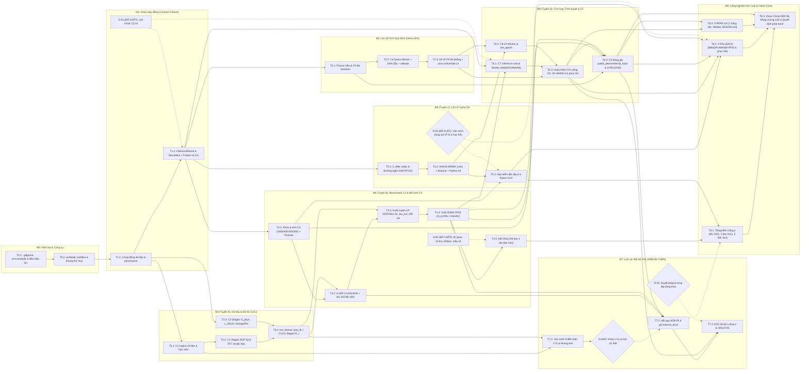
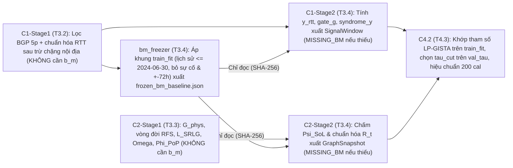

# Kế hoạch Triển khai SubseaBGP-Tomography (Từ Hiện trạng đến Nghiệm thu MVP)

Tài liệu này là **kế hoạch triển khai theo quan hệ phụ thuộc** đưa kho mã **SubseaBGP-Tomography** từ hiện trạng chỉ có tài liệu đặc tả tới nghiệm thu **Giai đoạn 1 (MVP)** trong phạm vi nghiên cứu và mô phỏng (không phải hệ thống giám sát quang nội bộ hay điều khiển mạng sản xuất theo [AGENTS.md](../AGENTS.md) §1). Đây **không phải tài liệu thiết kế kiến trúc mới**, **không phải báo cáo tiến độ/kết quả đã chạy**, và **không phải ủy quyền thực hiện thao tác Git** (`commit`, `push`, mở PR, `merge`) hay tải dữ liệu/chạy thực nghiệm.

> **Ràng buộc trung thực trạng thái (`AGENTS.md §6, §9, §13`):**
> - Tại thời điểm lập kế hoạch, kho mã **chưa có commit đầu tiên**, **chưa có mã nguồn, lockfile phụ thuộc, dữ liệu, mô hình ONNX, gói phát hành hay bài kiểm thử nào đã chạy**.
> - **Hiện có `0 / 54` yêu cầu ở trạng thái `ĐẠT`.** Tuyệt đối không đánh dấu `ĐẠT` dựa trên kế hoạch này, giá trị kỳ vọng của fixture hay số liệu nguyên mẫu cũ từ chú thích `[1]` (`unknown_url`) trong [RESEARCH.md](RESEARCH.md).
> - Mọi đường dẫn mã nguồn, lệnh CLI, fixture và tệp đầu ra được gắn nhãn **(dự kiến)** đều chưa tồn tại trong kho mã; các lệnh kiểm thử và dựng bản tĩnh chỉ khả dụng **sau khi hoàn tất gói `T0.2`**.

---

## 1. Căn cứ, Hiện trạng Kho mã và Bảo toàn Quyết định

### 1.1. Hiện trạng thực tế Git và cây thư mục

Kết quả kiểm tra trực tiếp kho mã bằng lệnh chỉ đọc (`git status --short --branch`, `git log`, `git remote -v`, `find`):

- **Trạng thái Git:** `No commits yet on main...origin/main [gone]`; nhánh `main` chưa có commit khởi tạo nào. Remote `origin` đã khai báo (`https://github.com/ckiet1612/SubseaBGP-Tomography.git`).
- **Tệp rác hệ điều hành & thiếu `.gitignore`:** Hiện chưa có `.gitignore`; tồn tại tệp chưa theo dõi `.DS_Store` và `docs/.DS_Store` (cấm stage theo [AGENTS.md](../AGENTS.md) §10).
- **Điều kiện khởi tạo Git bắt buộc trước khi chạy song song hoặc kiểm clean clone:** Trước bất kỳ hoạt động nào cần tạo nhánh tính năng (`feat/*`, `fix/*`), tạo `git worktree` để cô lập Agent song song, ghi `git_commit` vào `run_provenance.json` (`ML-013`), hoặc kiểm chứng tái lập từ bản sao sạch (`NFR-010`, `ADR-06`), kho mã **bắt buộc phải có commit khởi tạo hợp lệ trên `main`** (gồm `.gitignore`, tài liệu nền và loại trừ hoàn toàn `.DS_Store`). Thao tác commit khởi tạo chỉ thực hiện khi người dùng yêu cầu trực tiếp (`AGENTS.md §10`).

| Nhóm tệp / thư mục | Hiện có trong kho mã | Dự kiến tạo trong kế hoạch (chưa tồn tại) |
| --- | --- | --- |
| Quy tắc & cấu hình gốc | [AGENTS.md](../AGENTS.md), [skills-lock.json](../skills-lock.json) *(và tệp rác `.DS_Store` cần loại qua `.gitignore`)* | `.gitignore`, `.env.example`, `pyproject.toml`, `uv.lock`, `package.json`, `pnpm-lock.yaml`, `pnpm-workspace.yaml`, `tsconfig.base.json`, `vitest.config.ts`, `playwright.config.ts`, `configs/` |
| Tài liệu đặc tả | [docs/README.md](README.md), [docs/REQUIREMENTS.md](REQUIREMENTS.md), [docs/ARCHITECTURE.md](ARCHITECTURE.md), [docs/DATA.md](DATA.md), [docs/MODEL.md](MODEL.md), [docs/EVALUATION.md](EVALUATION.md), [docs/DESIGN.md](DESIGN.md), [docs/RESEARCH.md](RESEARCH.md), `docs/original-research.docx`, `docs/images/` (4 ảnh) và tệp kế hoạch này (`docs/IMPLEMENTATION_PLAN.md`) | `docs/REPRODUCIBILITY.md` (hướng dẫn clean clone cuối MVP, cập nhật cùng mã nguồn theo `AGENTS.md §12`) |
| Skill cục bộ | `.agents/skills/` (gồm 6 skill `subsea-*`, `data-visualization`, `geospatial-and-cartographic-visualization`, `knowledge-synthesis`, `ponytail*`, `webapp-testing`), `.claude/skills/ponytail*`, `agent/skills/ponytail*` | Không tạo mới skill trong phạm vi kế hoạch MVP |
| Mã nguồn, manifest, kiểm thử & artifact | **Không có** | `manifests/`, `pipeline/` (`contracts/`, `ingestion/`, `graph_builder/`, `benchmark/`, `modeling/`, `release/`), `packages/` (`contracts/`, `inference-core/`, `routing-lp/`), `web/` (`workers/`, `ui/`, `map/`, `src/`), `tests/` (6 nhóm `V-*`), `releases/`, `artifacts/` |

### 1.2. Thứ bậc tài liệu tham chiếu và kiểm tra skill

1. **Quy tắc làm việc & quản lý phiên bản:** [AGENTS.md](../AGENTS.md).
2. **Phạm vi, 54 yêu cầu, cổng nghiệm thu & sổ quyết định `Q-01`–`Q-07`, `O-01`–`O-03`:** [REQUIREMENTS.md](REQUIREMENTS.md).
3. **Kiến trúc MVP, 5 hợp đồng, `ADR-01`–`ADR-06`, bản đồ thư mục §9.2 & 6 nhóm `V-*`:** [ARCHITECTURE.md](ARCHITECTURE.md).
4. **Nguồn, tiền xử lý, lược đồ dữ liệu, phân hoạch `C3`, 5 chốt chống rò rỉ & phát hành:** [DATA.md](DATA.md).
5. **LP-GISTA 12 lớp, hàm mất mát, chọn $\tau_{\mathrm{cut}}$, Split Conformal, LP 3 pha, đối sánh & `run_provenance.json`:** [MODEL.md](MODEL.md).
6. **Giao thức kiểm chứng, điểm cần xác nhận §1.4 (mục 4–6), điều kiện gỡ chặn `ML-011` §3.5 & ma trận 54 ID §5:** [EVALUATION.md](EVALUATION.md).
7. **Quy tắc giao diện bắt buộc (`coss ui`, `Animate UI`, màu phẳng, bố cục mở):** [DESIGN.md](DESIGN.md).
8. **Tài liệu nghiên cứu đối chiếu:** [RESEARCH.md](RESEARCH.md) và [README.md](README.md) — chỉ dùng để đối chiếu bối cảnh và nguồn trích dẫn; mọi điểm lệch đã chuẩn hóa tuân theo `REQUIREMENTS.md` (`Q-01`–`Q-07`) và `ARCHITECTURE.md` §1.6; **không coi số liệu cũ thuộc chú thích `[1]` (`unknown_url`) là kết quả tái lập (`Q-06`)**.
9. **Skill cục bộ áp dụng:**
   - **Ghi nhận kiểm tra `writing-plans`:** Không tồn tại skill `writing-plans` trong `.agents/skills/` hay thư mục skill tích hợp sẵn của môi trường hiện tại; cấu trúc gói việc tự trị có checkbox kiểm thử dương/âm và tiêu chí hoàn thành được soạn trực tiếp theo [AGENTS.md](../AGENTS.md) §7–§10 và [EVALUATION.md](EVALUATION.md).
   - **6 skill `subsea-*` bắt buộc theo tuyến công việc:** [subsea-bgp-data-pipeline](../.agents/skills/subsea-bgp-data-pipeline/SKILL.md) (`M3`), [subsea-geospatial-srlg](../.agents/skills/subsea-geospatial-srlg/SKILL.md) (`M3`), [subsea-anti-leakage](../.agents/skills/subsea-anti-leakage/SKILL.md) (`M3`, `M4`, `M7`), [subsea-evaluation](../.agents/skills/subsea-evaluation/SKILL.md) (`M4`, `M7`, `M8`), [subsea-routing-verification](../.agents/skills/subsea-routing-verification/SKILL.md) (`M5`, `M8`), [subsea-research-integrity](../.agents/skills/subsea-research-integrity/SKILL.md) (toàn bộ `M0`–`M8`), kèm [webapp-testing](../.agents/skills/webapp-testing/SKILL.md) (`M2`, `M6`, `M8`).

### 1.3. Bảo toàn quyết định đã chốt, lựa chọn ADR mặc định và quyết định còn mở

Kế hoạch này **giữ nguyên 100%** phạm vi MVP, bộ quyết định `Q-01`–`Q-07`, các cổng `O-01`–`O-03`, 5 hợp đồng dữ liệu và toàn bộ ngưỡng nghiệm thu:

| Nhóm quyết định | Nội dung giữ nguyên trong kế hoạch | Phân loại |
| --- | --- | --- |
| **`Q-01`–`Q-07`** ([REQUIREMENTS.md](REQUIREMENTS.md) §9.5 A) | MVP chỉ gồm đường ống ngoại tuyến + Luồng 2 (phát lại 5 phút tách 3 lớp) + Luồng 3 (cắt/khôi phục giả định & LP 3 pha); công thức chuẩn hóa `formula-24`/`formula-33`/`formula-6` (tắt Mohr–Coulomb), `NA` tường minh; quét $\tau_{\mathrm{cut}}$ trên `val_tau` & LP 3 pha có $\ell_d$, trần SRLG thích nghi, ca `10 Tbps`; 4 cổng `Q-04` trên máy chuẩn M1 (`GPU logic < 150 MB`, trung vị `≥ 55 FPS`); cổng `manifest` từng tệp cấm GeoParquet gộp đa giấy phép; đường cơ sở mới `24/48` không gọi là tái lập `[1]`; giám sát trôi dạt JSD duyệt PR thuộc GĐ3. | **Bắt buộc (`Req`) — Đã chốt** |
| **Cấu hình `C3`/`C4` đã duyệt** ([DATA.md](DATA.md) §6.2 A, [MODEL.md](MODEL.md) §7.2 A) | Phân hoạch `C3`: `1.600 train_fit` (`880/480/240`), `400 val_tau` (`220/120/60`), `200 cal` (`110/60/30`), `200 test` (`110/60/30`), `25%` che khuất BGP có báo số thực tế; Weighted BCE trên logits trên `train_fit`; `F1` phụ chấm tại $1-\hat{q}_{0{,}90}$ (không quét $\tau_{\mathrm{F1}}$); quy tắc `Distractor FAR` không tính `NA` là âm tính đúng; `prior_mode = uniform_w1` cho phát lại lịch sử MVP; đóng băng $b_m$ chuyển giao từ `train_fit` $\le$ `2024-06-30` (không mượn trước ca `test`); `V-FALLBACK` FP32 `max_abs_diff <= 1e-4` + khớp quyết định; giấy phép Cloudflare Radar API là `CC BY-NC 4.0` (chặn khỏi `public_demo`). | **Đã duyệt triển khai** |
| **`ADR-01`–`ADR-06`** ([ARCHITECTURE.md](ARCHITECTURE.md) §9.1) | **Mặc định MVP (`Prop`):** `ADR-01` tệp tĩnh phân mảnh theo sự cố & lát 5 phút *(đối chứng: DuckDB-Wasm)*; `ADR-02` ONNX Runtime Web FP32 ưu tiên WebGPU / dự phòng WASM *(thay thế chỉ khi không đạt cổng: nhân WASM/WGSL riêng; lượng tử hóa FP16/INT8 chỉ sau FP32 và buộc $\Delta\mathrm{PR\text{-}AUC}<0{,}005$)*; `ADR-03` HiGHS WASM (`highs-js`, gói `highs`, giải phóng `model.dispose()`) *(thay thế: `glpk.js` hoặc simplex Rust/WASM)*; `ADR-04` bản đồ 2D màu phẳng MapLibre + Deck.gl chia sẻ WebGL2, không Three.js/3D/100k hạt *(thay thế ngoài MVP: Three.js WebGPU nếu không vi phạm `DESIGN.md`)*; `ADR-05` chuyển giao $\Delta\mathbf{R}_\theta=\mathbf{0}$ giữ $\mathbf{M}_{\mathrm{mask}},\Pi_\Delta$ không gán phủ `90%` khi chưa hiệu chuẩn *(thay thế: edge-level MLP)*; `ADR-06` lockfile + SHA-256 + `run_provenance.json`, không DVC/MLflow *(mở rộng sau: MLflow/DVC)*. | **Mặc định đề xuất (`Prop`) — Khóa bằng chứng ở M8** |
| **`D-01`, `D-02`** ([EVALUATION.md](EVALUATION.md) §1.4 mục 4–5) | `D-01`: khi `valid_channel_count == 0`, trả `null` cho `uncalibrated_transfer` và `[]` cho `calibrated_90` (cả hai giữ `insufficient_observations`, `unobservable_na`, không tính âm tính đúng trong `Distractor FAR`). `D-02`: khóa 4 quy ước chấm `200 test` (điểm chưa làm tròn + phá hòa bi quan; `ECE` 10 bin đều `[0,1]` trái đóng phải mở bin cuối chứa `1`; CI Wilson hai phía 95% với cổng `≥ 88,5%` áp cho ước lượng điểm; mẫu số toàn bộ ca có lỗi kèm báo riêng ca toàn lỗi khả kiến, `PR-AUC` không gán `0` cho `NA`). | **Đã chốt — Khóa triển khai (Mục 4.1)** |
| **`D-03`** ([EVALUATION.md](EVALUATION.md) §1.4 mục 6) | Đã duyệt nguyên tắc không buộc từng $f_k$ giống nhau khi có nghiệm đồng tối ưu và bộ dung sai đề xuất (`1e-7 Tbps` hậu kiểm, `1e-8` cho biên $u$, không nới $\varepsilon_{\mathrm{lex}}=10^{-9}$; đối chiếu 3 mục tiêu `1e-6 Tbps` / `1e-7` / `1e-4 Tbps·ms`, khớp chính xác `weighted_rtt_ms = null` & `NO_SERVED_FLOW`). **Chưa chạy — cần xác minh cấu hình HiGHS thực tế ở cả 2 backend trên fixture phát triển trước khi khóa `T5.3` và nhánh LP của `T8.2`.** | **ĐỀ XUẤT ĐÃ DUYỆT HƯỚNG — CHỜ XÁC MINH TRÊN FIXTURE PHÁT TRIỂN (Mục 4.1)** |
| **`D-HIST` (`ML-011`) & `O-01`–`O-03`** | `D-HIST`: khóa danh sách $\ge 3$ sự cố lịch sử khung `test` theo 6 điều kiện [EVALUATION.md](EVALUATION.md) §3.5 (đủ hồ sơ và được duyệt chỉ chuyển sang `CHƯA CHẠY`, không phải `ĐẠT`). `O-01` (`DATA-009`), `O-02` (`ML-008`), `O-03` (`U3`/`U4`): cổng giai đoạn sau / mở công khai nguồn hạn chế. | **BỊ CHẶN / HOÃN (Mục 4.2–4.3)** |

---

## 2. Mục tiêu, Phạm vi, Hai mặt phẳng Thực thi và Bản đồ Thư mục Đích

### 2.1. Mục tiêu và ranh giới phạm vi

- **Mục tiêu cuối MVP:** Bàn giao đầy đủ (1) đường ống ngoại tuyến tái lập sạch từ clean clone (`C1`–`C5`) với 0 vi phạm 5 chốt chống rò rỉ, đường cơ sở thực nghiệm mới đạt Cổng 1 (`ML-010`) và bộ giải LP đạt Cổng 3 (`ML-012`); (2) ứng dụng trình duyệt tĩnh không máy chủ ứng dụng (`C6`–`C9`) cho **Luồng 2** (phát lại 5 phút tách 3 lớp) và **Luồng 3** (cắt/khôi phục giả định & đối sánh LP với đường ngắn nhất) đạt Cổng 4 (`NFR-003`), `V-FALLBACK` và `DESIGN.md`; (3) gói phát hành `public_demo` mặc định dùng fixture độc lập + mô hình ONNX FP32 + trình tải nguồn gốc vượt `V-RELEASE`. Riêng Cổng 2 (`ML-011` và nghiệm thu lịch sử thật của `FR-010`) chỉ khép lại khi gỡ chặn `D-HIST` tại `M7`.
- **Trong MVP (`Q-01`):** `C1`–`C9`, Luồng 2 (trên fixture độc lập ở `public_demo` và gói lịch sử cục bộ ở `internal_local`), Luồng 3, chế độ `uniform_w1` (`FR-008`), ranh giới metadata nội bộ `external_flags` (`FR-007`), kiểm thử đơn vị Chốt 3 (`ML-003`), khóa tắt Mohr–Coulomb (`ML-007`).
- **Hoãn sang GĐ2/GĐ3 (không thiết kế sẵn hay triển khai trước):** Luồng 1 BGP sống (`FR-004`, `FR-005`), Luồng 4 quy hoạch 2030 (`FR-013`), bộ đệm & đối chiếu đầy đủ IODA/Radar (`FR-007`), đường ống định kỳ GFW 4Wings (`FR-008`, `ML-003` nguồn thật), bộ mã hóa tiên nghiệm & LOBO (`ML-002`), Mohr–Coulomb (`ML-008`), giám sát trôi dạt JSD & PR hàng tuần (`ML-014`). Chi tiết điều kiện mở tại Mục 8.
- **Ngoài phạm vi mọi giai đoạn:** Điều khiển mạng sản xuất hoặc đẩy cấu hình BGP/SRv6/MPLS/IGP (`NFR-008`), phát đo chủ động trái phép, truy cập OTDR/PFE nội bộ, công bố GeoParquet gộp đa giấy phép (`DATA-007`), tự động xuất bản mô hình không qua PR.

### 2.2. Hai mặt phẳng thực thi và phân định môi trường chạy

| Môi trường / Điều kiện thực thi | Thành phần & Mốc áp dụng | Ranh giới tin cậy & Lưu ý bắt buộc |
| --- | --- | --- |
| **Chạy hoàn toàn ngoại tuyến (không trình duyệt, không Internet)** | `M0`, `M1`, `T2.1`, `T3.2`–`T3.4` (trên fixture cục bộ), `M4` (`C3`/`C4`), `M5` (`C8` lõi + tham chiếu Python), `T6.1` (lõi `inference-core`), `T6.4` (`C5` & `V-RELEASE`), `T8.1`, phần kiểm tra đơn vị & huấn luyện trong `T8.4` | `TB1` (cô lập ngoại tuyến). Đáp ứng `NFR-009` (tách lõi khỏi UI/I/O) và `ML-005` (tháo rời `D_test` khi chạy `train_and_calibrate`). |
| **Cần trình duyệt thực & Máy chuẩn M1** (`MacBook Pro M1, RAM 8 GB, macOS 27.0, Chrome 157.0.8103.79`, cắm nguồn, bật tăng tốc phần cứng, `1280×800`, `60 Hz`) | `T2.2`–`T2.3` (E2E lát cắt tĩnh), `T6.2`–`T6.3` (E2E Luồng 2/3, tiếp cận, `DESIGN.md`), `T7.3` (E2E lịch sử nội bộ), `T8.2` (`V-FALLBACK` WebGPU vs ép tắt WebGPU/WASM, `device.lost`, `webglcontextlost`, `last_known_good`), `T8.3` (7 cổng `NFR-003` trên workload phát triển) | `TB3` (xác minh SHA-256/SemVer) & `TB4` (cô lập 3 Web Workers + cấm truyền `IncidentAnnouncement` vào `C7`). Chỉ dùng máy chủ tệp tĩnh cục bộ, **không backend API** (`NFR-001`), **không dùng `200 test` để chọn runtime**. |
| **Cần truy cập mạng ngoại tuyến chỉ đọc (tải nguồn sơ cấp)** | `T3.1` (khi chạy tải thật ngoài unit test), `T7.1` (xác minh 6 điều kiện ứng viên lịch sử khung `test` từ RouteViews, RIPE RIS MRT, RIPE Atlas built-in/anchoring, CAIDA/PeeringDB, TeleGeography, GEBCO, USGS) | `TB1` chỉ đọc theo hạn mức `DATA-004`, `NFR-008`. Bí mật (nếu đọc Radar nội bộ) chỉ nạp từ secret store ngoại tuyến (`NFR-007`), **tuyệt đối không lưu trong Git hay trình duyệt**. |
| **Cần phê duyệt thủ công của Người phụ trách dự án** | `T0.1` (yêu cầu riêng cho `.gitignore`, rà soát staged và tạo commit khởi tạo Git), khóa dung sai `D-03` sau khi xác minh trên fixture phát triển (`T5.3`/`T8.2`), `D-HIST` (`T7.1`→`T7.2`, đủ hồ sơ và duyệt chỉ chuyển sang `CHƯA CHẠY`), duyệt `ReleaseManifest` mặc định (`T6.4`), `O-01` nếu mở công khai gói lịch sử/nguồn hạn chế (`T7.3`), quyết định phát hành cuối (`T8.4`) *(riêng `D-01` và `D-02` đã được chốt)* | `TB2` (cổng pháp lý `Q-05`) & thẩm quyền nghiệm thu (`Q-01`). Agent không tự ý phê duyệt thay hoặc đổi đề xuất chưa chạy thành ngưỡng đã xác minh. |

### 2.3. Bản đồ thư mục đích theo [ARCHITECTURE.md](ARCHITECTURE.md) §9.2

```text
SubseaBGP-Tomography/
├── AGENTS.md                        # [HIỆN CÓ] Quy tắc làm việc
├── skills-lock.json                 # [HIỆN CÓ] Khóa phiên bản skill
├── .gitignore                       # [DỰ KIẾN - T0.1] Loại .DS_Store, .env, dữ liệu thô, build tạm
├── .env.example                     # [DỰ KIẾN - T0.1] Biến môi trường ngoại tuyến giá trị giả REPLACE_ME_LOCAL_ONLY
├── pyproject.toml & uv.lock         # [DỰ KIẾN - T0.2] Công cụ & khóa phụ thuộc Python (ADR-06)
├── package.json & pnpm-lock.yaml    # [DỰ KIẾN - T0.2] Công cụ & khóa phụ thuộc TS/Web (ADR-06)
├── configs/                         # [DỰ KIẾN - M4] Cấu hình khóa C3, huấn luyện LP-GISTA, chấm điểm D-02
├── docs/                            # [HIỆN CÓ] Đặc tả + IMPLEMENTATION_PLAN.md (+ REPRODUCIBILITY.md dự kiến ở M8)
├── manifests/                       # [DỰ KIẾN - M2/M6/M7] ReleaseManifest công khai & mẫu nội bộ (C5)
├── pipeline/                        # [DỰ KIẾN - Mặt phẳng ngoại tuyến Python, không DVC/MLflow]
│   ├── contracts/                   # [M1] Bộ xác thực Python khớp 1-1 packages/contracts
│   ├── ingestion/                   # [M3] C1: Tải chỉ đọc, lọc BGP/RTT, đóng băng b_m, SignalWindow
│   ├── graph_builder/               # [M3] C2: G_phys, L_SRLG, hành lang GEBCO/USGS, R_t đóng băng
│   ├── benchmark/                   # [M4] C3: Sinh 1.600/400/200/200, fixture công khai & 6 fixture LP
│   ├── modeling/                    # [M4/M7] C4: 5 chốt V-LEAKAGE, LP-GISTA, B1/B2/A1/A2, Conformal, ONNX, evals
│   └── release/                     # [M2/M6] C5: Đóng gói phân mảnh tách giấy phép, cổng manifest, quét bí mật
├── packages/                        # [DỰ KIẾN - Lõi TypeScript thuần, kiểm thử không cần trình duyệt]
│   ├── contracts/                   # [M1] JSON Schema + kiểu & validator TS cho 5 hợp đồng + thông cáo + provenance
│   ├── inference-core/              # [M6] C7 lõi: mặt nạ m_valid, chuyển giao ADR-05, Split Conformal, ORT wrapper
│   └── routing-lp/                  # [M5] C8 lõi: quy tắc C_tilde 4 bậc, LP 3 pha HiGHS, đường ngắn nhất FR-012, hậu kiểm
├── web/                             # [DỰ KIẾN - Mặt phẳng trình duyệt tĩnh C6/C7/C8-Worker/C9]
│   ├── workers/                     # [M2/M6] Query Worker (C6), Inference Worker (C7), LP Worker (C8)
│   ├── ui/                          # [M2/M6] Component tổ hợp coss ui & hiệu ứng Animate UI (Luồng 2 & Luồng 3)
│   └── map/                         # [M2/M6] Bản đồ 2D phẳng MapLibre + Deck.gl (WebGL2), Pre-flight Probe, phục hồi ngữ cảnh
├── tests/                           # [DỰ KIẾN - Đúng 6 nhóm kiểm chứng V-*]
│   ├── contracts/                   # V-CONTRACT (schemas/ thuộc Contracts Owner; c1_c2/ thuộc Data/Geo Owner)
│   ├── lp_regression/               # V-LP (gồm 6 fixture LP & lp_reference.py Python/HiGHS đối chiếu)
│   ├── anti_leakage/                # V-LEAKAGE (5 chốt ML-001..ML-005, tau_cut, ML-007, ML-009)
│   ├── release_gate/                # V-RELEASE (manifest, tách giấy phép, rollback, bí mật, chỉ đọc)
│   ├── wasm_parity/                 # V-FALLBACK (ONNX FP32 Python vs WebGPU vs WASM, mất ngữ cảnh, ngoại tuyến)
│   └── browser_e2e_perf/            # V-PERF-UX (lát cắt sớm, E2E Luồng 2/3, 7 cổng M1, DESIGN.md, a11y)
├── releases/                        # [DỰ KIẾN - Bỏ qua hoặc tách theo kênh] Gói tĩnh bất biến releases/<release_id>/
└── artifacts/                       # [DỰ KIẾN - Đầu ra thực nghiệm ngoại tuyến & hồ sơ nghiệm thu]
```

### 2.4. Phân tách 4 tầng bàn giao và quyết định phát hành

Kế hoạch tách rạch ròi bốn trạng thái trưởng thành để tránh đánh đồng một bản demo tĩnh chạy được với bằng chứng khoa học hay quyết định công bố:

1. **Tầng 1 — Lát cắt Demo Tĩnh (`M2`):** Chạy trọn mạch `Fixture mẫu -> ReleaseManifest sơ bộ -> C6 -> C9` trên trình duyệt không backend. Chỉ chứng minh hợp đồng, cơ chế xác minh SHA-256 và vỏ giao diện 2D theo `DESIGN.md`; **tuyệt đối không phải bằng chứng lịch sử hay điểm mô hình**.
2. **Tầng 2 — Bản chạy Nội bộ (`internal_local`, `M6` & `M7`):** Chạy đầy đủ `C1`–`C9` trên máy cục bộ với dữ liệu tải từ trình tải nguồn gốc, cho phép metadata tùy chọn `external_flags` (không đổi đầu ra mô hình) và gói $\ge 3$ sự cố lịch sử độc lập (khi gỡ chặn `D-HIST`). **Không đẩy tài sản hạn chế lên kho công khai.**
3. **Tầng 3 — Kiểm định Khoa học & Hiệu năng (`M4`, `M5`, `M7`, `M8`):** Độc lập 4 cổng: `ML-010` trên `200 test` khóa (1 lần duy nhất sau `0` vi phạm `V-LEAKAGE`), `ML-011` lịch sử (`BỊ CHẶN` chờ `D-HIST`), `ML-012` 6 fixture LP + hậu kiểm, và `NFR-003` + `V-FALLBACK` trên máy chuẩn M1 bằng workload phát triển.
4. **Tầng 4 — Quyết định Phát hành (`public_demo`, `T8.4`):** Chỉ xuất bản công khai gói gồm **fixture tổng hợp độc lập + mô hình ONNX FP32 đã đạt `ML-010`/`V-FALLBACK` + mã trình tải nguồn gốc** sau khi vượt `V-RELEASE`, qua clean clone `NFR-010` và có chữ ký phê duyệt của Người phụ trách dự án trong `ReleaseManifest`. Gói lịch sử chỉ vào `public_demo` nếu từng tệp vượt thêm cổng pháp lý `O-01`.

---

## 3. Lộ trình Theo Phụ thuộc, Đường găng, Song song và Bàn giao Tuyến

### 3.1. Sơ đồ phụ thuộc triển khai (DAG — không áp lịch tuần cứng)

Kế hoạch loại bỏ khung lịch 6 tuần cứng của [RESEARCH.md](RESEARCH.md) §8.2 và tổ chức theo quan hệ phụ thuộc kỹ thuật thực tế:



### 3.2. Tóm tắt các mốc, đầu ra kiểm tra được, đường găng và điểm tích hợp

- **Đường găng chính cho đường chạy MVP không bị chặn lịch sử (`public_demo` + Cổng 1/3/4):**
  `T0.1 -> T0.2 -> T1.1 -> T1.2 [Contract Freeze] -> T3.1 -> T3.2 -> T3.4 -> T4.2 -> T4.3 -> T4.4 -> T6.1 -> T6.3 -> T6.4 [Integration #2] -> T8.2/T8.3 -> T8.4`
  *(nhánh `T4.4 -> T4.5 -> T8.1 -> T8.4` chạy song song với `M6` ngay khi có ONNX FP32; quy ước chấm `D-02` đã chốt)*.
- **Đường găng nghiệm thu lịch sử thật (`Cổng 2`, hiện `BỊ CHẶN` tại `D-HIST`):**
  `T0.1 -> T0.2 -> T1.1 -> T3.1 -> T3.2 -> T3.4 -> T7.1 -> [D-HIST] -> T7.2 -> T7.3 -> T8.1 -> T8.4`.
- **Các tuyến song song sau điểm khóa `M1` (`T1.2`):** Tuyến Lát cắt sớm (`M2`), Tuyến Dữ liệu/Đồ thị (`M3`), Tuyến Benchmark (`T4.1`), và Tuyến Lõi LP (`M5`) triển khai đồng thời trên các thư mục sở hữu hoàn toàn tách biệt.

| Mốc | Trọng tâm | Đầu ra kiểm tra được (Verifiable Deliverable) | Cổng / Điểm kiểm soát |
| --- | --- | --- | --- |
| **`M0`** | Nền công cụ & vệ sinh repo | `.gitignore`, `.env.example`, `uv.lock`, `pnpm-lock.yaml`, lệnh lint/typecheck/test rỗng chạy đạt | Điều kiện khởi tạo Git (`AGENTS.md §10`) |
| **`M1`** | Hợp đồng & Fixture dương/âm | Bộ validator TS & Python 1-1 cho 5 hợp đồng + thông cáo + `run_provenance`, vượt 100% ca dương/âm `V-CONTRACT` | **Khóa hợp đồng #1 (`Contract Freeze v1.0.0`)** (`D-01` đã chốt) |
| **`M2`** | Lát cắt tích hợp sớm | Bản dựng tĩnh chạy trình duyệt không backend đọc fixture mẫu qua `ReleaseManifest` + `C6` SHA-256 + vỏ 2D `C9` | **Điểm tích hợp #1** (chứng minh mạch tĩnh sớm; ghi rõ dữ liệu mô phỏng) |
| **`M3`** | Dữ liệu mở & Đồ thị (`C1`/`C2`) | Trình tải chỉ đọc, lõi BGP 5p, `bm_freezer` trên `train_fit`, `SignalWindow` (`formula-33`/cổng $g_m$), `GraphSnapshot` đạt ca `2023-02` & `2026-08-25` | Đạt `V-CONTRACT` lõi `C1`/`C2` & Chốt 4 `ML-004` |
| **`M4`** | Benchmark `C3` & Mô hình `C4` | Bộ `1.600/400/200/200` khóa `seed`, 0 vi phạm 5 chốt `V-LEAKAGE`, 5 cấu hình `B1`–`Full`, ONNX FP32 (`in_profile` + `transfer`), báo cáo `200 test` 1 lần | **Cổng 1 (`ML-010`)** (`D-02` đã chốt; `0` vi phạm `V-LEAKAGE`) |
| **`M5`** | Bộ giải LP 3 pha (`C8`) | Thư viện `packages/routing-lp` (HiGHS WASM + `dispose` + đường ngắn nhất `FR-012`) + hậu kiểm độc lập vượt 6 fixture `V-LP` | **Cổng 3 (`ML-012`)** (xác minh dung sai đề xuất `D-03` trên fixture phát triển trước khi khóa `T5.3`) |
| **`M6`** | Tích hợp Trình duyệt & `C5` | Ứng dụng tĩnh hoàn chỉnh Luồng 2 & 3 (`C6`/`C7`/`C8`/`C9`) + gói phát hành `public_demo`/`internal_local` qua cổng `V-RELEASE` | **Điểm tích hợp #2** (`V-CONTRACT` + `V-LP` + `V-RELEASE` tích hợp) |
| **`M7`** | Xác minh lịch sử (`ML-011`) | Báo cáo xác minh 6 điều kiện $\ge 3$ ca khung `test`, hồi quy `ADR-05` & E2E nội bộ Luồng 2 | **BỊ CHẶN bởi `D-HIST`** (mở công khai bị chặn thêm bởi `O-01`) |
| **`M8`** | Nghiệm thu cuối & Clean Clone | Báo cáo 4 cổng độc lập, `V-FALLBACK` WebGPU/WASM, benchmark 7 cổng M1 (`V-PERF-UX`), clean clone `ADR-06`, gói bằng chứng cuối | **Cổng 4 (`NFR-003`) + `V-FALLBACK` + `V-RELEASE` + Quyết định phát hành** |

### 3.3. Điều kiện bàn giao giữa các tuyến và cách phá vỡ phụ thuộc vòng của $b_m$

Trong đặc tả tổng thể, `C1` và `C2` cần đường cơ sở $b_m = \mathrm{minRTT}_m^{\mathrm{base}}$ đã đóng băng từ `train_fit` để tính $\tilde{y}_m^{\mathrm{RTT}}(t)$ (`FR-006`) và cổng tốc độ ánh sáng $\Psi_{\mathrm{SoL}}$ trong $\mathbf{R}_t$ (`FR-002`), trong khi `C4` huấn luyện mô hình trên `SignalWindow` và `GraphSnapshot`. Để **tuyệt đối không phát sinh phụ thuộc vòng (`C1/C2 <-> C4`)** và bảo toàn Chốt 5 (`ML-005`) cùng `ADR-05`, kế hoạch tách cứng **chuẩn bị dữ liệu trung gian** khỏi **đóng băng thống kê `train_fit`** và **khớp tham số mô hình $\Theta$**:



**Bảng hợp đồng bàn giao giữa các tuyến song song:**

| Từ tuyến / gói | Sang tuyến / gói | Artifact bàn giao & Điều kiện bắt buộc |
| --- | --- | --- |
| `M1` (`T1.2`) | `M2`, `M3`, `M4`, `M5`, `M6` | Gói `packages/contracts` & `pipeline/contracts` phiên bản `1.0.0` đã khóa, đạt 100% `V-CONTRACT` dương/âm. |
| `M3` (`T3.4`) | `M4` (`T4.2`, `T4.3`) & `M7` (`T7.1`) | Hàm `bm_freezer` + lược đồ `frozen_bm_baseline.json` (ánh xạ `(channel_id, path_regime)` sang `min_rtt_base_ms` hoặc `null`, kèm `source_cutoffs_utc` & `sha256`), cùng fixture hồi quy `GraphSnapshot` mốc `2023-02` và `2026-08-25` (đạt Chốt 4 `ML-004`). |
| `M4` (`T4.1`) | `M5` (`T5.3`) & `M6` (`T6.4`) | Bộ 6 fixture LP chuẩn (`ML-012`) theo đúng hợp đồng `GraphSnapshot` + `SimulationRequest`, và bộ fixture demo công khai độc lập hoàn chỉnh (`synthetic_calibrated_baseline` / `simulated_assumption`). |
| `M4` (`T4.4`) | `M6` (`T6.1`, `T6.4`) & `M8` (`T8.2`) | Hai tệp ONNX FP32 (`lpgista_in_profile_fp32.onnx`, `lpgista_transfer_fp32.onnx`), tham số `calibration_quantile_q`, `auto_cut_policy`, `sha256` và `reference_vectors.json` (sinh trên `val_tau`/`cal`, không dùng `200 test`). |
| `M5` (`T5.2`, `T5.3`) | `M6` (`T6.2`) & `M8` (`T8.2`) | Thư viện thuần `packages/routing-lp` (API `solveSimulation`, giải phóng `model.dispose()`, khóa phiên bản gói npm `highs`) và tệp dung sai `configs/lp_verification_tolerances.json` (`D-03`). |
| `M6` (`T6.3`, `T6.4`) | `M7` (`T7.2`, `T7.3`) & `M8` (`T8.2`–`T8.4`) | Ứng dụng tĩnh `web/dist/` + trình đóng gói `C5` + gói phát hành `public_demo` vượt `V-RELEASE`. |

### 3.4. Phối hợp đa Agent, quyền sở hữu tệp và kỷ luật Git (`AGENTS.md §8, §10`)

Không giao cùng một tệp cho hai Agent sửa đồng thời. Khi làm song song sau `M1` (và sau khi có commit khởi tạo trên `main`), mỗi Agent chạy trên nhánh riêng hoặc `git worktree` cô lập:

| Vai trò Agent | Phạm vi sở hữu tệp độc quyền (dự kiến) | Tuyến / Mốc | Điểm review & Tích hợp |
| --- | --- | --- | --- |
| **Coordinator (Điều phối)** | `.gitignore`, `.env.example`, `pyproject.toml`, `uv.lock`, `package.json`, `pnpm-lock.yaml`, `pnpm-workspace.yaml`, `tsconfig.base.json`, `docs/`, `artifacts/acceptance/` *(và tệp khởi tạo khói M0 trước khi tách nhánh)* | `M0`, `T8.1`, `T8.4` | Đọc diff toàn bộ PR/nhánh trước khi ghép, giải quyết xung đột theo ý định, **tự chạy lại kiểm thử tích hợp sau ghép** (`AGENTS.md §8`). |
| **Contracts Owner** | `packages/contracts/`, `pipeline/contracts/`, `tests/contracts/schemas/`, `tests/contracts/fixtures/` | `M1` (`T1.1`–`T1.2`) | Duyệt mọi thay đổi hợp đồng sau `Contract Freeze v1.0.0`; bắt buộc chạy lại toàn bộ `V-CONTRACT`. |
| **Data/Geo Owner** | `pipeline/ingestion/`, `pipeline/graph_builder/`, `tests/contracts/c1_c2/`, `tests/anti_leakage/test_gate4_rfs_2023_2026.py`, `artifacts/historical/` | `M3` (`T3.1`–`T3.4`), `T7.1` | Phối hợp `ML/Eval Owner` review `bm_freezer.py` trước khi chốt `T3.4`. |
| **ML/Eval Owner** | `pipeline/benchmark/`, `pipeline/modeling/`, `configs/{benchmark_c3_v1,train_lpgista_v1,eval_locked_test_v1}.json`, `tests/anti_leakage/` *(trừ `test_gate4_rfs_2023_2026.py`)*, `tests/wasm_parity/test_onnx_python_parity.py` | `M4` (`T4.1`–`T4.5`), `T7.2` *(đánh giá)* | Bắt buộc đính kèm báo cáo `V-LEAKAGE` (`0` vi phạm) trước khi hợp nhất; Người phụ trách duyệt khóa `D-02` trước `T4.5`. |
| **Routing LP Owner** | `packages/routing-lp/`, `configs/lp_verification_tolerances.json`, `tests/lp_regression/` *(gồm `lp_reference.py`)* | `M5` (`T5.1`–`T5.3`) | Chốt phiên bản gói `highs` cùng `Coordinator`; chạy lại `V-LP` khi nhận fixture chính thức từ `T4.1`. |
| **Release Owner** | `pipeline/release/`, `manifests/`, `tests/release_gate/` *(sau M0)* | `T2.1`, `T6.4`, `T7.2` *(đóng gói nội bộ)* | Kiểm cổng `V-RELEASE` trước mọi bản đóng gói; không tự ký thay Người phụ trách trên `ReleaseManifest`. |
| **Web Owner** | `packages/inference-core/`, `web/`, `tests/wasm_parity/inferenceCore.test.ts` | `T2.2`–`T2.3`, `T6.1`–`T6.3` | Chỉ tiêu thụ `packages/contracts` và `packages/routing-lp` qua export công khai; không sửa trực tiếp lõi LP hay hợp đồng. |
| **Perf/QA Owner** | `tests/browser_e2e_perf/`, `tests/wasm_parity/{browser_parity,context_loss_recovery,offline_rollback}.spec.ts` | `T7.3` *(E2E nội bộ)*, `T8.2`, `T8.3` | Thực thi độc lập trên máy chuẩn M1 bằng workload phát triển; xác nhận checklist `DESIGN.md` và `V-FALLBACK`. |

> **Kỷ luật thao tác Git (`AGENTS.md §10`):** Mỗi gói việc bên dưới đề xuất một **mốc commit** độc lập (chỉ tạo sau khi hoàn tất phần việc, đã rà `git diff --cached` / `git diff --cached --check` và kiểm tra liên quan đã đạt). **Agent chỉ thực hiện `git commit`, `git push`, mở PR hoặc `merge` khi người dùng yêu cầu rõ đúng thao tác đó; bản kế hoạch này không phải ủy quyền thực hiện.**

---

## 4. Cổng Chặn và Sổ Quyết định Kỹ thuật (`D-01`–`D-03`, `D-HIST`, `O-01`–`O-03`)

### 4.1. Trạng thái ba hạng mục từ [EVALUATION.md](EVALUATION.md) §1.4 (mục 4–6)

Người phụ trách dự án đã chốt **`D-01`** và **`D-02`**, đồng thời duyệt hướng và bộ dung sai đề xuất **`D-03`** (chưa chạy — bắt buộc xác minh trên fixture phát triển trước khi khóa `T5.3` và phần LP của `T8.2`). Toàn bộ đã được đồng bộ sang [ARCHITECTURE.md](ARCHITECTURE.md), [MODEL.md](MODEL.md) và [EVALUATION.md](EVALUATION.md):

| Mã | Trạng thái | Nội dung áp dụng & Ràng buộc thực thi | Đầu ra lưu vết | Phạm vi tác động / Chặn |
| --- | --- | --- | --- | --- |
| **`D-01`** | **`ĐÃ CHỐT`** | Khi `valid_channel_count == 0`, trả **`null`** cho `uncalibrated_transfer` và **`[]`** cho `calibrated_90`. Cả hai giữ `status = insufficient_observations`, mọi phân đoạn là `unobservable_na`, và **không được tính là âm tính đúng trong `Distractor FAR`**. `null` nghĩa là không có tập Conformal được hiệu chuẩn; `[]` trong trường hợp này không có nghĩa là an toàn. | Đã đồng bộ [ARCHITECTURE.md](ARCHITECTURE.md) §4.2, [MODEL.md](MODEL.md) §2.3, [EVALUATION.md](EVALUATION.md) §1.4; sẽ khóa vào `inference_result.schema.json` (`1.0.0`). | Chỉ áp dụng cho phần biên tương ứng của `T1.2` và `T6.1` *(không còn chặn quyết định)*. |
| **`D-02`** | **`ĐÃ CHỐT`** | Khóa 4 quy ước chấm `200 test` trước `T4.5`, áp dụng đồng nhất cho mọi cấu hình (`B1`, `B2`, `A1`, `A2`, `Full`):<br>1. **Xếp hạng:** dùng điểm chưa làm tròn và phá hòa bi quan (trong nhóm đồng điểm, mọi phân đoạn không lỗi đứng trước phân đoạn lỗi); đa cáp SRLG: `Hit@k` cần ít nhất 1 lỗi thật trong top-$k$, `MRR` dùng hạng của lỗi thật đầu tiên, độ phủ Conformal vẫn yêu cầu chứa toàn bộ lỗi thật.<br>2. **ECE:** `10` bin đều trên $[0, 1]$, trái đóng phải mở, bin cuối chứa `1`; chỉ tính cặp có nhãn và khả kiến, so sánh xác suất dự đoán trung bình với tỷ lệ lỗi thực tế trong mỗi bin.<br>3. **CI:** Wilson hai phía 95% cho độ phủ, kèm tử số và mẫu số; cổng **`≥ 88,5%` áp dụng cho ước lượng điểm, không áp dụng cho cận dưới CI**.<br>4. **Mẫu số:** dùng toàn bộ ca có lỗi (`n_fault_total`) cho `Hit@k` và độ phủ ở cổng `Q-04`, đồng thời báo riêng trên các ca có tất cả lỗi thật khả kiến; ca đa cáp còn 1 lỗi khả kiến trong top-$k$ vẫn có thể đạt `Hit@k`, nhưng chỉ 1 lỗi không khả kiến cũng đủ làm ca đó trượt độ phủ; `PR-AUC` giữ mẫu số theo cặp có nhãn và khả kiến, không gán `0` cho `NA`. | Đã đồng bộ [EVALUATION.md](EVALUATION.md) §1.4, §3.3, §6.1 và [MODEL.md](MODEL.md) §5.3, §7.2; sẽ khóa vào `configs/eval_locked_test_v1.json` và `run_provenance.json`. | Áp dụng trực tiếp cho `T4.5` *(không còn chặn quyết định; vẫn chặn mở `200 test` bởi `V-LEAKAGE = PASS`)*. |
| **`D-03`** | **`ĐỀ XUẤT — CHỜ XÁC MINH TRÊN FIXTURE PHÁT TRIỂN`** | **Hậu kiểm đề xuất:** dung sai tuyệt đối `1e-7 Tbps` cho phần dư bảo toàn nhu cầu, giới hạn dung lượng, trần SRLG và biên luồng; `1e-8` cho biên của $u$; đường đi qua liên kết cắt phải bị loại hoặc có luồng đúng `0`; kiểm riêng các ràng buộc khóa pha và **không dùng dung sai hậu kiểm chung để nới $\varepsilon_{\mathrm{lex}} = 10^{-9}$** (HiGHS công bố dung sai khả thi mặc định `1e-7`, bắt buộc xác minh cấu hình thực tế ở cả hai backend).<br>**Đối chiếu nghiệm đồng tối ưu giữa hai backend:** không buộc từng $f_k$ giống nhau; hai backend phải độc lập vượt hậu kiểm trên cùng đầu vào, khớp trạng thái và cờ rời rạc (`srlg_redundancy_lost`, `disconnected`, `capacity_reason`), khớp chính xác `weighted_rtt_ms = null` và `NO_SERVED_FLOW` khi không có lưu lượng phục vụ, rồi đối chiếu 3 mục tiêu: tổng tải rớt **`1e-6 Tbps`**, $u^*$ **`1e-7`** (không thứ nguyên), và tổng $\sum_k \tau_k^{\mathrm{RTT}} f_k$ **`1e-4 Tbps·ms`**. | Ghi nhận dung sai đề xuất vào [EVALUATION.md](EVALUATION.md) §1.4, §4.2, §4.4 và [MODEL.md](MODEL.md) §4.2; chỉ khóa `configs/lp_verification_tolerances.json` **sau khi chạy xác minh trên fixture phát triển ở cả 2 backend**. | Chặn bước **khóa cuối** của `T5.3` và phần đối chiếu LP của `T8.2` *(không chặn triển khai `T5.1`, `T5.2` hay phần ONNX của `T8.2`)*. |

### 4.2. Cổng chặn lịch sử `D-HIST` (`ML-011` và phần lịch sử thật của `FR-010`)

- **Trạng thái hiện tại:** Giữ nguyên **`BỊ CHẶN`** cho `T7.2`, `T7.3`, `ML-011` và phần nghiệm thu lịch sử thật của `FR-010` theo [EVALUATION.md](EVALUATION.md) §3.5 và §5.3.
- **Điều kiện gỡ chặn duy nhất (`D-HIST`):** Gói `T7.1` phải xác minh thực tế trên dữ liệu sơ cấp và trình Người phụ trách dự án duyệt tối thiểu **`3` sự cố lịch sử độc lập thuộc khung `test` (`2025-07-01..2026-11-15`)** thỏa đồng thời cả **6 điều kiện**: (1) đủ bản ghi BGP liên quan VÀ chuỗi RIPE Atlas phù hợp kèm bảng kê `NA`/`MISSING_BM` (tệp BGP thô tồn tại chưa đủ để kết luận có đủ dữ liệu phát lại); (2) `100%` nguồn sơ cấp `source_citation`; (3) mốc `UTC` đúng độ chính xác nguồn (không dùng giờ Azure `05:45 UTC` ngày `2025-09-06` hay giờ động đất USGS `15:05:55 UTC` ngày `2025-12-27` làm $t_0$ đứt cáp, không gán chung một $t_0$ cho 4 tuyến ngày `2026-08-25`); (4) `GraphSnapshot` đóng băng `< t` đúng vòng đời RFS; (5) phân định `label_granularity` (`system` vs `segment`; khi `system` thì `confirmed_segment_ids = null`); (6) `0` vi phạm `V-LEAKAGE`. **Đủ hồ sơ và được duyệt chỉ chuyển trạng thái sang `CHƯA CHẠY`, tuyệt đối không chuyển sang `ĐẠT`.**
- **Ràng buộc chống thay thế:** Không thay thế `ML-011` bằng fixture tổng hợp hoặc 2 ca phát triển năm `2024` (Biển Đỏ `2024-02-24`, Tây Phi `2024-03-14`, vốn nằm trong khung `train`). Ngược lại, **vẫn triển khai và kiểm thử E2E khung phát lại Luồng 2 bằng fixture độc lập trong `M2` và `M6`** để không kẹt đường găng kỹ thuật trình duyệt.

### 4.3. Ba cổng mở rộng giai đoạn sau (`O-01`, `O-02`, `O-03`)

- **`O-01` (`DATA-009` — Cổng pháp lý từng tệp):** Chỉ mở khi Người phụ trách dự án xác minh văn bản điều khoản tái phân phối đúng định dạng đầu ra và ký duyệt từng mục `files[]` trong `ReleaseManifest` cho nguồn hạn chế (`GFW 4Wings`, `RIPE RIS/Atlas`, `CAIDA`, `PeeringDB`, `IODA`, `Cloudflare Radar`, gói sự cố lịch sử). Chặn tuyệt đối việc đưa các gói này vào `public_demo`; **không chặn đường `public_demo` mặc định dùng fixture độc lập + ONNX FP32 đã duyệt + trình tải nguồn gốc (bản demo vẫn bắt buộc vượt `V-RELEASE`)**.
- **`O-02` (`ML-008` — Địa kỹ thuật phân đoạn):** Giữ khóa tắt hoàn toàn số hạng Mohr–Coulomb trong MVP (`ML-007`).
- **`O-03` (`U3`/`U4` — Người dùng GĐ2):** Giữ Luồng 1 và Luồng 4 ngoài MVP.

---

## 5. Chi tiết Các Gói việc Triển khai (`M0`–`M8`)

> **Quy ước đọc lệnh trong các gói việc:** Toàn bộ lệnh bắt đầu bằng `uv run ...` và `pnpm ...` là **lệnh dự kiến, chỉ khả dụng sau khi hoàn tất `T0.2`**. Mọi tên tệp dưới `pipeline/`, `packages/`, `web/`, `tests/`, `manifests/`, `configs/`, `artifacts/`, `releases/` đều là **tệp dự kiến**.

---

### Mốc `M0` — Khởi tạo Nền tảng Công cụ & Điều kiện Git

#### `T0.1` — Thiết lập `.gitignore`, mẫu cấu hình bí mật giả & chuẩn bị mốc commit khởi tạo

- **Mục tiêu:** Ngăn rò rỉ tệp rác hệ điều hành (`.DS_Store`), bí mật `.env` và dữ liệu thô lớn vào Git; xác lập điều kiện tiên quyết tạo commit khởi tạo trên `main`.
- **Phụ thuộc:** Không *(thao tác `git commit` chỉ chạy khi người dùng yêu cầu theo `AGENTS.md §10`)*.
- **Thành phần:** Hạ tầng chung (`C1`–`C9`).
- **ID yêu cầu:** `NFR-007`, `NFR-010`.
- **Phạm vi sở hữu:** `Coordinator`.
- **Tệp dự kiến:** Tạo `.gitignore`, `.env.example`, `tests/release_gate/test_repo_hygiene.py` *(chạy sau `T0.2`)*.
- **Giao diện tiêu thụ:** Hiện trạng cây thư mục repo (`AGENTS.md`, `docs/`, `.agents/`).
- **Giao diện cung cấp:** Quy tắc bỏ qua tệp hệ thống/bí mật/dữ liệu thô (`data/raw/`, `.env`, `.DS_Store`, `.venv/`, `node_modules/`, `dist/`, `releases/*-internal/`); tệp `.env.example` chỉ chứa giá trị giả `REPLACE_ME_LOCAL_ONLY` (ví dụ `CLOUDFLARE_RADAR_TOKEN=REPLACE_ME_LOCAL_ONLY`).
- **Các bước thực thi:**
  - [ ] Viết kiểm thử dương/âm `tests/release_gate/test_repo_hygiene.py`: (a) ca dương xác nhận `.gitignore` chặn `.DS_Store`, `.env`, `*.local`, `data/raw/`; (b) ca âm xác nhận hàm kiểm tra phát hiện và thất bại nếu `.env.example` chứa chuỗi giống token thật (ví dụ chuỗi dài ngẫu nhiên khác `REPLACE_ME_LOCAL_ONLY`) hoặc nếu có `.DS_Store` trong danh sách tệp tracked.
  - [ ] Xác nhận lỗi kỳ vọng: trước khi tạo `.gitignore` và `.env.example`, chạy `git check-ignore .DS_Store docs/.DS_Store` trả mã lỗi khác `0` (chưa bị bỏ qua).
  - [ ] Triển khai tối thiểu `.gitignore` và `.env.example` đúng quy tắc [AGENTS.md](../AGENTS.md) §10–§11 và [ARCHITECTURE.md](ARCHITECTURE.md) §8.1.
  - [ ] Chạy lại kiểm tra: `git check-ignore -v .DS_Store docs/.DS_Store .env` (khả dụng ngay, phải khớp quy tắc `.gitignore`) và `git status --short --branch` (xác nhận `.DS_Store` và `docs/.DS_Store` không còn xuất hiện trong danh sách untracked); lưu log vào nhật ký bàn giao `M0`. *(Chạy `uv run pytest tests/release_gate/test_repo_hygiene.py` ngay sau `T0.2`.)*
- **Điều kiện bắt đầu:** Quy tắc `AGENTS.md` và bộ tài liệu `docs/` đã hiện diện.
- **Tiêu chí hoàn thành:** `git check-ignore` chặn 100% `.DS_Store`/`.env`/`data/raw/`, `.env.example` chỉ chứa `REPLACE_ME_LOCAL_ONLY`; khi người dùng yêu cầu commit khởi tạo, nhánh `main` có commit gốc sạch không chứa tệp nhạy cảm hay `.DS_Store`.
- **Bằng chứng bàn giao:** Nội dung `.gitignore`, `.env.example`, kết quả `git check-ignore` và `git status --short --branch`.
- **Bị chặn nếu thiếu tiền đề:** Nếu chưa có commit khởi tạo trên `main`, toàn bộ hoạt động tạo nhánh tính năng, `git worktree` song song (`M3`/`M4`/`M5`), ghi `git_commit` thật trong `run_provenance.json` (`T4.1`–`T4.5`) và kiểm thử clean clone (`T8.4`) bị chặn.
- **Mốc commit đề xuất *(chỉ thực hiện khi người dùng yêu cầu)*:** `chore: add gitignore and placeholder env template for initial commit`.

#### `T0.2` — Thiết lập công cụ phát triển tối thiểu Python (`uv`) & TypeScript/Web (`pnpm`) + Lockfiles

- **Mục tiêu:** Khởi tạo cấu trúc workspace tối thiểu theo [ARCHITECTURE.md](ARCHITECTURE.md) §9.2 với hai tệp lockfile bất biến (`uv.lock`, `pnpm-lock.yaml`) và bộ lệnh kiểm kiểu, lint, kiểm thử đơn vị, E2E chạy được từ thư mục sạch (`ADR-06`).
- **Phụ thuộc:** `T0.1` *(cần commit khởi tạo trước khi tách nhánh làm song song)*.
- **Thành phần:** Toàn bộ `pipeline/`, `packages/`, `web/`, `tests/`.
- **ID yêu cầu:** `NFR-009`, `NFR-010`, `ML-013`.
- **Phạm vi sở hữu:** `Coordinator`.
- **Tệp dự kiến:** Tạo `pyproject.toml`, `uv.lock`, `package.json`, `pnpm-workspace.yaml`, `pnpm-lock.yaml`, `tsconfig.base.json`, `vitest.config.ts`, `playwright.config.ts`, tệp khởi tạo tối thiểu `pipeline/__init__.py`, `packages/{contracts,inference-core,routing-lp}/package.json`, `web/package.json`, `tests/contracts/test_toolchain_smoke.{py,test.ts}`.
- **Giao diện tiêu thụ:** Python 3.11+, `uv`, Node.js 20+, `pnpm` trên máy phát triển.
- **Giao diện cung cấp:** Các lệnh thực thi chuẩn hóa cho toàn bộ kế hoạch:
  - Python: `uv sync --frozen`, `uv run ruff check pipeline tests`, `uv run mypy pipeline`, `uv run pytest`
  - JS/TS & Web: `pnpm install --frozen-lockfile`, `pnpm typecheck`, `pnpm lint`, `pnpm test`, `pnpm build`, `pnpm test:e2e`
  - Không cài máy chủ DVC/MLflow (`ADR-06`), không cài Three.js (`ADR-04`).
- **Các bước thực thi:**
  - [ ] Viết kiểm thử khói dương/âm `tests/contracts/test_toolchain_smoke.py` và `tests/contracts/test_toolchain_smoke.test.ts`: (a) ca dương xác nhận import được các gói workspace rỗng và đọc được phiên bản Python/Node; (b) ca âm xác nhận `pyproject.toml` không bắt buộc `dvc`/`mlflow` và `web/package.json` không chứa `three`.
  - [ ] Xác nhận lỗi kỳ vọng: trước khi cài công cụ, chạy kiểm tra sự tồn tại lockfile (`test -f uv.lock && test -f pnpm-lock.yaml`) thất bại.
  - [ ] Triển khai tối thiểu `pyproject.toml` (khai báo `pytest`, `mypy`, `ruff`, `pydantic`, `jsonschema`, `numpy`, `scipy`, `torch`, `onnx`, `onnxruntime`, `highspy` cho đối chiếu), `package.json` + workspace (`typescript`, `vitest`, `eslint`, `playwright`, `ajv`, `highs` khóa phiên bản, `onnxruntime-web`, `maplibre-gl`, `@deck.gl/*`, thư viện nền cho `coss ui` và `Animate UI`), sinh `uv.lock` và `pnpm-lock.yaml`.
  - [ ] Chạy lại kiểm tra: `uv sync --frozen && uv run ruff check pipeline tests && uv run mypy pipeline && uv run pytest tests/contracts/test_toolchain_smoke.py tests/release_gate/test_repo_hygiene.py && pnpm install --frozen-lockfile && pnpm typecheck && pnpm lint && pnpm test` và lưu mã băm `shasum -a 256 uv.lock pnpm-lock.yaml`.
- **Điều kiện bắt đầu:** `T0.1` hoàn tất.
- **Tiêu chí hoàn thành:** Cả hai bộ kiểm kiểu, lint và unit test khói chạy xanh 100% không lỗi trong môi trường ngoại tuyến sau khi cài từ lockfile; không có phụ thuộc cấm (`three`) hoặc hạ tầng thừa (`dvc`/`mlflow`).
- **Bằng chứng bàn giao:** `uv.lock`, `pnpm-lock.yaml`, mã băm `SHA-256` hai lockfile và log chạy xanh toàn bộ lệnh kiểm tra.
- **Bị chặn nếu thiếu tiền đề:** Toàn bộ `M1`–`M8` bị chặn vì chưa có công cụ chạy kiểm thử, kiểm kiểu và lockfile.
- **Mốc commit đề xuất *(chỉ thực hiện khi người dùng yêu cầu)*:** `chore: scaffold python and typescript workspaces with locked dependencies`.

---

### Mốc `M1` — Khóa Hợp đồng Dữ liệu Dùng chung & Bộ Fixture Dương/Âm (`Contract Freeze v1.0.0`)

#### `T1.1` — Triển khai 4 hợp đồng tầng dữ liệu & `run_provenance` (`GraphSnapshot`, `SignalWindow`, `IncidentAnnouncement`, `ReleaseManifest`)

- **Mục tiêu:** Cài đặt bộ JSON Schema và validator khớp 1-1 giữa TypeScript và Python cho 4 hợp đồng dữ liệu nền tảng và lược đồ `run_provenance.json`, cưỡng chế nghiêm SemVer, `ISO-8601 UTC Z`, hậu tố đơn vị, tập đóng `na_reason` và 4 nhãn bản chất dữ liệu.
- **Phụ thuộc:** `T0.2`.
- **Thành phần:** `C1`, `C2`, `C3`, `C5`, `C6` (lớp hợp đồng).
- **ID yêu cầu:** `DATA-002`, `DATA-006`, `FR-007`, `FR-010`, `ML-013`, `NFR-009`.
- **Phạm vi sở hữu:** `Contracts Owner`.
- **Tệp dự kiến:** Tạo `packages/contracts/schemas/{graph_snapshot,signal_window,incident_announcement,release_manifest,run_provenance}.schema.json`, `packages/contracts/src/{common,graphSnapshot,signalWindow,incidentAnnouncement,releaseManifest,provenance,index}.ts`, `pipeline/contracts/{common,schemas}.py`, `tests/contracts/schemas/test_data_contracts.{py,test.ts}`, `tests/contracts/fixtures/{valid,invalid}/*.json`.
- **Giao diện tiêu thụ:** Đặc tả hợp đồng tại [ARCHITECTURE.md](ARCHITECTURE.md) §4, [DATA.md](DATA.md) §3 và [EVALUATION.md](EVALUATION.md) §6.1.
- **Giao diện cung cấp:**
  - Kiểu dữ liệu & validator TS/Python đồng nhất (`schema_version = "1.0.0"`): `validateGraphSnapshot`, `validateSignalWindow`, `validateIncidentAnnouncement`, `validateReleaseManifest`, `validateRunProvenance`.
  - Tập đóng `data_provenance_class` (4 giá trị), tập đóng `na_reason` (9 mã tầng dữ liệu + `NO_SERVED_FLOW`), đơn vị bắt buộc (`_km`, `_m`, `_ms`, `_tbps`, `_pct`, `_mw`, `_kpa`, `_rad`, `_deg`).
  - Lỗi có kiểu rõ ràng: `SchemaVersionMajorError`, `TimestampUtcError`, `InvalidUnitOrRangeError`, `DuplicateIdError`, `NaSemanticViolationError`, `FutureCutoffError`, `PublicExternalFlagsViolationError`.
- **Các bước thực thi:**
  - [ ] Tạo bộ fixture dương/âm cụ thể trong `tests/contracts/fixtures/`:
    - *Dương:* `GraphSnapshot` hợp lệ (`1.0.0`, `1.0.1` PATCH, `1.1.0` MINOR kèm cảnh báo), `SignalWindow` đúng `300s` phân biệt `y_bgp = 0` (`bgp_active_pairs_count > 0`) với `y_bgp = null` (`ZERO_BGP_DENOMINATOR`), `IncidentAnnouncement` có `label_granularity = "system"` & `confirmed_segment_ids = null`, `ReleaseManifest` đủ 6 yếu tố kiểm toán, `run_provenance.json` khớp mẫu [EVALUATION.md](EVALUATION.md) §6.1.
    - *Âm:* lệch `MAJOR` (`2.0.0`), `requires_min_reader_version = "2.0.0"`, mốc thời gian `+07:00` hoặc thiếu `Z`, cửa sổ `299s`/`301s`, `source_cutoffs_utc >= effective_at_utc`, `length_km = 0`, `capacity_tbps = -1`, `lat_deg = 95`, trùng `segment_id`/`path_id`, `bgp_active_pairs_count = 0` nhưng `y_bgp = 0` (thay `NA` bằng `0`), `rtt_sample_count = 1` nhưng `is_valid = true`, `label_granularity = "system"` nhưng `confirmed_segment_ids = ["SEG_1"]`, `SignalWindow` kênh `public_demo` có chứa `external_flags`.
  - [ ] Xác nhận lỗi kỳ vọng: chạy `uv run pytest tests/contracts/schemas/test_data_contracts.py` và `pnpm test tests/contracts/schemas/test_data_contracts.test.ts` *(sau `T0.2`)* báo thất bại vì chưa có triển khai validator.
  - [ ] Triển khai tối thiểu JSON Schema + validator TS (`ajv`/strict types) và Python (`pydantic` + `jsonschema`) dùng chung đúng bộ tệp `.schema.json` để tránh trôi lược đồ giữa hai ngôn ngữ.
  - [ ] Chạy lại `uv run pytest tests/contracts/schemas/test_data_contracts.py && uv run mypy pipeline/contracts && pnpm --filter @subseabgp/contracts typecheck && pnpm test tests/contracts/schemas/test_data_contracts.test.ts` và lưu log kiểm định `V-CONTRACT`.
- **Điều kiện bắt đầu:** `T0.2` hoàn tất.
- **Tiêu chí hoàn thành:** 100% ca dương được chấp nhận và 100% ca âm bị từ chối với đúng mã lỗi có kiểu trên cả Python và TypeScript; không có trường không đơn vị hay `NA` bị đổi thành `0`.
- **Bằng chứng bàn giao:** Bộ JSON Schema `1.0.0`, log chạy xanh `V-CONTRACT` trên cả Python và TS, danh mục fixture dương/âm.
- **Bị chặn nếu thiếu tiền đề:** Toàn bộ `T1.2`, `M2`, `M3`, `M4`, `M5`, `M6` bị chặn vì chưa có hợp đồng chung.
- **Mốc commit đề xuất *(chỉ thực hiện khi người dùng yêu cầu)*:** `feat(contracts): define data plane and provenance v1.0.0 schemas with cross-language validators`.

#### `T1.2` — Triển khai hợp đồng `InferenceResult`, `SimulationRequest`, `SimulationResult` & Khóa hợp đồng (`Contract Freeze v1.0.0`)

- **Mục tiêu:** Hoàn thiện phần hợp đồng suy luận và mô phỏng định tuyến, khóa chặt quy tắc cô lập `IncidentAnnouncement` khỏi đầu vào `C7`, và đóng mốc **Contract Freeze v1.0.0** để mở khóa triển khai song song 4 tuyến.
- **Phụ thuộc:** `T1.1` *(áp dụng quyết định **`D-01`** đã chốt cho ca biên `valid_channel_count == 0`)*.
- **Thành phần:** `C4`, `C7`, `C8`, `C9`.
- **ID yêu cầu:** `FR-009`, `FR-011`, `FR-012`, `DATA-002`, `DATA-006`, `NFR-009`.
- **Phạm vi sở hữu:** `Contracts Owner`.
- **Tệp dự kiến:** Tạo `packages/contracts/schemas/{inference_result,simulation_request,simulation_result}.schema.json`, `packages/contracts/src/{inferenceResult,simulation}.ts`, `pipeline/contracts/{inference,simulation}.py`, `tests/contracts/schemas/test_model_sim_contracts.{py,test.ts}`, `tests/contracts/fixtures/{valid,invalid}/{inference,simulation}_*.json`.
- **Giao diện tiêu thụ:** `T1.1` (`common` types/schemas) và quyết định **`D-01`** *(đã chốt)*.
- **Giao diện cung cấp:**
  - `validateInferenceResult`, `validateInferenceInput` (chỉ chấp nhận `GraphSnapshot` + `SignalWindow`, từ chối mọi trường thuộc `IncidentAnnouncement`), `validateSimulationRequest`, `validateSimulationResult`.
  - Bắt buộc: `interpretation_disclaimer` không rỗng, `interpretation_warning` không rỗng; theo `D-01`: khi `valid_channel_count == 0` trả `status = "insufficient_observations"`, mọi phân đoạn `unobservable_na`, `conformal_set_segment_ids = []` với `calibrated_90` và `null` với `uncalibrated_transfer`; `conformal_calibration_status == "uncalibrated_transfer"` $\Rightarrow$ `nominal_coverage_target == null` & `calibration_quantile_q == null`; `total_served_tbps == 0` $\Rightarrow$ `weighted_rtt_ms == null` & `na_reason == "NO_SERVED_FLOW"`; `shortest_path_baseline` tách bạch `raw_unconstrained_overload_pct` và `mlu_pct` $\in [0,100]$.
- **Các bước thực thi:**
  - [ ] Viết fixture dương/âm:
    - *Dương:* `InferenceResult` chế độ `in_profile` + `calibrated_90`, chế độ `zero_delta_r_transfer` + `uncalibrated_transfer`, chế độ `degraded_partial_na` có phân đoạn `unobservable_na` (`x_hat = null, p_hat = null`), hai ca `insufficient_observations` (`valid_channel_count == 0`) theo đúng **`D-01`** (`[]` cho `calibrated_90`, `null` cho `uncalibrated_transfer`); `SimulationResult` bình thường và ca mất kết nối (`mlu_pct = 0`, `weighted_rtt_ms = null`, `NO_SERVED_FLOW`).
    - *Âm:* payload đầu vào `C7` cố tình chèn `incident_announcement` hoặc `confirmed_segment_ids`; `uncalibrated_transfer` kèm `valid_channel_count == 0` nhưng trả `conformal_set_segment_ids = []` thay vì `null`; `calibrated_90` kèm `valid_channel_count == 0` nhưng trả `null` thay vì `[]`; `uncalibrated_transfer` nhưng gán `nominal_coverage_target = 0.90`; `observability_status = "unobservable_na"` nhưng `p_hat = 0.0`; `total_served_tbps = 0` nhưng `weighted_rtt_ms = 0`; `demand_tbps = -2`; `srlg_cap_ratio = 1.2`; `mlu_pct = 120` trong trường thực chuyển (phải nằm ở `raw_unconstrained_overload_pct`).
  - [ ] Xác nhận lỗi kỳ vọng: chạy `uv run pytest tests/contracts/schemas/test_model_sim_contracts.py` và `pnpm test tests/contracts/schemas/test_model_sim_contracts.test.ts` thất bại trước triển khai.
  - [ ] Triển khai tối thiểu schema & validator đồng nhất TS/Python cho `InferenceResult`, `SimulationRequest`, `SimulationResult` và đầu vào `C7`.
  - [ ] Chạy lại toàn bộ `V-CONTRACT` (`uv run pytest tests/contracts/schemas && pnpm test tests/contracts/schemas && uv run mypy pipeline/contracts && pnpm --filter @subseabgp/contracts typecheck`) và ghi nhận mốc **Contract Freeze v1.0.0**.
- **Điều kiện bắt đầu:** `T1.1` đạt (`D-01` đã chốt).
- **Tiêu chí hoàn thành:** 100% ca dương/âm của cả 5 hợp đồng + thông cáo + provenance xanh trên Python và TS; toàn bộ tuyến `M2`, `M4`, `M5`, `M6` có thể nhập khẩu trực tiếp `@subseabgp/contracts` và `pipeline.contracts`.
- **Bằng chứng bàn giao:** Nhật ký `V-CONTRACT` toàn bộ 5 hợp đồng, bảng khóa phiên bản `1.0.0` tuân thủ `D-01`.
- **Bị chặn nếu thiếu tiền đề:** Toàn bộ tuyến `M2`, `M4`, `M5`, `M6` bị chặn nếu `T1.1` hoặc `T1.2` chưa qua `V-CONTRACT`.
- **Mốc commit đề xuất *(chỉ thực hiện khi người dùng yêu cầu)*:** `feat(contracts): add inference and simulation v1.0.0 contracts and freeze schemas`.

---

### Mốc `M2` — Lát cắt Tích hợp Sớm (`Early Vertical Slice`: Fixture $\to$ `ReleaseManifest` $\to$ `C6` $\to$ `C9` Vỏ 2D)

> **Cảnh báo bản chất dữ liệu của `M2`:** Toàn bộ dữ liệu trong lát cắt sớm này là **fixture mô phỏng tổng hợp nhỏ độc lập** (`synthetic_calibrated_baseline` / `simulated_assumption`), chỉ dùng để kiểm chứng sớm chuỗi nạp tệp tĩnh – kiểm SHA-256 – tách 3 lớp – bản đồ 2D, **tuyệt đối không coi là bằng chứng lịch sử hay kết quả suy luận/định tuyến thật**.

#### `T2.1` — Sinh bộ fixture tĩnh nhỏ độc lập & Đóng gói `ReleaseManifest` sơ bộ (`C5-lite`)

- **Mục tiêu:** Tạo một gói tài nguyên tĩnh bất biến nhỏ hợp lệ (`releases/v0.0.1-slice/`) gồm 3 bước thời gian `5 phút`, 1 thông cáo mẫu tách tệp, 1 kịch bản cắt cáp mẫu, `release_manifest.json` và `current_release.json` có mã băm `SHA-256`.
- **Phụ thuộc:** `T1.2`.
- **Thành phần:** `C3` (mẫu nhỏ), `C5` (đóng gói sơ bộ).
- **ID yêu cầu:** `DATA-002`, `DATA-007`, `DATA-008`, `NFR-001`.
- **Phạm vi sở hữu:** `Release Owner`.
- **Tệp dự kiến:** Tạo `pipeline/release/pack_fixture_slice.py`, `manifests/public_demo_slice.manifest.json`, `tests/release_gate/test_slice_pack.py`, thư mục đầu ra kiểm thử `tests/release_gate/fixtures/slice_bundle/`.
- **Giao diện tiêu thụ:** `T1.1` (`validateGraphSnapshot`, `validateSignalWindow`, `validateIncidentAnnouncement`, `validateReleaseManifest`).
- **Giao diện cung cấp:** Thư mục tĩnh phân mảnh bất biến gồm `current_release.json` (`active_release_id`, `manifest_path`, `manifest_sha256`, `previous_compatible_release_id`), `releases/v0.0.1-slice/release_manifest.json` và các tệp JSON/phân mảnh tách riêng nguồn & giấy phép (`source_name = "synthetic_fixture_generator"`, không chứa `external_flags`, gắn nhãn `synthetic_calibrated_baseline` / `simulated_assumption`).
- **Các bước thực thi:**
  - [ ] Viết test dương/âm `tests/release_gate/test_slice_pack.py`: (a) ca dương xác nhận gói sinh ra khớp `SHA-256` 100%, qua `validateReleaseManifest`, không chứa `external_flags`, tách riêng tệp `announcements.json`; (b) ca âm sửa `1 byte` của một tệp lát thời gian hoặc bỏ `approved_by` và xác nhận trình kiểm tra từ chối đóng gói.
  - [ ] Xác nhận lỗi kỳ vọng: chạy `uv run pytest tests/release_gate/test_slice_pack.py` thất bại trước triển khai.
  - [ ] Triển khai tối thiểu `pipeline/release/pack_fixture_slice.py` và sinh gói fixture lát cắt sớm.
  - [ ] Chạy lại `uv run pytest tests/release_gate/test_slice_pack.py && uv run mypy pipeline/release` và lưu bản kê `SHA-256`.
- **Điều kiện bắt đầu:** `T1.2` hoàn tất.
- **Tiêu chí hoàn thành:** Gói tĩnh `v0.0.1-slice` qua 100% validator `1.0.0`, khớp `SHA-256` và tách riêng hoàn toàn tệp thông cáo.
- **Bằng chứng bàn giao:** Gói fixture lát cắt sớm, `manifests/public_demo_slice.manifest.json`, log `test_slice_pack.py`.
- **Bị chặn nếu thiếu tiền đề:** `T2.2` và `T2.3` không có gói tĩnh chuẩn hóa để chạy mạch tích hợp sớm.
- **Mốc commit đề xuất *(chỉ thực hiện khi người dùng yêu cầu)*:** `feat(release): add minimal synthetic slice packager and v0.0.1-slice manifest`.

#### `T2.2` — Triển khai `C6` Query Worker đọc tệp tĩnh phân mảnh + Xác minh SHA-256/SemVer + `last_known_good`

- **Mục tiêu:** Hiện thực `ADR-01` (đọc tệp tĩnh phân mảnh theo sự cố và lát `5 phút`, không nạp DuckDB-Wasm ở tải khởi tạo) trong Web Worker riêng với kiểm tra `MAJOR` SemVer, `SubtleCrypto.digest("SHA-256")`, hủy truy vấn cũ qua `AbortController` và giữ khe lưu đệm `last_known_good`.
- **Phụ thuộc:** `T2.1`.
- **Thành phần:** `C6`.
- **ID yêu cầu:** `FR-010`, `DATA-006`, `NFR-001`, `NFR-002`, `NFR-005`.
- **Phạm vi sở hữu:** `Web Owner`.
- **Tệp dự kiến:** Tạo `web/workers/protocol.ts`, `web/workers/queryCore.ts`, `web/workers/query.worker.ts`, `web/workers/__tests__/queryWorker.test.ts`.
- **Giao diện tiêu thụ:** `T1.1` (validators `@subseabgp/contracts`), `T2.1` (`current_release.json`, `release_manifest.json`, tệp lát `5 phút`).
- **Giao diện cung cấp:** Thông điệp Worker `loadRelease(baseUrl)` và `queryStep({ epoch, request_id, scenario_id, window_end_utc })` trả về đối tượng tách bạch `{ epoch, graphSnapshot, signalWindow, incidentAnnouncement, releaseMeta }` hoặc lỗi có kiểu `{ code: "SHA256_MISMATCH" | "MAJOR_INCOMPATIBLE" | "MISSING_ESSENTIAL_BOOT" | "NETWORK_OFFLINE", fallbackActive: boolean }`.
- **Các bước thực thi:**
  - [ ] Viết test dương/âm `web/workers/__tests__/queryWorker.test.ts`:
    - *Dương:* nạp thành công `v0.0.1-slice`, đọc đúng 3 bước `5 phút`, trả `incidentAnnouncement` tách rời khỏi `signalWindow`, hủy yêu cầu cũ khi gọi liên tiếp với `epoch` mới hơn.
    - *Âm:* tiêm tệp bị đổi `1 byte` (`SHA256_MISMATCH`), tiêm `schema_version = "2.0.0"` (`MAJOR_INCOMPATIBLE`), tiêm lỗi mạng sau khi đã lưu đệm hợp lệ $\Rightarrow$ xác nhận `C6` từ chối gói mới, **không ghi đè `last_known_good`** và tiếp tục phục vụ dữ liệu từ bản đệm hợp lệ trước đó.
  - [ ] Xác nhận lỗi kỳ vọng: chạy `pnpm test web/workers/__tests__/queryWorker.test.ts` thất bại trước triển khai.
  - [ ] Triển khai tối thiểu `queryCore.ts` (thuần, tiêm `fetch`/`crypto`/`cache` để kiểm thử ngoại tuyến không cần DOM) và vỏ `query.worker.ts`.
  - [ ] Chạy lại `pnpm test web/workers/__tests__/queryWorker.test.ts && pnpm --filter web typecheck`.
- **Điều kiện bắt đầu:** `T2.1` hoàn tất.
- **Tiêu chí hoàn thành:** 100% ca dương/âm về tải phân mảnh, SHA-256, SemVer, `AbortController` và giữ `last_known_good` chạy xanh; không có lời gọi API backend hay PeeringDB/GFW/Radar.
- **Bằng chứng bàn giao:** Mã nguồn `C6` và nhật ký chạy `queryWorker.test.ts`.
- **Bị chặn nếu thiếu tiền đề:** `T2.3` và `T6.3` bị chặn vì không có nguồn cấp dữ liệu trình duyệt đã xác minh toàn vẹn.
- **Mốc commit đề xuất *(chỉ thực hiện khi người dùng yêu cầu)*:** `feat(web): implement C6 static sharded query worker with SHA-256 and rollback cache`.

#### `T2.3` — Dựng vỏ giao diện `C9` (MapLibre + Deck.gl 2D WebGL2 + `coss ui` + `Animate UI`) nối lát cắt tĩnh

- **Mục tiêu:** Dựng bản ứng dụng tĩnh chạy được sớm trên trình duyệt cho **Luồng 2** (tua 3 bước `5 phút` mẫu, tách 3 khu vực đo/suy luận-stub/thông cáo) và **Luồng 3** (chọn cắt/khôi phục phân đoạn với stub mô phỏng), tuân thủ ngay từ đầu `DESIGN.md` và `ADR-04` (bản đồ 2D màu phẳng WebGL2, 0 Three.js, 0 gradient, 0 lồng card).
- **Phụ thuộc:** `T2.2`.
- **Thành phần:** `C9`.
- **ID yêu cầu:** `FR-010` (vỏ Luồng 2 trên fixture), `FR-011` (vỏ cắt/khôi phục), `FR-014`, `DATA-002`, `NFR-001`, `NFR-006`, `UX-001`–`UX-007`.
- **Phạm vi sở hữu:** `Web Owner`.
- **Tệp dự kiến:** Tạo `web/index.html`, `web/src/{main.tsx,App.tsx,state/epochStore.ts,styles/tokens.css}`, `web/map/{Map2DCanvas.tsx,styleTokens.ts,preflightProbe.ts}`, `web/ui/{Flow2ReplayView.tsx,Flow3SimView.tsx,ThreeLayerPanel.tsx,StatusBadge.tsx}`, `web/src/__tests__/verticalSlice.spec.ts`.
- **Giao diện tiêu thụ:** `T2.2` (`C6` Query Worker), `T1.2` (`InferenceResult` và `SimulationResult` fixture stub gắn nhãn rõ `"Lát cắt mô phỏng sớm — chưa nối C7/C8"`).
- **Giao diện cung cấp:** Bản dựng tĩnh `web/dist/` phục vụ từ máy chủ tệp tĩnh thuần túy; bộ quản lý `replay_epoch`/`sim_epoch` loại bỏ kết quả cũ; lớp bản đồ 2D MapLibre + Deck.gl chia sẻ ngữ cảnh WebGL2; bộ component nền tổ hợp từ `coss ui` và hiệu ứng trạng thái từ `Animate UI`.
- **Các bước thực thi:**
  - [ ] Viết kiểm thử Playwright dương/âm `web/src/__tests__/verticalSlice.spec.ts`:
    - *Dương:* phục vụ `web/dist/` + `v0.0.1-slice` qua máy chủ tệp tĩnh, chuyển bước `5 phút` trên Luồng 2 bằng bàn phím (xác nhận tách đủ 3 khu vực Lớp 1/2/3 và hiển thị nhãn `"Dữ liệu mô phỏng/fixture"`), chuyển sang Luồng 3 chọn cắt & khôi phục 1 phân đoạn, xác nhận bản đồ 2D và bảng đồng bộ.
    - *Âm:* kiểm tra tĩnh CSS/computed styles có `0` khai báo `gradient`, `0` phần tử card lồng trong card, `0` lời gọi mạng ra tên miền ngoài (chỉ tải tệp tĩnh), và xác nhận phản hồi có `epoch < active_epoch` bị bỏ qua.
  - [ ] Xác nhận lỗi kỳ vọng: chạy `pnpm test:e2e web/src/__tests__/verticalSlice.spec.ts` thất bại trước triển khai.
  - [ ] Triển khai tối thiểu vỏ `C9` với `coss ui` + `Animate UI` + MapLibre/Deck.gl WebGL2 dùng chung + `prefers-reduced-motion`.
  - [ ] Chạy lại `pnpm build && pnpm test:e2e web/src/__tests__/verticalSlice.spec.ts` và lưu ảnh chụp màn hình kiểm chứng **Điểm tích hợp #1**.
- **Điều kiện bắt đầu:** `T2.2` hoàn tất.
- **Tiêu chí hoàn thành:** Lát cắt đầu-cuối `Fixture -> ReleaseManifest -> C6 -> C9` chạy xanh trên trình duyệt không cần backend, đạt kiểm tra tĩnh sơ bộ `DESIGN.md` và gắn rõ nhãn dữ liệu mô phỏng.
- **Bằng chứng bàn giao:** Log Playwright `verticalSlice.spec.ts`, Network trace chỉ tải tệp tĩnh, ảnh chụp màn hình Luồng 2 & 3 bản lát cắt sớm.
- **Bị chặn nếu thiếu tiền đề:** `T6.2` và `T6.3` bị chặn vì chưa có khung UI và `epochStore` để gắn `C7`/`C8`.
- **Mốc commit đề xuất *(chỉ thực hiện khi người dùng yêu cầu)*:** `feat(web): build early vertical slice UI with 2D MapLibre/Deck.gl and C6 integration`.

---

### Mốc `M3` (Tuyến A — Song song sau `M1`) — Nguồn Dữ liệu Chỉ đọc, Tiền xử lý & Đồ thị Đóng băng Thời điểm (`C1`, `C2`)

#### `T3.1` — Trình tải chỉ đọc nguồn mở sơ cấp (`C1-Ingest`), giới hạn tốc độ & chặn nguồn cấm

- **Mục tiêu:** Xây dựng các trình đọc chỉ đọc cho nguồn mở sơ cấp được phép ([DATA.md](DATA.md) §1.1–§1.2), gắn tách bạch `source_timestamp_utc` với `retrieved_at_utc` + `raw_sha256` + `parser_version`, cưỡng chế hạn mức và chặn tuyệt đối nguồn cấm (`SRC-BANNED`) cũng như mọi hành vi đo chủ động hoặc cấu hình mạng.
- **Phụ thuộc:** `T1.1`.
- **Thành phần:** `C1`.
- **ID yêu cầu:** `DATA-001`, `DATA-004`, `DATA-005` (phần USGS), `NFR-007`, `NFR-008`.
- **Phạm vi sở hữu:** `Data/Geo Owner`.
- **Tệp dự kiến:** Tạo `pipeline/ingestion/{sources.py,rate_limiter.py,downloader.py,usgs_client.py,atlas_client.py,mrt_client.py,metadata_optional.py}`, `tests/contracts/c1_c2/{test_ingestion_guards.py,test_readonly_and_banned_sources.py}`.
- **Giao diện tiêu thụ:** `T1.1` (`pipeline.contracts`), secret store môi trường ngoại tuyến (chỉ khi gọi optional Cloudflare Radar nội bộ).
- **Giao diện cung cấp:** Các hàm tải chỉ đọc + tệp biên bản truy xuất `RawFetchRecord` (`source_name`, `source_endpoint_or_doi`, `source_version`, `retrieved_at_utc`, `raw_sha256`, `parser_version`); lỗi `BannedSourceError`, `RateLimitConfigError`, `UsgsLimitExceededError`, `ActiveMeasurementForbiddenError`.
- **Các bước thực thi:**
  - [ ] Viết test dương/âm trên mock HTTP/fixture cục bộ (không cần Internet):
    - *Dương:* truy vấn USGS luôn truyền `eventtype=earthquake`, `minmagnitude=4.0`, tự chia khoảng thời gian khi kết quả tiệm cận `20.000`; RIPE Atlas chỉ đọc endpoint *built-in*/*anchoring*; ghi tách `retrieved_at_utc` và `raw_sha256`.
    - *Âm:* cố tình khai báo nguồn Kaggle `undersea-cables-and-global-digital-infrastructure` hoặc Hugging Face `alerterra/subsea_infrastructure` (`BannedSourceError`); cố gọi hàm tạo phép đo mới trên RIPE Atlas (`ActiveMeasurementForbiddenError`); phản hồi USGS có bản ghi `eventtype="quarry blast"` phải bị loại 100%; truy vấn USGS yêu cầu `limit=25000` phải bị chặn; quét tĩnh toàn bộ `pipeline/ingestion/` xác nhận `0` giao thức cấu hình (`NETCONF`/`gNMI`/`SSH`/BGP speaker) và `0` khóa API cứng.
  - [ ] Xác nhận lỗi kỳ vọng: chạy `uv run pytest tests/contracts/c1_c2/test_ingestion_guards.py tests/contracts/c1_c2/test_readonly_and_banned_sources.py` thất bại trước triển khai.
  - [ ] Triển khai tối thiểu trình tải chỉ đọc và bộ giới hạn tốc độ theo [DATA.md](DATA.md) §2.1.
  - [ ] Chạy lại `uv run pytest tests/contracts/c1_c2/test_ingestion_guards.py tests/contracts/c1_c2/test_readonly_and_banned_sources.py && uv run mypy pipeline/ingestion`.
- **Điều kiện bắt đầu:** `T1.1` hoàn tất.
- **Tiêu chí hoàn thành:** 100% kiểm thử nguồn mở, hạn mức, lọc USGS, chặn `SRC-BANNED`, chỉ đọc và bảo vệ token chạy xanh ngoại tuyến.
- **Bằng chứng bàn giao:** Mã nguồn `C1-Ingest`, nhật ký kiểm thử và báo cáo quét chỉ đọc ban đầu.
- **Bị chặn nếu thiếu tiền đề:** `T3.2` và `T7.1` bị chặn không có lớp truy xuất chuẩn hóa bảo toàn nguồn gốc.
- **Mốc commit đề xuất *(chỉ thực hiện khi người dùng yêu cầu)*:** `feat(ingestion): add read-only source downloaders with rate limits and banned-source guards`.

#### `T3.2` — Tiền xử lý lõi BGP 5 phút & Bản ghi RTT chuẩn hóa (`C1-Stage1` — Độc lập $b_m$)

- **Mục tiêu:** Triển khai tầng chuẩn hóa và tổng hợp cửa sổ BGP `300s` (`FR-003`, `DATA-005`) cùng tầng chuẩn hóa RTT trừ chặng nội địa nhân quả theo chế độ đường đi (`C1-Stage1`), **hoàn toàn không phụ thuộc $b_m$** để tránh phụ thuộc vòng.
- **Phụ thuộc:** `T1.1`, `T3.1`.
- **Thành phần:** `C1`.
- **ID yêu cầu:** `FR-003`, `DATA-005`, `DATA-006`, `NFR-009`.
- **Phạm vi sở hữu:** `Data/Geo Owner`.
- **Tệp dự kiến:** Tạo `pipeline/ingestion/{bgp_normalizer.py,bgp_window.py,rtt_normalizer.py,qc_report.py}`, `tests/contracts/c1_c2/test_bgp_and_rtt_stage1.py`, `tests/contracts/c1_c2/fixtures/c1_stage1/*.json`.
- **Giao diện tiêu thụ:** `T1.1`, `T3.1` (`RawFetchRecord` / fixture MRT & RIPE Atlas cục bộ).
- **Giao diện cung cấp:**
  - `aggregate_bgp_5min(records, window_start_utc, window_end_utc)` trả `{ y_bgp: float | None, bgp_active_pairs_count: int, bgp_na_reason: str | None, qc_counts }` (kiểu `[0,1] | None`, cửa sổ `300s`).
  - `normalize_rtt_samples(raw_traceroutes)` trả danh sách `NormalizedRttSample` (`source_timestamp_utc`, `retrieved_at_utc`, `channel_id`, `path_regime`, `subsea_rtt_ms`, `is_valid_sample`, `invalid_reason`, `parser_version`) chỉ dùng mẫu quá khứ $\le \tau$ khi trừ trung vị chặng nội địa.
- **Các bước thực thi:**
  - [ ] Tạo fixture dương/âm `tests/contracts/c1_c2/fixtures/c1_stage1/`:
    - *Dương:* cửa sổ BGP `300s` có 10 cặp `(peer, prefix)` hoạt động, 2 cặp bị rút ($W_m = 0{,}2$) và 4/10 peer đổi `AS_PATH` ($P_m = 0{,}4$) $\Rightarrow$ $\tilde{y}_m^{\mathrm{BGP}} = 0{,}30$; cửa sổ không rút/không đổi trên 10 cặp hợp lệ $\Rightarrow$ `y_bgp = 0.0` (số `0` hợp lệ); chuỗi RTT có đổi chế độ đường đi rõ rệt trong 60 phút chỉ giữ mẫu thuộc chế độ hiện tại $\le t$.
    - *Âm:* luồng MRT chứa bản ghi Class A/B (`route-views.sg`), bản tin `ANNOUNCE`/`WITHDRAW` trùng y hệt, sự kiện `STATE_CHANGE` / reset phiên đồng loạt (bắt buộc loại khỏi cả tử số lẫn mẫu số và đếm vào `qc_report`, không xóa im lặng); kênh có `bgp_active_pairs_count == 0` $\Rightarrow$ `y_bgp = None, ZERO_BGP_DENOMINATOR`; cửa sổ thiếu tệp MRT $\Rightarrow$ `y_bgp = None, COLLECTOR_GAP`; mẫu RTT âm sau khấu trừ nội địa $\Rightarrow$ đánh dấu `is_valid_sample = False` và tăng `invalid_rtt_sample_count`.
  - [ ] Xác nhận lỗi kỳ vọng: chạy `uv run pytest tests/contracts/c1_c2/test_bgp_and_rtt_stage1.py` thất bại trước triển khai.
  - [ ] Triển khai tối thiểu `bgp_normalizer.py`, `bgp_window.py`, `rtt_normalizer.py`, `qc_report.py` đúng [DATA.md](DATA.md) §2.1–§2.3 và skill [subsea-bgp-data-pipeline](../.agents/skills/subsea-bgp-data-pipeline/SKILL.md).
  - [ ] Chạy lại `uv run pytest tests/contracts/c1_c2/test_bgp_and_rtt_stage1.py && uv run mypy pipeline/ingestion && uv run ruff check pipeline/ingestion`.
- **Điều kiện bắt đầu:** `T1.1` và `T3.1` hoàn tất.
- **Tiêu chí hoàn thành:** 100% ca dương/âm BGP & RTT Stage 1 xanh ngoại tuyến; báo cáo QC ghi đủ mọi bộ đếm lọc (`duplicate_count`, `malformed_count`, `class_ab_filtered_count`, `session_reset_filtered_count`, `collector_gap_windows`, `invalid_rtt_sample_count`).
- **Bằng chứng bàn giao:** Mã `C1-Stage1`, fixture & log kiểm thử, mẫu báo cáo QC.
- **Bị chặn nếu thiếu tiền đề:** `T3.4` bị chặn không có đầu vào chuẩn hóa để đóng băng $b_m$ và dựng `SignalWindow`.
- **Mốc commit đề xuất *(chỉ thực hiện khi người dùng yêu cầu)*:** `feat(ingestion): implement C1-Stage1 5-min BGP windowing and causal RTT normalization`.

#### `T3.3` — Dựng đồ thị vật lý $\mathcal{G}_{\mathrm{phys}}$, hành lang địa vật lý, $\mathbf{L}_{\mathrm{SRLG}}$ và $(\Omega, \Phi_{\mathrm{PoP}})$ (`C2-Stage1` — Độc lập $b_m$)

- **Mục tiêu:** Dựng tầng vật lý $\mathcal{G}_{\mathrm{phys}}$ (`EPSG:4326`, trắc địa WGS84 `km`) có bổ sung tuyến đất liền (`VSTN`, `TEA`), kiểm vòng đời RFS và bản chụp `< t`, tính ma trận $\mathbf{A}^{\mathrm{SRLG}}$ ($r=25\ \mathrm{km}$, eo biển nghẽn) kèm bằng chứng SRLG & $\mathbf{L}_{\mathrm{SRLG}}$, trích xuất đặc trưng vùng đệm GEBCO/USGS (khóa cấm suy $(c_e,\varphi_e)$), và tính $(\Omega, \Phi_{\mathrm{PoP}})$ + kiểm chéo rDNS mà **chưa cần $b_m$**.
- **Phụ thuộc:** `T1.1`.
- **Thành phần:** `C1` (địa vật lý hành lang), `C2`.
- **ID yêu cầu:** `FR-001`, `FR-002` (phần RFS, $\Omega$, $\Phi_{\mathrm{PoP}}$), `DATA-003`, `DATA-005`, `ML-004`, `ML-007`, `NFR-009`.
- **Phạm vi sở hữu:** `Data/Geo Owner`.
- **Tệp dự kiến:** Tạo `pipeline/graph_builder/{geometry.py,physical_graph.py,srlg.py,geophysical_corridor.py,routing_priors.py,rdns_check.py}`, `tests/contracts/c1_c2/test_physical_graph_srlg.py`, `tests/contracts/c1_c2/fixtures/c2_geo/*.json`.
- **Giao diện tiêu thụ:** `T1.1`, fixture GeoJSON cáp biển + `VSTN`/`TEA` + CLS + bản chụp CAIDA/PeeringDB + mảnh lưới GEBCO/USGS cục bộ.
- **Giao diện cung cấp:** `PhysicalGraphCore` (`nodes_cls`, `segments` có `in_service` đúng mốc `effective_at_utc`, `geospatial_metadata` gồm `topology_hash`, `antimeridian_policy`, `snapping_tolerance_km`, `geometry_validity_status`), `srlg_laplacian` (kèm `srlg_evidence_type`, `min_distance_km`), đặc trưng hành lang ($\psi_{\mathrm{shelf}}$, $\mathrm{PGA}_e$), và bảng trọng số sơ bộ $(\Omega, \Phi_{\mathrm{PoP}}, \texttt{rdns\_verified}, \texttt{na\_reason})$.
- **Các bước thực thi:**
  - [ ] Tạo fixture dương/âm `tests/contracts/c1_c2/fixtures/c2_geo/`:
    - *Dương:* 2 phân đoạn chung eo biển nghẽn $\Rightarrow A_{ee'}^{\mathrm{SRLG}} = 1$; 2 phân đoạn ven bờ cách nhau `10 km` ($\le 25\ \mathrm{km}$ đo trắc địa WGS84) $\Rightarrow A_{ee'}^{\mathrm{SRLG}} = \exp(-10^2/(2\cdot 25^2)) > 0$ kèm `srlg_evidence_type = "coastal_proximity_25km"`; tuyến vượt kinh tuyến $\pm 180^\circ$ tách hình học hợp lệ OGC; tuyến đất liền `VSTN` có $\psi_{\mathrm{shelf}} = 0$ và được bảo toàn qua kiểm chéo rDNS; cặp AS có hợp tập cơ sở hiện diện rỗng $\Rightarrow J = 0$; không có động đất $\mathrm{Mw}\ge 4{,}0$ $\Rightarrow \mathrm{PGA}_e = 0$.
    - *Âm:* hình học tự cắt không hợp lệ OGC (`geometry_validity_status != "valid"`) $\Rightarrow$ chặn nạp; bản chụp CAIDA/PeeringDB có `published_at_utc >= effective_at_utc` $\Rightarrow$ chặn nạp (`FutureCutoffError`); kênh thiếu tọa độ PoP $\Rightarrow \Phi_{\mathrm{PoP}} = \texttt{None}$, `MISSING_POP` (không tự đặt $d_m(e) = 0$); kiểm tra tĩnh xác nhận `geophysical_corridor.py` không có hàm ánh xạ GEBCO sang $(c_e, \varphi_e)$ (`ML-007`).
  - [ ] Xác nhận lỗi kỳ vọng: chạy `uv run pytest tests/contracts/c1_c2/test_physical_graph_srlg.py` thất bại trước triển khai.
  - [ ] Triển khai tối thiểu theo [DATA.md](DATA.md) §2.4, §3.2 và skill [subsea-geospatial-srlg](../.agents/skills/subsea-geospatial-srlg/SKILL.md).
  - [ ] Chạy lại `uv run pytest tests/contracts/c1_c2/test_physical_graph_srlg.py && uv run mypy pipeline/graph_builder`.
- **Điều kiện bắt đầu:** `T1.1` hoàn tất.
- **Tiêu chí hoàn thành:** 100% ca dương/âm địa không gian, SRLG đối xứng, vùng đệm hành lang, rDNS, vòng đời RFS và `topology_hash` tất định đạt ngoại tuyến.
- **Bằng chứng bàn giao:** Mã `C2-Stage1`, nhật ký unit test và `topology_hash` kiểm thử tái lập.
- **Bị chặn nếu thiếu tiền đề:** `T3.4` bị chặn không có tầng vật lý và trọng số $(\Omega, \Phi_{\mathrm{PoP}})$ để ghép `GraphSnapshot`.
- **Mốc commit đề xuất *(chỉ thực hiện khi người dùng yêu cầu)*:** `feat(graph): implement C2-Stage1 physical graph, WGS84 SRLG Laplacian and corridor features`.

#### `T3.4` — Bộ đóng băng $b_m$ (`train_fit`), Hoàn thiện `SignalWindow` (`C1-Stage2`) và `GraphSnapshot` (`C2-Stage2`, ca `2023-02` & `2026-08-25`)

- **Mục tiêu:** Hiện thực điểm cắt vòng phụ thuộc $b_m$ (`bm_freezer`), hoàn thiện tính $\tilde{y}_m^{\mathrm{RTT}}(t)$ (`formula-33`), cổng vật lý chéo tầng $g_m(t)$, hội chứng $y_m(t)$, cổng tốc độ ánh sáng $\Psi_{\mathrm{SoL}}$ (`formula-24`) và ma trận $\mathbf{R}_t$; xác minh 2 ca hồi quy Chốt 4 (`2023-02` và `2026-08-25`).
- **Phụ thuộc:** `T3.2`, `T3.3`.
- **Thành phần:** `C1`, `C2`, giao điểm đóng băng `C4`.
- **ID yêu cầu:** `FR-002`, `FR-006`, `FR-007` (metadata nội bộ tùy chọn), `DATA-003`, `DATA-006`, `ML-001` (embargo $\pm 72\text{h}$), `ML-004`, `ML-005`, `NFR-009`.
- **Phạm vi sở hữu:** `Data/Geo Owner` *(phối hợp `ML/Eval Owner` rà soát `bm_freezer.py`)*.
- **Tệp dự kiến:** Tạo `pipeline/ingestion/{bm_freezer.py,rtt_syndrome.py,signal_window_builder.py}`, `pipeline/graph_builder/{sol_gate.py,snapshot_assembler.py}`, `tests/contracts/c1_c2/test_rtt_gate_and_rt.py`, `tests/anti_leakage/test_gate4_rfs_2023_2026.py`.
- **Giao diện tiêu thụ:** `T3.2` (BGP 5p + `NormalizedRttSample`), `T3.3` (`PhysicalGraphCore` + $(\Omega, \Phi_{\mathrm{PoP}})$ + rDNS).
- **Giao diện cung cấp:**
  - `freeze_bm_from_train_fit(rtt_samples, split_cutoff_utc, incident_windows_utc)` $\to$ `frozen_bm_baseline.json` (chỉ đọc cửa sổ sạch `60 phút` có $\ge 2$ mẫu hợp lệ trong `train_fit` $\le$ `2024-06-30` loại khoảng sự cố & $\pm 72\text{h}$; trả `MISSING_BM` cho `(channel_id, path_regime)` chưa có dữ liệu, không mượn trước ca `test`).
  - `build_signal_window(...) -> SignalWindow` (`1.0.0`, $\kappa=10{,}0, \tau_{\mathrm{SoL}}=0{,}12, \beta_{\mathrm{BGP}}=0{,}45$, mặc định `prior_mode = "uniform_w1"` cho lịch sử MVP, `external_flags` nội bộ `null` khi thiếu).
  - `assemble_graph_snapshot(...) -> GraphSnapshot` (`1.0.0`, $v_{\mathrm{fiber}}=204\ \mathrm{km/ms}$, `routing_weight_disclaimer`).
- **Các bước thực thi:**
  - [ ] Viết test dương/âm `test_rtt_gate_and_rt.py` và `test_gate4_rfs_2023_2026.py`:
    - *Dương:* (a) nhiễu BGP thuần ($\tilde{y}^{\mathrm{BGP}} = 0{,}8$, $\tilde{y}^{\mathrm{RTT}} = 0$) bị nén dưới $\sigma(-1{,}2)\cdot 0{,}45\cdot 0{,}8$; (b) đứt cáp che khuất BGP ($\tilde{y}^{\mathrm{BGP}} = 0$ hợp lệ, $\tilde{y}^{\mathrm{RTT}} = 0{,}25 > 0{,}12$) giữ $y_m = 0{,}55\cdot 0{,}25 = 0{,}1375 > 0$; (c) hồi quy `2023-02` bật `SMW-3` và khóa `ADC`/`SJC2`/`VSTN` về `r_weight = 0`, hồi quy `2026-08-25` khóa `SMW-3 = 0` và bật `ADC`/`SJC2`/`VSTN`; (d) kênh đi qua `VSTN` hợp lệ vượt rDNS không bị loại nhầm bởi chiều dài cáp biển.
    - *Âm:* (a) chỉ có `1` mẫu RTT trong $(t-60\text{p}, t]$ hoặc $b_m \le 0$ $\Rightarrow$ `y_rtt = None`, `syndrome_y = None`, `is_valid = False` (`INSUFFICIENT_RTT_SAMPLES` / `NON_POSITIVE_BM`); (b) mẫu RTT có $\tau >$ `window_end_utc` $\Rightarrow$ bị chặn (`FutureSampleError`); (c) thiếu $b_m$ cho tuyến mới sau `2024-06-30` (`SJC2`/`VSTN`) $\Rightarrow$ `MISSING_BM`, `is_scorable = False`, tuyệt đối không lấy mẫu năm `2025–2026` để bù và không gán `psi_sol_pass = True`; (d) $b_m < 2L_e/204$ $\Rightarrow$ `psi_sol_pass = False, r_weight = 0`.
  - [ ] Xác nhận lỗi kỳ vọng: chạy `uv run pytest tests/contracts/c1_c2/test_rtt_gate_and_rt.py tests/anti_leakage/test_gate4_rfs_2023_2026.py` thất bại trước triển khai.
  - [ ] Triển khai tối thiểu `bm_freezer.py`, `rtt_syndrome.py`, `signal_window_builder.py`, `sol_gate.py`, `snapshot_assembler.py`.
  - [ ] Chạy lại `uv run pytest tests/contracts/c1_c2 tests/anti_leakage/test_gate4_rfs_2023_2026.py && uv run mypy pipeline/ingestion pipeline/graph_builder` và lưu bằng chứng Chốt 4.
- **Điều kiện bắt đầu:** `T3.2` và `T3.3` hoàn tất.
- **Tiêu chí hoàn thành:** 100% đầu ra `SignalWindow` và `GraphSnapshot` vượt `validateSignalWindow`/`validateGraphSnapshot`; 2 ca hồi quy `2023-02` & `2026-08-25` đạt `0` vi phạm; không còn phụ thuộc vòng giữa `C1`/`C2` và `C4`.
- **Bằng chứng bàn giao:** Mã `C1-Stage2` & `C2-Stage2`, `bm_freezer.py`, log kiểm thử `V-CONTRACT` & Chốt 4 `ML-004`.
- **Bị chặn nếu thiếu tiền đề:** `T4.2` (tích hợp Chốt 4), `T4.3` (tái sử dụng `bm_freezer`) và `T7.1` (xác minh lịch sử) bị chặn.
- **Mốc commit đề xuất *(chỉ thực hiện khi người dùng yêu cầu)*:** `feat(pipeline): add train_fit bm freezer, cross-plane gate and point-in-time R_t assembly`.

---

### Mốc `M4` (Tuyến B — Song song sau `M1`) — Bộ Kiểm chuẩn `C3`, 5 Chốt `V-LEAKAGE`, Huấn luyện LP-GISTA & Cổng `ML-010` (`C3`, `C4`)

#### `T4.1` — Khóa cấu hình & Trình sinh Bộ Kiểm chuẩn Bán tổng hợp `C3` (`24/48`, `1.600/400/200/200`) + Fixture Độc lập

- **Mục tiêu:** Khóa cấu hình, `seed` riêng từng tập và xây dựng mới hoàn toàn bộ kiểm chuẩn bán tổng hợp (`24` phân đoạn, `48` kênh; `train_fit = 1.600`, `val_tau = 400`, `cal = 200`, `test = 200`, tỷ lệ `55%/30%/15%`, `25%` che khuất BGP trong đứt đơn) làm **đường cơ sở thực nghiệm mới** (`Q-06`), đồng thời sinh gói fixture demo công khai độc lập và 6 bộ fixture LP cho `M5`.
- **Phụ thuộc:** `T1.2`.
- **Thành phần:** `C3`.
- **ID yêu cầu:** `DATA-002`, `DATA-008`, `ML-001`, `ML-010`, `ML-012`, `ML-013`, `NFR-009`.
- **Phạm vi sở hữu:** `ML/Eval Owner`.
- **Tệp dự kiến:** Tạo `configs/benchmark_c3_v1.json`, `pipeline/benchmark/{config.py,topology_24seg.py,event_generator.py,split_builder.py,lp_fixtures.py,demo_fixture_gen.py}`, `tests/anti_leakage/{test_c3_benchmark_split.py,test_c3_fixtures.py}`.
- **Giao diện tiêu thụ:** `T1.1`, `T1.2` (`pipeline.contracts`).
- **Giao diện cung cấp:**
  - `artifacts/benchmark_c3_v1/{train_fit,val_tau,cal}/...` và thư mục **tách biệt độc lập** `artifacts/benchmark_c3_v1_locked_test/test/...` (có thể tháo rời hoàn toàn khỏi tiến trình huấn luyện), kèm `split_manifest.json` và `run_provenance.json` (`run_type = "benchmark_gen"`, `baseline_label = "new_experimental_baseline"`).
  - Bộ 6 fixture LP chuẩn ([MODEL.md](MODEL.md) §4.4: `82,0 Tbps`, Ca A `10/8`, Ca B `10/0`, `12 & 8 / 10`, bình thường/đứt đơn, `zero-demand`/`invalid_input`) trong `artifacts/fixtures/lp_v_lp_suite/`.
  - Gói fixture demo công khai độc lập (không chứa dữ liệu nguồn hạn chế, không chứa `external_flags`) cho `public_demo` tại `artifacts/fixtures/public_demo_independent/`.
- **Các bước thực thi:**
  - [ ] Viết test dương/âm `tests/anti_leakage/test_c3_benchmark_split.py` và `tests/anti_leakage/test_c3_fixtures.py`:
    - *Dương:* `24` phân đoạn (`22` biển + `2` đất liền `VSTN`/bắc), `48` kênh; đúng cỡ `1.600 (880/480/240)`, `400 (220/120/60)`, `200 (110/60/30)`, `200 (110/60/30)`; `0` giao cắt `incident_group_id` giữa mọi cặp tập; báo rõ số ca đứt đơn che khuất BGP thực tế theo `p = 0.25`; chạy lại cùng `configs/benchmark_c3_v1.json` & `seed` ra `SHA-256` khớp 100%; 100% đầu ra qua `V-CONTRACT` và gắn nhãn `synthetic_calibrated_baseline` hoặc `simulated_assumption`.
    - *Âm:* cố tình sửa cấu hình lấy bớt 10 mẫu từ `200 cal` sang `train_fit` hoặc tạo `incident_group_id` trùng giữa `train_fit` và `val_tau`/`test` $\Rightarrow$ `split_builder` phải ném lỗi và từ chối xuất dữ liệu; cố tình chạy không có `seed` cố định $\Rightarrow$ từ chối chạy.
  - [ ] Xác nhận lỗi kỳ vọng: chạy `uv run pytest tests/anti_leakage/test_c3_benchmark_split.py tests/anti_leakage/test_c3_fixtures.py` thất bại trước triển khai.
  - [ ] Khóa `configs/benchmark_c3_v1.json` trước khi sinh dữ liệu; triển khai `pipeline/benchmark/*` và chạy lệnh sinh `uv run python -m pipeline.benchmark.split_builder --config configs/benchmark_c3_v1.json`.
  - [ ] Chạy lại `uv run pytest tests/anti_leakage/test_c3_benchmark_split.py tests/anti_leakage/test_c3_fixtures.py && uv run mypy pipeline/benchmark` và lưu `split_manifest.json`, `run_provenance.json` cùng `SHA-256` từng tập.
- **Điều kiện bắt đầu:** `T1.2` hoàn tất.
- **Tiêu chí hoàn thành:** Sinh tất định đủ 4 tập `1.600/400/200/200` (`0` giao cắt nhóm sự cố), thư mục `D_test` tách vật lý khỏi `train`/`cal`, sinh đủ 6 fixture LP và gói fixture `public_demo` độc lập, đạt 100% `V-CONTRACT`.
- **Bằng chứng bàn giao:** `configs/benchmark_c3_v1.json`, `split_manifest.json`, `run_provenance.json`, danh sách `SHA-256` và log kiểm thử.
- **Bị chặn nếu thiếu tiền đề:** `T4.2`–`T4.5`, `T5.3` (khóa fixture LP chính thức) và `T6.4` (gói `public_demo` hoàn chỉnh) bị chặn.
- **Mốc commit đề xuất *(chỉ thực hiện khi người dùng yêu cầu)*:** `feat(benchmark): implement C3 deterministic 24-seg/48-ch generator and independent fixtures`.

#### `T4.2` — Bộ Kiểm chứng Tự động 5 Chốt Chống rò rỉ (`V-LEAKAGE`), Khóa `ML-007` & Bất biến `ML-009`

- **Mục tiêu:** Cài đặt và kiểm chứng đầy đủ cả 5 chốt chống rò rỉ dữ liệu (`ML-001`–`ML-005`), 3 ca biên `ML-006`, khóa tắt Mohr–Coulomb (`ML-007`) và bất biến hỗ trợ dương/chiếu đơn hình (`ML-009`) thành cổng máy kiểm tự động — thiếu bằng chứng bất kỳ chốt nào bắt buộc trả `BLOCKED` và cấm công bố điểm mô hình ([subsea-anti-leakage](../.agents/skills/subsea-anti-leakage/SKILL.md)).
- **Phụ thuộc:** `T4.1` và `T3.4` *(các chốt 1/2/3/5/`ML-007` viết xong ngay sau `T4.1`; tích hợp đủ Chốt 4 `2023-02` & `2026-08-25` sau `T3.4`)*.
- **Thành phần:** `C4` (cổng `V-LEAKAGE`).
- **ID yêu cầu:** `ML-001`, `ML-002` (unit test LOBO & lược đồ $\mathbf{z}_e$ sẵn cho GĐ2), `ML-003` (unit test mặt nạ AIS 96h / SAR 120h & lọc tàu sửa cáp), `ML-004`, `ML-005`, `ML-006`, `ML-007`, `ML-009`, `NFR-009`.
- **Phạm vi sở hữu:** `ML/Eval Owner`.
- **Tệp dự kiến:** Tạo `pipeline/modeling/anti_leakage/{gate1_time_group.py,gate2_lobo_schema.py,gate3_ais_sar_mask.py,gate4_rfs_cutoff.py,gate5_split_isolation.py,mohr_coulomb_lock.py,support_invariants.py,runner.py}`, `tests/anti_leakage/test_all_five_gates.py`, `tests/anti_leakage/fixtures/*.json`.
- **Giao diện tiêu thụ:** `T4.1` (`split_manifest`), `T3.4` (`GraphSnapshot` hồi quy `2023-02` & `2026-08-25`).
- **Giao diện cung cấp:** `verify_anti_leakage(context) -> AntiLeakageGateReport` (trả `overall_status` $\in \{\texttt{PASS}, \texttt{BLOCKED}, \texttt{FAIL}\}$, `total_violations: int`, chi tiết từng chốt khớp trường `anti_leakage_gate_results` của `run_provenance.json`).
- **Các bước thực thi:**
  - [ ] Viết đầy đủ cặp ca dương & ca âm theo [EVALUATION.md](EVALUATION.md) §2.3 trong `test_all_five_gates.py`:
    - *Chốt 1 (`ML-001`):* dương đúng 3 khung lịch sử & `1.600/400/200/200`; âm chèn 1 cửa sổ `2024-07-01T00:00:00Z` vào `train`, 1 mẫu âm tại $t_0 + 71\text{h}59\text{p}$ hoặc $t_{\mathrm{repair}} - 72\text{h}00\text{p}$, hoặc 1 `incident_group_id` trùng giữa `train_fit` và `cal` $\Rightarrow$ `FAIL`.
    - *Chốt 2 (`ML-002` — unit test sớm cho GĐ2):* dương 4 lượt LOBO không giao `segment_id`, lược đồ $\mathbf{z}_e$ không chứa `lat_deg`/`lon_deg`; âm chèn `lat_deg` hoặc 1 `segment_id` trùng $\Rightarrow$ `FAIL`; trong cấu hình MVP không có Hazard Encoder ghi `NOT_APPLICABLE_MVP`.
    - *Chốt 3 (`ML-003` — bắt buộc kiểm logic MVP):* dương giữ 100% AIS $\le \min(t,t_0)-96\text{h}$ và SAR $\le \min(t,t_0)-120\text{h}$ tàu thường; âm tiêm AIS tại $t_0 - 95\text{h}$, SAR tại $t_0 - 119\text{h}$, hoặc tàu sửa cáp/dịch vụ công trình ngầm trước/sau $t_0$ $\Rightarrow$ phải lọc `100%` (`repair_vessel_retained_count = 0`), nếu lọt báo `FAIL`.
    - *Chốt 4 (`ML-004`):* dương đạt `2023-02` và `2026-08-25`, mọi `source_cutoffs_utc < effective_at_utc`, RTT $\tau \le$ `window_end_utc`; âm bật `ADC`/`VSTN` năm `2023-02`, bật `SMW-3` ngày `2026-08-25`, cutoff `== effective_at_utc` hoặc mẫu RTT tương lai $\Rightarrow$ `FAIL`.
    - *Chốt 5 (`ML-005`, `ML-006`):* âm cố mở đường dẫn `D_test` trong môi trường `train_and_calibrate`, dùng `cal` chọn $\tau_{\mathrm{cut}}$, hoặc `locked_test_access_count > 1` $\Rightarrow$ `FAIL`.
    - *`ML-007` & `ML-009`:* âm bật `mohr_coulomb_enabled = true` khi thiếu duyệt `O-02` hoặc tiêm $\Delta R_{me} \neq 0$ tại $R_{me} = 0$ $\Rightarrow$ `FAIL`; thiếu bằng chứng 1 chốt $\Rightarrow$ `BLOCKED`.
  - [ ] Xác nhận lỗi kỳ vọng: chạy `uv run pytest tests/anti_leakage/test_all_five_gates.py` thất bại trước triển khai.
  - [ ] Triển khai tối thiểu bộ `pipeline/modeling/anti_leakage/*`.
  - [ ] Chạy lại `uv run pytest tests/anti_leakage/test_all_five_gates.py && uv run mypy pipeline/modeling/anti_leakage` và lưu nhật ký `V-LEAKAGE` (`0` vi phạm trên mọi ca dương, `100%` chặn đúng trên mọi ca âm).
- **Điều kiện bắt đầu:** `T4.1` hoàn tất (và `T3.4` cho ca tích hợp Chốt 4).
- **Tiêu chí hoàn thành:** Toàn bộ 5 chốt + `ML-007` + `ML-009` có cả ca dương và ca âm chạy xanh 100%; cơ chế trả `BLOCKED` khi thiếu bằng chứng hoạt động đúng.
- **Bằng chứng bàn giao:** Nhật ký chạy `test_all_five_gates.py` và báo cáo mẫu `AntiLeakageGateReport`.
- **Bị chặn nếu thiếu tiền đề:** `T4.3` và `T4.5` bị chặn — **nghiêm cấm huấn luyện hay công bố bất kỳ điểm số mô hình nào khi thiếu cổng `V-LEAKAGE`**.
- **Mốc commit đề xuất *(chỉ thực hiện khi người dùng yêu cầu)*:** `feat(modeling): implement automated 5-gate V-LEAKAGE verifier and ML-007/ML-009 locks`.

#### `T4.3` — Huấn luyện LP-GISTA 12 lớp, 4 Đối chứng (`B1`, `B2`, `A1`, `A2`), Chọn $\tau_{\mathrm{cut}}$ (`val_tau`) & Split Conformal (`200 cal`)

- **Mục tiêu:** Triển khai và chạy quy trình `train_and_calibrate` khi **`D_test` bị tháo hoàn toàn khỏi môi trường**, khớp toàn bộ mô hình (`Full`, `A1`, `A2`) & đường cơ sở $b_m$ trên `train_fit`, dựng `B1`/`B2`, quét $\tau_{\mathrm{cut}}$ độc quyền trên `val_tau`, và hiệu chuẩn Split Conformal $\hat{q}_{0{,}90}$ riêng cho từng cấu hình trên `200 cal`.
- **Phụ thuộc:** `T4.1`, `T4.2`, `T3.4` (tái sử dụng `bm_freezer`).
- **Thành phần:** `C4`.
- **ID yêu cầu:** `FR-008`, `FR-009`, `ML-005`, `ML-006`, `ML-007`, `ML-009`, `ML-013`, `NFR-009`.
- **Phạm vi sở hữu:** `ML/Eval Owner`.
- **Tệp dự kiến:** Tạo `configs/train_lpgista_v1.json`, `pipeline/modeling/{lpgista.py,baselines.py,loss.py,tau_selector.py,conformal.py,train_and_calibrate.py}`, `tests/anti_leakage/{test_tau_cut_edge_cases.py,test_lpgista_invariants.py,test_train_without_dtest.py}`.
- **Giao diện tiêu thụ:** `T4.1` (`train_fit`, `val_tau`, `200 cal` — **không gắn `D_test`**), `T4.2` (`verify_anti_leakage`), `T3.4` (`freeze_bm_from_train_fit`).
- **Giao diện cung cấp:**
  - Checkpoint PyTorch khóa cho `Full`, `A1`, `A2` (LP-GISTA đúng `K = 12` lớp, $\mathbf{M}_{\mathrm{mask}}$, $\Pi_\Delta$, mặt nạ kênh `m_valid` loại kênh `NA` khỏi phần dư, Weighted BCE trên logits với $w_+ = N_{\text{âm}}/N_{\text{dương}}$ đếm trên cặp có nhãn và khả kiến của `train_fit`, ràng buộc dương $\eta_k,\lambda_k,\gamma_k,a_{\mathrm{cal}}$, `mohr_coulomb_enabled = false`) và bản chạy `B1` ($\mathbf{R}_t^\top \tilde{\mathbf{y}}^{\mathrm{BGP}}$), `B2` (60 vòng L1 ISTA chỉ BGP).
  - `auto_cut_policy` (`enabled`, `tau_cut`, `disabled_reason`) từ `val_tau`.
  - `calibration_quantile_q_by_model` ($\hat{q}_{0{,}90}$ riêng cho `B1`, `B2`, `A1`, `A2`, `Full`) từ `200 cal` ($\alpha = 0{,}10$).
  - `artifacts/runs/train_v1/run_provenance.json` (`locked_test_access_count = 0`, `overall_status = PASS`).
- **Các bước thực thi:**
  - [ ] Viết test dương/âm trước:
    - `test_tau_cut_edge_cases.py`: (a) 2 ngưỡng cùng đạt recall đứt hoàn toàn cao nhất dưới trần `< 5%` kịch bản cắt nhầm $\Rightarrow$ trả ngưỡng **lớn hơn**; (b) mọi ngưỡng trong `[0,50; 0,99]` gây `≥ 5%` cắt nhầm $\Rightarrow$ `enabled = False, tau_cut = None`; (c) thiếu nhãn đứt hoàn toàn $\Rightarrow$ `enabled = False, tau_cut = None`; (d) xác nhận bộ chọn từ chối nếu truyền đầu vào mang nhãn tập `cal` hoặc `test`.
    - `test_lpgista_invariants.py`: kiểm 12 lớp giữ `100%` $R_{me}=0 \Rightarrow \tilde{R}_{me}=0$, tổng hàng đơn hình `= 1`, $\hat{\mathbf{x}}, \hat{\mathbf{p}} \in [0,1]^E$; kênh `NA` (`m_valid = 0`) có gradient đúng `= 0`; phân đoạn có `c_obs(e) == 0` trả `unobservable_na` (`None`); hỗ trợ chạy `prior_mode = uniform_w1` (`A2`) và `synthetic_benchmark_prior` (`Full`, công thức $w_e$ với $\epsilon_0 = 0{,}05$); chạy lại với `external_flags` thay đổi cho đầu ra giống hệt nhau (sai khác `0`).
    - `test_train_without_dtest.py`: xóa/không gắn thư mục `D_test` trong sandbox tạm, chạy trọn `train_and_calibrate` và xác nhận hoàn tất với `locked_test_access_count == 0` và `V-LEAKAGE == PASS`.
  - [ ] Xác nhận lỗi kỳ vọng: chạy `uv run pytest tests/anti_leakage/test_tau_cut_edge_cases.py tests/anti_leakage/test_lpgista_invariants.py tests/anti_leakage/test_train_without_dtest.py` thất bại trước triển khai.
  - [ ] Triển khai tối thiểu `pipeline/modeling/*`, chạy huấn luyện/hiệu chuẩn khóa trên `configs/train_lpgista_v1.json` (đảm bảo `D_test` tháo rời).
  - [ ] Chạy lại toàn bộ unit test và chạy lặp 2 lần cùng `seed` để xác nhận tái lập khớp (`ML-013`), lưu checkpoint + `run_provenance.json`.
- **Điều kiện bắt đầu:** `T4.1`, `T4.2` và `T3.4` hoàn tất.
- **Tiêu chí hoàn thành:** 5 cấu hình (`B1`, `B2`, `A1`, `A2`, `Full`) có tham số và $\hat{q}_{0{,}90}$ khóa; `tau_cut` chọn đúng trên `val_tau`; `V-LEAKAGE = PASS` (`0` vi phạm); `train_and_calibrate` thành công khi `D_test` vắng mặt trên đĩa.
- **Bằng chứng bàn giao:** `configs/train_lpgista_v1.json`, checkpoint khóa + `SHA-256`, `auto_cut_policy`, `calibration_quantile_q_by_model`, `run_provenance.json` (`locked_test_access_count = 0`), log kiểm thử.
- **Bị chặn nếu thiếu tiền đề:** `T4.4` và `T4.5` bị chặn.
- **Mốc commit đề xuất *(chỉ thực hiện khi người dùng yêu cầu)*:** `feat(modeling): implement 12-layer LP-GISTA, baselines B1-A2, val_tau selector and split conformal`.

#### `T4.4` — Xuất Mô hình ONNX FP32 (`in_profile` & `zero_delta_r_transfer`) + Vector Tham chiếu Ngoại tuyến

- **Mục tiêu:** Xuất mặc định hai đồ thị ONNX **FP32** theo `ADR-02` và `ADR-05` (`in_profile` khóa $\mathbf{M}_{\mathrm{mask}}, \Pi_\Delta$; `zero_delta_r_transfer` khóa $\Delta\mathbf{R}_\theta = \mathbf{0}$ nhận kích thước $(M, E)$ động) và tạo bộ vector tham chiếu ngoại tuyến để kiểm chứng `V-FALLBACK` trên `WebGPU`/`WASM`.
- **Phụ thuộc:** `T4.3`.
- **Thành phần:** `C4` (bàn giao sang `C5` & `C7`).
- **ID yêu cầu:** `ML-009`, `ML-013`, `NFR-004` (`ADR-02`, `ADR-05`).
- **Phạm vi sở hữu:** `ML/Eval Owner`.
- **Tệp dự kiến:** Tạo `pipeline/modeling/export_onnx.py`, `tests/wasm_parity/test_onnx_python_parity.py`, đầu ra dự kiến `artifacts/models/{lpgista_in_profile_fp32.onnx,lpgista_transfer_fp32.onnx,reference_vectors.json}`.
- **Giao diện tiêu thụ:** `T4.3` (checkpoint khóa, $\hat{q}_{0{,}90}$, `auto_cut_policy`, tập phát triển `val_tau`/`cal` — **tuyệt đối không lấy ca từ `200 test`** để làm vector đối chiếu runtime).
- **Giao diện cung cấp:**
  - `lpgista_in_profile_fp32.onnx` (đầu vào `R_t: float32[M,E]`, `L_srlg: float32[E,E]`, `y_filled: float32[M]`, `m_valid: float32[M]`, `w: float32[E]`; đầu ra `x_hat: float32[E]`, `p_hat: float32[E]`).
  - `lpgista_transfer_fp32.onnx` (cùng giao diện nhưng kích thước `(M, E)` động và $\Delta\mathbf{R}_\theta = \mathbf{0}$ cứng trong đồ thị).
  - `reference_vectors.json` gồm đủ 5 nhóm ca kiểm thử (`V-FALLBACK`: đủ kênh, một phần `NA`, toàn bộ `NA`, chuyển giao kích thước đồ thị khác `(M', E')`, và **các ca sát ngưỡng $1 - \hat{q}_{0{,}90}$ & $\tau_{\mathrm{cut}}$**).
- **Các bước thực thi:**
  - [ ] Viết test dương/âm `tests/wasm_parity/test_onnx_python_parity.py`:
    - *Dương:* chạy cả hai tệp `.onnx` bằng `onnxruntime` CPU trên đủ 5 nhóm ca trong `reference_vectors.json`, xác nhận `max_abs_diff <= 1e-4` cho cả $\hat{\mathbf{x}}, \hat{\mathbf{p}}$, khớp 100% quyết định $\mathcal{C}_{0{,}90}$ và $\tau_{\mathrm{cut}}$, khớp 100% bất biến `ML-009` trên đồ thị chuyển giao kích thước khác `(M'=18, E'=10)`.
    - *Âm:* tiêm sai lệch giả làm đổi quyết định thành viên tập $\mathcal{C}_{0{,}90}$ dù `max_abs_diff = 5e-5 <= 1e-4` $\Rightarrow$ hàm đối chiếu phải trả **`FAIL`** theo đúng [MODEL.md](MODEL.md) §6.1.
  - [ ] Xác nhận lỗi kỳ vọng: chạy `uv run pytest tests/wasm_parity/test_onnx_python_parity.py` thất bại trước triển khai.
  - [ ] Triển khai `pipeline/modeling/export_onnx.py` và chạy xuất hai tệp ONNX FP32 kèm `SHA-256`.
  - [ ] Chạy lại `uv run pytest tests/wasm_parity/test_onnx_python_parity.py && uv run mypy pipeline/modeling/export_onnx.py` và lưu `sha256` cùng phiên bản ONNX opset vào `run_provenance.json`.
- **Điều kiện bắt đầu:** `T4.3` hoàn tất.
- **Tiêu chí hoàn thành:** Hai tệp ONNX FP32 đạt `max_abs_diff <= 1e-4` và khớp 100% quyết định so với PyTorch trên cả 5 nhóm ca; không dùng `200 test` để sinh vector tham chiếu.
- **Bằng chứng bàn giao:** Hai tệp `.onnx` + `SHA-256`, `reference_vectors.json`, log `test_onnx_python_parity.py`.
- **Bị chặn nếu thiếu tiền đề:** `T6.1` (`C7`), `T6.4` (`C5`), `T7.2` (hồi quy lịch sử), `T8.2` (`V-FALLBACK`) bị chặn.
- **Mốc commit đề xuất *(chỉ thực hiện khi người dùng yêu cầu)*:** `feat(modeling): export FP32 ONNX models for in-profile and zero-delta-R transfer modes`.

#### `T4.5` — Khóa Bộ Chấm Điểm (`D-02` đã chốt) & Mở khóa Đánh giá `200 test` Đúng Một Lần (`ML-010`)

- **Mục tiêu:** Cài đặt bộ tính chỉ số khoa học khóa chặt 4 quy ước **`D-02`** (điểm chưa làm tròn + phá hòa bi quan không lỗi đứng trước lỗi; `ECE` 10 bin đều `[0, 1]` trái đóng phải mở bin cuối chứa `1`; CI Wilson hai phía 95% với cổng `≥ 88,5%` áp cho ước lượng điểm; mẫu số cổng `Q-04` dùng toàn bộ ca có lỗi kèm báo riêng ca có tất cả lỗi thật khả kiến; `PR-AUC` không gán `0` cho `NA`; loại bỏ `Accuracy`, `F1` tại đúng $1 - \hat{q}_{0{,}90}$, `Distractor FAR` không tính `NA` là âm tính đúng) và thực thi `evaluate_locked_test` **chỉ đọc đúng 1 lần duy nhất** trên `200 test` cho đồng nhất 5 cấu hình `B1`, `B2`, `A1`, `A2`, `Full`.
- **Phụ thuộc:** `T4.2` (`V-LEAKAGE = PASS`), `T4.3`, `T4.4` *(quy ước **`D-02`** đã chốt)*.
- **Thành phần:** `C4`.
- **ID yêu cầu:** `ML-005`, `ML-010`, `ML-013`, `DATA-002`.
- **Phạm vi sở hữu:** `ML/Eval Owner` *(Người phụ trách rà soát khóa `configs/eval_locked_test_v1.json` trước khi chạy mở `200 test`)*.
- **Tệp dự kiến:** Tạo `configs/eval_locked_test_v1.json`, `pipeline/modeling/{metrics.py,evaluate_locked_test.py}`, `tests/anti_leakage/test_metrics_unit.py`, đầu ra dự kiến `artifacts/evals/{ml010_locked_test_report.json,ml010_run_provenance.json}`.
- **Giao diện tiêu thụ:** Checkpoint & ngưỡng đã khóa (`T4.3`), ONNX FP32 (`T4.4`), thư mục chỉ đọc `artifacts/benchmark_c3_v1_locked_test/test/` (`T4.1`), quy ước **`D-02`** *(đã chốt)*.
- **Giao diện cung cấp:** Báo cáo đánh giá `ml010_locked_test_report.json` gồm đủ 4 khối kiểm toán ([EVALUATION.md](EVALUATION.md) §3.4): (1) bảng mẫu số tổng (`n_fault_total`) & phân rã ca toàn lỗi khả kiến (`n_fault_all_obs`) + số ca đứt đơn che khuất BGP thực tế + `n_dist_NA / 30`, (2) bảng đối sánh 5 cấu hình `B1`/`B2`/`A1`/`A2`/`Full` (6 chỉ số cổng `Q-04` kèm CI Wilson hai phía 95%, kích thước tập tách ca lỗi vs toàn `200 test`, `MRR`, `ECE` 10 bin, `F1` tại $1-\hat{q}_{0{,}90}$, không có `Accuracy`), (3) danh mục phân tích bỏ sót (False Negatives), (4) danh mục phân tích báo động giả (False Alarms); kèm `ml010_run_provenance.json` (`locked_test_access_count = 1`, `baseline_label = "new_experimental_baseline"`).
- **Các bước thực thi:**
  - [ ] Viết test dương/âm `tests/anti_leakage/test_metrics_unit.py`:
    - *Dương:* (a) phá hòa bi quan điểm chưa làm tròn: khi 1 phân đoạn không lỗi và 1 phân đoạn lỗi cùng $\hat{p}_e = 0{,}8000000$, phân đoạn không lỗi xếp trên (hạng lỗi bị đẩy xuống hạng `2` $\Rightarrow$ trượt `Hit@1`, `MRR = 0,5`); (b) ca đa cáp SRLG 2 lỗi trong đó 1 lỗi khả kiến ở top-1 và 1 lỗi `unobservable_na` $\Rightarrow$ **đạt `Hit@1` nhưng trượt độ phủ Conformal** trên mẫu số `n_fault_total` (và bị tách khỏi mẫu số phụ `n_fault_all_obs`); (c) `ECE` đúng `10` bin đều $[0, 0{,}1), \dots, [0{,}9, 1{,}0]$ (giá trị `1.0` rơi vào bin 10, chỉ tính cặp có nhãn và khả kiến); (d) CI Wilson hai phía 95% khớp tay kèm kiểm tra cổng `≥ 88,5%` chấm theo **ước lượng điểm** (không trượt khi điểm `= 89,4%` dù cận dưới CI `< 88,5%`); (e) `PR-AUC` không gán `0` cho `NA`, `F1` tại đúng $1-\hat{q}_{0{,}90}$, và `Distractor FAR` (`1/30 = 3,33% < 5%`, `2/30 = 6,67% ≥ 5%`).
    - *Âm:* (a) ca nhiễu mang `NA` (`insufficient_observations`, kể cả khi `calibrated_90` trả `[]`) cố tính vào âm tính đúng $\Rightarrow$ phải bị chặn, bắt buộc tách `n_dist_NA / 30` và chia cho `n_dist_scorable`; (b) báo cáo cố xuất cột `accuracy` hoặc gán `0` cho phân đoạn `unobservable_na` trong `PR-AUC` $\Rightarrow$ bộ kiểm định từ chối; (c) chạy `evaluate_locked_test` khi `V-LEAKAGE != PASS` hoặc tệp khóa báo `locked_test_access_count >= 1` $\Rightarrow$ chặn chạy và đánh dấu `BLOCKED`.
  - [ ] Xác nhận lỗi kỳ vọng: chạy `uv run pytest tests/anti_leakage/test_metrics_unit.py` thất bại trước triển khai.
  - [ ] Triển khai `metrics.py` và `evaluate_locked_test.py` (chế độ đọc duy nhất, không ghi vào thư mục `D_test`, kiểm đủ 6 cổng `Q-04`: `Hit@1 ≥ 90%`, `Hit@3 ≥ 95%`, `PR-AUC > 0,85`, `Distractor FAR < 5%`, độ phủ `≥ 88,5%` trên ước lượng điểm, kích thước tập TB `≤ 3`; nếu có biến thể lượng tử hóa thì kiểm thêm $\Delta\mathrm{PR\text{-}AUC}_{\mathrm{quant}} < 0{,}005$).
  - [ ] Chạy `uv run pytest tests/anti_leakage/test_metrics_unit.py` xanh trước; sau khi Người phụ trách xác nhận khóa mô hình + ngưỡng + `configs/eval_locked_test_v1.json`, thực thi **1 lần duy nhất** `uv run python -m pipeline.modeling.evaluate_locked_test --config configs/eval_locked_test_v1.json` và lưu `ml010_locked_test_report.json` + `ml010_run_provenance.json`.
- **Điều kiện bắt đầu:** `T4.2` (`0` vi phạm), `T4.3`, `T4.4` hoàn tất (`D-02` đã chốt).
- **Tiêu chí hoàn thành:** `evaluate_locked_test` mở `200 test` đúng 1 lần chỉ đọc (`locked_test_access_count = 1`), xuất đủ 4 khối kiểm toán đúng 4 quy ước `D-02` cho cả 5 cấu hình với nhãn `"new_experimental_baseline"` và kiểm chứng đồng thời 6 cổng `Q-04`. *(Nếu một ngưỡng `Q-04` chưa đạt, báo trung thực `KHÔNG ĐẠT` và lập hồ sơ phân tích lỗi, tuyệt đối không chỉnh ngưỡng trên `200 test`.)*
- **Bằng chứng bàn giao:** `configs/eval_locked_test_v1.json`, `ml010_locked_test_report.json`, `ml010_run_provenance.json`, log `test_metrics_unit.py`.
- **Bị chặn nếu thiếu tiền đề:** Bị chặn nếu `V-LEAKAGE != PASS` hoặc chưa khóa mô hình/ngưỡng từ `T4.3`–`T4.4`; `T8.1` (tổng kiểm Cổng 1) phụ thuộc trực tiếp vào gói này.
- **Mốc commit đề xuất *(chỉ thực hiện khi người dùng yêu cầu)*:** `feat(modeling): add locked D_test evaluator and ML-010 multi-baseline scoring suite`.

---

### Mốc `M5` (Tuyến C — Song song sau `M1`) — Lõi Bộ giải LP 3 Pha & Đối sánh Đường ngắn nhất (`C8`)

#### `T5.1` — Triển khai Quy tắc Dung lượng 4 Bậc & Mốc Đối sánh Đường ngắn nhất (`FR-011`, `FR-012`)

- **Mục tiêu:** Cài đặt tách biệt khỏi UI và bộ giải LP (1) bộ xác thực đầu vào và chuyển đổi dung lượng hiệu dụng $\tilde{C}_e(t)$ theo đúng 4 bậc ưu tiên loại trừ lẫn nhau (`manual_cut` ưu tiên tuyệt đối bất kể $\tau_{\mathrm{cut}}$), và (2) thuật toán đối sánh đường ngắn nhất mặc định đúng quy tắc [ARCHITECTURE.md](ARCHITECTURE.md) §1.6 & §7.2.
- **Phụ thuộc:** `T1.2`.
- **Thành phần:** `C8`.
- **ID yêu cầu:** `FR-011`, `FR-012`, `DATA-006`, `NFR-009`.
- **Phạm vi sở hữu:** `Routing LP Owner`.
- **Tệp dự kiến:** Tạo `packages/routing-lp/src/{validation.ts,capacityRules.ts,shortestPathBaseline.ts}`, `tests/lp_regression/{capacityRules.test.ts,shortestPathBaseline.test.ts}`.
- **Giao diện tiêu thụ:** `T1.2` (`@subseabgp/contracts`: `GraphSnapshot`, `SimulationRequest`, `InferenceResult`).
- **Giao diện cung cấp:**
  - `validateSimulationInput(snapshot, request)` $\to$ hợp lệ hoặc lỗi có kiểu `{ status: "invalid_input", errors[] }` (từ chối `demand_tbps < 0`, ID cắt không thuộc `snapshot_id`, `capacity_tbps < 0`, `srlg_cap_ratio` ngoài `(0, 1]`; cấm tự kẹp về `0`).
  - `computeEffectiveCapacities(snapshot, request)` $\to$ `effective_capacities[]` với `capacity_reason` $\in \{\texttt{manual\_cut}, \texttt{auto\_cut\_tau}, \texttt{conformal\_discount}, \texttt{normal}\}$.
  - `solveShortestPathBaseline(snapshot, effectiveCaps, demands)` $\to$ `shortest_path_baseline` (khử đường trùng tập phân đoạn, so RTT ở độ phân giải cố định `µs`, chia đều đường hòa, tăng lưu lượng theo bước $\delta^*$ cố định tại nút cổ chai, tách `raw_unconstrained_overload_pct` và `mlu_pct` $\in [0,100]$, trả `weighted_rtt_ms = null` + `NO_SERVED_FLOW` khi `total_served_tbps == 0`).
- **Các bước thực thi:**
  - [ ] Viết test dương/âm `capacityRules.test.ts` và `shortestPathBaseline.test.ts`:
    - *Dương:* (a) `auto_cut_policy.enabled = false` và `apply_inference_discount = false` nhưng `manual_cut_segment_ids = ["SEG_A"]` $\Rightarrow$ `SEG_A` có $\tilde{C} = 0$, `capacity_reason = "manual_cut"`; phân đoạn `unobservable_na` giữ nguyên $C_e$ (`normal`); (b) hai đường hòa RTT sau quy đổi `µs` (ví dụ `12.345000 ms` và `12.345000 ms`) chia đều `50%/50%` không phụ thuộc thứ tự `path_id`; (c) ca nghẽn bắt buộc `12 Tbps` & `8 Tbps` qua cùng liên kết `10 Tbps` $\Rightarrow$ thực chuyển đúng `6 Tbps` và `4 Tbps`, rớt `6 Tbps` và `4 Tbps`, `raw_unconstrained_overload_pct = 200%`, `mlu_pct = 100%`; (d) đường hòa thứ nhất nghẽn cổ chai $\Rightarrow$ **không dồn phần rớt sang đường hòa thứ hai và không chuyển sang đường dài hơn**.
    - *Âm:* truyền `demand_tbps = -5`, `manual_cut_segment_ids = ["KHONG_TON_TAI"]`, `srlg_cap_ratio = 0` hoặc `1.5` $\Rightarrow$ trả `invalid_input`, không tự sửa dữ liệu; truyền kịch bản không còn đường khả dụng $\Rightarrow$ `total_dropped_tbps = total_demand_tbps`, `mlu_pct = 0`, `weighted_rtt_ms = null` (`NO_SERVED_FLOW`).
  - [ ] Xác nhận lỗi kỳ vọng: chạy `pnpm test tests/lp_regression/capacityRules.test.ts tests/lp_regression/shortestPathBaseline.test.ts` thất bại trước triển khai.
  - [ ] Triển khai tối thiểu `validation.ts`, `capacityRules.ts`, `shortestPathBaseline.ts`.
  - [ ] Chạy lại `pnpm test tests/lp_regression/capacityRules.test.ts tests/lp_regression/shortestPathBaseline.test.ts && pnpm --filter @subseabgp/routing-lp typecheck`.
- **Điều kiện bắt đầu:** `T1.2` hoàn tất.
- **Tiêu chí hoàn thành:** 100% ca dương/âm của 4 bậc dung lượng và đối sánh đường ngắn nhất (kể cả ca `12 & 8 / 10`) xanh ngoại tuyến.
- **Bằng chứng bàn giao:** Mã nguồn và log test `capacityRules` & `shortestPathBaseline`.
- **Bị chặn nếu thiếu tiền đề:** `T5.2` bị chặn.
- **Mốc commit đề xuất *(chỉ thực hiện khi người dùng yêu cầu)*:** `feat(routing-lp): implement 4-tier effective capacity rules and FR-012 shortest-path baseline`.

#### `T5.2` — Triển khai Lõi Bộ giải LP Tuần tự 3 Pha trên HiGHS WASM (`highs-js`) + Tham chiếu Python & Vòng đời Bộ nhớ

- **Mục tiêu:** Cài đặt bộ giải LP tuần tự 3 pha (`Pha 1` $\min \sum \ell_d \to$ `Pha 2` $\min u \in [0, 1] \to$ `Pha 3` $\min \sum \tau_k f_k$ với $\varepsilon_{\mathrm{lex}} = 10^{-9}$ và trần SRLG thích nghi) bằng HiGHS WASM (`highs-js`, gói `highs` theo `ADR-03`), giải phóng tường minh bộ nhớ (`model.dispose()` theo API khóa phiên bản), kèm mô-đun tham chiếu Python (`highspy`) để đối chiếu chéo.
- **Phụ thuộc:** `T5.1`.
- **Thành phần:** `C8`.
- **ID yêu cầu:** `FR-011`, `FR-012`, `ML-012`, `NFR-002`, `NFR-009`.
- **Phạm vi sở hữu:** `Routing LP Owner`.
- **Tệp dự kiến:** Tạo `packages/routing-lp/src/{srlgPolicy.ts,highsThreePhaseSolver.ts,solveSimulation.ts,index.ts}`, `tests/lp_regression/{threePhaseLp.test.ts,lp_reference.py}`.
- **Giao diện tiêu thụ:** `T5.1`, gói npm `highs` (đã khóa trong `pnpm-lock.yaml` ở `T0.2`), `highspy` (đã khóa trong `uv.lock`).
- **Giao diện cung cấp:** Hàm bất đồng bộ thuần `solveSimulation(snapshot, request) -> Promise<SimulationResult>` (xuất đầy đủ `lp_solution`, `shortest_path_baseline`, `effective_capacities`, `solve_time_ms` cả 3 pha, `interpretation_warning`, cờ `srlg_redundancy_lost`, `disconnected`, `na_reason = NO_SERVED_FLOW` khi `total_served_tbps == 0`, kiểm khớp `validateSimulationResult`).
- **Các bước thực thi:**
  - [ ] Viết test dương/âm `tests/lp_regression/threePhaseLp.test.ts` (dùng fixture nội bộ nhỏ trước khi nhận bộ chính thức `T4.1`):
    - *Dương:* (a) Ca A `10 Tbps` còn `1` hành lang `8 Tbps` $\Rightarrow$ tự nâng trần từ `6,5` lên `10 Tbps`, `srlg_redundancy_lost = true`, chuyển `8 Tbps`, rớt `2 Tbps`, `mlu_pct = 100%`; (b) Ca B `10 Tbps` mất kết nối $\Rightarrow$ `disconnected = true`, rớt `10 Tbps`, `mlu_pct = 0%`, `weighted_rtt_ms = null` (`NO_SERVED_FLOW`); (c) ca đủ dung lượng đa hành lang $\Rightarrow$ `total_dropped_tbps = 0`, `mlu_pct <= 100%`, `srlg_redundancy_lost = false`; (d) vòng lặp `50` lần gọi giải liên tiếp xác nhận `model.dispose()` được gọi đầy đủ và bộ nhớ WASM ổn định.
    - *Âm:* truyền đầu vào sai (`demand_tbps < 0` hoặc `manual_cut_segment_ids` chứa ID lạ) $\Rightarrow$ trả ngay `status = "invalid_input"`, không gọi HiGHS.
  - [ ] Xác nhận lỗi kỳ vọng: chạy `pnpm test tests/lp_regression/threePhaseLp.test.ts` thất bại trước triển khai.
  - [ ] Triển khai tối thiểu `srlgPolicy.ts`, `highsThreePhaseSolver.ts`, `solveSimulation.ts` và script đối chiếu Python `tests/lp_regression/lp_reference.py` giải cùng hệ 3 pha.
  - [ ] Chạy lại `pnpm test tests/lp_regression/threePhaseLp.test.ts && pnpm --filter @subseabgp/routing-lp typecheck`.
- **Điều kiện bắt đầu:** `T5.1` hoàn tất.
- **Tiêu chí hoàn thành:** Lõi `packages/routing-lp` giải chính xác 3 pha từ điển, áp đúng trần SRLG thích nghi, gọi `model.dispose()` và vượt `validateSimulationResult` ngoại tuyến không cần trình duyệt.
- **Bằng chứng bàn giao:** Thư viện `packages/routing-lp`, `tests/lp_regression/lp_reference.py`, log chạy `threePhaseLp.test.ts`.
- **Bị chặn nếu thiếu tiền đề:** `T5.3` và `T6.2` (`LP Solver Worker`) bị chặn.
- **Mốc commit đề xuất *(chỉ thực hiện khi người dùng yêu cầu)*:** `feat(routing-lp): implement 3-phase lexicographic HiGHS WASM solver with adaptive SRLG and disposal`.

#### `T5.3` — Bộ Hậu kiểm Độc lập & Kiểm chứng Toàn bộ 6 Bộ Fixture `V-LP` (`ML-012`)

- **Mục tiêu:** Cài đặt bộ hậu kiểm độc lập tính khả thi nghiệm (tuyệt đối không coi mã trạng thái HiGHS là đủ bằng chứng khả thi theo [subsea-routing-verification](../.agents/skills/subsea-routing-verification/SKILL.md)), **xác minh cấu hình thực tế của HiGHS (dung sai khả thi mặc định `1e-7`) và bộ dung sai đề xuất `D-03` trên fixture phát triển**, rồi khóa kiểm chứng toàn bộ 6 bộ fixture bắt buộc của `ML-012`.
- **Phụ thuộc:** `T5.2`, `T4.1` (6 bộ fixture LP chính thức từ `C3`), và xác minh khóa dung sai đề xuất **`D-03`** trên fixture phát triển ([EVALUATION.md](EVALUATION.md) §1.4 mục 6).
- **Thành phần:** `C8`.
- **ID yêu cầu:** `FR-011`, `FR-012`, `ML-012`, `NFR-002`, `NFR-009`.
- **Phạm vi sở hữu:** `Routing LP Owner`.
- **Tệp dự kiến:** Tạo `configs/lp_verification_tolerances.json`, `packages/routing-lp/src/postCheckFeasibility.ts`, `tests/lp_regression/{v_lp_suite.test.ts,test_lp_cross_backend.py}`, đầu ra dự kiến `artifacts/evals/ml012_v_lp_report.json`.
- **Giao diện tiêu thụ:** `T5.2` (`solveSimulation`, `lp_reference.py`), `T4.1` (`artifacts/fixtures/lp_v_lp_suite/`), bộ dung sai đề xuất **`D-03`** *(xác minh cấu hình thực tế ở cả 2 backend trước khi khóa)*.
- **Giao diện cung cấp:** `verifySolutionFeasibility(snapshot, request, result, tolerances) -> FeasibilityAudit` (hậu kiểm đề xuất: `1e-7 Tbps` cho bảo toàn nhu cầu, giới hạn dung lượng, trần SRLG và biên luồng; `1e-8` cho biên $u$; đường qua liên kết $\tilde{C}_e = 0$ bị loại hoặc luồng đúng `0`; kiểm riêng ràng buộc khóa pha và **không nới $\varepsilon_{\mathrm{lex}} = 10^{-9}$**) cùng hàm đối chiếu nghiệm đồng tối ưu giữa 2 backend (không buộc từng $f_k$ giống nhau; hai backend độc lập vượt hậu kiểm, khớp trạng thái/cờ rời rạc và `weighted_rtt_ms = null`/`NO_SERVED_FLOW`, đối chiếu 3 mục tiêu `1e-6 Tbps` / `1e-7` / `1e-4 Tbps·ms`) và báo cáo `ml012_v_lp_report.json`.
- **Các bước thực thi:**
  - [ ] Viết bộ kiểm thử dương/âm `v_lp_suite.test.ts` và `test_lp_cross_backend.py`:
    - *Dương:* xác minh cấu hình dung sai thực tế của HiGHS ở cả hai backend (`highs` WASM và `highspy`) trên fixture phát triển trước khi khóa `configs/lp_verification_tolerances.json`; chạy đủ 6 bộ fixture [EVALUATION.md](EVALUATION.md) §4.2 (`82,0 Tbps`, Ca A `10/8`, Ca B `10/0`, `12 & 8 / 10`, bình thường/đứt đơn, `zero-demand`/`invalid_input`); kiểm chứng nghiệm đồng tối ưu đạt 3 mục tiêu (`1e-6 Tbps`, `1e-7`, `1e-4 Tbps·ms`), khớp trạng thái, cờ rời rạc và `weighted_rtt_ms = null` + `NO_SERVED_FLOW`; kiểm tra 50 vòng giải liên tiếp không tăng `WebAssembly.Memory`.
    - *Âm:* cố tình sửa kết quả LP giả lập có phần dư vượt `1e-7 Tbps` (bảo toàn nhu cầu/dung lượng/SRLG), $u$ vượt biên `1e-8`, luồng khác `0` trên liên kết $\tilde{C}_e = 0$, hoặc vi phạm ràng buộc khóa pha dù nằm dưới dung sai hậu kiểm chung (chứng minh không nới $\varepsilon_{\mathrm{lex}} = 10^{-9}$) dù `status = "optimal"` $\Rightarrow$ `verifySolutionFeasibility` bắt buộc trả **`FAIL`**; kiểm ca hai nghiệm đồng tối ưu khác `f_k` nhưng khớp 3 mục tiêu & cờ rời rạc vẫn vượt đối chiếu chéo.
  - [ ] Xác nhận lỗi kỳ vọng: chạy `pnpm test tests/lp_regression/v_lp_suite.test.ts` thất bại trước khi cài `postCheckFeasibility.ts`.
  - [ ] Triển khai `postCheckFeasibility.ts`, chạy xác minh cấu hình HiGHS thực tế trên fixture phát triển cho cả hai backend rồi khóa `configs/lp_verification_tolerances.json` (`D-03`).
  - [ ] Chạy lại `pnpm test tests/lp_regression && uv run pytest tests/lp_regression/test_lp_cross_backend.py` và lưu `artifacts/evals/ml012_v_lp_report.json` cùng `run_provenance.json` (`run_type = "lp_regression"`).
- **Điều kiện bắt đầu:** `T5.2` và `T4.1` hoàn tất (xác minh bộ dung sai đề xuất `D-03` trên fixture phát triển ở bước chạy đầu trước khi khóa).
- **Tiêu chí hoàn thành:** Xác minh xong cấu hình HiGHS thực tế & khóa `configs/lp_verification_tolerances.json`; 100% trong 6 bộ fixture đạt hậu kiểm độc lập (không nới $\varepsilon_{\mathrm{lex}} = 10^{-9}$), khớp chéo 3 mục tiêu & cờ rời rạc giữa HiGHS WASM với Python/HiGHS, `0` rò rỉ bộ nhớ WASM qua 50 vòng trên Node.
- **Bằng chứng bàn giao:** `configs/lp_verification_tolerances.json` (kèm log xác minh cấu hình HiGHS trên fixture phát triển), `ml012_v_lp_report.json`, nhật ký chạy `V-LP`.
- **Bị chặn nếu thiếu tiền đề:** Chưa khóa chính thức nếu bộ dung sai đề xuất `D-03` chưa được xác minh thực tế trên fixture phát triển ở cả 2 backend; `T8.1` (tổng kiểm Cổng 3 `ML-012`) và nhánh đối chiếu LP của `T8.2` phụ thuộc trực tiếp vào gói này.
- **Mốc commit đề xuất *(chỉ thực hiện khi người dùng yêu cầu)*:** `test(routing-lp): add independent feasibility post-checker and 6-fixture V-LP regression suite`.

---

### Mốc `M6` (Tuyến D) — Tích hợp Ứng dụng Trình duyệt Tĩnh (`C6`, `C7`, `C8`, `C9`) & Đóng gói `C5`

#### `T6.1` — Triển khai Lõi Suy luận (`packages/inference-core`) & `C7` Inference Worker (ONNX Runtime Web FP32)

- **Mục tiêu:** Hiện thực lõi suy luận TypeScript tách biệt khỏi DOM và `Inference Worker` chạy ONNX Runtime Web FP32 (`['webgpu', 'wasm']` theo `ADR-02`), xử lý mặt nạ `m_valid` cho kênh `NA`, chế độ chuyển giao `zero_delta_r_transfer` (`ADR-05`, cấm gán độ phủ `90%` khi chưa hiệu chuẩn), theo dõi bộ nhớ GPU logic và bắt sự kiện `device.lost`.
- **Phụ thuộc:** `T1.2`, `T4.4` *(áp dụng quyết định **`D-01`** đã chốt cho ca `valid_channel_count == 0`)*.
- **Thành phần:** `C7`.
- **ID yêu cầu:** `FR-007` (không đọc `external_flags`), `FR-008` ($w_e=1$), `FR-009`, `ML-009`, `NFR-002`, `NFR-004`, `NFR-009`.
- **Phạm vi sở hữu:** `Web Owner` *(phối hợp `ML/Eval Owner` kiểm khớp `reference_vectors.json`)*.
- **Tệp dự kiến:** Tạo `packages/inference-core/src/{masking.ts,conformalPost.ts,transferMode.ts,ortRunner.ts,index.ts}`, `web/workers/inference.worker.ts`, `tests/wasm_parity/inferenceCore.test.ts`.
- **Giao diện tiêu thụ:** `T1.2` (`@subseabgp/contracts`), `T4.4` (`lpgista_in_profile_fp32.onnx`, `lpgista_transfer_fp32.onnx`, `reference_vectors.json`), quyết định **`D-01`** *(đã chốt)*.
- **Giao diện cung cấp:**
  - Thư viện thuần `packages/inference-core`: `runInference(snapshot, signalWindow, modelBundle, options) -> Promise<InferenceResult>` (chỉ nhận `GraphSnapshot` + `SignalWindow`, từ chối mọi trường `IncidentAnnouncement` và bỏ qua hoàn toàn `external_flags`).
  - `Inference Worker` (`web/workers/inference.worker.ts`): hỗ trợ `latest-wins coalescing` theo `replay_epoch`, báo `execution_backend` (`webgpu | wasm_cpu`), đếm ngân sách bộ đệm GPU logic cấp phát, lắng nghe `device.lost` và hạ cấp tự động sang `wasm_cpu`.
- **Các bước thực thi:**
  - [ ] Viết test dương/âm `tests/wasm_parity/inferenceCore.test.ts` (chạy trên Node/WASM với `reference_vectors.json` từ `T4.4`):
    - *Dương:* cả 5 nhóm ca (đủ kênh, một phần `NA`, toàn bộ `NA`, chuyển giao `graph_profile_id` không khớp, ca sát ngưỡng $1-\hat{q}_{0{,}90}$ và $\tau_{\mathrm{cut}}$) đạt `max_abs_diff <= 1e-4` cho $(\hat{\mathbf{x}}, \hat{\mathbf{p}})$, khớp 100% $\mathcal{C}_{0{,}90}$, `observability_status` và `auto_cut_policy`; ca `valid_channel_count == 0` trả đúng **`D-01`** (`[]` cho `calibrated_90`, `null` cho `uncalibrated_transfer`, giữ `insufficient_observations` và `unobservable_na`); hai lần chạy có và không có `external_flags` cho kết quả sai khác đúng bằng `0`.
    - *Âm:* cố tình truyền object chứa trường `incident_announcement` vào `runInference` $\Rightarrow$ ném lỗi hợp đồng; cố tình ép gán `nominal_coverage_target = 0.90` ở chế độ `uncalibrated_transfer` $\Rightarrow$ bị chặn; giả lập lỗi khởi tạo WebGPU $\Rightarrow$ tự hạ cấp sang `wasm_cpu` và gắn đúng nhãn `execution_backend = "wasm_cpu"`.
  - [ ] Xác nhận lỗi kỳ vọng: chạy `pnpm test tests/wasm_parity/inferenceCore.test.ts` thất bại trước triển khai.
  - [ ] Triển khai tối thiểu `packages/inference-core/src/*` và `web/workers/inference.worker.ts`.
  - [ ] Chạy lại `pnpm test tests/wasm_parity/inferenceCore.test.ts && pnpm --filter @subseabgp/inference-core typecheck`.
- **Điều kiện bắt đầu:** `T1.2` và `T4.4` hoàn tất (`D-01` đã chốt).
- **Tiêu chí hoàn thành:** 100% ca kiểm thử lõi `C7` trên WASM khớp `reference_vectors.json` (`<= 1e-4` + khớp quyết định), đảm bảo cách ly `IncidentAnnouncement` và `external_flags`.
- **Bằng chứng bàn giao:** Mã nguồn `packages/inference-core` & `inference.worker.ts`, log chạy `inferenceCore.test.ts`.
- **Bị chặn nếu thiếu tiền đề:** `T6.3` và `T8.2` bị chặn.
- **Mốc commit đề xuất *(chỉ thực hiện khi người dùng yêu cầu)*:** `feat(inference): implement C7 inference-core and ONNX Runtime Web FP32 worker`.

#### `T6.2` — Nối `C8` LP Solver Worker & Hàng đợi `sim_epoch`

- **Mục tiêu:** Đưa lõi `packages/routing-lp` vào `LP Solver Worker` cô lập khỏi luồng chính, áp hàng đợi *latest-wins coalescing* theo `sim_epoch`, đo tách biệt thời gian giải LP thuần 3 pha (`solve_time_ms`) với tổng thời gian khứ hồi Worker, và quản lý giải phóng bộ nhớ sau mỗi lần giải.
- **Phụ thuộc:** `T5.2`, `T2.3`.
- **Thành phần:** `C8` (Worker), `C9` (cầu nối Worker).
- **ID yêu cầu:** `FR-011`, `FR-012`, `NFR-002`, `NFR-003` (công cụ đo tách `solve_time_ms` vs round-trip).
- **Phạm vi sở hữu:** `Web Owner` *(chỉ nhập `@subseabgp/routing-lp`, không sửa tệp thuộc `Routing LP Owner`)*.
- **Tệp dự kiến:** Tạo `web/workers/lp.worker.ts`, `web/src/services/workerBridge.ts`, `web/workers/__tests__/lpWorkerBridge.test.ts`.
- **Giao diện tiêu thụ:** `T5.2` (`@subseabgp/routing-lp`), `T1.2` (`SimulationRequest`/`SimulationResult`), `T2.3` (`epochStore`).
- **Giao diện cung cấp:** `lpWorkerClient.simulate(request) -> Promise<{ result: SimulationResult, worker_roundtrip_ms: number, wasm_memory_bytes: number }>` (hủy bỏ kết quả có `epoch < active_sim_epoch`, giải phóng bộ nhớ HiGHS sau giải).
- **Các bước thực thi:**
  - [ ] Viết test dương/âm `web/workers/__tests__/lpWorkerBridge.test.ts`:
    - *Dương:* gửi liên tiếp 5 yêu cầu với `sim_epoch = 1..5` khi Worker đang bận $\Rightarrow$ các yêu cầu trung gian được gộp bỏ, luồng chính chỉ nhận và áp dụng đúng kết quả `sim_epoch = 5`; trả riêng `result.solve_time_ms` (3 pha) và `worker_roundtrip_ms`.
    - *Âm:* gửi phản hồi trễ có `epoch = 2` khi `active_sim_epoch = 5` $\Rightarrow$ bị loại bỏ hoàn toàn; gửi `SimulationRequest` sai (`demand_tbps = -1`) $\Rightarrow$ nhận `status = "invalid_input"` mà không làm sập Worker.
  - [ ] Xác nhận lỗi kỳ vọng: chạy `pnpm test web/workers/__tests__/lpWorkerBridge.test.ts` thất bại trước triển khai.
  - [ ] Triển khai `web/workers/lp.worker.ts` và `web/src/services/workerBridge.ts`.
  - [ ] Chạy lại `pnpm test web/workers/__tests__/lpWorkerBridge.test.ts && pnpm --filter web typecheck`.
- **Điều kiện bắt đầu:** `T5.2` và `T2.3` hoàn tất.
- **Tiêu chí hoàn thành:** `LP Solver Worker` nối thông suốt với `C9`, cô lập lỗi đầu vào, hủy đúng kết quả cũ và ghi tách `solve_time_ms` cùng `wasm_memory_bytes`.
- **Bằng chứng bàn giao:** Mã `lp.worker.ts`, `workerBridge.ts`, nhật ký test `lpWorkerBridge.test.ts`.
- **Bị chặn nếu thiếu tiền đề:** `T6.3` bị chặn tích hợp Luồng 3 thật.
- **Mốc commit đề xuất *(chỉ thực hiện khi người dùng yêu cầu)*:** `feat(web): wire C8 LP solver worker with sim_epoch coalescing and telemetry hooks`.

#### `T6.3` — Hoàn thiện Giao diện Luồng 2 & Luồng 3 (`C9`) theo `DESIGN.md`, Bản đồ 2D WebGL2 & Phục hồi Lỗi

- **Mục tiêu:** Thay toàn bộ stub của lát cắt `M2` bằng `C7` và `C8` thật, hoàn thiện trải nghiệm đồng bộ bản đồ 2D phẳng MapLibre + Deck.gl (chia sẻ WebGL2, 0 Three.js/3D/100k hạt) với bảng số liệu cho **Luồng 2** (tách 3 lớp đo / suy luận / thông cáo, hiển thị `NA` tường minh) và **Luồng 3** (cắt/khôi phục giả định, đối sánh đồng thời `MLU %`, `Tbps` rớt, `raw_unconstrained_overload_pct`, `ms`, cảnh báo mất dự phòng SRLG / mất kết nối), kèm Pre-flight Probe, phục hồi `device.lost`/`webglcontextlost`, `gpuMemoryTracker`, 100% bàn phím, thang xám và `prefers-reduced-motion`.
- **Phụ thuộc:** `T2.3`, `T6.1`, `T6.2`.
- **Thành phần:** `C9`.
- **ID yêu cầu:** `FR-009`, `FR-010` (phát lại 5 phút 3 lớp trên fixture), `FR-011`, `FR-012`, `FR-014`, `DATA-002`, `NFR-001`, `NFR-002`, `NFR-004`, `NFR-005`, `NFR-006`, `UX-001`–`UX-007`.
- **Phạm vi sở hữu:** `Web Owner`.
- **Tệp dự kiến:** Cập nhật/tạo `web/map/{Map2DCanvas.tsx,deckLayers.ts,contextRecovery.ts,gpuMemoryTracker.ts}`, `web/ui/{Flow2ReplayView.tsx,Flow3SimView.tsx,ComparisonTable.tsx,SegmentListKeyboard.tsx,NaStatusBanner.tsx,DisclaimerBar.tsx}`, `web/src/styles/tokens.css`, `web/src/ui_inventory.json` (bảng ánh xạ component tới `coss ui` và `Animate UI`).
- **Giao diện tiêu thụ:** `T2.2` (`C6`), `T6.1` (`C7`), `T6.2` (`C8`).
- **Giao diện cung cấp:** Bản dựng tĩnh hoàn chỉnh `web/dist/` kèm bộ đếm đo đạc nội bộ (`window.__SUBSEA_PERF_HOOK__` chỉ bật trong chế độ kiểm thử để đo 7 cổng M1 tại `T8.3`, gồm tổng bộ nhớ GPU logic WebGL2 + WebGPU và đỉnh `WebAssembly.Memory`).
- **Các bước thực thi:**
  - [ ] Viết kiểm thử E2E & kiểm tĩnh dương/âm (phối hợp với `Perf/QA Owner` dùng `web/src/__tests__/` trước khi chạy nghiệm thu độc lập ở `M8`):
    - *Dương:* (a) Luồng 2 tua bước `5 phút` trên fixture độc lập hiển thị tách 3 lớp, chỉ báo `execution_backend`, nhãn `data_provenance_class`, chú giải giới hạn suy luận và danh sách kênh `NA` kèm `na_reason`; (b) Luồng 3 cắt/khôi phục phân đoạn ngay trong bảng bằng bàn phím (`Enter`/`Space`), hiển thị đồng thời `MLU %`, `Tbps` rớt, `raw_unconstrained_overload_pct`, `ms`, cảnh báo `srlg_redundancy_lost` & `disconnected` bằng `aria-live="polite"`; (c) bản đồ 2D mã hóa trạng thái bằng cả màu phẳng rời rạc, kiểu nét (liền/đứt/gạch chéo) và nhãn; (d) khi bật `prefers-reduced-motion: reduce`, mọi hiệu ứng tắt/giảm mà mọi thao tác giữ nguyên.
    - *Âm:* (a) quét tĩnh CSS/TSX/shader xác nhận `0` `linear-gradient`/`radial-gradient`/`conic-gradient`, `0` import `three`, `0` card lồng card, `0` bọc từng chỉ số đơn lẻ (`MLU`, `Tbps`, `ms`) trong card; (b) kiểm tra danh sách văn bản xác nhận `0` slogan/trích dẫn/subtext lặp; (c) giả lập `webglcontextlost` rồi `webglcontextrestored` xác nhận khôi phục nguyên mốc `5 phút` và danh sách phân đoạn đang cắt; (d) xác minh `C9` không truyền `incidentAnnouncement` trong thông điệp gửi sang `C7`.
  - [ ] Xác nhận lỗi kỳ vọng: chạy `pnpm test web/src/__tests__` thất bại trước triển khai hoàn chỉnh.
  - [ ] Triển khai hoàn chỉnh giao diện `C9`, rà soát chặt mọi component dùng từ `coss ui` và hiệu ứng từ `Animate UI` theo [DESIGN.md](DESIGN.md).
  - [ ] Chạy lại `pnpm build && pnpm typecheck && pnpm lint && pnpm test` và lưu bảng ánh xạ `coss ui` / `Animate UI`.
- **Điều kiện bắt đầu:** `T2.3`, `T6.1`, `T6.2` hoàn tất.
- **Tiêu chí hoàn thành:** Toàn bộ Luồng 2 & Luồng 3 vận hành đồng bộ với 3 Web Workers thật trên máy chủ tệp tĩnh không backend; đạt 100% kiểm tra tĩnh `DESIGN.md`, tiếp cận bàn phím và phục hồi mất ngữ cảnh.
- **Bằng chứng bàn giao:** Bản dựng `web/dist/`, `web/src/ui_inventory.json`, log kiểm thử `web`.
- **Bị chặn nếu thiếu tiền đề:** `T6.4`, `T7.3`, `T8.2` và `T8.3` bị chặn.
- **Mốc commit đề xuất *(chỉ thực hiện khi người dùng yêu cầu)*:** `feat(web): integrate C7/C8 workers into Flow 2/3 2D UI complying with DESIGN.md`.

#### `T6.4` — Triển khai `C5` Đóng gói Tĩnh (`internal_local` & `public_demo`), Cổng `ReleaseManifest`, Rollback & Quét Bí mật (`V-RELEASE`)

- **Mục tiêu:** Hoàn thiện bộ đóng gói và cổng chặn phát hành `C5` cho hai kênh tách biệt `internal_local` và `public_demo`: xác thực phê duyệt từng tệp, tách tuyệt đối một tệp = một nguồn = một giấy phép, chặn GeoParquet gộp đa giấy phép, bỏ `external_flags` & mọi nguồn hạn chế chưa duyệt (`O-01`) khỏi `public_demo`, kiểm trần dung lượng nén (`< 15 MB` thiết yếu, `< 65 MB` tổng), tạo `current_release.json` có `previous_compatible_release_id` để quay lui, quét bí mật (`NFR-007`) và kiểm toán chỉ đọc (`NFR-008`).
- **Phụ thuộc:** `T2.1`, `T4.1` (fixture `public_demo` độc lập hoàn chỉnh), `T4.4` (ONNX FP32), `T6.3` (`web/dist/`).
- **Thành phần:** `C5`.
- **ID yêu cầu:** `FR-007`, `DATA-001`, `DATA-004`, `DATA-007`, `DATA-008`, `DATA-009` (cơ chế chặn khi thiếu `O-01`), `ML-013`, `NFR-001`, `NFR-003` (trần nén), `NFR-005`, `NFR-007`, `NFR-008`.
- **Phạm vi sở hữu:** `Release Owner` *(Người phụ trách duyệt các mục tệp trong `manifests/public_demo.manifest.json`)*.
- **Tệp dự kiến:** Tạo `pipeline/release/{packager.py,manifest_gate.py,license_audit.py,secret_scan.py,rollback_pointer.py}`, `manifests/{public_demo.manifest.json,internal_local.manifest.template.json}`, `tests/release_gate/{test_manifest_gate.py,test_license_separation.py,test_rollback_and_sha256.py,test_secret_and_readonly_audit.py}`.
- **Giao diện tiêu thụ:** `T1.1`, `T4.1` (`public_demo_independent`), `T4.4` (ONNX FP32), `T6.3` (`web/dist/`).
- **Giao diện cung cấp:** Thư mục phát hành bất biến `releases/<release_id>/` + `current_release.json`, báo cáo `V-RELEASE` (`artifacts/evals/v_release_report.json`), lệnh CLI `uv run python -m pipeline.release.packager --channel public_demo|internal_local` và lệnh quay lui `rollback_pointer.py`.
- **Các bước thực thi:**
  - [ ] Viết toàn bộ bộ test dương/âm `V-RELEASE` ([EVALUATION.md](EVALUATION.md) §4.3):
    - *Dương:* đóng gói `public_demo` mặc định chỉ chứa fixture tổng hợp độc lập + ONNX FP32 + trình tải nguồn gốc + `web/dist/`, đạt đủ 6 trường kiểm toán trong `files[]`, tổng `essential_boot` nén `< 15 MB`, tổng nén `< 65 MB`, 100% khớp `SHA-256`; mô phỏng nâng từ `v1.0.0` lên `v1.0.1` rồi chạy `rollback_pointer.py` trỏ ngược `current_release.json` về `v1.0.0` mà không cần dựng lại; quét bí mật ra `0` lộ bí mật; kiểm toán chỉ đọc ra `0` giao thức cấu hình thiết bị mạng.
    - *Âm (bắt buộc bị chặn 100%):* (a) tệp thiếu `approved_by`/`approved_at_utc`/`license_id`/`attribution_text` hoặc `redistribution_approved = false`; (b) tệp GeoParquet trộn `≥ 2` nguồn khác giấy phép; (c) đưa bất kỳ tệp nào mang nguồn hạn chế chưa vượt `O-01` (`gfw_4wings`, `ripe_ris`, `ripe_atlas`, `caida`, `peeringdb`, `ioda`, `cloudflare_radar`, `historical_fault_pack`) vào `public_demo`; (d) gắn nhầm giấy phép `CC BY 4.0` cho dữ liệu Cloudflare Radar API (phải là `CC BY-NC 4.0`); (e) dẫn xuất Submarine Cable Map thiếu `modifications_notice` (VSTN/ALC/VTS); (f) `SignalWindow` trong `public_demo` chứa trường `external_flags`; (g) nguồn bị cấm `SRC-BANNED`; (h) đổi `1 byte` của một tệp tĩnh sau khi tạo manifest; (i) gói vượt trần `15 MB` hoặc `65 MB`; (j) chèn chuỗi giống Bearer Token vào tệp build/log.
  - [ ] Xác nhận lỗi kỳ vọng: chạy `uv run pytest tests/release_gate` thất bại trước triển khai đầy đủ.
  - [ ] Triển khai tối thiểu `pipeline/release/*` và đóng gói bản ứng viên `public_demo` mặc định.
  - [ ] Chạy lại toàn bộ **Điểm tích hợp #2** (`Coordinator` chạy lại chéo `V-CONTRACT`, `V-LP`, `V-RELEASE`: `uv run pytest tests/contracts tests/release_gate && pnpm test`) và lưu `artifacts/evals/v_release_report.json`.
- **Điều kiện bắt đầu:** `T2.1`, `T4.1`, `T4.4`, `T6.3` hoàn tất.
- **Tiêu chí hoàn thành:** 100% ca dương/âm `V-RELEASE` đạt; bản đóng gói `public_demo` mặc định chỉ chứa fixture độc lập + mô hình FP32 + trình tải nguồn gốc, nằm dưới trần `15 MB`/`65 MB`, quay lui thành công và `0` bí mật lộ.
- **Bằng chứng bàn giao:** `manifests/public_demo.manifest.json`, `manifests/internal_local.manifest.template.json`, `artifacts/evals/v_release_report.json`, gói `releases/<release_id>/`, log kiểm thử tích hợp #2.
- **Bị chặn nếu thiếu tiền đề:** `T7.2`, `T8.2`, `T8.3`, `T8.4` bị chặn.
- **Mốc commit đề xuất *(chỉ thực hiện khi người dùng yêu cầu)*:** `feat(release): implement C5 split-channel packager, manifest gate, rollback and secret scan`.

---

### Mốc `M7` — Xác minh Dữ liệu Lịch sử & Nghiệm thu `ML-011` / `FR-010` Thật *(HIỆN `BỊ CHẶN`)*

> **Cổng chặn bắt buộc:** Giữ `ML-011` và phần nghiệm thu phát lại $\ge 3$ sự cố lịch sử thật của `FR-010` ở trạng thái **`BỊ CHẶN`** cho đến khi `T7.1` hoàn tất xác minh cả **6 điều kiện** của [EVALUATION.md](EVALUATION.md) §3.5 và Người phụ trách khóa danh mục **`D-HIST`**. Tuyệt đối không thay bằng fixture tổng hợp hoặc hai ca năm `2024` (thuộc khung `train`).

#### `T7.1` — Xác minh 6 Điều kiện Lịch sử trên Dữ liệu Sơ cấp Ngoại tuyến (`internal_local`)

- **Mục tiêu:** Dùng trình tải chỉ đọc `T3.1` và bộ dựng `T3.4` khảo sát thực tế dữ liệu BGP (RouteViews / RIPE RIS MRT), RIPE Atlas (*built-in*/*anchoring*) và bản chụp CAIDA/PeeringDB cho tối thiểu `3` sự cố độc lập nằm trọn trong khung `test` (`2025-07-01..2026-11-15`: ứng viên Biển Đỏ `2025-09-06`, Đông Đài Loan `2025-12-27`, Việt Nam `2026-08-25`, hoặc ứng viên thay thế đạt chuẩn), kiểm định đủ 6 điều kiện [EVALUATION.md](EVALUATION.md) §3.5 để trình Người phụ trách khóa **`D-HIST`**.
- **Phụ thuộc:** `T3.1`, `T3.4` *(cần kết nối mạng ngoại tuyến chỉ đọc tới kho nguồn mở sơ cấp)*.
- **Thành phần:** `C1`, `C2`.
- **ID yêu cầu:** `ML-011`, `FR-010`, `DATA-001`, `DATA-004`, `DATA-005`, `DATA-006`, `ML-001`, `ML-004`.
- **Phạm vi sở hữu:** `Data/Geo Owner` *(khóa danh mục bởi `Người phụ trách dự án`)*.
- **Tệp dự kiến:** Tạo `pipeline/ingestion/verify_historical_candidates.py`, `tests/contracts/c1_c2/test_historical_6conditions.py`, đầu ra cục bộ nội bộ (không commit dữ liệu thô, không đưa lên `public_demo`) `artifacts/historical/{candidate_audit_report.json,historical_catalog_candidates.json}`.
- **Giao diện tiêu thụ:** `T3.1`, `T3.4` (`bm_freezer` lịch sử chỉ đọc `train_fit` $\le$ `2024-06-30`, loại khoảng sự cố & đệm $\pm 72\text{h}$), nguồn sơ cấp công bố của từng ứng viên.
- **Giao diện cung cấp:** Báo cáo kiểm toán 6 điều kiện cho từng ứng viên (`bgp_coverage_ok`, `atlas_coverage_ok`, `na_and_missing_bm_breakdown`, `primary_source_citation_ok`, `utc_precision_verified`, `snapshot_before_window_ok`, `label_granularity` $\in \{\texttt{system}, \texttt{segment}\}$, `v_leakage_violations == 0`) kèm đề xuất mở/giữ chặn `D-HIST`.
- **Các bước thực thi:**
  - [ ] Viết kiểm thử đơn vị dương/âm `tests/contracts/c1_c2/test_historical_6conditions.py` cho bộ kiểm toán 6 điều kiện:
    - *Dương:* danh mục có `3` sự cố độc lập trong `2025-07-01..2026-11-15` thỏa cả 6 điều kiện, có `label_granularity = "system"` đi kèm `confirmed_segment_ids = null` $\Rightarrow$ báo `ELIGIBLE_FOR_LOCK`.
    - *Âm:* (a) cố đưa sự cố năm `2024` (`2024-02-24` hoặc `2024-03-14`) vào danh mục `ML-011` $\Rightarrow$ chặn ngay (`TrainWindowEventForbiddenError`); (b) ứng viên chỉ có tệp BGP nhưng thiếu chuỗi RIPE Atlas phù hợp $\Rightarrow$ đánh dấu không đủ điều kiện; (c) ứng viên gán giờ Azure `05:45 UTC` (`2025-09-06`) hay giờ động đất `15:05:55 UTC` (`2025-12-27`) làm `event_start_utc` xác nhận đứt cáp hoặc gán chung 1 `t_0` cho 4 tuyến ngày `2026-08-25` khi thiếu trích dẫn độc lập $\Rightarrow$ từ chối khóa; (d) ứng viên mượn cửa sổ năm `2025` để tính $b_m$ thay vì trả `MISSING_BM` $\Rightarrow$ vi phạm Chốt 5 (`FAIL`).
  - [ ] Xác nhận lỗi kỳ vọng: chạy `uv run pytest tests/contracts/c1_c2/test_historical_6conditions.py` thất bại trước triển khai.
  - [ ] Triển khai `verify_historical_candidates.py` và chạy khảo sát dữ liệu sơ cấp ngoại tuyến cho các ứng viên khung `test` *(lưu dữ liệu thô trong `data/raw/` đã nằm trong `.gitignore`)*.
  - [ ] Chạy lại `uv run pytest tests/contracts/c1_c2/test_historical_6conditions.py`, xuất `artifacts/historical/candidate_audit_report.json` trình Người phụ trách dự án xem xét gỡ chặn **`D-HIST`**.
- **Điều kiện bắt đầu:** `T3.1` và `T3.4` hoàn tất.
- **Tiêu chí hoàn thành:** Có báo cáo kiểm toán định lượng cả 6 điều kiện cho từng ứng viên; chỉ chuyển `D-HIST` sang đã khóa nếu đạt $\ge 3$ ca độc lập khung `test`, ngược lại giữ nguyên `ML-011` ở trạng thái **`BỊ CHẶN`** kèm giải trình lỗ hổng dữ liệu.
- **Bằng chứng bàn giao:** `candidate_audit_report.json`, trích dẫn nguồn sơ cấp 100%, bảng tỷ lệ `NA`/`MISSING_BM`, chữ ký khóa `D-HIST` (nếu đủ điều kiện).
- **Bị chặn nếu thiếu tiền đề:** `T7.2` và `T7.3` tiếp tục ở trạng thái **`BỊ CHẶN`** chừng nào `D-HIST` chưa được gỡ chặn.
- **Mốc commit đề xuất *(chỉ thực hiện khi người dùng yêu cầu)*:** `feat(ingestion): add 6-condition historical candidate verifier for ML-011 unblock`.

#### `T7.2` — Chạy Hồi quy Lịch sử `ADR-05` & Đóng gói `internal_local` *(HIỆN `BỊ CHẶN` bởi `D-HIST`)*

- **Mục tiêu:** Khi `D-HIST` đã gỡ chặn, thực thi hồi quy lịch sử trên $\ge 3$ sự cố độc lập đã khóa bằng mô hình chuyển giao `lpgista_transfer_fp32.onnx` (`ADR-05`: $\Delta\mathbf{R}_\theta = \mathbf{0}$, `prior_mode = uniform_w1`, `uncalibrated_transfer` cấm gán bảo chứng phủ `90%`, $b_m \le$ `2024-06-30`), kiểm 0 vi phạm `V-LEAKAGE` và đóng gói vào kênh cục bộ **`internal_local`**.
- **Phụ thuộc:** `T7.1` + gỡ chặn **`D-HIST`**, `T4.2` (`V-LEAKAGE`), `T4.4` (`lpgista_transfer_fp32.onnx`), `T6.4` (`C5` kênh `internal_local`).
- **Thành phần:** `C4`, `C5`.
- **ID yêu cầu:** `ML-011`, `FR-010`, `ML-001`, `ML-004`, `ML-005`, `ML-009`, `ML-013`, `DATA-008`.
- **Phạm vi sở hữu:** `ML/Eval Owner` & `Release Owner`.
- **Tệp dự kiến:** Tạo `pipeline/modeling/evaluate_historical.py`, `tests/anti_leakage/test_historical_adr05.py`, đầu ra nội bộ dự kiến `artifacts/evals/{ml011_historical_report.json,ml011_run_provenance.json}`, `releases/<id>-internal/`.
- **Giao diện tiêu thụ:** Danh mục $\ge 3$ ca lịch sử khóa (`T7.1`), `lpgista_transfer_fp32.onnx` (`T4.4`), `frozen_bm_baseline.json` lịch sử ($\le$ `2024-06-30`).
- **Giao diện cung cấp:** Báo cáo `ml011_historical_report.json` (tách riêng nhóm `label_granularity = segment` với `system`, kê đủ `NA`/`MISSING_BM`, không áp ngưỡng bán tổng hợp `ML-010`, `0` vi phạm `V-LEAKAGE`, `nominal_coverage_target = null`) + gói tĩnh cục bộ `releases/<id>-internal/` tách tệp `IncidentAnnouncement`.
- **Các bước thực thi:**
  - [ ] Viết test dương/âm `tests/anti_leakage/test_historical_adr05.py`: (a) ca dương xác nhận chế độ chạy luôn là `zero_delta_r_transfer` + `uniform_w1` + `uncalibrated_transfer`, tách báo cáo `system` vs `segment`; (b) ca âm cố gán `calibrated_90` / bảo chứng `90%`, cố áp ngưỡng `Hit@1 ≥ 90%` để chấm đỗ/trượt lịch sử, cố truyền `IncidentAnnouncement` vào `C7`, hoặc cố xuất gói lịch sử vào kênh `public_demo` khi chưa có `O-01` $\Rightarrow$ chặn lỗi.
  - [ ] Xác nhận lỗi kỳ vọng: chạy `uv run pytest tests/anti_leakage/test_historical_adr05.py` thất bại trước triển khai.
  - [ ] Triển khai `evaluate_historical.py`; sau khi gỡ chặn `D-HIST`, chạy `uv run python -m pipeline.modeling.evaluate_historical --catalog manifests/historical_catalog_locked.json` và đóng gói bằng `C5 --channel internal_local`.
  - [ ] Chạy lại `uv run pytest tests/anti_leakage/test_historical_adr05.py` và lưu `ml011_historical_report.json` + `ml011_run_provenance.json`.
- **Điều kiện bắt đầu:** `D-HIST` đã được khóa với $\ge 3$ ca đạt đủ 6 điều kiện, cùng `T4.2`, `T4.4`, `T6.4` đạt.
- **Tiêu chí hoàn thành:** `100%` ca nghiệm thu truy vết đủ nguồn/`UTC`/`GraphSnapshot`/`NA`, `0` vi phạm `V-LEAKAGE`, tuân thủ nghiêm `ADR-05` và không rò rỉ dữ liệu hạn chế sang `public_demo`.
- **Bằng chứng bàn giao:** `ml011_historical_report.json`, `ml011_run_provenance.json`, gói `releases/<id>-internal/`.
- **Bị chặn nếu thiếu tiền đề:** Bị chặn bởi `D-HIST`; chặn `T7.3` và phần kết luận Cổng 2 (`ML-011`) trong `T8.1`.
- **Mốc commit đề xuất *(chỉ thực hiện khi người dùng yêu cầu)*:** `feat(modeling): add ADR-05 historical replay evaluator for internal_local ML-011 gate`.

#### `T7.3` — Kiểm thử E2E Luồng 2 trên Gói Lịch sử Nội bộ & Xét duyệt Cổng Công bố `O-01` *(HIỆN `BỊ CHẶN`)*

- **Mục tiêu:** Xác minh E2E Luồng 2 trên trình duyệt nạp cục bộ gói $\ge 3$ sự cố lịch sử thật (`internal_local`) đúng tô-pô đóng băng bước `5 phút` và tách bạch 3 lớp thông tin (`FR-010`); chỉ đưa tệp lịch sử sang `public_demo` khi từng tệp vượt thêm cổng pháp lý **`O-01`** (`DATA-009`).
- **Phụ thuộc:** `T7.2`, `T6.3`; nhánh công bố `public_demo` phụ thuộc thêm **`O-01`**.
- **Thành phần:** `C5`, `C6`, `C7`, `C9`.
- **ID yêu cầu:** `FR-010`, `ML-011`, `DATA-008`, `DATA-009`.
- **Phạm vi sở hữu:** `Perf/QA Owner` (E2E nội bộ) & `Người phụ trách dự án` (ký duyệt `O-01`).
- **Tệp dự kiến:** Tạo `tests/browser_e2e_perf/flow2_historical_internal.spec.ts`, hồ sơ phê duyệt `O-01` (nếu mở công khai).
- **Giao diện tiêu thụ:** Gói `releases/<id>-internal/` (`T7.2`), ứng dụng tĩnh `web/dist/` (`T6.3`).
- **Giao diện cung cấp:** Bản ghi E2E Luồng 2 trên $\ge 3$ sự cố lịch sử thật (kênh `internal_local`) và quyết định `O-01` cho từng tệp (mặc định giữ ngoài `public_demo` nếu chưa duyệt).
- **Các bước thực thi:**
  - [ ] Viết kiểm thử Playwright dương/âm `flow2_historical_internal.spec.ts`: (a) nạp cục bộ từng sự cố trong $\ge 3$ ca đã khóa, tua bước `5 phút`, xác minh chỉ hiển thị cáp `in_service = true` tại thời điểm sự cố, 3 khu vực Lớp 1 (`NA`/`MISSING_BM` rõ ràng) / Lớp 2 (`uncalibrated_transfer`, không hiện nhãn phủ `90%`) / Lớp 3 (thông cáo & trích dẫn) hoàn toàn tách bạch; (b) xác minh payload gửi `C7` không chứa trường thông cáo.
  - [ ] Xác nhận lỗi kỳ vọng khi thiếu gói `internal_local`.
  - [ ] Thực thi E2E nội bộ sau khi `T7.2` hoàn tất: `pnpm test:e2e tests/browser_e2e_perf/flow2_historical_internal.spec.ts`.
  - [ ] Nếu muốn đưa bất kỳ tệp lịch sử nào sang `public_demo`, rà soát điều khoản tái phân phối từng tệp (`DATA-009`), lấy chữ ký duyệt `O-01` vào `ReleaseManifest` rồi chạy lại `C5` + `V-RELEASE`.
- **Điều kiện bắt đầu:** `T7.2` và `T6.3` hoàn tất (và `O-01` riêng cho nhánh mở công khai).
- **Tiêu chí hoàn thành:** E2E Luồng 2 đạt trên đủ $\ge 3$ sự cố lịch sử độc lập ở kênh nội bộ; không tự ý đẩy gói lịch sử chưa qua `O-01` lên `public_demo`.
- **Bằng chứng bàn giao:** Bản ghi & ảnh chụp E2E `flow2_historical_internal.spec.ts`, quyết định `O-01` (nếu có).
- **Bị chặn nếu thiếu tiền đề:** Bị chặn bởi `D-HIST` (nhánh nội bộ) và `O-01` (nhánh `public_demo`).
- **Mốc commit đề xuất *(chỉ thực hiện khi người dùng yêu cầu)*:** `test(e2e): add Flow 2 internal_local historical replay verification suite`.

---

### Mốc `M8` — Các Cổng Nghiệm thu Cuối, Đối chiếu `V-FALLBACK`, Benchmark M1, Clean Clone & Bàn giao MVP

#### `T8.1` — Tổng kiểm Độc lập 3 Cổng Ngoại tuyến (`ML-010`, `ML-011`, `ML-012`)

- **Mục tiêu:** Đối chiếu và tổng hợp riêng biệt bằng chứng của **Cổng 1** (`ML-010` bán tổng hợp), **Cổng 2** (`ML-011` lịch sử — giữ trung thực trạng thái `BỊ CHẶN` nếu `M7` chưa gỡ chặn) và **Cổng 3** (`ML-012` 6 fixture LP + hậu kiểm), bảo đảm tuyệt đối không trộn ngưỡng giữa các cổng và không gắn nhầm nhãn bản chất dữ liệu.
- **Phụ thuộc:** `T4.5`, `T5.3` *(và trạng thái thực tế của `T7.2` nếu đã gỡ chặn `D-HIST`)*.
- **Thành phần:** `C3`, `C4`, `C8`.
- **ID yêu cầu:** `ML-001`, `ML-003`–`ML-007`, `ML-009`–`ML-013`, `FR-012`.
- **Phạm vi sở hữu:** `Coordinator` & `ML/Eval Owner`.
- **Tệp dự kiến:** Tạo `artifacts/acceptance/{gate1_ml010_summary.md,gate2_ml011_status.md,gate3_ml012_summary.md}`.
- **Giao diện tiêu thụ:** `ml010_locked_test_report.json` (`T4.5`), `ml012_v_lp_report.json` (`T5.3`), `ml011_historical_report.json` (nếu `T7.2` đã chạy), các tệp `run_provenance.json`.
- **Giao diện cung cấp:** Ba biên bản cổng độc lập nêu rõ `ĐẠT` / `KHÔNG ĐẠT` / `BỊ CHẶN`, tử số/mẫu số, CI 95%, `0` vi phạm `V-LEAKAGE`, nhãn `data_provenance_class` và giới hạn diễn giải.
- **Các bước thực thi:**
  - [ ] Chạy script kiểm toán tự động xác minh chữ ký/hash `run_provenance.json` của `T4.5` (`locked_test_access_count == 1`, `overall_status == "PASS"`, 6 ngưỡng `Q-04` đạt) và `T5.3` (`6/6` fixture đạt hậu kiểm độc lập, `0` vi phạm ràng buộc).
  - [ ] Xác nhận trường hợp âm: nếu bất kỳ tệp `run_provenance.json` nào thiếu trường `anti_leakage_gate_results` hoặc `overall_status != "PASS"` $\Rightarrow$ chặn lập báo cáo điểm và đánh dấu `BLOCKED`.
  - [ ] Lập riêng `gate1_ml010_summary.md`, `gate2_ml011_status.md` (ghi rõ `BỊ CHẶN` cùng trạng thái 6 điều kiện nếu `D-HIST` chưa mở), và `gate3_ml012_summary.md`.
  - [ ] Rà soát đối chiếu toàn bộ số liệu trực tiếp từ tệp JSON đầu ra (không chép số cũ từ `RESEARCH.md`).
- **Điều kiện bắt đầu:** `T4.5` và `T5.3` hoàn tất.
- **Tiêu chí hoàn thành:** Cả 3 cổng được thẩm định tách bạch, 100% số liệu truy vết trực tiếp về JSON đầu ra có `SHA-256`, không trộn ngưỡng bán tổng hợp lên lịch sử.
- **Bằng chứng bàn giao:** Ba biên bản cổng tại `artifacts/acceptance/`.
- **Bị chặn nếu thiếu tiền đề:** `T8.4` bị chặn.
- **Mốc commit đề xuất *(chỉ thực hiện khi người dùng yêu cầu)*:** `docs(acceptance): record offline gate summaries for ML-010, ML-011 and ML-012`.

#### `T8.2` — Kiểm chứng Đối chiếu `WebGPU`/`WASM` FP32 & Phục hồi Lỗi Trình duyệt (`V-FALLBACK`)

- **Mục tiêu:** Chạy phiên đối chiếu trình duyệt thực cho cả **hai đường ONNX FP32 (`WebGPU` và `WASM` khi ép tắt WebGPU)** so với `reference_vectors.json` ngoại tuyến (`max_abs_diff <= 1e-4` cho $\hat{\mathbf{x}}, \hat{\mathbf{p}}$ và khớp 100% quyết định $\mathcal{C}_{0{,}90}$/$\tau_{\mathrm{cut}}$ — sai quyết định là `FAIL`), đối chiếu chuỗi `C7 -> C8` theo quy tắc **`D-03`** đã xác minh từ `T5.3` (không buộc từng $f_k$ giống nhau; độc lập vượt hậu kiểm, khớp trạng thái/cờ rời rạc/`weighted_rtt_ms = null` + `NO_SERVED_FLOW`, đối chiếu 3 mục tiêu `1e-6 Tbps` / `1e-7` / `1e-4 Tbps·ms`), và kiểm thử phục hồi `device.lost`, `webglcontextlost` và `last_known_good` khi lỗi mạng/gói hỏng.
- **Phụ thuộc:** `T5.3`, `T6.3`, `T6.4`, `T4.4`, và khóa dung sai **`D-03`** đã xác minh trên fixture phát triển từ `T5.3`.
- **Thành phần:** `C6`, `C7`, `C8`, `C9`.
- **ID yêu cầu:** `FR-009`, `NFR-004`, `NFR-005`.
- **Phạm vi sở hữu:** `Perf/QA Owner`.
- **Tệp dự kiến:** Tạo `tests/wasm_parity/{browser_parity.spec.ts,context_loss_recovery.spec.ts,offline_rollback.spec.ts}`, đầu ra dự kiến `artifacts/acceptance/v_fallback_report.json`.
- **Giao diện tiêu thụ:** Gói tĩnh `public_demo` (`T6.4`), `reference_vectors.json` (`T4.4`), tệp dung sai `configs/lp_verification_tolerances.json` đã xác minh từ `T5.3` (`D-03`).
- **Giao diện cung cấp:** Báo cáo `v_fallback_report.json` ghi rõ `max_abs_diff` từng nhóm ca trên `WebGPU` và `WASM`, trạng thái khớp quyết định 100%, kết quả nối `C7 -> C8`, và kết quả 3 kịch bản tiêm lỗi phục hồi.
- **Các bước thực thi:**
  - [ ] Viết kiểm thử Playwright dương/âm trong `tests/wasm_parity/`:
    - *Dương:* (1) chạy 5 nhóm ca trên Chrome bật WebGPU và trên phiên Chrome ép tắt WebGPU (`--disable-unsafe-webgpu` / ghi đè `navigator.gpu = undefined`, bản đồ 2D vẫn chạy WebGL2), kiểm `max_abs_diff <= 1e-4`, khớp 100% `m_valid`/`NA`/trạng thái/$\mathcal{C}_{0{,}90}$/$\tau_{\mathrm{cut}}$ và nghiệm LP nối tiếp theo `configs/lp_verification_tolerances.json` (`D-03`: 3 mục tiêu + trạng thái + cờ rời rạc + `weighted_rtt_ms = null`/`NO_SERVED_FLOW`, không buộc từng $f_k$); (2) tiêm `device.lost` vào `C7` xác nhận tái khởi tạo hoặc hạ cấp mượt sang `wasm_cpu` kèm nhãn trạng thái; (3) tiêm `webglcontextlost`/`webglcontextrestored` trên bản đồ 2D xác nhận giữ nguyên mốc `5 phút` & danh sách cắt thủ công; (4) sau khi lưu đệm hợp lệ, ngắt mạng / trả tệp sai `SHA-256` / trả `schema_version = "2.0.0"` xác nhận `C6` giữ `last_known_good`, Luồng 2 & 3 chạy bình thường và hiển thị rõ nguồn/gói lỗi.
    - *Âm:* kiểm chứng assertion của bộ test trả **`FAIL`** nếu sai số `<= 1e-4` nhưng danh sách `conformal_set_segment_ids` lệch dù chỉ 1 phân đoạn, hoặc nếu một trong ba mục tiêu LP vượt dung sai `D-03` hay lệch `NO_SERVED_FLOW`.
  - [ ] Xác nhận lỗi kỳ vọng trước khi nối đầy đủ kịch bản kiểm thử.
  - [ ] Chạy trên máy chuẩn: `pnpm test:e2e tests/wasm_parity` và lưu `artifacts/acceptance/v_fallback_report.json` cùng bản ghi log trình duyệt.
  - [ ] Kiểm tra lại toàn bộ trường `execution_backend`, `max_abs_diff`, cờ phục hồi và lưu vào gói bằng chứng.
- **Điều kiện bắt đầu:** `T5.3` (đã xác minh và khóa dung sai `D-03` trên fixture phát triển), `T6.3`, `T6.4`, `T4.4` hoàn tất.
- **Tiêu chí hoàn thành:** 100% ca đối chiếu `WebGPU` và `WASM` đạt `<= 1e-4` + khớp quyết định + khớp chuỗi `C7 -> C8`, và 3/3 kịch bản phục hồi (`device.lost`, `webglcontextlost`, `last_known_good`) đạt.
- **Bằng chứng bàn giao:** `artifacts/acceptance/v_fallback_report.json` và nhật ký Playwright `tests/wasm_parity`.
- **Bị chặn nếu thiếu tiền đề:** Bị chặn nhánh đối chiếu LP `C7 -> C8` nếu dung sai đề xuất `D-03` chưa được xác minh và khóa tại `T5.3`; chặn `T8.4`.
- **Mốc commit đề xuất *(chỉ thực hiện khi người dùng yêu cầu)*:** `test(fallback): add browser WebGPU/WASM FP32 parity and fault-recovery verification`.

#### `T8.3` — Benchmark 7 Ngưỡng Máy Chuẩn M1, Vòng đời Worker & Kiểm định UX/Tiếp cận (`V-PERF-UX`)

- **Mục tiêu:** Thực thi đầy đủ giao thức đo trên máy chuẩn **`MacBook Pro M1, RAM 8 GB, macOS 27.0, Chrome 157.0.8103.79`** (cắm nguồn, bật tăng tốc phần cứng, viewport `1280×800`, `60 Hz`) trên **workload phát triển** (tuyệt đối **không dùng `200 test` khóa** để chọn runtime) để kiểm chứng đồng thời **7 ngưỡng `NFR-003`**, khóa `ADR-01`–`ADR-04`, kiểm tra vòng đời Worker/0 rò rỉ WASM (`NFR-002`), khả năng tiếp cận (`NFR-006`) và checklist `DESIGN.md` (`UX-001`–`UX-007`).
- **Phụ thuộc:** `T6.3`, `T6.4`.
- **Thành phần:** `C5`, `C6`, `C7`, `C8`, `C9`.
- **ID yêu cầu:** `FR-014`, `DATA-002`, `NFR-001`, `NFR-002`, `NFR-003`, `NFR-006`, `UX-001`–`UX-007`.
- **Phạm vi sở hữu:** `Perf/QA Owner`.
- **Tệp dự kiến:** Tạo `tests/browser_e2e_perf/{m1_benchmark.spec.ts,wasm_leak_50runs.spec.ts,design_md_audit.spec.ts,accessibility.spec.ts}`, đầu ra dự kiến `artifacts/acceptance/{v_perf_ux_m1_report.json,ux_grayscale_and_a11y_checklist.md,screenshots/}`.
- **Giao diện tiêu thụ:** Bản dựng tích hợp `T6.4` phục vụ trên máy chủ tệp tĩnh thuần túy + workload phát triển (không dùng `200 test`).
- **Giao diện cung cấp:** Báo cáo `v_perf_ux_m1_report.json` khóa đủ 7 cổng `NFR-003` + hồ sơ bằng chứng `ADR-01`–`ADR-04` + báo cáo tuân thủ `DESIGN.md` và tiếp cận `NFR-006`.
- **Các bước thực thi:**
  - [ ] Viết bộ kiểm thử và đo đạc tự động trong `tests/browser_e2e_perf/`:
    - *Giao thức đo chuẩn (`m1_benchmark.spec.ts` + `wasm_leak_50runs.spec.ts`):* chạy đúng **`3` lượt tải lạnh** (xóa sạch Cache Storage/IndexedDB/HTTP cache) $\to$ **`5` lượt làm nóng** $\to$ **`50` thao tác** (chuyển bước `5 phút` Luồng 2 & cắt/khôi phục cáp Luồng 3) $\to$ **`30 giây` tương tác bản đồ 2D liên tục** trên bản dựng tích hợp cả bản đồ WebGL2 lẫn suy luận WebGPU. Kiểm đủ 7 ngưỡng:
      1. LP 3 pha `p95 < 15 ms` (báo tách LP thuần 3 pha trong `C8` và tổng khứ hồi Worker).
      2. Thao tác $\to$ hiển thị `p95 ≤ 100 ms` (`pointerdown`/`keydown` đến `rAF` vẽ xong bảng + bản đồ).
      3. Tốc độ khung hình trung vị `≥ 55 FPS` trong `30 giây` tương tác ở `60 Hz`.
      4. Ngân sách bộ nhớ **GPU logic cấp phát** `< 150 MB` (cộng cả bản đồ 2D WebGL2 `C9` và suy luận WebGPU `C7`; không buffer đơn lẻ nào `> 256 MB`; không gọi là VRAM vật lý rời).
      5. Đỉnh `WebAssembly.Memory` `≤ 210 MB` và **không tăng đơn điệu (0 rò rỉ)** qua 50 lượt (`model.dispose()`).
      6. Tải khởi tạo thiết yếu nén `essential_boot` `< 15 MB` (3 lượt tải lạnh).
      7. Tổng tài nguyên tải nén `< 65 MB` (3 lượt tải lạnh).
    - *Kiểm định UX & Tiếp cận (`design_md_audit.spec.ts` + `accessibility.spec.ts`):*
      - Dương: bản đồ 2D phẳng MapLibre + Deck.gl chia sẻ WebGL2; thao tác 100% Luồng 2 & 3 bằng bàn phím với `focus-visible`; `aria-live="polite"` cho cảnh báo SRLG/mất kết nối/WASM/lỗi gói; chụp ảnh thang xám (grayscale) xác nhận phân biệt đủ mọi trạng thái bằng kiểu nét + nhãn; bật `prefers-reduced-motion: reduce` xác nhận giảm/tắt chuyển động nhưng giữ đủ 100% thông tin/thao tác; 100% component điều khiển thuộc `coss ui` và hiệu ứng trạng thái thuộc `Animate UI`.
      - Âm: phát hiện bất kỳ `linear-gradient`/`radial-gradient`/`conic-gradient`, `Three.js`/địa cầu 3D/100k hạt, card lồng card, bọc từng chỉ số đơn lẻ trong card, slogan/trích dẫn/subtext lặp lại, thiếu đơn vị/cảnh báo diễn giải `MLU + Tbps`, hoặc kết nối mạng tới backend API/PeeringDB/GFW/Radar $\Rightarrow$ **`FAIL`**.
  - [ ] Xác nhận lỗi kỳ vọng trên bài test âm (ví dụ tiêm tạm 1 thuộc tính `linear-gradient` hoặc tăng bộ nhớ giả trong unit test chứng minh bộ quét bắt đúng `FAIL`).
  - [ ] Thực thi toàn bộ bộ đo và kiểm UX/tiếp cận `V-PERF-UX` trên đúng máy chuẩn M1 bằng workload phát triển: `pnpm test:e2e tests/browser_e2e_perf`.
  - [ ] Rà soát đủ 7 cổng `NFR-003` + checklist `DESIGN.md` và lưu `v_perf_ux_m1_report.json`, Chrome DevTools traces, ảnh chụp thang xám và `ux_grayscale_and_a11y_checklist.md`. *(Chỉ mở nhánh đối chứng phương án thay thế như `DuckDB-Wasm` cho `ADR-01` hoặc nhân riêng cho `ADR-02` nếu phương án mặc định không đạt 7 cổng hoặc khi cần ghi biên bản đối sánh trên cùng workload phát triển.)*
- **Điều kiện bắt đầu:** `T6.3` và `T6.4` hoàn tất, máy chuẩn M1 đúng cấu hình sẵn sàng.
- **Tiêu chí hoàn thành:** Đạt đồng thời 7/7 cổng `NFR-003` đúng giao thức đo M1, 0 rò rỉ WASM, 100% checklist `DESIGN.md` (`UX-001`–`UX-007`) và tiếp cận (`NFR-006`), đồng bộ bản đồ–bảng (`FR-014`), chạy tĩnh 0 backend (`NFR-001`).
- **Bằng chứng bàn giao:** `v_perf_ux_m1_report.json`, Chrome DevTools Performance/Network traces, ảnh chụp thang xám & bố cục, `ux_grayscale_and_a11y_checklist.md`.
- **Bị chặn nếu thiếu tiền đề:** Chặn `T8.4` và quyết định phát hành `public_demo`.
- **Mốc commit đề xuất *(chỉ thực hiện khi người dùng yêu cầu)*:** `test(perf-ux): add M1 7-gate benchmark, WASM leak check and DESIGN.md accessibility audit`.

#### `T8.4` — Kiểm thử Tái lập Clean Clone (`ADR-06`, `NFR-010`), Gói Bằng chứng Cuối & Quyết định Phát hành

- **Mục tiêu:** Chứng minh tái lập sạch toàn hệ thống từ thư mục trống (*clean clone*) theo đúng 8 bước [EVALUATION.md](EVALUATION.md) §6.2 (không dùng DVC/MLflow), tập hợp **Gói Bằng chứng Cuối cùng** và trình Người phụ trách dự án rà soát ký quyết định phát hành (`public_demo` mặc định với fixture độc lập vs giữ nội bộ).
- **Phụ thuộc:** `T6.4`, `T8.1`, `T8.2`, `T8.3` *(và nhánh sạch đã có commit khóa)*.
- **Thành phần:** Toàn hệ thống (`C1`–`C9`).
- **ID yêu cầu:** `ML-013`, `NFR-007`, `NFR-008`, `NFR-010`, `DATA-007`, `DATA-008`.
- **Phạm vi sở hữu:** `Coordinator` (tập hợp & chạy clean clone) + `Người phụ trách dự án` (phê duyệt phát hành).
- **Tệp dự kiến:** Tạo `docs/REPRODUCIBILITY.md`, `artifacts/acceptance/final_evidence_bundle/{master_run_provenance.json,lockfile_hashes.json,artifact_sha256.txt,clean_clone_log.txt,limitations_and_release_decision.md}`.
- **Giao diện tiêu thụ:** Toàn bộ báo cáo cổng & `run_provenance.json` từ `T6.4`, `T8.1`, `T8.2`, `T8.3`, và commit Git sạch.
- **Giao diện cung cấp:** Hồ sơ tái lập clean clone (`NFR-010`, `ADR-06`), gói bằng chứng cuối đầy đủ (Mục 6.2), cập nhật trạng thái thực tế của 54 ID yêu cầu (chỉ chuyển sang `ĐẠT` các ID đã có bằng chứng chạy thật vượt 100% tiêu chí; giữ nguyên `BỊ CHẶN` cho `ML-011`, nhánh lịch sử của `FR-010`, `DATA-009` nếu chưa gỡ chặn).
- **Các bước thực thi:**
  - [ ] Soạn `docs/REPRODUCIBILITY.md` ghi chính xác 8 bước clean clone, phiên bản công cụ tối thiểu và lệnh thực thi.
  - [ ] Chạy thử kịch bản âm tính trước: chạy clean clone khi thiếu lockfile hoặc sửa `1` phiên bản trong lockfile $\Rightarrow$ xác nhận `uv sync --frozen` / `pnpm install --frozen-lockfile` từ chối cài đặt.
  - [ ] Thực thi clean clone vào thư mục trống tạm ngoài workspace (hoặc `/tmp/subseabgp-clean-clone` chỉ phục vụ xác minh đọc rồi xóa sau khi lưu log): `git clone` đúng `git_commit` $\to$ kiểm `SHA-256` `uv.lock` & `pnpm-lock.yaml` $\to$ cài frozen $\to$ chạy `V-CONTRACT`, `V-LP`, `V-LEAKAGE` $\to$ tái sinh `C3` đối chiếu `SHA-256` $\to$ chạy `train_and_calibrate` khi tháo `D_test` $\to$ chạy `V-RELEASE` & `pnpm build` $\to$ đối chiếu khớp chỉ số tái lập (`ML-013`).
  - [ ] Đóng gói `artifacts/acceptance/final_evidence_bundle/` và trình Người phụ trách dự án ký quyết định phát hành `public_demo` (chỉ gồm fixture độc lập + mô hình FP32 + trình tải nguồn gốc) và ghi rõ giới hạn còn lại (`ML-011`/`O-01` nếu còn mở).
- **Điều kiện bắt đầu:** `T6.4`, `T8.1`, `T8.2`, `T8.3` hoàn tất trên commit sạch (`git_working_tree_clean = true`).
- **Tiêu chí hoàn thành:** Clean clone hoàn tất 100% không can thiệp thủ công ngoài `docs/REPRODUCIBILITY.md` và không yêu cầu DVC/MLflow; gói bằng chứng cuối đủ mọi trường bắt buộc; trạng thái 54 ID phản ánh trung thực kết quả đã chạy.
- **Bằng chứng bàn giao:** `docs/REPRODUCIBILITY.md` và thư mục `artifacts/acceptance/final_evidence_bundle/`.
- **Bị chặn nếu thiếu tiền đề:** Không thể đóng nghiệm thu MVP hay phát hành `public_demo` nếu thiếu clean clone hoặc thiếu quyết định phê duyệt của Người phụ trách.
- **Mốc commit đề xuất *(chỉ thực hiện khi người dùng yêu cầu)*:** `docs(release): add clean-clone reproducibility guide and finalize MVP evidence bundle`.

---

## 6. Tách biệt Các Cổng Nghiệm thu Cuối và Gói Bằng chứng Bàn giao MVP

### 6.1. Bốn cổng nghiệm thu độc lập (không cổng nào thay thế cổng khác)

| Cổng nghiệm thu cuối | Gói thực thi | Tiêu chí bắt buộc | Ranh giới cấm trộn lẫn |
| --- | --- | --- | --- |
| **Cổng 1 — Bán tổng hợp (`ML-010`)** | `T4.1`–`T4.5`, `T8.1` | `0` vi phạm 5 chốt `V-LEAKAGE`; mở `200 test` đúng `1` lần chỉ đọc đúng 4 quy ước `D-02`; đối sánh `B1`/`B2`/`A1`/`A2`/`Full` không dùng `Accuracy`; `Full` đạt đồng thời `Hit@1 ≥ 90%`, `Hit@3 ≥ 95%`, `PR-AUC > 0,85`, `Distractor FAR < 5%`, độ phủ `≥ 88,5%` trên ước lượng điểm (kèm tử số/mẫu số/CI Wilson hai phía 95%), kích thước tập TB `≤ 3`, và $\Delta\mathrm{PR\text{-}AUC}_{\mathrm{quant}} < 0{,}005$ nếu lượng tử hóa. | Gắn nhãn `"new_experimental_baseline"`; không gọi là tái lập `[1]`; không dùng `200 test` chọn runtime trình duyệt. |
| **Cổng 2 — Lịch sử thật (`ML-011` — *HIỆN `BỊ CHẶN`*)** | `T7.1`–`T7.3`, `T8.1` | Gỡ chặn `D-HIST` với $\ge 3$ sự cố độc lập khung `test` (`2025-07-01..2026-11-15`) thỏa cả 6 điều kiện [EVALUATION.md](EVALUATION.md) §3.5 (đủ hồ sơ và được duyệt chỉ chuyển sang `CHƯA CHẠY`, không phải `ĐẠT`); `100%` truy vết; `0` vi phạm `V-LEAKAGE`; chế độ `ADR-05` (`ΔR_θ = 0`, `uniform_w1`, $b_m \le$ `2024-06-30`, không gán phủ `90%`). | Không thay bằng fixture hay 2 ca năm `2024`; không áp ngưỡng định lượng bán tổng hợp lên lịch sử; không đưa lên `public_demo` nếu thiếu `O-01`. |
| **Cổng 3 — Bộ giải LP (`ML-012`)** | `T5.1`–`T5.3`, `T8.1` | `100%` trong 6 bộ fixture (`82,0 Tbps`, Ca A `10/8`, Ca B `10/0`, `12 & 8 / 10`, bình thường/đứt đơn, `zero-demand`/`invalid_input`) đạt hậu kiểm độc lập bảo toàn luồng, $0 \le u \le 1$, trần SRLG thích nghi, ưu tiên `manual_cut` và khớp đối sánh đường ngắn nhất `FR-012`. | Gắn nhãn `simulated_assumption`; luôn công bố đồng thời `MLU (%)` thực chuyển, `raw_unconstrained_overload_pct` và lưu lượng rớt (`Tbps`). |
| **Cổng 4 — Máy chuẩn M1, `V-FALLBACK` & `DESIGN.md` (`NFR-003`, `NFR-004`, `UX-001`–`UX-007`)** | `T8.2`, `T8.3` | Đúng cấu hình M1 và giao thức `3` tải lạnh / `5` làm nóng / `50` thao tác / `30s` tương tác trên **workload phát triển**: LP 3 pha `p95 < 15 ms`, thao tác→hiển thị `p95 ≤ 100 ms`, trung vị `≥ 55 FPS`, GPU logic `< 150 MB` (buffer `≤ 256 MB`), `WASM ≤ 210 MB` & `0` rò rỉ (`model.dispose()`), tải thiết yếu `< 15 MB`, tổng `< 65 MB`; `V-FALLBACK` FP32 `WebGPU`/`WASM` `≤ 1e-4` + khớp quyết định + phục hồi `device.lost`/`webglcontextlost`/`last_known_good`; đạt 100% `DESIGN.md` (bản đồ 2D phẳng, `0` gradient/lồng card/subtext lặp, `coss ui`, `Animate UI`, bàn phím, thang xám, `prefers-reduced-motion`). | Không gọi GPU logic là VRAM vật lý rời; không dùng `200 test` khóa làm workload đo M1. |

### 6.2. Định nghĩa Gói Bằng chứng Cuối cùng (`T8.4`) và Quy tắc Clean Clone (`ADR-06`)

Bàn giao MVP chỉ được coi là có đủ hồ sơ nghiệm thu khi xuất đủ 10 thành phần sau trong `artifacts/acceptance/final_evidence_bundle/` (dự kiến):

1. **`run_provenance.json` cho từng lượt chạy khóa** (`benchmark_gen`, `train_and_calibrate`, `evaluate_locked_test`, `lp_regression`, `release_pack`, và `historical_eval` khi gỡ chặn `ML-011`) khớp lược đồ [EVALUATION.md](EVALUATION.md) §6.1.
2. **Mã commit Git & băm Lockfile:** `git_commit` đầy đủ (`git_working_tree_clean = true`) kèm `SHA-256` của `uv.lock` và `pnpm-lock.yaml` (không cần DVC/MLflow theo `ADR-06`).
3. **Tệp cấu hình khóa & xác nhận quyết định:** `configs/benchmark_c3_v1.json`, `configs/train_lpgista_v1.json`, `configs/eval_locked_test_v1.json` (khóa `D-02`), `configs/lp_verification_tolerances.json` (khóa `D-03`), và biên bản chốt `D-01`.
4. **Hạt giống & phân hoạch:** `random_seeds` theo từng tập/thư viện và `split_manifest.json` (`1.600/400/200/200`, số thực tế đứt đơn che khuất BGP, `0` trùng `incident_group_id`).
5. **Mốc thời gian cắt nguồn:** `source_cutoffs_utc` (mọi mốc `< effective_at_utc`) và `retrieved_at_utc` tách khỏi `source_timestamp_utc`.
6. **Danh mục `SHA-256` artifact:** Trọng số ONNX FP32, `calibration_quantile_q`, `auto_cut_policy`, `release_manifest.json`, `current_release.json`, báo cáo đánh giá.
7. **Lệnh chạy & Nhật ký thực thi:** Toàn bộ lệnh CLI đã chạy và nhật ký `V-CONTRACT`, `V-LEAKAGE` (`0` vi phạm), `V-LP`, `V-RELEASE`, `V-FALLBACK`, `V-PERF-UX`.
8. **Danh mục giới hạn còn lại:** Nêu trung thực 4 giới hạn diễn giải gốc (`REQUIREMENTS.md §1.2`), không điều khiển mạng sản xuất, và trạng thái `BỊ CHẶN` của `ML-011` / `O-01` nếu chưa gỡ chặn.
9. **Hướng dẫn & Nhật ký Clean Clone (`docs/REPRODUCIBILITY.md` + `clean_clone_log.txt`):** Xác nhận chạy lại sạch đúng 8 bước [EVALUATION.md](EVALUATION.md) §6.2 từ thư mục trống.
10. **Biên bản trạng thái 54 ID & Quyết định Phát hành:** Tuyệt đối không đánh dấu `ĐẠT` từ kế hoạch, giá trị kỳ vọng của fixture hay số nguyên mẫu cũ `[1]`.

---

## 7. Ma trận Truy vết Nghiệm thu 54/54 Yêu cầu

Ma trận dưới đây ánh xạ đầy đủ **54 / 54 ID yêu cầu** từ [EVALUATION.md](EVALUATION.md) §5 sang gói việc/mốc triển khai và đúng **6 nhóm kiểm chứng** (`V-CONTRACT`, `V-LEAKAGE`, `V-LP`, `V-RELEASE`, `V-FALLBACK`, `V-PERF-UX`). Toàn bộ bằng chứng đầu ra dưới đây là **dự kiến khi triển khai**; **hiện có `0 / 54` mục ở trạng thái `ĐẠT`**.

| ID yêu cầu | Task / Mốc | Nhóm kiểm chứng (`V-*`) | Bằng chứng cần lưu (dự kiến) | Trạng thái hiện tại |
| --- | --- | --- | --- | --- |
| `FR-001` | `T3.3` (`M3`) | `V-CONTRACT` | Log unit test `C2` (`G_phys`, `A^SRLG` đối xứng, `25 km`, eo biển nghẽn) + `GraphSnapshot` mẫu | **`CHƯA CHẠY`** |
| `FR-002` | `T3.3`, `T3.4` (`M3`) | `V-CONTRACT`, `V-LEAKAGE` | Log unit test `R_t` (`Ω`, `Φ_PoP`, `Ψ_SoL`, `NA`) + kiểm `routing_weight_disclaimer` | **`CHƯA CHẠY`** |
| `FR-003` | `T3.2` (`M3`) | `V-CONTRACT` | Log unit test cửa sổ BGP `5 phút` + báo cáo QC (`duplicate_count`, `session_reset_filtered_count`, `NA`) | **`CHƯA CHẠY`** |
| `FR-004` | Hoãn GĐ2 (`E1`) | `V-CONTRACT`, `V-PERF-UX` | Log chạy WebSocket `E1` đệm `250 ms` (GĐ2) | **`KHÔNG ÁP DỤNG`** *(ngoài MVP theo `Q-01`)* |
| `FR-005` | Hoãn GĐ2 (`E1`) | `V-FALLBACK` | Bản ghi E2E tiêm lỗi mạng / `ris_error` (GĐ2) | **`KHÔNG ÁP DỤNG`** *(ngoài MVP theo `Q-01`)* |
| `FR-006` | `T3.2`, `T3.4` (`M3`) | `V-CONTRACT` | Log unit test `formula-33`, 3 ca biên cổng $g_m(t)$ và `NA` | **`CHƯA CHẠY`** |
| `FR-007` | `T1.1`, `T3.4`, `T6.1`, `T6.4` (`M1`, `M3`, `M6`) *(GĐ2: `E3`)* | `V-CONTRACT`, `V-RELEASE` | Log bất biến đầu ra `C7` với `external_flags` + báo cáo quét lược bỏ ở `public_demo` | **`CHƯA CHẠY`** *(ranh giới MVP; GĐ2: `KHÔNG ÁP DỤNG` chờ `O-01`)* |
| `FR-008` | `T4.3`, `T6.1` (`M4`, `M6`) *(GĐ2: `E3`)* | `V-CONTRACT`, `V-LEAKAGE` | Log unit test `w(t)` (`uniform_w1` & nghịch đảo `ε_0=0,05`) + đối sánh `A2`/`Full` | **`CHƯA CHẠY`** *(chế độ `w_e=1` & benchmark; GFW GĐ2: `KHÔNG ÁP DỤNG` chờ `O-01`)* |
| `FR-009` | `T1.2`, `T4.3`, `T6.1`, `T6.3`, `T8.2` (`M1`, `M4`, `M6`, `M8`) | `V-CONTRACT`, `V-FALLBACK` | Log unit test `m_valid` loại `NA`, `unobservable_na`, `interpretation_disclaimer` + ảnh DOM Lớp 2 | **`CHƯA CHẠY`** |
| `FR-010` | `T1.1`, `T2.2`–`T2.3`, `T6.3` (khung fixture); `T7.1`–`T7.3` (lịch sử thật) | `V-CONTRACT`, `V-LEAKAGE`, `V-PERF-UX` | Log cô lập thông cáo khỏi `C7` + E2E Luồng 2 (3 lớp) + báo cáo `ML-011` | **`BỊ CHẶN`** *(khung fixture: `CHƯA CHẠY`; ≥3 ca lịch sử thật bị chặn bởi `D-HIST`/`ML-011`; công bố công khai bị chặn bởi `O-01`)* |
| `FR-011` | `T5.1`, `T5.2`, `T6.2`, `T6.3` (`M5`, `M6`) | `V-LP`, `V-PERF-UX` | Log unit test ưu tiên `manual_cut` khi tắt $\tau_{\mathrm{cut}}$ + bản ghi E2E cắt/khôi phục Luồng 3 | **`CHƯA CHẠY`** |
| `FR-012` | `T5.1`–`T5.3`, `T6.3` (`M5`, `M6`) | `V-LP`, `V-PERF-UX` | Báo cáo hồi quy 6 fixture `V-LP` + hậu kiểm độc lập + ảnh DOM bảng `MLU`/`Tbps`/`raw_overload`/`ms` | **`CHƯA CHẠY`** |
| `FR-013` | Hoãn GĐ2 (`E2`, `O-03`) | `V-LP`, `V-PERF-UX` | Báo cáo kiểm thử bật/tắt tuyến 2030, chuẩn 1+2 và IRI (GĐ2) | **`KHÔNG ÁP DỤNG`** *(ngoài MVP theo `Q-01` và chờ `O-03`)* |
| `FR-014` | `T2.3`, `T6.3`, `T8.3` (`M2`, `M6`, `M8`) | `V-PERF-UX` | Bản ghi E2E đồng bộ bản đồ 2D – bảng số liệu & log kiểm hủy `replay_epoch`/`sim_epoch` | **`CHƯA CHẠY`** |
| `DATA-001` | `T3.1`, `T6.4` (`M3`, `M6`) | `V-RELEASE` | Báo cáo kiểm toán truy vết 100% nguồn mở sơ cấp & `0` nguồn `SRC-BANNED` | **`CHƯA CHẠY`** |
| `DATA-002` | `T1.1`–`T1.2`, `T2.1`, `T4.1`, `T4.5`, `T6.3`, `T8.3` | `V-CONTRACT`, `V-PERF-UX` | Log xác thực enum 4 lớp `data_provenance_class` + checklist nhãn màn hình Luồng 2/3 | **`CHƯA CHẠY`** |
| `DATA-003` | `T3.3`, `T3.4` (`M3`) | `V-CONTRACT` | Log unit test vùng đệm hành lang, bổ sung `VSTN`/`TEA` & kiểm chéo rDNS trước $\Psi_{\mathrm{SoL}}$ | **`CHƯA CHẠY`** |
| `DATA-004` | `T3.1`, `T6.4`, `T8.3` (`M3`, `M6`, `M8`) | `V-RELEASE` | Báo cáo rà soát tĩnh hạn mức/Atlas built-in + Network/HAR log `0` gọi PeeringDB/GFW/Radar từ trình duyệt | **`CHƯA CHẠY`** |
| `DATA-005` | `T3.1`, `T3.2`, `T3.3` (`M3`) | `V-CONTRACT` | Log unit test lọc Class A/B, khử trùng, reset phiên & lọc USGS `eventtype=earthquake` ($\le 20.000$) | **`CHƯA CHẠY`** |
| `DATA-006` | `T1.1`–`T1.2`, `T2.2`, `T3.2`, `T3.4` (`M1`–`M3`) | `V-CONTRACT` | Báo cáo chạy bộ fixture âm tính `V-CONTRACT` (chặn sai lược đồ/đơn vị/`UTC`, trả `null` + `na_reason`) | **`CHƯA CHẠY`** |
| `DATA-007` | `T2.1`, `T6.4`, `T8.4` (`M2`, `M6`, `M8`) | `V-RELEASE` | Báo cáo kiểm toán tách giấy phép từng tệp (`0` GeoParquet gộp, Radar API `CC BY-NC 4.0`, sửa đổi `SRC-SCM`) | **`CHƯA CHẠY`** |
| `DATA-008` | `T2.1`, `T4.1`, `T6.4`, `T8.4` (`M2`, `M4`, `M6`, `M8`) | `V-RELEASE` | Log cổng chặn `C5` trên ca âm + `release_manifest.json` đã duyệt mặc định (`public_demo`) | **`CHƯA CHẠY`** |
| `DATA-009` | `T6.4` (cơ chế chặn), `T7.3` (cổng mở `O-01`) | `V-RELEASE` | Hồ sơ xác minh điều khoản tái phân phối & chữ ký duyệt `O-01` từng tệp trong `ReleaseManifest` | **`BỊ CHẶN`** *(không chặn mặc định MVP; bị chặn mở công khai nguồn hạn chế bởi `O-01`)* |
| `ML-001` | `T3.4`, `T4.1`, `T4.2` (`M3`, `M4`) | `V-LEAKAGE` | Nhật ký Chốt 1 (`violations = 0`, 3 khung `UTC`, embargo `±72h`, `0` trùng `incident_group_id`) + `split_manifest` | **`CHƯA CHẠY`** |
| `ML-002` | Hoãn GĐ2 (`E3`; unit test sớm ở `T4.2`) | `V-LEAKAGE` | Nhật ký Chốt 2 LOBO 4 lưu vực & `0` tọa độ thô trong $\mathbf{z}_e$ (GĐ2) | **`KHÔNG ÁP DỤNG`** *(MVP không huấn luyện Hazard Encoder `E3`)* |
| `ML-003` | `T4.2` (`M4`, unit test logic MVP; nguồn GFW GĐ2 chờ `O-01`) | `V-LEAKAGE` | Nhật ký Chốt 3 (`ais_lag_violations = 0`, `sar_lag_violations = 0`, `repair_vessel_retained_count = 0`) | **`CHƯA CHẠY`** *(logic MVP; nguồn GFW GĐ2 chờ `O-01`)* |
| `ML-004` | `T3.3`, `T3.4`, `T4.2` (`M3`, `M4`) | `V-LEAKAGE` | Nhật ký Chốt 4 (hồi quy `2023-02` & `2026-08-25`, `future_cutoff_violations = 0`, `future_rtt_sample_violations = 0`) | **`CHƯA CHẠY`** |
| `ML-005` | `T3.4`, `T4.2`, `T4.3`, `T4.5` (`M3`, `M4`) | `V-LEAKAGE` | Log chạy `train_and_calibrate` khi tháo `D_test` + `run_provenance.json` (`locked_test_access_count = 0 -> 1`) | **`CHƯA CHẠY`** |
| `ML-006` | `T4.2`, `T4.3` (`M4`) | `V-LEAKAGE` | Log 3 ca unit test biên $\tau_{\mathrm{cut}}$ trên `val_tau` + `auto_cut_policy` khóa | **`CHƯA CHẠY`** |
| `ML-007` | `T3.3`, `T4.2`, `T4.3` (`M3`, `M4`) | `V-LEAKAGE` | Báo cáo khóa `mohr_coulomb_enabled = false` + quét tĩnh `0` ánh xạ GEBCO $\to (c_e, \varphi_e)$ & `0` gán $S_e=1$ sai | **`CHƯA CHẠY`** |
| `ML-008` | Hoãn GĐ2 (`E3`, cổng `O-02`) | `V-LEAKAGE` | Hồ sơ duyệt `O-02` (`kPa`, `radian`, $\ge 3$ mức ứng suất hữu hiệu) + log test `E3` (GĐ2) | **`KHÔNG ÁP DỤNG`** *(hoãn sang GĐ2 theo `Q-02`/`ML-007`, chờ `O-02`)* |
| `ML-009` | `T4.2`–`T4.4`, `T6.1` (`M4`, `M6`) | `V-LEAKAGE` | Báo cáo bất biến `ML-009` (`non_physical_edge_count = 0`, tổng hàng đơn hình `= 1`, biên $[0,1]^E$, gồm `ADR-05`) | **`CHƯA CHẠY`** |
| `ML-010` | `T4.1`, `T4.5`, `T8.1` (`M4`, `M8`) | `V-LEAKAGE` | `ml010_locked_test_report.json` (5 cấu hình, CI Wilson 95%, mẫu số kép `D-02`, 6 cổng `Q-04`) + `ml010_run_provenance.json` | **`CHƯA CHẠY`** *(`D-02` đã chốt; mở `test` sau khi `V-LEAKAGE = PASS`)* |
| `ML-011` | `T7.1`–`T7.3`, `T8.1` (`M7`, `M8`) | `V-LEAKAGE` | `candidate_audit_report.json` (6 điều kiện $\ge 3$ ca khung `test`) + `ml011_historical_report.json` (`ADR-05`, `0` rò rỉ) | **`BỊ CHẶN`** *(chờ gỡ chặn `D-HIST` tại `T7.1` theo 6 điều kiện `EVALUATION.md §3.5`; đủ hồ sơ chỉ chuyển sang `CHƯA CHẠY`)* |
| `ML-012` | `T4.1`, `T5.2`, `T5.3`, `T8.1` (`M4`, `M5`, `M8`) | `V-LP` | `ml012_v_lp_report.json` (6 bộ fixture, hậu kiểm độc lập, `topology_hash`, đối chiếu 3 mục tiêu Python/HiGHS) | **`CHƯA CHẠY`** *(cần xác minh dung sai đề xuất `D-03` trên fixture phát triển trước khi khóa `T5.3`)* |
| `ML-013` | `T0.2`, `T1.1`, `T4.1`, `T4.3`–`T4.5`, `T6.4`, `T8.4` | `V-LEAKAGE`, `V-RELEASE` | Hai bộ `run_provenance.json` chạy lại khớp + đối chiếu `SHA-256` & lockfiles (`ADR-06`) | **`CHƯA CHẠY`** |
| `ML-014` | Hoãn GĐ3 (`E4`, `Q-07`) | `V-LEAKAGE`, `V-RELEASE` | Báo cáo kiểm thử JSD 3 chuỗi tuần & PR ứng viên duyệt thủ công (GĐ3) | **`KHÔNG ÁP DỤNG`** *(thuộc GĐ3 theo `Q-01` và `Q-07`)* |
| `NFR-001` | `T2.1`–`T2.3`, `T6.3`–`T6.4`, `T8.3` (`M2`, `M6`, `M8`) | `V-RELEASE`, `V-PERF-UX` | Bản ghi E2E Luồng 2 & 3 trên máy chủ tệp tĩnh thuần túy + Network trace `0` backend API | **`CHƯA CHẠY`** |
| `NFR-002` | `T2.2`, `T5.2`–`T5.3`, `T6.1`–`T6.3`, `T8.3` | `V-PERF-UX` | Performance trace 3 Web Workers + biểu đồ `WebAssembly.Memory` 50 lượt (`0` rò rỉ sau `model.dispose()`) | **`CHƯA CHẠY`** |
| `NFR-003` | `T6.4`, `T8.3` (`M6`, `M8`) | `V-PERF-UX` | `v_perf_ux_m1_report.json` + DevTools traces đạt đủ 7 cổng trên M1 đúng giao thức `3/5/50/30s` (workload phát triển) | **`CHƯA CHẠY`** |
| `NFR-004` | `T4.4`, `T6.1`, `T6.3`, `T8.2` (`M4`, `M6`, `M8`) | `V-FALLBACK` | `v_fallback_report.json` (FP32 `WebGPU`/`WASM` `≤ 1e-4` + khớp quyết định) + bản ghi phục hồi `device.lost`/`webglcontextlost` | **`CHƯA CHẠY`** |
| `NFR-005` | `T2.2`, `T6.3`, `T6.4`, `T8.2` (`M2`, `M6`, `M8`) | `V-FALLBACK` | Bản ghi E2E tiêm lỗi ngắt mạng / sai `SHA-256` / lệch `MAJOR` giữ nguyên `last_known_good` | **`CHƯA CHẠY`** |
| `NFR-006` | `T2.3`, `T6.3`, `T8.3` (`M2`, `M6`, `M8`) | `V-PERF-UX` | `ux_grayscale_and_a11y_checklist.md` + E2E 100% bàn phím (`focus-visible`), `aria-live`, thang xám & `prefers-reduced-motion` | **`CHƯA CHẠY`** |
| `NFR-007` | `T0.1`, `T3.1`, `T6.4`, `T8.4` (`M0`, `M3`, `M6`, `M8`) | `V-RELEASE` | Báo cáo quét bí mật tự động (`0` khóa thật trên repo, build tĩnh, log, mạng) + `.env.example` giả | **`CHƯA CHẠY`** |
| `NFR-008` | `T3.1`, `T6.4`, `T8.4` (`M3`, `M6`, `M8`) | `V-RELEASE` | Báo cáo kiểm toán tĩnh/mạng chỉ đọc (`0` đo chủ động trái phép, `0` mô-đun cấu hình thiết bị mạng) | **`CHƯA CHẠY`** |
| `NFR-009` | `T0.2`, `T1.1`–`T1.2`, `T3.2`–`T3.4`, `T4.1`–`T4.3`, `T5.1`–`T5.3`, `T6.1` | `V-CONTRACT`, `V-LP`, `V-LEAKAGE` | Log kiểm kiểu (`mypy`/`tsc`), lint (`ruff`/`eslint`) & unit test lõi chạy hoàn toàn ngoại tuyến | **`CHƯA CHẠY`** |
| `NFR-010` | `T0.1`, `T0.2`, `T8.4` (`M0`, `M8`) | `V-RELEASE` | `clean_clone_log.txt` & `docs/REPRODUCIBILITY.md` xác nhận dựng + test thành công 8 bước từ thư mục trống (`ADR-06`) | **`CHƯA CHẠY`** |
| `UX-001` | `T2.3`, `T6.3`, `T8.3` (`M2`, `M6`, `M8`) | `V-PERF-UX` | Log quét tĩnh `0` gradient CSS/SVG/Canvas/shader + báo cáo tương phản màu phẳng | **`CHƯA CHẠY`** |
| `UX-002` | `T2.3`, `T6.3`, `T8.3` (`M2`, `M6`, `M8`) | `V-PERF-UX` | Ảnh chụp thang xám Luồng 2 & 3 + bảng token màu rời rạc kèm kiểu nét và nhãn/biểu tượng | **`CHƯA CHẠY`** |
| `UX-003` | `T2.3`, `T6.3`, `T8.3` (`M2`, `M6`, `M8`) | `V-PERF-UX` | Kết quả kiểm tra cây DOM bố cục mở (`0` lồng card, `0` bọc chỉ số đơn lẻ trong card) + ảnh chụp | **`CHƯA CHẠY`** |
| `UX-004` | `T2.3`, `T6.3`, `T8.3` (`M2`, `M6`, `M8`) | `V-PERF-UX` | Checklist nhãn đủ đơn vị/bất định/cảnh báo diễn giải (`MLU + Tbps`, giới hạn suy luận) & `0` subtext lặp | **`CHƯA CHẠY`** |
| `UX-005` | `T2.3`, `T6.3`, `T8.3` (`M2`, `M6`, `M8`) | `V-PERF-UX` | Checklist rà soát văn bản UI (`0` slogan, `0` trích dẫn hay câu dẫn trang trí) | **`CHƯA CHẠY`** |
| `UX-006` | `T2.3`, `T6.3`, `T8.3` (`M2`, `M6`, `M8`) | `V-PERF-UX` | `web/src/ui_inventory.json` ánh xạ `100%` component điều khiển tới `coss ui` (`0` tự viết trùng) | **`CHƯA CHẠY`** |
| `UX-007` | `T2.3`, `T6.3`, `T8.3` (`M2`, `M6`, `M8`) | `V-PERF-UX` | `web/src/ui_inventory.json` ánh xạ hiệu ứng tới `Animate UI` (`0` trang trí/3D/100k hạt) + bản ghi `reduced-motion` | **`CHƯA CHẠY`** |

**Tổng hợp đếm trạng thái 54 ID (khớp 1-1 với [EVALUATION.md](EVALUATION.md) §5.3):**
- **`ĐẠT`:** `0 / 54`
- **`KHÔNG ĐẠT`:** `0 / 54`
- **`CHƯA CHẠY`:** `45 / 54`
- **`BỊ CHẶN`:** `3 / 54` (`FR-010`, `DATA-009`, `ML-011`)
- **`KHÔNG ÁP DỤNG` (ngoài đường chạy MVP):** `6 / 54` (`FR-004`, `FR-005`, `FR-013`, `ML-002`, `ML-008`, `ML-014`)

---

## 8. Hạng mục Hoãn sang Giai đoạn 2 và Giai đoạn 3 (Không triển khai trước)

Theo `Q-01`, `Q-02`, `Q-05` và `Q-07`, các hạng mục dưới đây **chỉ được liệt kê ranh giới hoãn và điều kiện mở**, tuyệt đối **không thiết kế sẵn hay triển khai trước trong đường chạy MVP**:

| Giai đoạn | Hạng mục hoãn & Thành phần mở rộng | ID yêu cầu | Điều kiện bắt buộc để mở khóa |
| --- | --- | --- | --- |
| **Giai đoạn 2** | **Luồng 1 — Giám sát luồng BGP trực tiếp** (`E1`: `LiveBgpWorker` WebSocket RIPE RIS Live có `?client=`, lọc `ris_subscribe`, đệm `250 ms`, xử lý mất kết nối / `ris_error`) | `FR-004`, `FR-005` | Hoàn tất nghiệm thu MVP (`Q-01`); xác nhận nhu cầu `U3` (`O-03`) khi chuyển trạng thái từ `Đề xuất`. |
| **Giai đoạn 2** | **Luồng 4 — Phân tích quy hoạch hạ tầng 2027–2030** (`E2`: bật/tắt `ALC`, `VTS`, `MViSTA`, tuyến đất liền thứ hai, tính chuẩn dự phòng 1+2 và chỉ số IRI) | `FR-013` | Hoàn tất nghiệm thu MVP (`Q-01`); xác nhận chân dung người dùng quy hoạch `U4` (`O-03`). |
| **Giai đoạn 2** | **Tích hợp đầy đủ IODA v2 / Cloudflare Radar & GFW 4Wings AIS/SAR + Hazard Encoder LOBO** (`E3`: bộ đệm loại trừ BGP hijack, đường ống 6h GFW dưới trần `50.000 req/ngày`, huấn luyện bộ mã hóa tiên nghiệm theo 4 lưu vực LOBO không dùng tọa độ thô) | `FR-007` (phần đầy đủ), `FR-008` (nguồn GFW), `ML-002`, `ML-003` (nguồn GFW thật), `DATA-009` | Hoàn tất nghiệm thu MVP và vượt **cổng pháp lý `O-01`** (xác minh điều khoản API/metadata từng dataset và ký duyệt từng tệp trong `ReleaseManifest`). |
| **Giai đoạn 2** | **Kích hoạt số hạng phạt vật lý Mohr–Coulomb (`formula-6`)** (`E3`) | `ML-008` | Vượt **cổng địa kỹ thuật `O-02`**: xác minh dữ liệu thí nghiệm cắt trực tiếp thoát nước theo phân đoạn (`kPa`, `radian`, $\ge 3$ mức ứng suất hữu hiệu), căn cứ địa kỹ thuật cho $S_e(t)=1$ và mô hình $\sigma'_{n,e}$ hợp lệ. |
| **Giai đoạn 3** | **Giám sát trôi dạt hàng tuần bằng JSD & mở Pull Request cập nhật có duyệt** (`E4`: $\mathrm{JSD} \ge 0{,}10$ với `bin` cố định, $\ge 100$ cửa sổ & $\ge 80\%$ dữ liệu/tuần, `2` tuần liên tiếp hoặc đổi tô-pô xác nhận $\to$ sinh ứng viên $(\mathbf{R}_t, \hat{q}_{0{,}90})$ vượt `V-LEAKAGE` mở PR duyệt thủ công) | `ML-014` | Hoàn tất đường cơ sở đã duyệt ở MVP và luồng thu thập định kỳ ở GĐ2 (`Q-07`); giữ nguyên lệnh cấm tự động xuất bản. |
