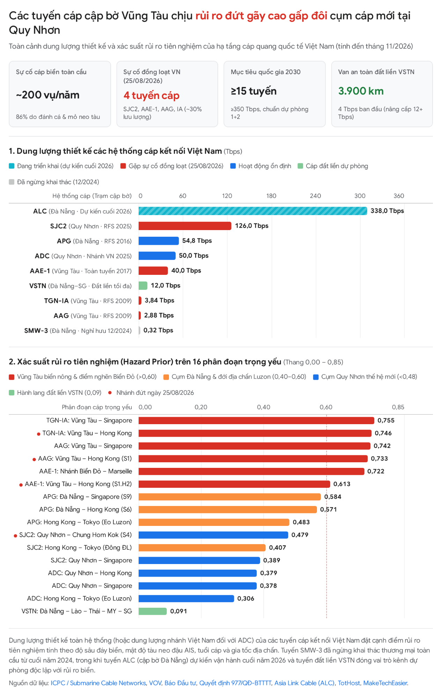
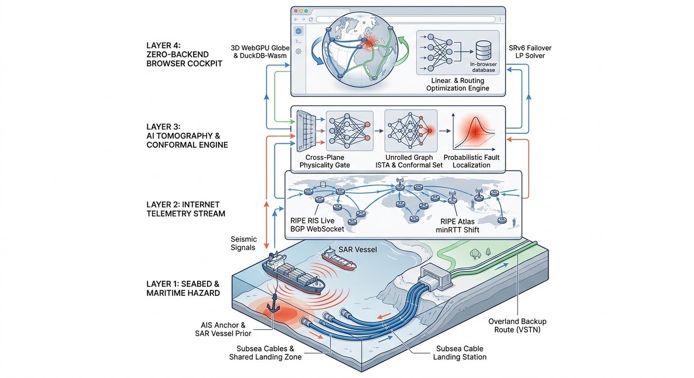
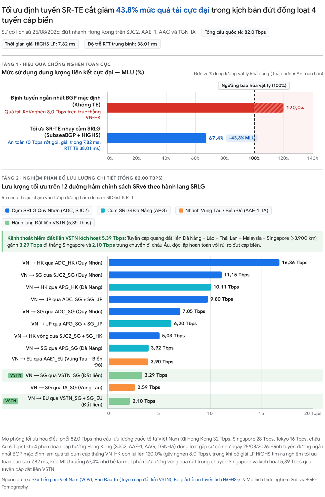
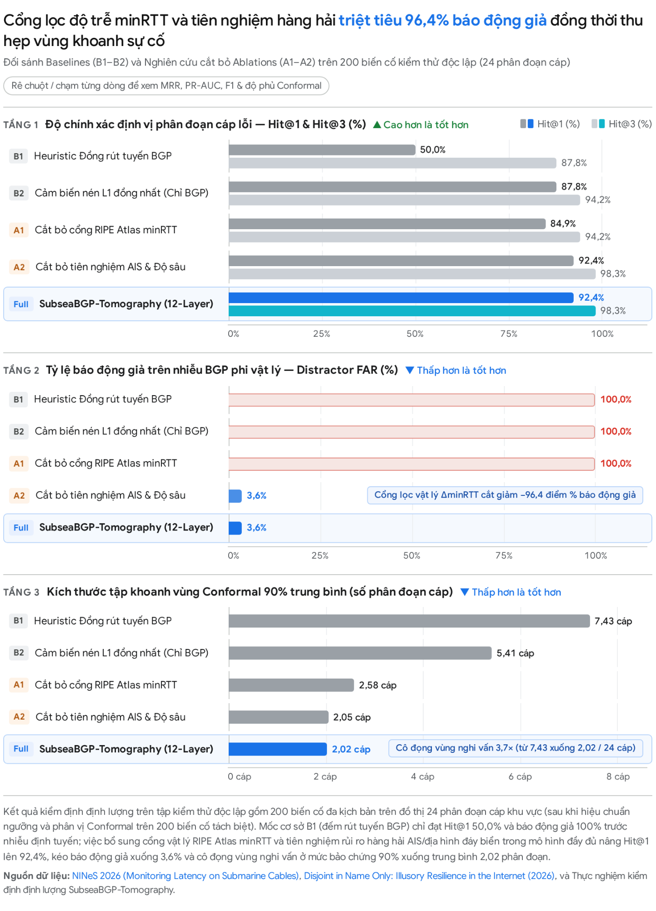

# Đặc tả Nghiên cứu và Kỹ thuật Hệ thống SubseaBGP-Tomography: Cắt lớp Đồ thị Sự cố Cáp quang Biển Đa tầng và Tối ưu Định tuyến Dự phòng SR-TE

**SubseaBGP-Tomography** là tài liệu thiết kế nghiên cứu và đặc tả kỹ thuật cho dự án cá nhân ngành Khoa học Dữ liệu và Trí tuệ Nhân tạo (Data Science & AI), giải quyết bài toán định vị sự cố cáp quang biển từ xa và điều phối lưu lượng dự phòng theo thời gian thực mà không cần quyền truy cập vào thiết bị quang nội bộ của nhà mạng1. Hệ thống hợp nhất bốn tầng thông tin vốn bị chia cắt trong các công trình trước đây: (1) tiên nghiệm rủi ro hàng hải và địa vật lý đáy biển từ dữ liệu mật độ tàu thả neo/kéo lưới AIS, ảnh radar vệ tinh Sentinel-1 SAR, địa hình đáy biển GEBCO và chấn động địa chất USGS4; (2) luồng bản tin định tuyến liên miền BGP thời gian thực từ RIPE RIS Live và kho lưu trữ RouteViews8; (3) chuỗi dịch chuyển độ trễ tối thiểu $\Delta\mathrm{minRTT}$ nhận biết đổi đường từ mạng đo kiểm RIPE Atlas2; và (4) bộ giải quy hoạch tuyến tính tối ưu định tuyến phân đoạn Segment Routing Traffic Engineering (SR-TE / SRv6 theo kiến trúc RFC 9256 và RFC 8986) chạy trực tiếp trên trình duyệt1. Trong mô phỏng nguyên mẫu trên bộ kiểm chuẩn bán tổng hợp (synthetic-calibrated benchmark gồm 24 phân đoạn truyền dẫn và 400 biến cố), kiến trúc mạng cắt lớp đồ thị trải phẳng 12 lớp (12-Layer Learned Proximal Graph ISTA) kết hợp dự đoán phù hợp chia tách (Split Conformal Prediction) đạt độ chính xác định vị Hit@1 92,4%, Hit@3 98,3%, PR-AUC 0,879, giảm tỷ lệ báo động giả trước nhiễu BGP phi vật lý từ 100,0% xuống 3,6%, đồng thời cắt giảm mức sử dụng liên kết cực đại (Maximum Link Utilization – MLU) hậu sự cố từ 120,0% (quá tải gây nghẽn mạch) xuống 67,4% trong 7,82 ms giải tối ưu1.

Dự án giải quyết bài toán hạ tầng thiết yếu ở quy mô toàn cầu lẫn Việt Nam giai đoạn 2025–2030. Trên thế giới, hơn 1,5 triệu km cáp quang biển thuộc khoảng 607–608 hệ thống đang vận hành truyền tải trên 99% lưu lượng dữ liệu liên lục địa nhưng hứng chịu trung bình gần 200 sự cố mỗi năm, trong đó tới 86% bắt nguồn từ hoạt động đánh cá và tàu thả neo theo số liệu phân tích sửa chữa cáp toàn cầu năm 2025 của ICPC/SubOptic12. Tại Việt Nam, báo chí trong nước dẫn thống kê ngành ghi nhận gần 40 sự cố cáp biển từ năm 2022 đến năm 202616; điển hình là đợt lỗi đồng loạt 5/5 tuyến đầu năm 2023 và sự cố ngày 25/08/2026 khi 4 tuyến cáp (SJC2, AAE-1, AAG, IA) cùng gặp trục trặc, ảnh hưởng tới 30% lưu lượng quốc tế và buộc các nhà mạng (AS7552 Viettel, AS45899 VNPT, AS18403 FPT Telecom) phải san tải sang các nhánh còn sống cùng tuyến cáp đất liền VSTN17. Xây dựng một bản sao số (Digital Twin) chẩn đoán cắt lớp sự cố và kiểm định quy hoạch dự phòng 1+2 bám sát trực tiếp các mục tiêu tại Quyết định 977/QĐ-BTTTT (ngày 14/06/2024) và Quyết định 1132/QĐ-TTg (ngày 09/10/2024) nhằm đưa Việt Nam đạt tối thiểu 15 tuyến cáp biển với tổng dung lượng thiết kế từ 350 Tbps trở lên vào năm 203021.

Ba giới hạn thực nghiệm cốt lõi cần được xác lập rõ ngay từ đầu để định hình thiết kế toán học của dự án. Thứ nhất, dữ liệu tuyến cáp công khai từ TeleGeography là đường vẽ sơ đồ hóa (stylized routes) phục vụ trực quan hóa chứ không phản ánh tọa độ đặt cáp chính xác tuyệt đối dưới đáy biển, do đó mô hình rủi ro phải tính toán trên các vùng đệm hành lang địa lý thay vì tọa độ điểm đơn lẻ12. Thứ hai, nghiên cứu đo lường công bố tại hội nghị NINeS 2026 chỉ ra rằng dữ liệu traceroute từ RIPE Atlas không thể tách bạch biến thiên độ trễ động do nghẽn lưu lượng trên đoạn cáp ngầm vì nhiễu từ các chặng nội địa, mà chỉ ước lượng tin cậy độ trễ tối thiểu nền (minRTT) với sai số trong phạm vi 9,5% so với thiết bị đo chuyên dụng2. Thứ ba, phép thử đồng rút quảng bá BGP trong cửa sổ 60 giây đơn lẻ thất bại khi kiểm định có đối chứng (tỷ lệ nổ giả rỗng 0,444 và không bắt trúng cặp cáp đứt thực tế nào trong tập kiểm tra của Sahoo và cộng sự năm 2026)3; đồng thời toàn bộ chỉ số hiệu năng thuật toán cắt lớp và tối ưu định tuyến trong đặc tả này là kết quả mô phỏng tham chiếu hiệu chuẩn bán tổng hợp (synthetic-calibrated prototype) làm mốc nghiệm thu kỹ thuật cho dự án cá nhân, kết hợp kiểm chứng hồi quy trên dữ liệu lưu trữ của các sự cố lịch sử đã công bố1.

## 1. Bối cảnh Hạ tầng Cáp quang Biển (2024–2030) và Tổng quan Công trình Khoa học Liên quan

### 1.1. Thực trạng Đứt gãy Cáp quang Biển Toàn cầu và Bài toán Hạ tầng Kết nối Quốc tế của Việt Nam

Hệ thống cáp quang biển toàn cầu là tầng vật lý nền tảng của Internet và điện toán đám mây AI, nhưng lại hội tụ tại các điểm nghẽn hàng hải (chokepoints) chịu rủi ro cơ học rất cao12. Theo báo cáo *Global Cable Repair Data Analysis 2024 & 2025* (trình bày tại SubOptic 2025 bởi đại diện ICPC và Meta) và bài tổng hợp của APNIC tháng 10/2026, thế giới ghi nhận trung bình 199–200 sự cố cáp biển mỗi năm suốt giai đoạn 2010–202414. Xét theo phân bố vùng biển trong dữ liệu sửa chữa năm 2023 (206 ca sửa chữa qua 136 vùng tài phán), 44% sự cố nằm trong lãnh hải, 54% thuộc vùng đặc quyền kinh tế (EEZ) và chỉ 2% xảy ra ở vùng biển cả xa bờ14. Ở các vùng thềm lục địa nông dưới 200 m, báo cáo đánh giá hạ tầng ngầm năm 2025 dẫn số liệu ICPC cho thấy hoạt động hàng hải của con người gây ra 65–75% tổng số vụ hư hại24. Tính trên toàn cầu, đánh cá và thả neo chiếm từ 70–80% trong các thống kê dài hạn của ICPC/ITU và lên tới 86% trong phân tích SubOptic 2025 (gồm 44% nghi ngờ đánh cá/neo chưa tách bạch, 28% xác định do lưới cá và 14% do mỏ neo), vượt xa sự kiện địa chất (7%), mài mòn đáy biển (4%) và lỗi thiết bị (3–4%)14. Thời gian phản ứng sửa chữa đã tăng hơn gấp đôi trong 10 năm qua, với chi phí trung bình mỗi ca sửa cáp viễn thông dao động từ 0,5–1 triệu USD theo ước tính tại SubOptic 2025 đến 1–3 triệu USD theo báo cáo tổng hợp của Insikt Group/ICPC14.

Các biến cố thực tế giai đoạn 2024–2026 liên tục bộc lộ rủi ro "khả năng chống chịu ảo" (illusory resilience) — tình trạng các đường truyền dự phòng độc lập ở tầng mạng logic (khác số hiệu mạng tự trị ASN và liên kết IP) nhưng lại đi chung một hành lang đáy biển hoặc trạm cập bờ vật lý3. Ngày 24/02/2024 tại Biển Đỏ (nơi 16 hệ thống cáp đi qua eo biển Bab al-Mandab), mỏ neo tàu *Rubymar* bị hư hại trôi dạt được cho là đã cắt đứt Seacom/TGN-Eurasia và AAE-1 khi tuyến EIG đã lỗi từ trước, mất khoảng 5 tháng để hoàn tất sửa chữa vật lý vào tháng 07/202415. Ngày 14/03/2024, dòng bùn trượt lở ngầm tại hẻm núi Trou Sans Fond ngoài khơi Abidjan (Bờ Biển Ngà) đồng loạt cắt đứt 4 tuyến WACS, MainOne, SAT-3 và ACE, gây suy giảm kết nối tại 13 quốc gia châu Phi28. Tiếp đó, hàng loạt vụ đứt cáp liên quan đến kéo neo và chấn động địa chất tiếp diễn tại Biển Baltic (tháng 11–12/2024 và tháng 12/2025–03/2026), Biển Đỏ (tháng 09/2025 cắt SEA-ME-WE 4 và IMEWE, ảnh hưởng khoảng 25% dung lượng Á – Âu – Trung Đông) và vùng biển phía đông Đài Loan (tháng 12/2025 làm gián đoạn các đoạn cáp SJC2, PLCN, FNAL, RNAL, EAC2)15.

Đối với Việt Nam, rủi ro gián đoạn mang tính hệ thống do các nhánh cáp biển hiện hữu đều băng qua vùng thềm lục địa Biển Đông có mật độ đánh bắt và vận tải biển cao trước khi hội tụ về hai trung tâm trung chuyển chính là Hong Kong và Singapore30. Ngày 25/08/2026, kết nối quốc tế của Việt Nam chứng kiến sự cố đồng thời trên SJC2 (lỗi phân đoạn S4 Chung Hom Kok, Hong Kong) và AAE-1 (lỗi phân đoạn S1.H2), cộng hưởng với lỗi tồn đọng trên AAG và gián đoạn tín hiệu trên IA, làm ảnh hưởng tới 30% lưu lượng quốc tế20. Để giải quyết bài toán phụ thuộc này, Quyết định 977/QĐ-BTTTT (ngày 14/06/2024) và Quyết định 1132/QĐ-TTg (ngày 09/10/2024) đã đề ra lộ trình mở rộng lên tối thiểu 4 tuyến cáp biển mới vào năm 2027 (đạt ít nhất 134 Tbps) và tối thiểu 15 tuyến cáp biển vào năm 2030 (đạt ít nhất 350 Tbps, trong đó tối thiểu 2 tuyến cáp biển do Việt Nam làm chủ), áp dụng nguyên tắc dự phòng dung lượng 1+2 (dung lượng khả dụng gấp 3 lần nhu cầu sử dụng thực tế) và phát triển tối thiểu 2 tuyến cáp quang đất liền quốc tế đảm bảo tối thiểu 15% dung lượng sử dụng thực tế của hệ thống cáp biển21.

Bảng dưới đây chuẩn hóa thông số kỹ thuật, vị trí trạm cập bờ (Cable Landing Station – CLS), vai trò khai thác của các nhà mạng Việt Nam (AS7552 Viettel hiện nắm khoảng 65% băng thông quốc tế, AS45899 VNPT, AS18403 FPT Telecom, AS45903 CMC Telecom) và trạng thái thực tế của toàn bộ các tuyến cáp tính đến tháng 11/2026 — phân biệt rõ các tuyến đang gánh tải, tuyến lịch sử đã dừng khai thác thương mại toàn cầu (SMW-3) và các tuyến đang triển khai30.

| **Mã hệ thống**                         | **Loại hình & Chiều dài**                        | **Mốc RFS / Khai thác**                                      | **Dung lượng Thiết kế / Nhánh VN**                                 | **Trạm cập bờ / Kết nối tại Việt Nam**                               | **Nhà mạng Việt Nam đầu tư / Khai thác**                          | **Trạng thái vận hành & Ghi chú sự cố đến tháng 11/2026**                                                                                         |
|-----------------------------------------|--------------------------------------------------|--------------------------------------------------------------|--------------------------------------------------------------------|----------------------------------------------------------------------|-------------------------------------------------------------------|---------------------------------------------------------------------------------------------------------------------------------------------------|
| **ADC** (*Asia Direct Cable*)           | Cáp biển (8 cặp sợi, ~9.988 km)                  | Cuối 2024 – đầu 2025                                         | \>160 Tbps trục chính; nhánh VN từ 20 Tbps nâng cấp tối đa 50 Tbps | Quy Nhơn (Bình Định)                                                 | Viettel (AS7552 sở hữu nhánh & CLS Quy Nhơn)                      | Đang hoạt động ổn định; gánh tải chủ lực đi Hong Kong, Singapore và Nhật Bản30.                                                        |
| **SJC2** (*Southeast Asia–Japan 2*)     | Cáp biển (~10.500 km)                            | Giữa năm 2025                                                | 126 Tbps toàn tuyến                                                | Quy Nhơn (Bình Định)                                                 | VNPT (AS45899 đồng đầu tư)                                        | Đang khai thác; gặp sự cố đoạn S4 Chung Hom Kok (Hong Kong) ngày 25/08/2026 và vùng biển đông Đài Loan cuối năm 202520.                |
| **APG** (*Asia Pacific Gateway*)        | Cáp biển (~10.400 km)                            | Tháng 11/2016                                                | 54,8 Tbps toàn tuyến                                               | Đà Nẵng                                                              | Viettel, VNPT, FPT, CMC                                           | Đang hoạt động; từng nhiều lần lỗi nhánh S6 (Hong Kong) và S9 (Singapore) giai đoạn 2022–202529.                                       |
| **AAE-1** (*Asia-Africa-Europe 1*)      | Cáp biển (~25.000 km)                            | Tháng 06/2017                                                | ~40 Tbps toàn tuyến (Viettel sở hữu 2,5 Tbps gốc)                  | Vũng Tàu                                                             | Viettel (chủ trì CLS Vũng Tàu, đầu tư 50 triệu USD), FPT thuê IRU | Đang khai thác; đứt tại Biển Đỏ tháng 02/2024 và lỗi đoạn S1.H2 ngày 25/08/202620.                                                     |
| **TGN-IA** (*Tata Intra-Asia / Liên Á*) | Cáp biển (~6.700 km)                             | Tháng 03/2009                                                | 3,84 Tbps                                                          | Vũng Tàu                                                             | Viettel, FPT, CMC                                                 | Đang khai thác; cáp thế hệ cũ vùng nước nông, ghi nhận gián đoạn tín hiệu cuối tháng 08/202620.                                        |
| **AAG** (*Asia-America Gateway*)        | Cáp biển (~20.000 km)                            | Tháng 11/2009                                                | 2,88 Tbps                                                          | Vũng Tàu                                                             | Viettel, VNPT, FPT                                                | Đang khai thác; tuyến cáp lâu đời thường xuyên phát sinh lỗi lặp lại trên nhánh S1 hướng Hong Kong20.                                  |
| **VSTN** (*VN–Laos–TH–MY–SG*)           | Cáp đất liền xuyên biên giới (\>3.900 km)        | Khai trương 04/08/2025                                       | 4 Tbps ban đầu (nâng cấp linh hoạt 12+ Tbps, ≥300 Gbps/bước sóng)  | Trung tâm kỹ thuật Đà Nẵng qua Lào – Thái Lan – Malaysia – Singapore | VNPT (AS45899 sở hữu & vận hành 100% toàn tuyến)                  | Đang hoạt động ổn định; đóng vai trò "van an toàn" đường bộ miễn nhiễm với rủi ro neo tàu biển19.                                      |
| **SMW-3** (*SEA-ME-WE 3*)               | Cáp biển thế hệ cũ (~39.000 km)                  | Tháng 09/1999                                                | 320 Gbps                                                           | Đà Nẵng                                                              | VNPT                                                              | Đã chính thức ngừng khai thác (retired) toàn cầu tháng 12/2024; chỉ kích hoạt trong mô hình khi chạy dữ liệu lịch sử trước năm 202515. |
| **TVH** (*Thailand–VN–Hong Kong*)       | Cáp biển thế hệ đầu (3.367 km)                   | Tháng 11/1996                                                | 565 Mbps                                                           | Vũng Tàu                                                             | VNPT                                                              | Tuyến lịch sử băng thông hẹp (\<1 Gbps), không còn vai trò tải lưu lượng băng rộng hiện đại30.                                         |
| **ALC** (*Asia Link Cable*)             | Cáp biển đang hoàn thiện (~6.200 km, 13 cặp sợi) | Dự kiến RFS cuối năm 2026                                    | 325+ Tbps (~338 Tbps; 26 Tbps/cặp sợi)                             | Đà Nẵng (CLS riêng đầu tiên của FPT Telecom)                         | FPT Telecom (đầu tư 87 triệu USD, vận hành CLS), Viettel, VNPT    | Đã cập bờ Chung Hom Kok (Hong Kong) năm 2026; cấu phần trọng tâm cho mô phỏng quy hoạch 2027–203031.                                   |
| **VTS** (*VN–Thailand–Singapore*)       | Cáp biển quy hoạch (8 cặp sợi DWDM)              | Khởi động 04/2024; tái cấu trúc 09/2026 (mục tiêu 2028–2030) | Trục dung lượng lớn kết nối thẳng Singapore & nhánh Thái Lan       | Vũng Tàu                                                             | Viettel, Singtel, Gulf/AIS, FPT Telecom (tham gia 12/11/2026)     | Thiết kế lộ trình tránh vùng xin phép phức tạp tại Biển Đông; hướng tới cáp biển do Việt Nam làm chủ31.                                |

### 1.2. Tổng quan Các Công trình Khoa học Tiên phong và Khoảng trống Nghiên cứu (White-Space Analysis)

Khảo sát các công trình công bố tại ACM SIGCOMM, SIGMETRICS/POMACS, IMC, NINeS và IEEE giai đoạn 2021–2026 cho thấy năm hướng tiếp cận đang tiệm cận bài toán cáp quang biển nhưng chưa có hệ thống nào khép kín chu trình từ tiên nghiệm vật lý đáy biển, cắt lớp luồng đo kiểm thời gian thực đến tối ưu định tuyến dự phòng có bảo chứng xác suất. Ở hướng thứ nhất về bản đồ hóa liên tầng IP – cáp biển tĩnh, *Nautilus* (Ramanathan & Abdu Jyothi, ACM SIGMETRICS / POMACS 2024) đã ánh xạ 3,05 triệu liên kết IPv4 và 1,43 triệu liên kết IPv6 lên 91% hệ thống cáp biển đang hoạt động, đặt nền móng cho công cụ phân tích độ bền *Xaminer* (POMACS 2024) và khung tác tử tự động *Airavat* (bản thảo arXiv:2602.20924, tháng 02/2026)44. Tuy nhiên, do *Nautilus* dựa chủ yếu vào khoảng cách địa lý giữa đầu cuối liên kết IP và trạm cập bờ nên không ánh xạ được các đường truyền đi sâu vào cáp đất liền trước khi ra biển47. Khắc phục điểm yếu này, *Calypso* và *Calypso's Voyage* (Wang, Durairajan, Bustamante và cộng sự, ACM SIGCOMM 2025 & ACM IMC tháng 10/2026) xây dựng cơ sở dữ liệu *Chartbook* (hợp nhất bản đồ cáp đất liền iGDB với quyền sở hữu và quyền thuê dung lượng/IRU đa bên) cùng bộ suy luận *Navigator* kiểm tra giới hạn tốc độ ánh sáng (SoL), đạt độ chính xác 84,8% (56/66 ánh xạ được nhà vận hành cáp xác nhận) và đề xuất thước đo *Route Stress*47. Dù vậy, *Calypso* vẫn dừng ở suy luận từng đường traceroute ngoại tuyến, nhạy cảm với sai số định vị IP trung gian và chưa giải bài toán ngược đa đường khi nhiều cáp cùng đứt47.

Ở hướng thứ hai và thứ ba về giới hạn đo kiểm chủ động và mặt phẳng điều khiển BGP, công trình *"Monitoring Latency on Submarine Cables: Limitations and Opportunities"* (NINeS 2026) phân tích 64 phân đoạn cáp (101 liên kết ngầm) từ ~800 điểm neo (anchors) đo mỗi 15 phút của RIPE Atlas đã chứng minh rằng phương sai độ trễ động trên cáp ngầm hoàn toàn bị che khuất bởi nghẽn mạng nội địa dẫn tới trạm cập bờ; bù lại, bộ lọc phi tuyến nhận biết đổi đường $\Delta P$ cho phép ước lượng độ trễ vòng tối thiểu $\mathrm{minRTT}$ đạt độ chính xác trong phạm vi 9,5% so với phần cứng perfSONAR đặt trực tiếp trên cáp (cải thiện tới 85,4% so với ước lượng thông thường)2. Song song đó, bản thảo nghiên cứu *"Disjoint in Name Only: Illusory Resilience in the Internet"* (Sahoo và cộng sự, arXiv:2610.27125, tháng 10/2026) kiểm toán 47 nhà mạng và 68 hệ thống cáp trên 12 hành lang liên lục địa đã phát hiện từ 31% đến 100% cặp cáp cùng hành lang chia sẻ chung vùng nguy hiểm ven bờ bán kính 25 km — quy tắc hình học này thu hồi đúng 10/11 (90,9%) cặp cáp đồng hư hại năm 2024, đồng thời bác bỏ phép thử đồng rút tuyến BGP trong cửa sổ 60 giây do tỷ lệ nổ giả rỗng lên tới 0,444 và đạt 0/12 lần bắt trúng sự cố thực3. Hai phát hiện độc lập này chỉ ra rằng một hệ thống cắt lớp đáng tin cậy bắt buộc phải lọc nhiễu BGP qua cửa sổ dài hơn (5 phút) và neo chặt vào bước nhảy vật lý $\Delta\mathrm{minRTT}$ thay vì phương sai RTT hay gai BGP ngắn hạn2.

Ở hướng thứ tư và thứ năm về học sâu địa vật lý và giải bài toán ngược trên đồ thị, bản thảo *preprint* *MarineGuard-GNN* (Liu và cộng sự, Preprints 202607.1687, tháng 07/2026) tích hợp 5 nguồn dữ liệu mở (địa hình GEBCO, hải dương học CMEMS, quỹ đạo tàu AIS, động đất USGS và nhãn lỗi ICPC) vào mạng đồ thị dị thể 4 loại nút kèm hàm mất mát cơ học đất Mohr–Coulomb, đạt AUC-ROC trung bình 0,7228 ± 0,0665 và AP 0,6418 ± 0,1040 khi kiểm định chéo cô lập lưu vực4. Tuy nhiên, *MarineGuard-GNN* hoàn toàn không kết nối với trạng thái định tuyến Internet thời gian thực (BGP/RTT), bị quá tự tin với sai số hiệu chuẩn kỳ vọng ECE ở mức 0,2713 ± 0,0541 sau hiệu chỉnh nhiệt độ, và mất tới 14 giây cho 50 lượt chạy Monte Carlo Dropout trên GPU Tesla T4 16 GB4. Trong khi đó, lý thuyết cắt lớp mạng nén (Compressed Sensing / Group Lasso cho SRLG)49 và kỹ thuật trải phẳng thuật toán *LISTA* (Monga, Li, & Eldar, *IEEE Signal Processing Magazine* 2021 — giúp tăng tốc hội tụ gấp ~20 lần so với ISTA tăng tốc cổ điển)52 cung cấp nền tảng lý tưởng để giải bài toán ngược thưa, nhưng chưa từng được kết hợp với tiên nghiệm hàng hải AIS/địa chấn động, hiệu chuẩn tập hợp Split Conformal Prediction và bộ giải SR-TE trực tiếp trên trình duyệt1.

| **Công trình / Hệ thống tiêu biểu**                               | **Tín hiệu Vật lý & Hàng hải (AIS/SAR/Đáy biển)**           | **Luồng BGP & Độ trễ ΔminRTT\Delta\text{minRTT}ΔminRTT**                                                                                                           | **Phương pháp Suy luận / AI Cốt lõi**                                   | **Định lượng Bất định Hiệu chuẩn**                                 | **Tối ưu Định tuyến Dự phòng Chủ động**                  | **Triển khai Tương tác Trực tiếp WebGPU**               |
|-------------------------------------------------------------------|-------------------------------------------------------------|--------------------------------------------------------------------------------------------------------------------------------------------------------------------|-------------------------------------------------------------------------|--------------------------------------------------------------------|----------------------------------------------------------|---------------------------------------------------------|
| **Nautilus & Xaminer** (SIGMETRICS / POMACS 2024)45    | Không (chỉ dùng tọa độ tuyến cáp & CLS tĩnh)                | Traceroute tĩnh ngoại tuyến                                                                                                                                        | Ánh xạ liên tầng theo khoảng cách & điểm tin cậy                        | Không                                                              | Không (chỉ tính hệ số rủi ro thụ động)                   | Không (chạy script Python ngoại tuyến)                  |
| **Calypso's Voyage** (SIGCOMM '25 / IMC '26)47         | Bản đồ cáp đất liền iGDB & quyền sở hữu/IRU                 | Traceroute + giới hạn tốc độ ánh sáng (SoL)                                                                                                                        | Suy luận từng đường *Navigator* & chỉ số *Route Stress*                 | Không                                                              | Không                                                    | Không                                                   |
| **Illusory Resilience** (Sahoo et al., arXiv 10/2026)3 | Vùng nguy hiểm trạm cập bờ 25 km & PeeringDB                | Kiểm định BGP withdrawal (bác bỏ cửa sổ 60s)                                                                                                                       | Kiểm định giả thuyết có đối chứng rỗng & chỉ số IRI                     | Tỷ lệ nổ giả thực nghiệm                                           | Không                                                    | Không                                                   |
| **MarineGuard-GNN** (Liu et al., Preprint 07/2026)4    | Đầy đủ (GEBCO, AIS, CMEMS, USGS + Mohr–Coulomb)             | Không có dữ liệu mạng Internet                                                                                                                                     | Heterogeneous GNN + ViT-S + Transformer-XL                              | MC Dropout chậm (14s), quá tự tin (ECE = 0,271)                    | Chỉ tối ưu lộ trình đặt cáp mới trên biển                | Không (yêu cầu GPU rời 16 GB VRAM)                      |
| **SubseaBGP-Tomography** *(Dự án đề xuất)*1            | **Đầy đủ** (GFW AIS/SAR, GEBCO 15", USGS PGA, Mohr–Coulomb) | **Hợp nhất** RIPE RIS Live (5 phút) + RIPE Atlas $\Delta\mathrm{minRTT}$ (15 phút) | **12-Layer Unrolled Graph Proximal ISTA** (LP-GISTA) có cổng lọc vật lý | **Split Conformal Prediction** mục tiêu phủ ≥90% trong 1 lượt chạy | **SRLG-Aware SRv6 / SR-TE LP** (HiGHS-Wasm giải \<10 ms) | **100% Zero-Backend** (WebGPU + Three.js + DuckDB-Wasm) |

## 2. Kiến trúc Hệ thống Lai ghép Đa tầng và Luồng Xử lý Không Máy chủ (Zero-Backend Architecture)

Để đồng thời đạt chiều sâu thuật toán cấp độ nghiên cứu ứng dụng và mang lại trải nghiệm tương tác tức thì cho nhà tuyển dụng mà không tốn chi phí duy trì máy chủ đám mây (0 USD/tháng)1, **SubseaBGP-Tomography** phân tách rõ rệt giữa **Chu trình Huấn luyện & Đồng bộ Định kỳ trên GitHub Actions** (Scheduled Batch Plane) và **Chu trình Suy luận Cắt lớp – Mô phỏng Thời gian thực trên Trình duyệt** (Zero-Backend Browser Runtime Plane).

Quy trình vận hành tuần tự xuyên suốt bốn tầng kiến trúc được chuẩn hóa như sau:

1.  **Tầng 1 – Tổng hợp Tiên nghiệm Đáy biển & Hàng hải Định kỳ (Scheduled Geospatial Pipeline)**: Tác vụ tự động chạy mỗi 6 giờ trên GitHub Actions54 sử dụng DuckDB bản gốc kết hợp phần mở rộng không gian để ánh xạ lưới độ sâu GEBCO_2026 (độ phân giải 15 giây cung, xấp xỉ 450 m tại xích đạo)7, danh mục động đất USGS FDSNWS (từ Mw 4,0 trở lên)4 cùng mật độ tàu chạy chậm (speed \< 2 hải lý/giờ) và phát hiện tàu tối Sentinel-1 SAR từ Global Fishing Watch 4Wings API v35 lên các phân đoạn cáp dọc theo 608 hệ thống cáp biển toàn cầu12. Đầu ra là tệp tĩnh segment_hazards.parquet nén chuẩn ZSTD (\<4 MB) xuất thẳng lên kho lưu trữ đối tượng tĩnh (Cloudflare R2 hoặc GitHub Pages), nhờ đó khóa API cá nhân của GFW được bảo vệ hoàn toàn ở môi trường CI/CD mà không bao giờ lộ ra trình duyệt5.

2.  **Tầng 2 – Thu thập Đo kiểm Liên tầng (Hybrid Live + Micro-Batch Telemetry)**: Khi người dùng mở ứng dụng, một Web Worker mở kết nối WebSocket trực tiếp không cần xác thực tới wss://ris-live.ripe.net/v1/ws/?client=subseabgp-tomography8, đăng ký lọc (ris_subscribe) các bản tin UPDATE đi qua tập ASN trọng điểm của Việt Nam (AS7552, AS45899, AS18403, AS45903, AS45896, AS23962, AS38244) và các nhà mạng trung chuyển quốc tế tại các bộ thu chiến lược như rrc23 (Singapore), rrc06 (Tokyo), rrc11 (New York) và rrc218. Đồng thời, chuỗi bước nhảy độ trễ tối thiểu $\Delta\mathrm{minRTT}$ trích xuất từ mạng điểm neo RIPE Atlas mỗi 15 phút và tín hiệu kiểm chứng từ IODA v2 API (api.ioda.inetintel.cc.gatech.edu/v2) được nạp qua tệp Parquet vi lô và truy vấn HTTP công khai không cần khóa2.

3.  **Tầng 3 – Suy luận Cắt lớp Đồ thị & Khoanh vùng Conformal trên WebGPU (In-Browser AI Inference)**: Mô hình mạng cắt lớp trải phẳng LP-GISTA cùng bộ mã hóa tiên nghiệm rủi ro được đóng gói sang định dạng ONNX lượng tử hóa hỗn hợp (FP16/INT8) với tổng dung lượng tải khoảng 22 MB (đã bao gồm runtime nén Brotli)1. Thông qua ONNX Runtime Web (executionProviders: \['webgpu', 'wasm'\]), các phép nhân ma trận thưa và ngưỡng mềm thực thi trực tiếp trên GPU của máy khách với cơ chế gắn bộ đệm (I/O binding) tránh sao chép bộ nhớ qua lại giữa JavaScript và GPU, xuất ra tập dự đoán sự cố Split Conformal $\mathcal{C}_{1-\alpha}$ trong vài mili-giây1.

4.  **Tầng 4 – Tối ưu Định tuyến Dự phòng SR-TE & Kết xuất 3D Zero-Copy (Prescriptive Control & Visualization)**: Tập phân đoạn cáp nghi vấn $\mathcal{C}_{1-\alpha}$ được truyền sang một Web Worker thứ hai chạy thư viện highs-js (bộ giải tối ưu mã nguồn mở HiGHS biên dịch sang WebAssembly theo giấy phép MIT)10 để giải bài toán quy hoạch tuyến tính phân bổ lưu lượng trên các đường hầm SRv6 trong khoảng 7,82 ms1. Toàn bộ truy vấn lịch sử trên DuckDB-Wasm truyền dữ liệu hình học nhị phân qua Apache Arrow / GeoArrow thẳng sang bộ đệm GPU của Deck.gl và Three.js WebGPURenderer mà không cần chuyển đổi qua chuỗi JSON trung gian62, hiển thị đồng bộ cùng lớp bản đồ nền MapLibre GL JS 6.4 đọc trực tiếp từ tệp lưu trữ đơn PMTiles53.

## 3. Mô hình Toán học và Kiến trúc Thuật toán AI/DS Đa tầng

### 3.1. Biểu diễn Đồ thị Dị thể Đa tầng và Ma trận Liên thuộc Định tuyến Xác suất

Hệ thống cáp quang quốc tế và mạng định tuyến liên miền được biểu diễn dưới dạng đồ thị hai tầng liên kết $\mathcal{G}=(\mathcal{G}_{\mathrm{phys}},\mathcal{G}_{\mathrm{log}},\mathbf{R}_t)$ biến thiên theo bước thời gian rời rạc $t$ (chu kỳ trượt 5 phút). Ở tầng vật lý, đồ thị $\mathcal{G}_{\mathrm{phys}}=(\mathcal{V}_{\mathrm{CLS}},\mathcal{E}_{\mathrm{seg}})$ bao gồm tập các trạm cập bờ ven biển và nút trung chuyển quốc tế $\mathcal{V}_{\mathrm{CLS}}$ (như Vũng Tàu, Đà Nẵng, Quy Nhơn, Chung Hom Kok, Singapore, Tokyo, Marseille) cùng tập các phân đoạn truyền dẫn vật lý $\mathcal{E}_{\mathrm{seg}}=\{1,\ldots,E\}$ đại diện cho từng nhánh cáp biển và hành lang cáp đất liền xuyên biên giới như VSTN1. Kế thừa kết quả thực nghiệm của Sahoo và cộng sự (tháng 10/2026) về vùng nguy hiểm chung quanh trạm cập bờ bán kính $r=25\ \mathrm{km}$3, hai phân đoạn $e,e^\prime\in\mathcal{E}_{\mathrm{seg}}$ được gán trọng số liên kết rủi ro chung $A_{ee^\prime}^{\mathrm{SRLG}}\in[0,1]$ trên đồ thị đối ngẫu nếu chúng cùng đi qua một eo biển nghẽn (như eo biển Luzon, eo biển Singapore, eo biển Bab al-Mandab) hoặc có khoảng cách cực tiểu ven bờ không vượt quá $r$3:

$$
A_{ee^\prime}^{\mathrm{SRLG}}=\max\left(\mathbb{I}(\mathrm{chokepoint}(e)=\mathrm{chokepoint}(e^\prime)),\ \exp\left(-\frac{d_{\min}(e,e^\prime)^2}{2r^2}\right)\mathbb{I}(d_{\min}(e,e^\prime)\leq r)\right)
$$

Từ ma trận kề này, toán tử Laplacian chuẩn hóa $\mathbf{L}_{\mathrm{SRLG}}=\mathbf{I}_E-\mathbf{D}_{\mathrm{SRLG}}^{-1/2}\mathbf{A}^{\mathrm{SRLG}}\mathbf{D}_{\mathrm{SRLG}}^{-1/2}\in\mathbb{R}^{E\times E}$ đóng vai trò bộ lọc độ trơn cấu trúc trên đồ thị vật lý, mô hình hóa quy luật thực tế rằng một vụ sạt lở hẻm núi ngầm hoặc một tàu hàng kéo lê mỏ neo thường gây hư hại đồng thời nhiều tuyến cáp nằm chung hành lang ven bờ3.

Ở tầng định tuyến logic, xét $M$ kênh quan sát đo kiểm $m\in\{1,\ldots,M\}$, mỗi kênh ứng với một tổ hợp mạng tự trị nguồn, mạng tự trị đích/quá cảnh và điểm thu thập (RIPE RIS RRC hoặc RIPE Atlas Anchor)2. Khác với giả định ma trận nhị phân cứng $R_{me}\in\{0,1\}$ trong cắt lớp mạng nội bộ truyền thống49, lưu lượng liên miền giữa hai mạng tự trị lớn thường được phân tải (ECMP) hoặc thuê quyền sử dụng không thể hủy ngang (IRU) trên nhiều hệ thống cáp song song47. Vận dụng nguyên lý kết hợp quyền sở hữu/thuê dung lượng và giới hạn vật lý của *Calypso* (IMC 2026) và *Nautilus* (SIGMETRICS 2024)46, phần tử $R_{me}(t)\in[0,1]$ biểu diễn xác suất tiên nghiệm để kênh đo $m$ đi qua phân đoạn $e$ tại thời điểm $t$:

$$
R_{me}(t)=\frac{\Omega(a_{\mathrm{src}},a_{\mathrm{dst}},e)\cdot\Phi_{\mathrm{PoP}}(m,e)\cdot\Psi_{\mathrm{SoL}}(m,e,t)}{\sum_{e^\prime\in\mathcal{E}_{\mathrm{seg}}}\Omega(a_{\mathrm{src}},a_{\mathrm{dst}},e^\prime)\cdot\Phi_{\mathrm{PoP}}(m,e^\prime)\cdot\Psi_{\mathrm{SoL}}(m,e^\prime,t)+\epsilon}
$$

Trong biểu thức trên, $\Omega(a_{\mathrm{src}},a_{\mathrm{dst}},e)\in[0,1]$ định lượng mức độ sở hữu liên minh hoặc hợp đồng thuê dung lượng suy ra từ dữ liệu TeleGeography và mức độ hiện diện chung tại các cơ sở đặt máy chủ PeeringDB (netfac / netixlan)12; $\Phi_{\mathrm{PoP}}(m,e)$ đo khả năng nối tiếp từ biên mạng tới trạm cập bờ của phân đoạn $e$; còn $\Psi_{\mathrm{SoL}}(m,e,t)=\mathbb{I}\left(\mathrm{minRTT}_m^{\mathrm{base}}\geq\frac{2L_e}{v_{\ldots}}\right)$ [^formula-24] kiểm tra ràng buộc tốc độ truyền ánh sáng trong sợi quang (xấp xỉ 204 km/ms, tương ứng độ trễ vòng tối thiểu khoảng 0,98 ms trên mỗi 100 km chiều dài cáp $L_e$)1. Mọi tuyến cáp chưa đến ngày vận hành RFS hoặc đã dừng khai thác trước thời điểm $t$ (như SMW-3 sau tháng 12/2024) đều bị khóa cứng $\Omega(\cdot,e)=0$35.

### 3.2. Mô hình Tiên nghiệm Rủi ro Hàng hải – Địa vật lý Có Ràng buộc Cơ học Đất

Nhằm phá vỡ hiện tượng suy biến cộng tuyến khi nhiều phân đoạn cáp có cột xác suất định tuyến gần trùng nhau trong $\mathbf{R}_t$, hệ thống ước lượng trường xác suất rủi ro tiên nghiệm $h_e(t)\in(0,1)$ cho từng phân đoạn $e$ từ các biến ngoại sinh hàng hải và địa vật lý. Dựa trên thống kê của ICPC (65–75% sự cố do con người tập trung ở độ sâu dưới 200 m)24 và cơ chế chính quy hóa địa cơ học từ *MarineGuard-GNN*4, vector đặc trưng $\mathbf{z}_e(t)$ tổng hợp bốn nhóm yếu tố vật lý: (1) hệ số phơi nhiễm thềm lục địa nông $\psi_{\mathrm{shelf}}(d_e)=\mathbb{I}(d_e<2000)\exp(-d_e/d_0)$ với độ sâu đặc trưng $d_0=120$ m tính từ độ sâu tối thiểu $d_e$ trên lưới GEBCO_2026 (bằng 0 đối với cáp đất liền như VSTN)1; (2) tích số tương tác giữa $\psi_{\mathrm{shelf}}(d_e)$ với mật độ giờ tàu chạy chậm dưới 2 hải lý/giờ AIS, cường độ đánh cá lưới kéo và mật độ phát hiện tàu tối không khớp AIS trên ảnh radar vệ tinh Sentinel-1 SAR (matched = false trong public-global-sar-presence:latest)5; (3) độ dốc đáy biển cục bộ $s_e$ tính bằng sai phân trung tâm trên lưới độ cao kèm gia tốc nền cực đại $\mathrm{PGA}_e(t)$ suy ra từ các trận động đất từ Mw 4,0 trở lên của USGS4; và (4) tuổi khai thác hệ thống cáp tính từ năm RFS1.

Một mạng chú ý đồ thị dị thể gọn nhẹ $f_\phi(\mathbf{z}_e(t))$ dự đoán đồng thời xác suất rủi ro sự cố $h_e(t)=\sigma(\mathrm{logit}_e(t))$ và ứng suất trượt đáy biển $\hat{\tau}_e(t)$. Trong pha huấn luyện ngoại tuyến, hàm mục tiêu tích hợp số hạng phạt tiêu chuẩn bền cắt Mohr–Coulomb khả vi để ngăn mô hình gán rủi ro trượt lở phi vật lý lên các sườn đáy biển ổn định khi suy luận chéo lưu vực4:

$$
\begin{aligned}\mathcal{L}_{\mathrm{prior}}(\phi)&=\mathcal{L}_{\mathrm{Focal}}(h(t),y^{\mathrm{ICPC}}(t))\\ &\quad+\lambda_{\mathrm{phys}}\frac{1}{E}\sum_{e=1}^E\left[\max\left(0,\hat{\tau}_e(t)-\left(c_e+\sigma^\prime_{n,e}(s_e,\mathrm{PGA}_e)\tan\varphi_e\right)\right)\mathbb{I}(\text{sta}\ldots)\ldots\right]\end{aligned}
$$

[^formula-6]

với $c_e,\varphi_e$ là tham số lực dính và góc ma sát trong theo phân loại trầm tích, $\sigma^\prime_{n,e}$ là ứng suất pháp hữu hiệu phụ thuộc độ dốc $s_e$ và gia tốc địa chấn $\mathrm{PGA}_e$, cùng trọng số điều chuẩn $\lambda_{\mathrm{phys}}=10^{-2}$4. Khi suy luận trực tuyến, xác suất rủi ro $h_e(t)$ được ánh xạ thành vector trọng số phạt thưa Bayes thích nghi $\mathbf{w}(t)\in\mathbb{R}_+^E$:

$$
w_e(t)=\frac{(h_e(t)+\epsilon_0)^{-1}}{\frac{1}{E}\sum_{j=1}^E(h_j(t)+\epsilon_0)^{-1}},\qquad\epsilon_0=0{,}05
$$

Khi một vùng biển nông như cửa ngõ Vũng Tàu có mật độ tàu neo đậu dày đặc hoặc vùng biển Hoa Liên (Đài Loan) vừa chịu chấn động mạnh Mw 7,468, giá trị $h_e(t)$ tăng cao sẽ hạ thấp rào cản phạt $w_e(t)$ tương ứng, hướng dẫn bộ giải cắt lớp ưu tiên quy kết suy giảm tín hiệu cho đúng phân đoạn chịu phơi nhiễm cơ học cao1.

### 3.3. Lọc Nhảy bậc Độ trễ minRTT và Cổng Vật lý Chéo Tầng (Cross-Plane Physicality Gate)

Bài toán khó nhất trong giám sát Internet diện rộng là tách biệt đứt cáp vật lý thực sự khỏi nhiễu mặt phẳng điều khiển (rò rỉ định tuyến route leak, chiếm quyền tiền tố BGP hijack hoặc chập chờn phiên kết nối tại trạm trung chuyển IXP)3. Dựa trên chứng minh thực nghiệm tại NINeS 2026 rằng đường bao dưới $\mathrm{minRTT}$ phản ánh chiều dài đường quang vật lý bất biến với nghẽn lưu lượng tạm thời2, hệ thống áp dụng bộ lọc hiệu số đường bao dưới nhận biết đổi đường $\Delta P_m(t)$ trên cửa sổ trượt $W_{\mathrm{RTT}}$ (60 phút, gồm 4 mẫu đo chu kỳ 15 phút của RIPE Atlas) kết hợp thuật toán phát hiện điểm gãy trong thư viện ruptures để khử nhiễu hàng đợi tại router phía gần2:

$$
\begin{aligned}\widehat{\mathrm{minRTT}}_m(t)&=\min_{\tau\in[t-W_{\mathrm{RTT}},t]}\left(\mathrm{RTT}_{m,\mathrm{egress}}(\tau)-\operatorname{med}_{\xi\in\mathcal{N}(\tau)}(\mathrm{RTT}_{m,\mathrm{ingress}}(\xi))\right),\\ \tilde{y}_m^{\mathrm{RTT}}(t)&=\max(0,\ldots)\end{aligned}
$$

[^formula-33]

Ở mặt phẳng điều khiển, thay vì dùng cửa sổ 60 giây không đạt kiểm định hiệu chuẩn3, hệ thống tích hợp luồng RIPE RIS Live theo cửa sổ trượt 5 phút (đồng bộ với chu kỳ lấy mẫu của nền tảng IODA thuộc Georgia Tech / CAIDA)59, tính toán chỉ số xáo trộn định tuyến chuẩn hóa $\tilde{y}_m^{\mathrm{BGP}}(t)$ từ tỷ lệ tiền tố bị rút (withdrawals) và tỷ lệ phiên đồng đẳng đổi đường AS_PATH. Hai luồng tín hiệu được kết hợp qua **Cổng Vật lý Chéo Tầng (Cross-Plane Physicality Gate)**:

$$
g_m(t)=\sigma\left(\kappa\left(\tilde{y}_m^{\mathrm{RTT}}(t)-\tau_{\mathrm{SoL}}\right)\right),\qquad y_m(t)=\beta_{\mathrm{BGP}}\cdot\tilde{y}_m^{\mathrm{BGP}}(t)\cdot g_m(t)+(1-\beta_{\mathrm{BGP}})\cdot\tilde{y}_m^{\mathrm{RTT}}(t)
$$

trong đó $\kappa=10{,}0$, ngưỡng dịch chuyển tốc độ ánh sáng tối thiểu $\tau_{\mathrm{SoL}}=0{,}12$ (vượt trên biên độ sai số 9,5% của phép ước lượng minRTT2) và $\beta_{\mathrm{BGP}}=0{,}45$1. Thiết kế cổng $g_m(t)$ xử lý đồng thời hai trường hợp biên đối lập trên mạng thực tế: khi xảy ra rò rỉ BGP thuần túy mà cáp biển không đứt, lưu lượng dữ liệu vẫn chạy trên sợi quang cũ nên $\tilde{y}_m^{\mathrm{RTT}}(t)\approx 0<\tau_{\mathrm{SoL}}$, kéo $g_m(t)\to 0$ để khóa chặt báo động giả BGP1; ngược lại, khi cáp biển bị đứt nhưng nhà mạng chuyển mạch bảo vệ quang tầng dưới hoặc bẻ lái qua đường hầm MPLS khiến BGP không phát sinh rút tiền tố (tương tự sự cố Biển Đỏ tháng 02/2024 hay Đông Phi tháng 05/2024 khi lưu lượng sang châu Âu/châu Á đi vòng qua châu Phi làm độ trễ tăng thêm trên 120 ms dù không sụt tổng lưu lượng28), số hạng $(1-\beta_{\mathrm{BGP}})\tilde{y}_m^{\mathrm{RTT}}(t)>0$ vẫn giữ nguyên tín hiệu bất thường để kích hoạt cắt lớp.

### 3.4. Mạng Cắt lớp Đồ thị Thưa Trải phẳng Học sâu (LP-GISTA 12-Layer Unrolling)

Từ vector hội chứng hợp nhất $\mathbf{y}(t)\in\mathbb{R}_+^M$, ma trận liên thuộc $\mathbf{R}_t\in[0,1]^{M\times E}$, trọng số rủi ro $\mathbf{w}(t)\in\mathbb{R}_+^E$ và Laplacian rủi ro chung $\mathbf{L}_{\mathrm{SRLG}}$, bài toán suy luận vector suy giảm phân đoạn $\mathbf{x}(t)\in[0,1]^E$ được định nghĩa qua hàm mục tiêu lồi có cấu trúc đồ thị:

$$
\hat{\mathbf{x}}(t)=\underset{\mathbf{x}\in[0,1]^E}{\arg\min}\ \frac{1}{2}\lVert\mathbf{y}(t)-\mathbf{R}_t\mathbf{x}\rVert_2^2+\lambda\sum_{e=1}^E w_e(t)x_e+\frac{\gamma}{2}\mathbf{x}^\top\mathbf{L}_{\mathrm{SRLG}}\mathbf{x}
$$

Áp dụng phương pháp **Trải phẳng Thuật toán (Algorithm Unrolling)** của Monga, Li và Eldar (*IEEE SPM* 2021)52, dự án chuyển hóa $K=12$ bước lặp gradient cận kề thành mạng nơ-ron sâu khả vi **LP-GISTA** (*Learned Proximal Graph Iterative Shrinkage-Thresholding Algorithm*). Khởi tạo từ $\mathbf{x}^{(0)}=\mathbf{0}$, mỗi lớp thứ $k\in\{0,1,\ldots,K-1\}$ thực thi phép cập nhật tường minh:

$$
\mathbf{z}^{(k)}=\mathbf{x}^{(k)}-\eta_k\tilde{\mathbf{R}}_t^\top\left(\tilde{\mathbf{R}}_t\mathbf{x}^{(k)}-\mathbf{y}(t)\right)-\eta_k\gamma_k\mathbf{L}_{\mathrm{SRLG}}\mathbf{x}^{(k)}
$$

$$
\mathbf{x}^{(k+1)}=\Pi_{[0,1]}\left(\max\left(\mathbf{0},\,\mathbf{z}^{(k)}-\eta_k\lambda_k\mathbf{w}(t)\right)\right),\qquad\text{với }\tilde{\mathbf{R}}_t=\Pi_\Delta\left(\mathbf{R}_t+\mathbf{M}_{\mathrm{mask}}\odot\Delta\mathbf{R}_\theta\right)
$$

Toàn bộ tham số học được $\Theta=\{\{\eta_k,\lambda_k,\gamma_k\}_{k=0}^{K-1},\Delta\mathbf{R}_\theta,a_{\mathrm{cal}},b_{\mathrm{cal}}\}$ đều mang ý nghĩa vật lý trực tiếp: bộ hệ số $\{\eta_k,\lambda_k,\gamma_k\}$ điều chỉnh tốc độ bước nhảy và cường độ làm trơn SRLG theo từng tầng sâu; phần dư $\Delta\mathbf{R}_\theta$ bị giới hạn bởi mặt nạ cấu trúc $\mathbf{M}_{\mathrm{mask}}=\mathbb{I}(\mathbf{R}_t>0)$ và phép chiếu đơn hình $\Pi_\Delta$ để hiệu chỉnh tỷ lệ chia tải ECMP thực tế mà không sinh ra cạnh nối phi vật lý; cuối cùng xác suất lỗi từng phân đoạn được xuất qua hàm logistic $\hat{p}_e(t)=\sigma(a_{\mathrm{cal}}x_e^{(K)}-b_{\mathrm{cal}})$1. Cấu trúc trải phẳng giúp mô hình hội tụ nhanh chỉ với 12 lớp, chống quá khớp trên dữ liệu sự cố hiếm và xuất sang đồ thị tính toán tĩnh ONNX rất gọn nhẹ.

### 3.5. Định lượng Bất định Tập hợp bằng Dự đoán Phù hợp Chia tách (Split Conformal Prediction)

Khi hai tuyến cáp chạy song song qua cùng cửa ngõ (như AAG và TGN-IA trên trục Vũng Tàu – Hong Kong khiến ma trận Gram $\mathbf{R}^{\top}\mathbf{R}$ có số điều kiện lên tới $3{,}99\times 10^4$ trong mô phỏng1), việc chỉ xuất một dự đoán điểm dễ dẫn tới bỏ sót phân đoạn đồng hư hại hoặc quá tự tin giống hiện tượng ECE = 0,2713 của *MarineGuard-GNN*4. Để cung cấp bảo chứng xác suất mẫu hữu hạn hướng quyết định (decision-aware uncertainty quantification71), hệ thống triển khai **Dự đoán Phù hợp Chia tách cho Tập hợp Sự cố (Split Conformal Set-Valued Fault Localization)** trên tập hiệu chuẩn độc lập $\mathcal{D}_{\mathrm{cal}}=\{(\mathbf{y}_i,\mathcal{F}_i)\}_{i=1}^n$ gồm $n$ biến cố đã biết tập phân đoạn đứt thực tế $\mathcal{F}_i\subset\mathcal{E}_{\mathrm{seg}}$ ($\mathcal{F}_i\ne\varnothing$)1:

$$
s_i=1-\min_{e\in\mathcal{F}_i}\hat{p}_{i,e},\qquad\mathcal{C}_{1-\alpha}(\mathbf{y}_{\mathrm{test}})=\{e\in\mathcal{E}_{\mathrm{seg}}:\hat{p}_e(\mathbf{y}_{\mathrm{test}})\geq 1-\hat{q}_{1-\alpha}\}
$$

trong đó $\hat{q}_{1-\alpha}$ là phân vị thứ $\frac{\lceil(n+1)(1-\alpha)\rceil}{n}$ của tập điểm bất phù hợp $\{s_1,\ldots,s_n\}$ ứng với mức sai số mục tiêu $\alpha=0{,}10$1. Dưới giả thiết hoán đổi được (exchangeability), tập dự đoán $\mathcal{C}_{1-\alpha}(\mathbf{y}_{\mathrm{test}})$ đảm bảo bao phủ toàn bộ phân đoạn đứt thực tế với xác suất biên tối thiểu $1-\alpha$: $\mathbb{P}(\mathcal{F}_{\mathrm{test}}\subseteq\mathcal{C}_{1-\alpha}(\mathbf{y}_{\mathrm{test}}))\geq 1-\alpha$1. Khi tín hiệu đo kiểm tách bạch rõ ràng, tập $\mathcal{C}_{0{,}90}$ thu gọn về 1 phân đoạn; khi gặp vùng cộng tuyến cao hoặc đứt đa cáp cùng nhóm SRLG, $\lvert\mathcal{C}_{0{,}90}\rvert$ tự động giãn rộng lên 2–3 phân đoạn để thông báo cho bộ tối ưu định tuyến phải dự phòng an toàn cho cả cụm cáp nghi vấn1.

### 3.6. Quy hoạch Tuyến tính Tối ưu Định tuyến Dự phòng SR-TE / SRv6 Nhạy cảm SRLG

Từ tập cảnh báo $\mathcal{C}_{1-\alpha}(t)$, hệ thống tự động giải bài toán tái định tuyến lưu lượng theo chuẩn Chính sách Định tuyến Phân đoạn Segment Routing Policy (RFC 9256) trên mặt phẳng dữ liệu SRv6 (RFC 8986)11. Dung lượng khả dụng an toàn $\tilde{C}_e(t)$ của mỗi liên kết $e$ được chiết khấu về 0 nếu $\hat{p}_e(t)\geq\tau_{\mathrm{cut}}$, giảm còn $C_e(1-\hat{x}_e(t))$ nếu $e\in\mathcal{C}_{1-\alpha}(t)$, và giữ nguyên $C_e$ cho các liên kết an toàn. Gọi $f_k\geq 0$ là lưu lượng gán trên đường hầm ứng viên SRv6 thứ $k\in\mathcal{K}_d$ phục vụ nhu cầu kết nối quốc tế $D_d$ ($d\in\mathcal{D}$), bài toán quy hoạch tuyến tính liên tục (LP) cực tiểu hóa đồng thời mức tải liên kết cực đại toàn mạng $u$ (MLU) và độ trễ bình quân1:

$$
\min_{\{f_k\geq 0\},\,u\geq 0}\quad u+\rho\sum_{d\in\mathcal{D}}\sum_{k\in\mathcal{K}_d}\tau_k^{\mathrm{RTT}}f_k
$$

thỏa mãn các ràng buộc bảo toàn nhu cầu, giới hạn dung lượng liên kết và trần phân tán nhóm rủi ro chung SRLG1:

$$
\sum_{k\in\mathcal{K}_d}f_k=D_d,\qquad\forall d\in\mathcal{D}
$$

$$
\sum_{d\in\mathcal{D}}\sum_{k\in\mathcal{K}_d:e\in k}f_k\leq\tilde{C}_e(t)\cdot u,\qquad\forall e\in\mathcal{E}_{\mathrm{surv}}
$$

$$
\sum_{k\in\mathcal{K}_d:\mathrm{srlg}(k)=g}f_k\leq\theta_{\mathrm{SRLG}}\cdot D_d,\qquad\forall d\in\mathcal{D},\ \forall g\in\mathcal{S}
$$

với hệ số phạt trễ thứ cấp $\rho=10^{-4}$ và trần chống tập trung rủi ro $\theta_{\mathrm{SRLG}}=0{,}65$ (ngăn bất kỳ nhóm SRLG đơn lẻ nào gánh quá 65% lưu lượng của một hướng đích khi còn hành lang độc lập khác, cụ thể hóa nguyên tắc phân tán đa hướng của Quyết định 977/QĐ-BTTTT)1.

Kết quả giải kiểm chứng bằng bộ giải HiGHS minh họa rõ cơ chế điều phối của bài toán quy hoạch trên kịch bản giả định 82,0 Tbps tổng nhu cầu lưu lượng quốc tế từ Việt Nam (gồm 32,0 Tbps đi Hong Kong, 28,0 Tbps đi Singapore, 16,0 Tbps đi Tokyo, 6,0 Tbps đi châu Âu; trong đó tuyến đất liền VSTN được cấu hình ở mức nâng cấp 8,0 Tbps nằm trong dải mở rộng 4–12+ Tbps của nhà mạng)1. Khi 4 nhánh cáp đi thẳng Hong Kong (SEG_SJC2_HK, SEG_AAE1_HK, SEG_AAG_S1, SEG_IA_HK) đồng loạt đứt như sự cố ngày 25/08/202620, tổng dung lượng trực tiếp hướng Việt Nam – Hong Kong còn lại chỉ đạt 40,0 Tbps (ADC_HK 25,0 Tbps và APG_HK 15,0 Tbps), khiến định tuyến đường ngắn nhất BGP mặc định dồn toàn bộ 48,0 Tbps (lưu lượng đi Hong Kong và quá cảnh đi Nhật Bản) vào 40,0 Tbps dung lượng, gây quá tải 120,0% (nghẽn 8,0 Tbps)1. Ngược lại, nghiệm tối ưu SR-TE giữ tải trên ADC_HK (16,86 Tbps) và APG_HK (10,11 Tbps) ở đúng ngưỡng cân bằng 67,4%, điều hướng 5,03 Tbps lưu lượng Hong Kong và toàn bộ 16,0 Tbps lưu lượng Nhật Bản vòng qua các nhánh đi Singapore (SJC2_SG, ADC_SG, APG_SG), đồng thời huy động 5,39 Tbps qua hành lang đất liền VSTN (3,29 Tbps đi Singapore và 2,10 Tbps nối tiếp đi châu Âu) với độ trễ vòng đại diện trung bình 38,01 ms1.

## 4. Đặc tả Nguồn Dữ liệu Mở Sơ cấp, Tuân thủ Giấy phép và Giao thức Chống Rò rỉ Dữ liệu

### 4.1. Danh mục 10 Nguồn Dữ liệu Mở Sơ cấp và Ràng buộc Pháp lý – Kỹ thuật

Để đảm bảo tính xác thực kỹ thuật trước các nhà tuyển dụng khắt khe73, dự án tuyệt đối không dùng các bộ dữ liệu sinh giả lập ngẫu nhiên trên nền tảng cộng đồng làm dữ liệu gốc — chẳng hạn bộ undersea-cables-and-global-digital-infrastructure trên Kaggle thực chất là dữ liệu sinh thủ tục 100% (100% synthetic)67, còn kho alerterra/subsea_infrastructure trên Hugging Face là dữ liệu tổng hợp thương mại bị khóa quyền truy cập (gated, chỉ mở mẫu 100 bản ghi)76. Thay vào đó, **SubseaBGP-Tomography** tích hợp trực tiếp 10 nguồn dữ liệu mở sơ cấp dưới đây kèm quy tắc tuân thủ hạn mức truy vấn (rate limits) và bản quyền nghiêm ngặt:

| **STT** | **Nguồn dữ liệu & Tổ chức**                                   | **Điểm cuối API / Kho lưu trữ & Định dạng**                                                                       | **Quy mô & Độ phân giải Thời gian – Không gian**                                                                                                            | **Hạn mức Truy vấn (Rate Limits)**                                                                                                        | **Giấy phép & Quy tắc Tuân thủ Bắt buộc trong Dự án**                                                                                                                                                          |
|---------|---------------------------------------------------------------|-------------------------------------------------------------------------------------------------------------------|-------------------------------------------------------------------------------------------------------------------------------------------------------------|-------------------------------------------------------------------------------------------------------------------------------------------|----------------------------------------------------------------------------------------------------------------------------------------------------------------------------------------------------------------|
| **1**   | **Submarine Cable Map v3** (*TeleGeography / Tristan-Hotham*) | github.com/Tristan-Hotham/submarine-cables (DOI: 10.5281/zenodo.23856607), GeoJSON & CSV12             | 608 cáp biển đang vận hành (1.592.824 km), 105 cáp quy hoạch (502.770 km), 1.928 điểm cập bờ, 9 eo biển nghẽn12                                  | Tải tĩnh trọn gói (cables.geojson 292 KB)12                                                                                    | Mã MIT, dữ liệu dẫn xuất CC BY-NC-SA 4.0 (ghi công TeleGeography); bổ sung thủ công tuyến đất liền VSTN và ALC/VTS12.                                                                               |
| **2**   | **RIPE RIS Live** (*RIPE NCC*)                                | wss://ris-live.ripe.net/v1/ws/?client=subseabgp (JSON WebSocket)8                                      | Luồng BGP UPDATE / RIS_PEER_STATE thời gian thực từ hơn 23 bộ thu toàn cầu (rrc23 SG, rrc06 JP, rrc11 NYC, rrc21)8                               | Không cần khóa; máy chủ gửi ris_error và đóng kết nối nếu trình duyệt xử lý chậm8                                              | Dữ liệu mở công cộng của RIPE NCC; bắt buộc truyền tham số định danh ?client= và lọc hẹp theo path/prefix trong Web Worker8.                                                                        |
| **3**   | **RIPE RIS & RouteViews MRT Archives** (*qua BGPKIT*)         | data.ris.ripe.net & archive.routeviews.org (route-views.sg), nhị phân MRT .bz2/.gz9                    | RIS xuất RIB mỗi 8 giờ, UPDATE mỗi 5 phút; RouteViews xuất RIB mỗi 2 giờ, UPDATE mỗi 15 phút9                                                    | Truy vấn và đọc luồng qua bgpkit-broker v0.9 & bgpkit-parser v0.14 (Rust/Python)81                                             | Mở hoàn toàn cho nghiên cứu; cần lọc nhiễu bất nhất thời gian (Class A/B inconsistencies) từng ghi nhận trên bộ thu route-views.sg80.                                                               |
| **4**   | **RIPE Atlas Probes & Anchor Mesh** (*RIPE NCC*)              | atlas.ripe.net REST API & ftp.ripe.net/ripe/atlas/probes/archive/82                                    | \>14.000 đầu đo (probes) & ~800 điểm neo (anchors) chạy traceroute ICMP lưới mỗi 15 phút (55 triệu phép đo tích hợp sẵn/ngày)2                   | Phép đo tích hợp sẵn (built-in) tải miễn phí không tốn điểm; phép đo tự tạo giới hạn 1.000.000 credits/ngày, 50 kết quả/giây83 | Công cộng miễn phí; khai thác dữ liệu built-in & anchoring measurements có sẵn để tránh chạm trần chi tiêu credit hàng ngày2.                                                                       |
| **5**   | **IODA v2 Outage API** (*Georgia Tech / CAIDA*)               | https://api.ioda.inetintel.cc.gatech.edu/v2/signals/raw/ & /outages/events (JSON)59                    | Chuỗi thời gian 5 phút của BGP /24 khả kiến, thăm dò chủ động ping-slash24 (10 phút/lần) và kính thiên văn mạng Merit60                          | API công khai không yêu cầu khóa xác thực, chu kỳ gọi khuyến nghị ≥2 phút/lần59                                                | Mở cho nghiên cứu; dùng làm nhãn kiểm chứng độc lập đa tín hiệu khi xảy ra suy giảm kết nối cấp quốc gia hoặc ASN59.                                                                                |
| **6**   | **Cloudflare Radar API v4** (*Cloudflare*)                    | https://api.cloudflare.com/client/v4/radar/bgp/ & /annotations/outages69                               | Sự kiện chiếm quyền tiền tố (BGP hijacks), rò rỉ định tuyến (route leaks) và xác nhận sự cố mất kết nối69                                        | Yêu cầu Bearer Token miễn phí (Cloudflare Radar Read); cần lưu đệm phản hồi để tránh chạm hạn mức ẩn59                         | Giấy phép CC BY 4.088; dùng để loại trừ các biến cố BGP hijack khỏi tập cảnh báo đứt cáp vật lý69.                                                                                       |
| **7**   | **CAIDA AS-Relationships & PeeringDB**                        | Đồ thị quan hệ AS hàng tháng của CAIDA & REST API peeringdb.com66                                      | 118.519 ASN trên CAIDA AS-Rank; 31.548 mạng, 12.783 cơ sở netfac và 16.345 kết nối netixlan trên PeeringDB66                                     | Không gọi trực tiếp PeeringDB ở mỗi lượt tải trang của người dùng; đồng bộ bản chụp tĩnh định kỳ90                             | Mở cho nghiên cứu mạng; dùng để tính điểm hiện diện đồng cơ sở $\Omega$ và chỉ số chống chịu ảo IRI3. |
| **8**   | **GEBCO_2026 Global Bathymetry Grid**                         | doi:10.5285/4f68d5c7-45eb-f999-e063-7086abc036fa (NetCDF, GeoTIFF, OPeNDAP)7                           | Lưới độ cao/độ sâu toàn cầu liên tục ở độ phân giải 15 giây cung (~450 m) kèm lưới định danh nguồn đo TID7                                       | Tải tĩnh theo vùng cắt hoặc truy cập qua giao thức CEDA OPeNDAP7                                                               | **Public Domain** (miễn phí hoàn toàn, ghi nhận nguồn GEBCO Bathymetric Compilation Group 2026)7.                                                                                                   |
| **9**   | **Global Fishing Watch 4Wings API v3 (Pipeline v5)**          | public-global-presence:latest, public-global-fishing-effort:latest, public-global-sar-presence:latest5 | Giờ hiện diện tàu AIS (từ 2012 đến cách hiện tại 96 giờ, 1 vị trí/giờ/tàu) & phát hiện tàu công nghiệp Sentinel-1 SAR (từ 2017 đến cách 5 ngày)5 | Tối đa 50.000 request/ngày và 1.500.000 request/tháng; vượt ngưỡng bị khóa toàn bộ token 24 giờ đến 30 ngày (HTTP 429)5        | **CC BY-NC 4.0** (chỉ dùng phi thương mại); **nghiêm cấm** nhúng API token vào mã giao diện web công khai và bắt buộc gắn nhãn "Powered by Global Fishing Watch"5.                                  |
| **10**  | **USGS Earthquake Catalog FDSNWS API**                        | https://earthquake.usgs.gov/fdsnws/event/1/query & GeoJSON Feeds thời gian thực6                       | Danh mục động đất toàn cầu kèm tọa độ, độ sâu chấn tiêu và độ lớn; feed thời gian thực cập nhật mỗi 60 giây91                                    | Tối đa 20.000 sự kiện mỗi truy vấn query (HTTP 400 nếu vượt); bắt buộc truyền eventtype=earthquake để lọc vụ nổ phi tự nhiên6  | **U.S. Public Domain** (không cần khóa API, miễn phí hoàn toàn, ghi công "U.S. Geological Survey")91.                                                                                               |

Để phục vụ kiểm chứng hồi quy trên dữ liệu thực, danh mục sự cố lịch sử (Historical Fault Catalog) tổng hợp 11 cặp cáp biển đồng hư hại đã xác minh năm 2024 trên tập 68 hệ thống cáp của Sahoo và cộng sự3, chuỗi sự kiện geocables/internet-latency-and-routing-events94, thông cáo sự cố của cơ quan quản lý MODA Đài Loan29 cùng mốc thời gian đứt – khôi phục của các đợt sự cố cáp biển Việt Nam giai đoạn 2022–2026 được công bố trên báo chí chính thống16.

### 4.2. Giao thức Chống Rò rỉ Dữ liệu 5 Chốt chặn (5-Gate Anti-Leakage Protocol)

Trong các bài toán học máy trên đồ thị chuỗi thời gian hạ tầng, rò rỉ thông tin tương lai hoặc chồng lấp không gian rất dễ làm phồng chỉ số đánh giá một cách giả tạo55. Hệ thống áp đặt 5 chốt chặn kỹ thuật được kiểm tra tự động trong bộ kiểm thử đơn vị trước mọi lượt huấn luyện:

1.  **Chia tách Thời gian Tiến bước kèm Vùng Đệm Cách ly Sự cố (Walk-Forward Split with Pre/Post-Fault Embargo)**: Dữ liệu lịch sử được cắt cứng theo trình tự thời gian gồm Tập Huấn luyện (2021-01-01 đến 2024-06-30), Tập Hiệu chuẩn Conformal (2024-07-01 đến 2025-06-30) và Tập Kiểm thử Độc lập (2025-07-01 đến 2026-11-15, giữ nguyên vẹn sự cố Biển Đỏ tháng 09/2025, động đất đông Đài Loan tháng 12/2025 và sự cố 4 tuyến cáp Việt Nam ngày 25/08/2026)15. Xung quanh mỗi mốc đứt cáp $t_0$ và mốc hoàn tất sửa chữa $t_{\mathrm{repair}}$, hệ thống thiết lập vùng đệm loại trừ ±72 giờ khi trích xuất mẫu âm (normal baseline), tránh việc mô hình học nhầm cấu hình định tuyến vòng hậu sự cố làm trạng thái bình thường.

2.  **Kiểm định Chéo Cô lập Theo Lưu vực Đại dương (Leave-One-Basin-Out Spatial Cross-Validation)**: Khi huấn luyện bộ mã hóa tiên nghiệm rủi ro vật lý $f_\phi(\mathbf{z}_e)$, dữ liệu được phân tách theo 4 lưu vực không giao nhau (Biển Đông & Eo biển Luzon; Biển Đỏ & Ấn Độ Dương; Tây Phi & Đại Tây Dương; Biển Baltic & Địa Trung Hải) tương tự giao thức của *MarineGuard-GNN*4, buộc mạng học mối quan hệ cơ học (độ sâu thềm lục địa, mật độ neo đậu, độ dốc đáy biển) thay vì ghi nhớ tọa độ kinh – vĩ độ.

3.  **Mặt nạ Trễ Nhân quả trên Dữ liệu AIS/SAR và Khử Rò rỉ Tàu Sửa Cáp (Causal Lag & Cable-Ship Leakage Masking)**: Vì dữ liệu Global Fishing Watch có độ trễ cập nhật 96 giờ đối với AIS và 5 ngày đối với ảnh radar Sentinel-1 SAR5, tại mọi thời điểm suy luận $t$, mô hình chỉ được phép đọc đặc trưng hàng hải từ mốc $t-96$ giờ (với AIS) và $t-120$ giờ (với SAR) trở về trước. Quan trọng hơn, sau thời điểm cáp đứt $t_0$, các tàu chuyên dụng sửa cáp (cable repair vessels) sẽ tiến ra đúng vị trí đứt và neo giữ nhiều tuần lễ ở tốc độ dưới 2 hải lý/giờ5; nếu sơ suất tính mật độ tàu trong hoặc sau $t_0$, mô hình sẽ gian lận nhãn thông qua sự xuất hiện của chính tàu sửa cáp. Chốt chặn số 3 khóa chặt cửa sổ truy vấn AIS/SAR trước $t_0-96$ giờ và lọc bỏ phân lớp tàu dịch vụ công trình ngầm.

4.  **Đóng băng Tô-pô và Quyền Sở hữu Theo Đúng Thời điểm Lịch sử (Point-in-Time Topology Freezing)**: Ma trận liên thuộc $\mathbf{R}_t$ ở thời điểm $t$ chỉ được khởi tạo từ các tuyến cáp đã hoàn thành RFS trước $t$ và bản chụp CAIDA AS-Relationships / PeeringDB của tháng liền kề trước $t$89. Cụ thể, khi kiểm thử sự cố tháng 02/2023 tại Việt Nam, SMW-3 vẫn hiện diện nhưng ADC, SJC2 và VSTN chưa tồn tại; khi kiểm thử sự cố ngày 25/08/2026, SMW-3 đã bị loại bỏ (ngừng khai thác tháng 12/2024) trong khi ADC, SJC2 và VSTN hoạt động đầy đủ17.

5.  **Cô lập Tuyệt đối Tập Hiệu chuẩn Conformal và Thống kê Chuẩn hóa**: Mọi tham số chuẩn hóa đặc trưng, đường cơ sở $\mathrm{minRTT}_m^{\mathrm{base}}$, ngưỡng phân loại F1 và phân vị bất phù hợp $\hat{q}_{1-\alpha}$ đều được ước lượng độc quyền trên $\mathcal{D}_{\mathrm{train}}$ và $\mathcal{D}_{\mathrm{cal}}$ trước khi mở khóa $\mathcal{D}_{\mathrm{test}}$ đúng một lần duy nhất1.

## 5. Thiết kế Mô phỏng Tương tác Trực tiếp trên Trình duyệt (Zero-Backend WebGPU Cockpit)

### 5.1. Kiến trúc Luồng Dữ liệu Nhị phân Zero-Copy và Ngân sách Bộ nhớ Trình duyệt

Trong thực tế tuyển dụng, một ứng dụng web chạy trực tiếp ngay lập tức trên trình duyệt khách mà không cần chờ máy chủ miễn phí khởi động lại (cold-start) giúp nhà tuyển dụng kiểm chứng năng lực kỹ thuật trọn vẹn chỉ trong 60 giây đầu tiên55. **SubseaBGP-Tomography** loại bỏ hoàn toàn tầng máy chủ ứng dụng bằng cách kết hợp các định dạng đám mây tĩnh (PMTiles, GeoParquet), động cơ phân tích cột DuckDB-Wasm, trình suy luận ONNX Runtime Web (WebGPU), bộ giải quy hoạch highs-js và bộ kết xuất đồ họa Three.js WebGPURenderer / Deck.gl10.

Để không vượt quá giới hạn mặc định 256 MB maxBufferSize của đặc tả WebGPU trên các bộ xử lý đồ họa tích hợp phổ thông hoặc trần 4 GB bộ nhớ tuyến tính của WebAssembly 32-bit98, ngân sách tài nguyên của ứng dụng được phân bổ chi tiết như sau:

| **Thành phần Kiến trúc Trình duyệt**        | **Công nghệ & Thư viện Cụ thể**                                                                                           | **Dung lượng Tải Mạng (Nén Brotli q11 / ZSTD)**                                                                                | **Bộ nhớ Chiếm dụng Lúc Chạy (VRAM / WASM Heap)**                                             | **Chiến lược Tối ưu Hiệu năng & Cơ chế Dự phòng (Fallback)**                                                                                                                                                                                |
|---------------------------------------------|---------------------------------------------------------------------------------------------------------------------------|--------------------------------------------------------------------------------------------------------------------------------|-----------------------------------------------------------------------------------------------|---------------------------------------------------------------------------------------------------------------------------------------------------------------------------------------------------------------------------------------------|
| **Dữ liệu Không gian & Chuỗi Sự kiện Tĩnh** | PMTiles (nền bản đồ + đường đồng mức độ sâu GEBCO) & GeoParquet nén ZSTD (608 cáp, 1.928 CLS, sự cố lịch sử)12 | **~18 MB** (chỉ tải các khối dữ liệu theo khung nhìn qua HTTP Range Requests)1                                      | ~45 MB trong bộ nhớ đệm DuckDB-Wasm                                                           | Lưu đệm bền vững trong IndexedDB / Cache Storage API kèm mã băm nội dung; các lần mở trang tiếp theo tải tức thì61.                                                                                                              |
| **Động cơ Truy vấn Phân tích OLAP**         | @duckdb/duckdb-wasm (duckdb-eh.wasm + phần mở rộng spatial & httpfs) chạy trong Web Worker riêng62             | **~5,5 MB** nén cho nhân WASM (duckdb-eh.wasm nén khoảng 4,2–6,4 MB)100                                             | **~115 MB** WASM Heap (nằm sâu dưới trần 2–4 GB của tab trình duyệt)98             | Đẩy vị từ lọc (Predicate & Projection Pushdown) xuống tệp Parquet; truyền bảng nhị phân Arrow/GeoArrow thẳng sang GPU62.                                                                                                         |
| **Mô hình AI Cắt lớp & Runtime WebGPU**     | onnxruntime-web/webgpu + trọng số LP-GISTA & Hazard Encoder lượng tử hóa INT8/FP1656                           | **~22 MB** tổng gói mô hình + runtime (tệp ort-wasm-simd-threaded 25,5–27,0 MB gốc nén Brotli q11 chỉ còn ~3,8 MB)1 | **~65 MB** GPU VRAM (hoặc ~50 MB WASM RAM khi chạy dự phòng CPU)                              | Chia nhỏ tệp trọng số \<10 MB, biên dịch ngầm WGSL shaders khi rảnh; tự động hạ cấp về WASM SIMD nếu không có WebGPU61.                                                                                                          |
| **Bộ giải Quy hoạch Tuyến tính SR-TE**      | highs-js (biên dịch bộ giải C++ HiGHS sang WebAssembly, giấy phép MIT) chạy trong Web Worker10                 | **~2,5 MB** nén WASM                                                                                                           | **~20 MB** WASM Heap; quản lý tường minh bằng model.dispose() tránh rò rỉ bộ nhớ10 | Dùng Persistent Model API giữ cấu trúc mạng gốc trong bộ nhớ, chỉ cập nhật cận trên dung lượng $\tilde{C}_e$ để giải lại trong \<10 ms1. |
| **Kết xuất Quả địa cầu 3D & Hạt Lưu lượng** | Three.js (r183+ WebGPURenderer + TSL compute shaders) kết hợp MapLibre GL JS 6.4 & Deck.gl64                   | **~17 MB** (tài nguyên địa hình, shader TSL & giao diện TypeScript)1                                                | **~75 MB** GPU VRAM (instancedArray cập nhật 100.000 hạt lưu lượng trong \<2 ms)97 | Dò tìm navigator.gpu lúc khởi động; tự động chuyển sang WebGL2 cho các thiết bị chưa hỗ trợ WebGPU101.                                                                                                                           |
| **Tổng cộng Toàn Hệ thống**                 | **Kiến trúc Tĩnh 100% (Static Build)** triển khai trên Cloudflare Pages / GitHub Pages56                       | **~65 MB** tổng tài nguyên (luồng khởi tạo thiết yếu ban đầu \<15 MB)1                                              | **~140 MB VRAM** & **~210 MB WASM RAM**; độ trễ chu trình cắt lớp + LP **~12 ms**1 | Vận hành mượt trên cả máy tính xách tay mỏng nhẹ và thiết bị di động mà không gây nghẽn luồng giao diện chính97.                                                                                                                 |

Theo thống kê từ *Can I Use* được dẫn lại vào tháng 10/2026, độ phủ WebGPU đạt khoảng 89% người dùng trình duyệt toàn cầu, đồng nghĩa cứ 11 người truy cập thì có khoảng 1 người (thường trên máy tính Linux, Windows ARM hoặc Android đời cũ) cần cơ chế dự phòng101. Do đó, ứng dụng triển khai mô-đun **Kiểm tra Hệ thống Trước Khởi chạy & Phục hồi Mất Thiết bị GPU (Pre-flight Probe & GPU Device Loss Recovery)**101: kiểm tra navigator.gpu, requestAdapter() và tính năng shader-f16 trước khi tải mô hình để chọn biến thể lượng tử hóa tương thích, đồng thời lắng nghe sự kiện renderer.backend.device.lost trong Three.js để tự động khởi tạo lại đường ống kết xuất và khôi phục trạng thái mô phỏng từ IndexedDB khi máy tính thức dậy sau chế độ ngủ62.

### 5.2. Đặc tả 4 Chế độ Tương tác Trực quan Thu hút Nhà tuyển dụng

Giao diện buồng lái trên trình duyệt tích hợp bốn chế độ tương tác chuyên sâu phục vụ cả giám sát thời gian thực lẫn thử nghiệm kịch bản giả định (What-If Simulation). Ở **Chế độ 1 – Giám sát Luồng BGP Sống (Live Global & Vietnam NOC Stream)**, khi người dùng bật công tắc luồng trực tiếp, Web Worker kết nối tới wss://ris-live.ripe.net/v1/ws/ thu nhận các bản tin UPDATE liên quan tới cụm mạng tự trị Việt Nam (AS7552, AS45899, AS18403, AS45903) và các trục liên lục địa8. Để tuân thủ quy tắc vận hành của RIPE RIS Live (máy chủ sẽ ngắt kết nối nếu phía khách đọc chậm hơn tốc độ luồng đến8), Web Worker gom nhóm bản tin qua bộ đệm vòng chu kỳ 250 ms trước khi đẩy sang bộ nhớ GPU. Trên quả địa cầu 3D, hệ thống 100.000 hạt ánh sáng chạy dọc theo các sợi cáp biển được tính toán hoàn toàn bằng WebGPU Compute Shader viết trên ngôn ngữ nút TSL (Three.js Shading Language), giữ nguyên tọa độ hạt trong bộ đệm lưu trữ GPU để đạt tốc độ cập nhật dưới 2 ms mỗi khung hình mà không tốn băng thông sao chép từ CPU sang GPU97.

Ở **Chế độ 2 – Mô phỏng "Kéo Cắt Cáp & Thả Neo Tàu Ảo" (Interactive Cut-Cable & Anchor-Drag Simulator)**, người xem có thể dùng chuột bấm cắt trực tiếp vào bất kỳ tổ hợp phân đoạn cáp nào (ví dụ cắt đồng thời nhánh SJC2 Quy Nhơn – Hong Kong và AAE-1 Vũng Tàu – Hong Kong) hoặc kéo vùng rủi ro tàu thả neo đi ngang qua vùng biển nông Vũng Tàu. Trong vòng khoảng 12 ms1, trình duyệt thực thi trọn vẹn vòng lặp AI – Tối ưu: chạy mạng LP-GISTA trên ONNX Runtime Web để tái tạo điểm xác suất lỗi và làm sáng đường viền cảnh báo của tập Conformal $\mathcal{C}_{0{,}90}$, sau đó kích hoạt highs-js giải lại bài toán SR-TE để người xem quan sát trực tiếp các luồng hạt lưu lượng tự động chuyển hướng sang ADC_SG, SJC2_SG và tuyến đất liền VSTN, kéo kim đồng hồ MLU từ vùng quá tải đỏ 120,0% về vùng an toàn 67,4%1.

Song hành cùng mô phỏng tức thời, **Chế độ 3 – Cỗ máy Thời gian Sự cố Lịch sử (DuckDB-Wasm Historical Time-Machine)** cho phép kéo thanh trượt thời gian phát lại từng bước 5 phút từ tệp GeoParquet của ba sự cố điển hình: đợt lỗi đồng loạt 4 tuyến cáp kết nối Việt Nam ngày 25/08/202620, vụ sạt lở hẻm núi Trou Sans Fond cắt 4 cáp Tây Phi ngày 14/03/2024 và vụ đứt cáp Biển Đỏ ngày 24/02/202428, đối chiếu trực diện thời điểm phát hiện của mô hình với thông cáo vận hành. Cuối cùng, **Chế độ 4 – Phòng Thử nghiệm Quy hoạch Hạ tầng 2030 (Decision 977/QĐ-BTTTT Sandbox)** cho phép bật/tắt các tuyến cáp đang xây dựng và quy hoạch của Việt Nam (ALC 338 Tbps tại Đà Nẵng, VTS tại Vũng Tàu, MViSTA qua vịnh Thái Lan và tuyến cáp đất liền thứ hai)22 dưới kịch bản động đất lớn tại eo biển Luzon để kiểm tra mức độ thỏa mãn tiêu chuẩn dự phòng 1+2 và mức giảm chỉ số chống chịu ảo IRI3.

## 6. Hệ thống Chỉ số Đánh giá (Evals), Mốc So sánh (Baselines) và Nghiên cứu Cắt bỏ (Ablations)

### 6.1. Thiết kế Bộ Chỉ số Đánh giá Đa Tầng Hướng Quyết định

Bám sát phương pháp luận kỹ thuật AI hướng đánh giá (Evaluation-Driven Development106) và tiêu chuẩn trình bày dự án AI thực chiến55, hệ thống loại bỏ chỉ số độ chính xác tổng thể (Accuracy) do mất cân bằng lớp nghiêm trọng (số phân đoạn cáp gặp sự cố tại một thời điểm chỉ chiếm tỷ lệ rất nhỏ trên toàn đồ thị67). Thay vào đó, chất lượng hệ thống được đo lường đồng thời trên bốn nhóm thước đo: (1) **Nhóm định vị cắt lớp và kháng nhiễu** gồm Hit@1, Hit@3, MRR (*Mean Reciprocal Rank*), diện tích dưới đường cong Precision-Recall PR-AUC, F1-Score (tại ngưỡng tối ưu chọn trên tập hiệu chuẩn) và **Tỷ lệ Báo động Giả trên Nhiễu Phi Vật lý (Distractor FAR)** đo trên các biến cố rò rỉ/dao động BGP không có đứt cáp biển1; (2) **Nhóm hiệu chuẩn bất định** gồm độ bao phủ biên thực nghiệm (Empirical Conformal Coverage so với mục tiêu 90%), kích thước tập dự đoán trung bình $\lvert\mathcal{C}_{0{,}90}\rvert$ và sai số hiệu chuẩn ECE1; (3) **Nhóm chất lượng điều phối dự phòng SR-TE** gồm MLU (%) hậu sự cố, lưu lượng bị rớt/nghẽn (Tbps) và độ trễ trung bình gia quyền lưu lượng (ms)1; và (4) **Nhóm hiệu năng vận hành trình duyệt** gồm thời gian suy luận p50/p95 (ms), thời gian giải LP (ms) và mức tiêu thụ VRAM / WASM RAM (MB)1.

### 6.2. Kết quả Thực nghiệm Đối sánh Baselines và Ablation Studies

Để lượng hóa đóng góp của từng khối toán học trong nguyên mẫu tham chiếu, bộ kiểm chuẩn hiệu chuẩn bán tổng hợp gồm 24 phân đoạn truyền dẫn khu vực (22 phân đoạn cáp biển quanh Việt Nam, eo biển Luzon, Singapore, Biển Đỏ, Nhật Bản cùng 2 hành lang cáp đất liền VSTN và hướng bắc) kết hợp 48 kênh đo liên miền đã được đánh giá trên 400 biến cố (200 biến cố dùng để hiệu chuẩn ngưỡng và phân vị Split Conformal, 200 biến cố dùng để kiểm thử độc lập; cơ cấu kịch bản gồm 55% đứt cáp đơn lẻ có xác suất 25% bị che khuất tín hiệu BGP bởi chuyển mạch quang, 30% đứt đồng thời 2–3 cáp trong cùng nhóm SRLG, và 15% nhiễu rò rỉ BGP/IXP nội địa không đứt cáp)1.

Bảng dưới đây trình bày chi tiết toàn bộ các chỉ số định lượng trên tập kiểm thử độc lập của mô phỏng tham chiếu1:

| **Cấu hình Mô hình / Đối chứng (Baselines & Ablations)**                                                                                           | **Hit@1 (%) ↑** | **Hit@3 (%) ↑** | **MRR ↑** | **PR-AUC ↑** | **F1 ↑**  | **Distractor FAR (%) ↓** | **Độ phủ Conformal 90% (%)** | **Kích thước Tập TB ↓** |
|----------------------------------------------------------------------------------------------------------------------------------------------------|-----------------|-----------------|-----------|--------------|-----------|--------------------------|------------------------------|-------------------------|
| **B1: Heuristic Đồng rút tuyến BGP** ($\mathbf{R}^{\top}\mathbf{y}_{\mathrm{BGP}}$)     | 50,0%           | 87,8%           | 0,694     | 0,365        | 0,411     | 100,0%                   | 90,1%                        | 7,43 phân đoạn          |
| **B2: Cảm biến nén L1 đồng nhất** (60 vòng lặp ISTA, chỉ BGP)                                                                                      | 87,8%           | 94,2%           | 0,911     | 0,447        | 0,600     | 100,0%                   | 93,0%                        | 5,41 phân đoạn          |
| **A1: SubseaBGP cắt bỏ độ trễ RIPE Atlas** $\Delta\mathrm{minRTT}$ | 84,9%           | 94,2%           | 0,896     | 0,448        | 0,531     | 100,0%                   | 86,0%                        | 2,58 phân đoạn          |
| **A2: SubseaBGP cắt bỏ Tiên nghiệm AIS / Độ sâu / Địa chấn**                                                                                       | 92,4%           | 98,3%           | 0,956     | 0,877        | 0,792     | 3,6%                     | 90,1%                        | 2,05 phân đoạn          |
| **Full: SubseaBGP-Tomography (12-Layer LP-GISTA)**                                                                                                 | **92,4%**       | **98,3%**       | **0,956** | **0,879**    | **0,787** | **3,6%**                 | **89,5%**                    | **2,02 phân đoạn**      |

Kết quả đối sánh làm nổi bật ba quy luật kỹ thuật quan trọng. Trước hết, phương pháp chiếu ngược trực tiếp $\mathbf{R}^{\top}\mathbf{y}_{\mathrm{BGP}}$ (B1) chỉ đạt Hit@1 50,0% và buộc tập Conformal phải giãn rộng tới 7,43 phân đoạn mới giữ được độ phủ 90% do hiện tượng nhiễu chéo giữa các cáp đi chung hành lang, tương đồng với kết luận bác bỏ tín hiệu đồng rút BGP đơn thuần trong nghiên cứu của Sahoo và cộng sự1. Thứ hai, mọi phương pháp thiếu vắng cổng lọc vật lý RIPE Atlas $\Delta\mathrm{minRTT}$ (B1, B2 và biến thể cắt bỏ A1) đều bị đánh lừa hoàn toàn trước các sự cố rò rỉ/dao động BGP phi vật lý (Distractor FAR ở mức 100,0%) và bỏ sót các vụ đứt cáp được che chắn bởi chuyển mạch quang tầng dưới (PR-AUC sụt từ 0,879 xuống 0,448); khi bổ sung cổng $\Delta\mathrm{minRTT}$ vào mô hình 12 lớp trải phẳng (vốn giảm số bước tính toán đi 5 lần so với 60 vòng lặp của B2), Distractor FAR giảm xuống 3,6%1. Thứ ba, mặc dù A2 và Full đạt cùng mức Hit@1 92,4% trên bình diện toàn mạng khi kênh đo đủ dày, việc tích hợp tiên nghiệm hàng hải AIS và độ sâu đáy biển trong mô hình Full giúp nâng nhẹ PR-AUC lên 0,879 và thu hẹp thêm kích thước tập dự đoán Conformal xuống trung bình **2,02 phân đoạn** ở độ bao phủ thực nghiệm 89,5% (sát mục tiêu danh định 90% trong biên độ dao động mẫu hữu hạn $n=200$), phát huy hiệu quả rõ nhất khi cần phân định các nhánh cáp song song cộng tuyến cao như cụm Vũng Tàu – Hong Kong1.

## 7. Phân tích Lỗi Chuyên sâu (Error Analysis) và Kịch bản Biên Hạ tầng Thực tế

Việc mổ xẻ trung thực các trường hợp mô hình dự đoán sai (failure modes) là tiêu chuẩn vàng chứng minh năng lực tư duy phản biện của ứng viên Khoa học Dữ liệu trước hội đồng phỏng vấn kỹ thuật55. Phân tích 7,6% số ca trượt Hit@1 và 3,6% ca báo động giả trên tập kiểm thử kết hợp đối chiếu thực tiễn vận hành mạng quốc tế giai đoạn 2024–2026 xác định năm cơ chế lỗi đặc trưng cùng biện pháp giảm thiểu trong bảng dưới đây:

| **Nhóm lỗi điển hình (Failure Mode)**                           | **Nguyên nhân Cơ học & Đo lường Gốc rễ**                                                                                                                                                                                                                                                                                      | **Biểu hiện trên Đầu ra Mô hình**                                                                                                                                                           | **Giải pháp Giảm thiểu Kỹ thuật trong Hệ thống**                                                                                                                                                                                                                                        |
|-----------------------------------------------------------------|-------------------------------------------------------------------------------------------------------------------------------------------------------------------------------------------------------------------------------------------------------------------------------------------------------------------------------|---------------------------------------------------------------------------------------------------------------------------------------------------------------------------------------------|-----------------------------------------------------------------------------------------------------------------------------------------------------------------------------------------------------------------------------------------------------------------------------------------|
| **1. Cộng tuyến giữa các cáp song song cùng chủ sở hữu**        | Hai tuyến cáp nối cùng cặp trạm cập bờ và dùng chung tập AS khai thác (như ADC và SJC2 từ Quy Nhơn đi Hong Kong, hoặc AAG và TGN-IA từ Vũng Tàu đi Singapore) tạo ra hai cột phụ thuộc tuyến tính trong $\mathbf{R}_t$1.  | Đảo thứ hạng \#1 và \#2 giữa hai cáp song song khi đứt ở vùng nước sâu ít tàu AIS (làm trượt Hit@1 dù Hit@3 đạt 98,3%)1.                                                         | Bổ sung ánh xạ IP cấp giao diện router biên theo *Calypso Navigator*47; sử dụng tập Conformal $\mathcal{C}_{0{,}90}$ gom cả hai cáp vào vùng cảnh báo để SR-TE né tránh trọn cụm SRLG.      |
| **2. Chuyển mạch quang bảo vệ tầng 1 đồng hành lang**           | Nhà vận hành kích hoạt chuyển mạch tự động dưới tầng IP (DWDM/OTN protection) sang một sợi dự phòng có chiều dài chênh lệch \<50 km ($\Delta\mathrm{minRTT}<0{,}5$ ms, nhỏ hơn sai số đo 9,5% của RIPE Atlas) và không rút quảng bá BGP2. | Sự cố trở nên "vô hình" với mọi phép đo ngoài mạng (False Negative).                                                                                                                        | Ghi nhận rõ giới hạn khả kiến của cắt lớp từ xa; bổ sung luồng phát hiện tàu sửa cáp chuyên dụng neo đậu dài ngày làm tín hiệu hậu kiểm.                                                                                                                                                |
| **3. Thiếu bản đồ cáp đất liền hoặc sai lệch GeoIP trung gian** | Bỏ sót tuyến cáp đất liền xuyên lục địa (như mạng **TEA** qua Nga giúp đường Tokyo – London đạt độ trễ ~200 ms thấp hơn mọi đường biển) hoặc GeoIP gán nhầm router London về Cape Town làm sai kiểm tra tốc độ ánh sáng SoL47.                                                                                     | Loại bỏ nhầm đường cáp hợp lệ trong ma trận $\mathbf{R}_t$ hoặc phát sinh cảnh báo lệch hành lang. | Đưa tường minh các trục cáp đất liền (VSTN, TEA) vào đồ thị $\mathcal{G}_{\mathrm{phys}}$ và kiểm tra chéo nhãn địa danh rDNS trước khi áp ngưỡng SoL2.                                             |
| **4. Sự cố cáp trục nội địa / trạm trung chuyển đất liền**      | Đứt cáp trục Bắc – Nam nội địa hoặc sự cố tại điểm trung chuyển nội địa (như trạm Quận 7 / Nhà Bè nối ra Vũng Tàu109) làm đồng thời nhảy cả BGP lẫn độ trễ cuối – cuối.                                                                                                                                            | Chiếm tỷ trọng chính trong 3,6% tỷ lệ báo động giả Distractor FAR1.                                                                                                              | Khấu trừ độ trễ chặng nội địa (probe-to-CLS ingress) thông qua bộ ước lượng hiệu số hai đầu $\Delta P$2 và đối chiếu tín hiệu ping-slash24 theo vùng của IODA v2110. |
| **5. Tàu tắt bộ phát đáp AIS khi kéo neo vùng xám**             | Tàu hàng có hồ sơ sở hữu phức tạp hoặc tàu cá trái phép tắt AIS khi đi qua hành lang cáp nông như ghi nhận tại Biển Baltic và vùng biển quanh Đài Loan năm 2024–202624.                                                                                                                                            | Tiên nghiệm rủi ro $h_e(t)$ bị ước lượng thấp hơn thực tế nếu chỉ dùng dữ liệu AIS hợp tác.  | Hợp nhất dữ liệu phát hiện tàu bằng ảnh radar khẩu độ tổng hợp xuyên mây Sentinel-1 SAR (matched = false) từ Global Fishing Watch5.                                                                                                                                          |

Sự minh bạch trong phân tích năm kịch bản biên trên cho thấy hệ thống không coi mô hình học sâu là "hộp đen vạn năng", mà hiểu rõ ranh giới vật lý giữa tầng quang (Layer 1), tầng định tuyến IP/BGP (Layer 3) và tầng địa không gian hàng hải để bố trí các lớp kiểm soát rủi ro bù trừ lẫn nhau3.

## 8. Lộ trình Triển khai Chuẩn MLOps 6 Tuần và Chiến lược Định vị Hồ sơ Tuyển dụng 2026

### 8.1. Hạ tầng MLOps Cấp độ 3 Chi phí 0 Đồng (GitHub Actions, DVC, MLflow, EvidentlyAI)

Theo tổng hợp nghiên cứu ngành MLOps năm 2026, khoảng 85% mô hình học máy dừng lại ở thử nghiệm cục bộ không bao giờ vươn tới môi trường vận hành ổn định, và các nhà quản lý tuyển dụng đánh giá một kiến trúc có đường ống dữ liệu sạch, kiểm thử tự động và giám sát trôi dạt cao hơn hẳn một tệp Jupyter Notebook phức tạp54. **SubseaBGP-Tomography** triển khai kiến trúc **MLOps Level 3 (Tự động hóa Giám sát & Hiệu chuẩn lại Khép kín)** sử dụng hoàn toàn bộ công cụ mã nguồn mở miễn phí54. Toàn bộ mã nguồn Python/TypeScript và phụ thuộc được khóa phiên bản bằng trình quản lý gói uv (uv.lock), kiểm tra kiểu tĩnh bằng mypy, chuẩn hóa bằng ruff và kiểm thử tự động qua pytest trên mỗi lần đẩy mã lên GitHub (bao gồm bài kiểm thử chống rò rỉ thời gian 5 chốt chặn và bài kiểm thử bảo toàn luồng quy hoạch tuyến tính SR-TE), trong khi dữ liệu GeoParquet và ma trận $\mathbf{R}_t$ được quản lý phiên bản bằng DVC54.

Ở tầng quản lý vòng đời mô hình, mọi thực nghiệm huấn luyện LP-GISTA và Hazard Encoder đều ghi nhận tham số, ma trận Ablation, phân vị Conformal $\hat{q}_{0{,}90}$ và sai số lượng tử hóa ONNX INT8/FP16 vào MLflow Model Registry theo cơ chế đối sánh *Champion / Challenger* trước khi xuất bản54. Đặc biệt, vì tô-pô Internet biến đổi liên tục khi các siêu tuyến cáp mới đi vào hoạt động (chẳng hạn khi tuyến ALC 338 Tbps chính thức vận hành tại Đà Nẵng cuối năm 2026 làm thay đổi phân phối đường đi AS_PATH của AS18403 FPT Telecom31), một quy trình GitHub Actions định kỳ hàng tuần chạy EvidentlyAI54 để giám sát độ trôi dạt phân phối (Data & Concept Drift) trên mật độ bản tin BGP theo từng bộ thu RRC, phần dư tái tạo $\lVert\mathbf{y}(t)-\mathbf{R}_t\hat{\mathbf{x}}(t)\rVert_2$ và đường cơ sở $\mathrm{minRTT}_m^{\mathrm{base}}$. Ngay khi phát hiện trôi dạt vượt ngưỡng do thay đổi hạ tầng, đường ống tự động tính lại ma trận $\mathbf{R}_t$ từ bản chụp CAIDA/PeeringDB mới nhất, hiệu chuẩn lại ngưỡng $\hat{q}_{0{,}90}$, nén gói tài sản tĩnh bằng Brotli q11 và cập nhật trang báo cáo sức khỏe mô hình công khai54.

### 8.2. Kế hoạch Thực thi Chi tiết 6 Tuần cho Cá nhân (~16 Giờ GPU)

Với tổng nhu cầu tính toán huấn luyện chỉ khoảng 16 giờ GPU (hoàn toàn khả thi trên hạn mức GPU T4/L4 miễn phí của Google Colab hoặc Kaggle cho mạng đồ thị cỡ vừa và mô hình trải phẳng 12 lớp1), một cá nhân làm việc đều đặn có thể hoàn thành toàn bộ hệ thống trong 6 tuần theo lộ trình và cổng nghiệm thu dưới đây:

| **Tuần**   | **Trọng tâm Kỹ thuật**                                                                                                                       | **Đầu ra Cụ thể (Deliverables)**                                                                                                                                                                                                                                                                                                                                                                                                                                                                | **Cổng Nghiệm thu Kỹ thuật (Acceptance Gate)**                                                                                              |
|------------|----------------------------------------------------------------------------------------------------------------------------------------------|-------------------------------------------------------------------------------------------------------------------------------------------------------------------------------------------------------------------------------------------------------------------------------------------------------------------------------------------------------------------------------------------------------------------------------------------------------------------------------------------------|---------------------------------------------------------------------------------------------------------------------------------------------|
| **Tuần 1** | **Thu thập Dữ liệu Mở & Dựng Đồ thị Đa tầng**                                                                                                | Kho mã uv + DVC; nạp 608 cáp TeleGeography, bổ sung VSTN/ALC/VTS, trích xuất độ sâu GEBCO_2026, động đất USGS và dựng ma trận $\mathbf{L}_{\mathrm{SRLG}}$ ($r=25$ km) cùng $\mathbf{R}_t$ từ CAIDA/PeeringDB3. | Toàn bộ bài kiểm thử chống rò rỉ 5 chốt chặn và giới hạn tốc độ ánh sáng SoL vượt qua 100% trên pytest.                                     |
| **Tuần 2** | **Xử lý Luồng Đo kiểm BGP & Độ trễ** $\Delta\mathrm{minRTT}$ | Mô-đun BGPKIT đọc lịch sử MRT RIPE RIS / RouteViews; bộ lọc đường bao dưới nhận biết đổi đường $\Delta P$ cho RIPE Atlas và đối chiếu nhãn IODA v2 / Cloudflare Radar2.                                                                                                                                                                                                                 | Tái hiện khớp chuỗi tín hiệu của sự cố Biển Đỏ (02/2024), Tây Phi (03/2024) và 4 tuyến cáp Việt Nam (25/08/2026)20.              |
| **Tuần 3** | **Huấn luyện Tiên nghiệm Hàng hải & Baselines**                                                                                              | Đường ống tổng hợp lưới GFW AIS/SAR ẩn danh khóa API; huấn luyện Hazard Encoder có chính quy hóa Mohr–Coulomb; cài đặt B1 (Heuristic BGP) và B2 (L1 ISTA) ghi log vào MLflow4.                                                                                                                                                                                                                                                                                                       | Mốc cơ sở vận hành ổn định; xác minh tỷ lệ báo động giả của BGP đơn tầng trước tập nhiễu định tuyến phi vật lý1.                 |
| **Tuần 4** | **Mạng Trải phẳng LP-GISTA, Conformal & SR-TE**                                                                                              | Cài đặt mạng 12 lớp LP-GISTA trong PyTorch, hiệu chuẩn Split Conformal Prediction, xuất ONNX INT8/FP16 và tích hợp bộ giải quy hoạch tuyến tính HiGHS cho SRv610.                                                                                                                                                                                                                                                                                                                    | Đạt PR-AUC \> 0,85, Distractor FAR \< 5%, độ phủ Conformal trong dải \[88,5%; 93,0%\], sai lệch ONNX \<0,5% và giải LP \<15 ms1. |
| **Tuần 5** | **Xây dựng Buồng lái WebGPU Zero-Backend**                                                                                                   | Giao diện TypeScript + Three.js WebGPURenderer TSL + Deck.gl/MapLibre 6.4 + DuckDB-Wasm + highs-js; kết nối WebSocket tới wss://ris-live.ripe.net và công cụ cắt cáp ảo8.                                                                                                                                                                                                                                                                                                            | Đạt 60 FPS trên WebGPU, hạ cấp mượt sang WebGL2/WASM trên trình duyệt thiếu WebGPU, tổng gói tải \<65 MB, VRAM \<150 MB1.        |
| **Tuần 6** | **Tự động hóa MLOps, Phân tích Lỗi & Đóng gói**                                                                                              | Luồng GitHub Actions CI/CD + giám sát trôi dạt EvidentlyAI; báo cáo phân tích lỗi 5 kịch bản biên, hoàn thiện README.md chuẩn công nghiệp và video demo 90 giây54.                                                                                                                                                                                                                                                                                                                   | Tải kho mã về một thư mục sạch (clean clone), chạy lại toàn bộ kiểm thử và khởi chạy bản build tĩnh thành công trong \<5 phút55. |

### 8.3. Chiến lược Đóng gói Portfolio, Minh bạch AI và Định vị Theo Nhóm Nhà Tuyển dụng Trọng điểm

Theo *Báo cáo Tác động AI & Tuyển dụng IT Việt Nam 2026* của ITviec (cập nhật tháng 11/2026), thị trường lao động công nghệ đang dịch chuyển mạnh từ tuyển dụng số lượng sang ưu tiên chiều sâu nền tảng kỹ thuật, năng lực vận hành hệ thống AI/Cloud và khả năng giải quyết bài toán thực tiễn của doanh nghiệp trong khi thu hẹp các vị trí đầu vào mang tính rập khuôn114. Dự án **SubseaBGP-Tomography** tạo ra điểm chạm chuyên môn trực diện với ba phân khúc nhà tuyển dụng hàng đầu tại Việt Nam và quốc tế. Đối với **khối Viễn thông, Đám mây và Hạ tầng AI Chủ quyền (Viettel AI / Viettel Networks, FPT Telecom / FPT AI Factory, VNPT, VNG GreenNode)**, đây chính là những tập đoàn đang trực tiếp vận hành AS7552, AS45899, AS18403, AS38244, khai thác các trạm cập bờ Vũng Tàu – Đà Nẵng – Quy Nhơn, vận hành tuyến đất liền VSTN và đầu tư hàng chục triệu USD vào ADC, ALC cùng VTS để bảo vệ băng thông cho các trung tâm dữ liệu AI19; bản mô phỏng trực tiếp sự cố ngày 25/08/2026 và phòng thử nghiệm Quyết định 977/QĐ-BTTTT ngay trong buổi phỏng vấn sẽ chứng minh sự am hiểu hiếm có về bài toán cốt lõi của ngành. Đối với **khối Ngân hàng Số & Công nghệ Tài chính (Techcombank, VPBank, MoMo)**, năng lực thiết kế đồ thị dị thể thời gian thực, lọc nhiễu đa nguồn, hiệu chuẩn rủi ro Conformal Prediction và tối ưu hóa phân bổ dòng chảy chuyển giao trực tiếp sang bài toán phát hiện mạng lưới gian lận giao dịch và quản trị thanh khoản118. Đối với **khối R&D Hệ thống & Điện toán Biên (NVIDIA Vietnam, Bosch BGSV)**, việc tự triển khai Algorithm Unrolling, lượng tử hóa ONNX INT8/FP16 và lập trình WebGPU Compute Shaders trong ngân sách 140 MB VRAM khẳng định kỹ năng tối ưu hóa suy luận cấp thấp vượt xa các dự án gọi API thông thường1.

Để tối ưu hóa ấn tượng ngay từ cái nhìn đầu tiên trên GitHub và CV, trang chủ README.md của dự án cần tuân thủ cấu trúc súc tích chuẩn công nghiệp55: mở đầu bằng đúng 2–3 câu định vị bài toán và kết quả định lượng nổi bật kèm ảnh động 15 giây quay cảnh cắt cáp ảo tự động tái định tuyến SRv6 trên quả địa cầu 3D WebGPU và liên kết mở thẳng bản chạy sống không cần cài đặt; tiếp nối bằng bảng nguồn dữ liệu mở kèm giấy phép, bảng đối sánh Baselines & Ablations, mục **Phân tích Lỗi Trung thực (Error Analysis)** trình bày rõ 5 giới hạn thực nghiệm, hướng dẫn tái lập sạch bằng 3 dòng lệnh uv, và mục **Minh bạch Sử dụng AI Hỗ trợ (AI-Assistance Disclosure)** phân định rạch ròi giữa phần lõi thuật toán tự xây dựng (xây dựng ma trận liên thuộc định tuyến, cổng vật lý $\Delta\mathrm{minRTT}$, mạng trải phẳng LP-GISTA, hiệu chuẩn Split Conformal, quy hoạch tuyến tính SR-TE và giao thức chống rò rỉ 5 chốt chặn) với phần phụ trợ có dùng công cụ AI tăng tốc (tinh chỉnh giao diện CSS, sinh khung kiểm thử mẫu và biên tập tài liệu)55. Sự kết hợp chặt chẽ giữa tính mới khoa học đã kiểm chứng, kiến trúc mô phỏng không máy chủ tốc độ cao và kỷ luật kỹ thuật MLOps chính là chìa khóa biến **SubseaBGP-Tomography** thành một dự án định danh năng lực vượt trội.

#### Nguồn trích dẫn

1.  [<u>unknown_url</u>](http://docs.google.com/unknown_url)

2.  Monitoring Latency on Submarine Cables: Limitations and ... - DROPS, [<u>https://drops.dagstuhl.de/storage/01oasics/oasics-vol139-nines2026/OASIcs.NINeS.2026.16/OASIcs.NINeS.2026.16.pdf</u>](https://drops.dagstuhl.de/storage/01oasics/oasics-vol139-nines2026/OASIcs.NINeS.2026.16/OASIcs.NINeS.2026.16.pdf)

3.  Disjoint in Name Only: Illusory Resilience in the Internet, [<u>https://www.researchgate.net/publication/416430461_Disjoint_in_Name_Only_Illusory_Resilience_in_the_Internet</u>](https://www.researchgate.net/publication/416430461_Disjoint_in_Name_Only_Illusory_Resilience_in_the_Internet)

4.  MarineGuard-GNN: A Physics-Informed Multimodal Heterogeneous, [<u>https://www.preprints.org/manuscript/202607.1687</u>](https://www.preprints.org/manuscript/202607.1687)

5.  [<u>https://globalfishingwatch.org/our-apis/documentation/docs/v3/4wings</u>](https://globalfishingwatch.org/our-apis/documentation/docs/v3/4wings)

6.  API Documentation - Earthquake Catalog, [<u>https://earthquake.usgs.gov/fdsnws/event/1/</u>](https://earthquake.usgs.gov/fdsnws/event/1/)

7.  Gridded Bathymetry Data - GEBCO, [<u>https://www.gebco.net/data-products/gridded-bathymetry-data</u>](https://www.gebco.net/data-products/gridded-bathymetry-data)

8.  [<u>https://ris-live.ripe.net/manual/</u>](https://ris-live.ripe.net/manual/)

9.  Archived - Working with Raw BGP Data, [<u>https://docs.thousandeyes.com/product-documentation/archived-documentation/working-with-raw-bgp-data</u>](https://docs.thousandeyes.com/product-documentation/archived-documentation/working-with-raw-bgp-data)

10. lovasoa/highs-js: Javascript linear programming library - GitHub, [<u>https://github.com/lovasoa/highs-js</u>](https://github.com/lovasoa/highs-js)

11. Segment Routing For Service Provider and Enterprise Networks \| PDF, [<u>https://www.scribd.com/document/1005235844/Segment-Routing-for-Service-Provider-and-Enterprise-Networks</u>](https://www.scribd.com/document/1005235844/Segment-Routing-for-Service-Provider-and-Enterprise-Networks)

12. Tristan-Hotham/submarine-cables: The internet's seabed ... - GitHub, [<u>https://github.com/Tristan-Hotham/submarine-cables</u>](https://github.com/Tristan-Hotham/submarine-cables)

13. Submarine Cables and the Ocean: Communications, Fisheries, [<u>https://lab.bluehub.jp/en/submarine-cable-ocean/</u>](https://lab.bluehub.jp/en/submarine-cable-ocean/)

14. [<u>https://www.submarinenetworks.com/en/nv/insights/statistics-on-subsea-cable-fault-and-repair</u>](https://www.submarinenetworks.com/en/nv/insights/statistics-on-subsea-cable-fault-and-repair)

15. Submarine cable resilience - APNIC Blog, [<u>https://blog.apnic.net/2026/10/14/submarine-cable-resilience/</u>](https://blog.apnic.net/2026/10/14/submarine-cable-resilience/)

16. Nhà mạng ứng phó ra sao khi hàng loạt tuyến cáp quang biển đang, [<u>https://baocantho.com.vn/nha-mang-ung-pho-ra-sao-khi-hang-loat-tuyen-cap-quang-bien-dang-gap-su-co-a213858.html</u>](https://baocantho.com.vn/nha-mang-ung-pho-ra-sao-khi-hang-loat-tuyen-cap-quang-bien-dang-gap-su-co-a213858.html)

17. 5 tuyến cáp quang biển gặp sự cố vẫn chưa được khắc phục - VTV.vn, [<u>https://vtv.vn/cong-nghe/5-tuyen-cap-quang-bien-gap-su-co-van-chua-duoc-khac-phuc-20230415095331136.htm</u>](https://vtv.vn/cong-nghe/5-tuyen-cap-quang-bien-gap-su-co-van-chua-duoc-khac-phuc-20230415095331136.htm)

18. Cách kiểm tra ASN, nhà mạng (VNPT, Viettel, FPT) và GeoIP của, [<u>https://thuecloud.vn/kiem-tra-asn-isp-va-geoip-cua-proxy-viet-nam-co-chuan-vnpt-viettel-fpt</u>](https://thuecloud.vn/kiem-tra-asn-isp-va-geoip-cua-proxy-viet-nam-co-chuan-vnpt-viettel-fpt)

19. [<u>https://baodautu.vn/vnpt-dua-them-cao-toc-du-lieu-vao-hoat-dong-d348900.html</u>](https://baodautu.vn/vnpt-dua-them-cao-toc-du-lieu-vao-hoat-dong-d348900.html)

20. [<u>https://vov.vn/xa-hoi/bon-tuyen-cap-quang-bien-ket-noi-internet-viet-nam-di-quoc-te-cung-gap-su-co-post1328173.vov</u>](https://vov.vn/xa-hoi/bon-tuyen-cap-quang-bien-ket-noi-internet-viet-nam-di-quoc-te-cung-gap-su-co-post1328173.vov)

21. [<u>https://vneconomy.vn/techconnect/xay-dung-tam-giac-vang-cap-bien-trung-tam-du-lieu-dien-toan-dam-may.htm</u>](https://vneconomy.vn/techconnect/xay-dung-tam-giac-vang-cap-bien-trung-tam-du-lieu-dien-toan-dam-may.htm)

22. [<u>https://thuvienphapluat.vn/van-ban/Cong-nghe-thong-tin/Quyet-dinh-977-QD-BTTTT-2024-phe-duyet-Chien-luoc-phat-trien-he-thong-cap-quang-quoc-te-613788.aspx</u>](https://thuvienphapluat.vn/van-ban/Cong-nghe-thong-tin/Quyet-dinh-977-QD-BTTTT-2024-phe-duyet-Chien-luoc-phat-trien-he-thong-cap-quang-quoc-te-613788.aspx)

23. Submarine Cable FAQs - TeleGeography, [<u>https://www2.telegeography.com/submarine-cable-faqs-frequently-asked-questions</u>](https://www2.telegeography.com/submarine-cable-faqs-frequently-asked-questions)

24. 2025 New Zealand Critical Underwater Infrastructure Assessment, [<u>https://www.transport.govt.nz/assets/Uploads/Other/2025-New-Zealand-Critical-Underwater-Infrastructure-Assessment.pdf</u>](https://www.transport.govt.nz/assets/Uploads/Other/2025-New-Zealand-Critical-Underwater-Infrastructure-Assessment.pdf)

25. Fishing, anchoring cause 80% of submarine cable damage, says ITU, [<u>https://guardian.ng/business-services/fishing-anchoring-cause-80-of-submarine-cable-damage-says-itu/</u>](https://guardian.ng/business-services/fishing-anchoring-cause-80-of-submarine-cable-damage-says-itu/)

26. Best Practices - International Cable Protection Committee (ICPC), [<u>https://www.iscpc.org/documents/?id=3733</u>](https://www.iscpc.org/documents/?id=3733)

27. Submarine Cable Security at Risk Amid Geopolitical Tensions &, [<u>https://www.recordedfuture.com/research/submarine-cables-face-increasing-threats</u>](https://www.recordedfuture.com/research/submarine-cables-face-increasing-threats)

28. Subsea Cable Cuts: Does Local Hosting Protect Your Services?, [<u>https://www.lineserve.net/blog/subsea-cable-cuts-local-hosting</u>](https://www.lineserve.net/blog/subsea-cable-cuts-local-hosting)

29. [<u>https://moda.gov.tw/en/press/press-releases/18412?utm_source=chatgpt.com</u>](https://moda.gov.tw/en/press/press-releases/18412?utm_source=chatgpt.com)

30. Cáp quang biển đứt ảnh hưởng doanh nghiệp thế nào - Cloudzone, [<u>https://cloudzone.vn/khoa-hoc-cong-nghe-chuyen-doi-so/cap-quang-bien-dut-thi-dich-vu-cua-doanh-nghiep-ra-sao.html</u>](https://cloudzone.vn/khoa-hoc-cong-nghe-chuyen-doi-so/cap-quang-bien-dut-thi-dich-vu-cua-doanh-nghiep-ra-sao.html)

31. FPT Telecom Joins Vietnam–Singapore Submarine Cable (VTS), [<u>https://www.submarinenetworks.com/en/systems/intra-asia/vts/fpt-joins-vts-cable</u>](https://www.submarinenetworks.com/en/systems/intra-asia/vts/fpt-joins-vts-cable)

32. Đến năm 2035, Việt Nam nằm trong nhóm dẫn đầu về cáp quang, [<u>https://baochinhphu.vn/den-nam-2035-viet-nam-nam-trong-nhom-dan-dau-ve-cap-quang-quoc-te-102240619142137257.htm</u>](https://baochinhphu.vn/den-nam-2035-viet-nam-nam-trong-nhom-dan-dau-ve-cap-quang-quoc-te-102240619142137257.htm)

33. AS63743 VietNam payment solution joint stock company - bgp.tools, [<u>https://bgp.tools/as/63743</u>](https://bgp.tools/as/63743)

34. [<u>https://tothost.vn/en/knowledge/how-many-submarine-fiber-optic-cables-does-vietnam-have</u>](https://tothost.vn/en/knowledge/how-many-submarine-fiber-optic-cables-does-vietnam-have)

35. How does a fibre-optic cable no thicker than a garden hose carry, [<u>https://maketecheasier.com/how-undersea-fibre-carries-internet/</u>](https://maketecheasier.com/how-undersea-fibre-carries-internet/)

36. Tuyến cáp quang biển lớn nhất Việt Nam bắt đầu hoạt động, [<u>https://vnexpress.net/tuyen-cap-quang-bien-lon-nhat-viet-nam-bat-dau-hoat-dong-4829852.html</u>](https://vnexpress.net/tuyen-cap-quang-bien-lon-nhat-viet-nam-bat-dau-hoat-dong-4829852.html)

37. Tuyến cáp quang biển dung lượng băng thông lớn nhất Việt Nam, [<u>https://viettel.com.vn/en/news-events/news/tuyen-cap-quang-bien-dung-luong-bang-thong-lon-nhat-viet-nam-do-viettel-dau-tu-chinh-thuc-cap-bo/</u>](https://viettel.com.vn/en/news-events/news/tuyen-cap-quang-bien-dung-luong-bang-thong-lon-nhat-viet-nam-do-viettel-dau-tu-chinh-thuc-cap-bo/)

38. Sự cố đứt cáp quang biển APG, AAG, AAE-1, SMW3 2023 - Mạng FPT, [<u>https://mangfpt.vn/su-co-dut-cap-quang-bien/</u>](https://mangfpt.vn/su-co-dut-cap-quang-bien/)

39. Hải trình và lịch sử các tuyến internet cáp quang biển, [<u>https://netviettel.vn/internet-cap-quang-bien/</u>](https://netviettel.vn/internet-cap-quang-bien/)

40. Vung Tau Cable Landing Station (VNPT) - Submarine Networks, [<u>https://www.submarinenetworks.com/en/stations/asia/vietnam/vung-tau</u>](https://www.submarinenetworks.com/en/stations/asia/vietnam/vung-tau)

41. FPT Telecom Invests \$87 million in Asia Link Cable (ALC) Project, [<u>https://www.submarinenetworks.com/en/systems/intra-asia/alc/fpt-telecom-invests-87-million-in-asia-link-cable-alc-project</u>](https://www.submarinenetworks.com/en/systems/intra-asia/alc/fpt-telecom-invests-87-million-in-asia-link-cable-alc-project)

42. [<u>https://www.submarinenetworks.com/en/systems/intra-asia/alc/alc-lands-in-hong-kong,-strengthening-asia-s-subsea-backbone</u>](https://www.submarinenetworks.com/en/systems/intra-asia/alc/alc-lands-in-hong-kong,-strengthening-asia-s-subsea-backbone)

43. [<u>https://doanhnghiepcuocsong.vn/dn-thuoc-bo-cong-an-vua-co-quyet-dinh-quan-trong-lien-quan-den-tuyen-cap-bien-tham-vong-cua-viettel-a284584.html</u>](https://doanhnghiepcuocsong.vn/dn-thuoc-bo-cong-an-vua-co-quyet-dinh-quan-trong-lien-quan-den-tuyen-cap-bien-tham-vong-cua-viettel-a284584.html)

44. Airavat: An Agentic Framework for Internet Measurement - arXiv, [<u>https://arxiv.org/html/2602.20924v1</u>](https://arxiv.org/html/2602.20924v1)

45. Alagappan Ramanathan \| - UCI Sites, [<u>https://sites.uci.edu/alagappan/</u>](https://sites.uci.edu/alagappan/)

46. [<u>https://www.researchgate.net/publication/376464278_Nautilus_A_Framework_for_Cross-Layer_Cartography_of_Submarine_Cables_and_IP_Links</u>](https://www.researchgate.net/publication/376464278_Nautilus_A_Framework_for_Cross-Layer_Cartography_of_Submarine_Cables_and_IP_Links)

47. [<u>https://aqualab.cs.northwestern.edu/publication/2026/cwang-imc26/CWang-IMC26.pdf</u>](https://aqualab.cs.northwestern.edu/publication/2026/cwang-imc26/CWang-IMC26.pdf)

48. Qianli Dong, [<u>https://www.oscardd5.com/</u>](https://www.oscardd5.com/)

49. Identifiability of Link Metrics Based on End-to-end Path, [<u>https://www.commsp.ee.ic.ac.uk/~wiser/publications/Liang/NetworkTomography-IMC13.pdf</u>](https://www.commsp.ee.ic.ac.uk/~wiser/publications/Liang/NetworkTomography-IMC13.pdf)

50. Robust Loss Inference in the Presence of Noisy Measurements and, [<u>https://www.researchgate.net/publication/338620018_Robust_Loss_Inference_in_the_Presence_of_Noisy_Measurements_and_Hidden_Fault_Diagnosis</u>](https://www.researchgate.net/publication/338620018_Robust_Loss_Inference_in_the_Presence_of_Noisy_Measurements_and_Hidden_Fault_Diagnosis)

51. Structured and Sparse Signal Estimation Fundamental Limits and, [<u>https://conservancy.umn.edu/bitstreams/5a12ff82-ed4f-483a-8a57-7e6e2e0b77a5/download</u>](https://conservancy.umn.edu/bitstreams/5a12ff82-ed4f-483a-8a57-7e6e2e0b77a5/download)

52. Algorithm Unrolling - Weizmann Institute of Science, [<u>https://www.weizmann.ac.il/math/yonina/sites/math.yonina/files/publications/09363511.pdf</u>](https://www.weizmann.ac.il/math/yonina/sites/math.yonina/files/publications/09363511.pdf)

53. [<u>https://offnadir-delta.com/blog/webgis-architecture-modern-stack</u>](https://offnadir-delta.com/blog/webgis-architecture-modern-stack)

54. MLOps in 2026: From MLflow to LLMOps — The Complete Guide to, [<u>https://medium.com/codex/mlops-in-2026-from-mlflow-to-llmops-the-complete-guide-to-shipping-ai-in-production-0024955b70c4</u>](https://medium.com/codex/mlops-in-2026-from-mlflow-to-llmops-the-complete-guide-to-shipping-ai-in-production-0024955b70c4)

55. [<u>https://bigocoding.com/bai-viet/du-an-ai-portfolio/</u>](https://bigocoding.com/bai-viet/du-an-ai-portfolio/)

56. Brotli for WASM and ONNX Models: 72MB to 13MB Downloads, [<u>https://clearpix.org/blog/brotli-wasm-models-r2-delivery/</u>](https://clearpix.org/blog/brotli-wasm-models-r2-delivery/)

57. AS23962 Vietnam Internet Network Information Center - BGP.Tools, [<u>https://bgp.tools/as/23962</u>](https://bgp.tools/as/23962)

58. net-mcp by steelcutoatmeal \| Glama, [<u>https://glama.ai/mcp/servers/steelcutoatmeal/net-mcp</u>](https://glama.ai/mcp/servers/steelcutoatmeal/net-mcp)

59. andre347/mcp-internet-outages - GitHub, [<u>https://github.com/andre347/mcp-internet-outages</u>](https://github.com/andre347/mcp-internet-outages)

60. OpenIran/PLAN.md at main - amahjoor - GitHub, [<u>https://github.com/amahjoor/OpenIran/blob/main/PLAN.md</u>](https://github.com/amahjoor/OpenIran/blob/main/PLAN.md)

61. WebGPU Inference, 2025 Playbook - Medium, [<u>https://medium.com/@2nick2patel2/webgpu-inference-2025-playbook-a7f7467997b7</u>](https://medium.com/@2nick2patel2/webgpu-inference-2025-playbook-a7f7467997b7)

62. GitHub - AtelierCartographie/khartis-v3: Outil de cartographie, [<u>https://github.com/AtelierCartographie/khartis-v3/</u>](https://github.com/AtelierCartographie/khartis-v3/)

63. Building a Zero-AWS, Browser-Native OLAP Solution with DuckDB, [<u>https://dev.to/fabricio_ramos/building-a-zero-aws-browser-native-olap-solution-with-duckdb-wasm-apache-parquet-and-automated-cic</u>](https://dev.to/fabricio_ramos/building-a-zero-aws-browser-native-olap-solution-with-duckdb-wasm-apache-parquet-and-automated-cic)

64. MapLibre Newsletter August 2026, [<u>https://maplibre.org/news/2026-09-02-maplibre-newsletter-august-2026/</u>](https://maplibre.org/news/2026-09-02-maplibre-newsletter-august-2026/)

65. Untangling the world-wide mesh of undersea cables - ResearchGate, [<u>https://www.researchgate.net/publication/328896248_Untangling_the_world-wide_mesh_of_undersea_cables</u>](https://www.researchgate.net/publication/328896248_Untangling_the_world-wide_mesh_of_undersea_cables)

66. Linnaeus: A Hierarchical, Multi-Label Framework for Autonomous, [<u>https://arxiv.org/html/2603.13649v1</u>](https://arxiv.org/html/2603.13649v1)

67. Undersea Cables & Global Digital Infrastructure - Kaggle, [<u>https://www.kaggle.com/datasets/sergionefedov/undersea-cables-and-global-digital-infrastructure</u>](https://www.kaggle.com/datasets/sergionefedov/undersea-cables-and-global-digital-infrastructure)

68. Event Response: Hualien City Earthquake, Taiwan April 3, 2024, [<u>https://www.wtwco.com/en-kw/insights/2024/04/event-response-hualien-city-earthquake-taiwan-april-3-2024</u>](https://www.wtwco.com/en-kw/insights/2024/04/event-response-hualien-city-earthquake-taiwan-april-3-2024)

69. Cloudflare Radar's new BGP origin hijack detection system, [<u>https://blog.cloudflare.com/bgp-hijack-detection/</u>](https://blog.cloudflare.com/bgp-hijack-detection/)

70. Technical multi-stakeholder report on Internet shutdowns: The case, [<u>https://ooni.org/post/2022-iran-technical-multistakeholder-report/</u>](https://ooni.org/post/2022-iran-technical-multistakeholder-report/)

71. Publications - Bryan Wilder, [<u>https://bryanwilder.github.io/publications/</u>](https://bryanwilder.github.io/publications/)

72. Multicast Routing Protocols Guide - Nokia Documentation Center, [<u>https://documentation.nokia.com/sr/23-7-2/pdf/Multicast_Guide_23.7.R1.pdf</u>](https://documentation.nokia.com/sr/23-7-2/pdf/Multicast_Guide_23.7.R1.pdf)

73. What are some practical AI/ML projects a beginner should build for, [<u>https://www.reddit.com/r/learnmachinelearning/comments/1xp92e5/what_are_some_practical_aiml_projects_a_beginner/</u>](https://www.reddit.com/r/learnmachinelearning/comments/1xp92e5/what_are_some_practical_aiml_projects_a_beginner/)

74. I'm burnt out with learning, can't find work. How do you guys ... - Reddit, [<u>https://www.reddit.com/r/datascience/comments/msc85z/im_burnt_out_with_learning_cant_find_work_how_do/</u>](https://www.reddit.com/r/datascience/comments/msc85z/im_burnt_out_with_learning_cant_find_work_how_do/)

75. 5 Data Science Portfolio Projects That Get You Hired (2026), [<u>https://growthintellilabs.com/data-science-portfolio-projects/</u>](https://growthintellilabs.com/data-science-portfolio-projects/)

76. alerterra/subsea_infrastructure at main - Hugging Face, [<u>https://huggingface.co/datasets/alerterra/subsea_infrastructure/tree/main</u>](https://huggingface.co/datasets/alerterra/subsea_infrastructure/tree/main)

77. The Internet's Seabed: Submarine Cables, When They Were Laid, [<u>https://zenodo.org/doi/10.5281/zenodo.23856607</u>](https://zenodo.org/doi/10.5281/zenodo.23856607)

78. RoutePulse: BGP Analytics and Security Intelligence - goline sa, [<u>https://www.goline.ch/routepulse/</u>](https://www.goline.ch/routepulse/)

79. MRT files - bgpipe: BGP pipeline processor, [<u>https://bgpipe.org/mrt/</u>](https://bgpipe.org/mrt/)

80. Evaluating Data Consistency of BGP Route Collectors & Brokers, [<u>https://pure.mpg.de/rest/items/item_3705202_4/component/file_3705203/content</u>](https://pure.mpg.de/rest/items/item_3705202_4/component/file_3705203/content)

81. Blog - BGPKIT, [<u>https://bgpkit.com/blog/</u>](https://bgpkit.com/blog/)

82. Quantifying Nations' Exposure to Traffic Observation and Selective, [<u>https://arxiv.org/html/2110.05772v2</u>](https://arxiv.org/html/2110.05772v2)

83. User-defined Measurements \| RIPE Atlas Documentation, [<u>https://atlas.ripe.net/docs/getting-started/user-defined-measurements.html</u>](https://atlas.ripe.net/docs/getting-started/user-defined-measurements.html)

84. Site blocked in Spain during football: LaLiga and Cloudflare, [<u>https://wppoland.com/en/site-blocked-in-spain-during-football-laliga-cloudflare/</u>](https://wppoland.com/en/site-blocked-in-spain-during-football-laliga-cloudflare/)

85. RIPE Atlas: the Largest Active Measurements Network, [<u>https://www.ripe.net/documents/4388/see2-ripe-atlas-v1.pdf</u>](https://www.ripe.net/documents/4388/see2-ripe-atlas-v1.pdf)

86. bgp - Noise, [<u>https://noise.getoto.net/tag/bgp/</u>](https://noise.getoto.net/tag/bgp/)

87. design:website_classification \[Measure The Web\], [<u>https://measuretheweb.org/design/website_classification</u>](https://measuretheweb.org/design/website_classification)

88. Interest-disclosing Mechanisms for Advertising are Privacy-Exposing, [<u>https://arxiv.org/html/2306.03825v2</u>](https://arxiv.org/html/2306.03825v2)

89. Documentation - Peer Drift, [<u>https://peerdrift.com/docs</u>](https://peerdrift.com/docs)

90. CHANGELOG.md · v1.53.4 - aspa-explorer - GitLab @DEI, [<u>https://gitlab.dei.unipd.it/Antonio-Prado/aspa-explorer/-/blob/v1.53.4/CHANGELOG.md?ref_type=tags</u>](https://gitlab.dei.unipd.it/Antonio-Prado/aspa-explorer/-/blob/v1.53.4/CHANGELOG.md?ref_type=tags)

91. USGS Earthquakes scraper skill for AI agents - Browser Use, [<u>https://browser-use.com/skills/usgs-earthquake</u>](https://browser-use.com/skills/usgs-earthquake)

92. climatechange-ai-tutorials/intro-ai-tsunami-alerts · GitHub, [<u>https://github.com/climatechange-ai-tutorials/intro-ai-tsunami-alerts/blob/main/Predicting_Tsunami_Alerts_from_Earthquake_Observations.ipynb</u>](https://github.com/climatechange-ai-tutorials/intro-ai-tsunami-alerts/blob/main/Predicting_Tsunami_Alerts_from_Earthquake_Observations.ipynb)

93. Learn with real data - pivotkit, [<u>https://pivotkit.eize.dev/learn/</u>](https://pivotkit.eize.dev/learn/)

94. geocables/internet-latency-and-routing-events · Datasets at Hugging, [<u>https://huggingface.co/datasets/geocables/internet-latency-and-routing-events</u>](https://huggingface.co/datasets/geocables/internet-latency-and-routing-events)

95. ALPAR: automated learning pipeline for antimicrobial resistance, [<u>https://academic.oup.com/bioinformatics/article/42/8/btag545/8739913</u>](https://academic.oup.com/bioinformatics/article/42/8/btag545/8739913)

96. Future-Proof Portfolio for 2026 - Code Labs Academy, [<u>https://codelabsacademy.com/en/blog/build-future-proof-portfolio-2026-with-and-without-ai/</u>](https://codelabsacademy.com/en/blog/build-future-proof-portfolio-2026-with-and-without-ai/)

97. WebGL vs. WebGPU Explained - Three.js Roadmap, [<u>https://threejsroadmap.com/blog/webgl-vs-webgpu-explained</u>](https://threejsroadmap.com/blog/webgl-vs-webgpu-explained)

98. Best DuckDB Tools and Extensions in 2026: The Ecosystem Guide, [<u>https://fastero.com/blog/best-duckdb-tools-and-extensions-2026</u>](https://fastero.com/blog/best-duckdb-tools-and-extensions-2026)

99. [<u>https://pinggy.io/blog/run_llm_in_browser_webgpu/</u>](https://pinggy.io/blog/run_llm_in_browser_webgpu/)

100. DuckDB WASM large file size · Issue \#1260 · observablehq/framework, [<u>https://github.com/observablehq/framework/issues/1260</u>](https://github.com/observablehq/framework/issues/1260)

101. WebGPU in 2026: Support Matrix, Detection, and Fallback for Flutter, [<u>https://blog.redlinesoft.net/posts/flutter-web-webgpu/</u>](https://blog.redlinesoft.net/posts/flutter-web-webgpu/)

102. WebGPU Shaders! This Claude Skill Does the Heavy Lifting - Prompts, [<u>https://www.prompts.brightcoding.dev/blog/stop-wrestling-with-webgpu-shaders-this-claude-skill-does-the-heavy-lifting</u>](https://www.prompts.brightcoding.dev/blog/stop-wrestling-with-webgpu-shaders-this-claude-skill-does-the-heavy-lifting)

103. Interactive Galaxy with WebGPU Compute Shaders, [<u>https://threejsroadmap.com/blog/galaxy-simulation-webgpu-compute-shaders</u>](https://threejsroadmap.com/blog/galaxy-simulation-webgpu-compute-shaders)

104. webgpu-threejs-tsl - Agent Skills Library, [<u>https://skills.rest/skill/webgpu-threejs-tsl-imanlangaran</u>](https://skills.rest/skill/webgpu-threejs-tsl-imanlangaran)

105. OpenAI Privacy Filter — browser demo (transformers.js v4 ... - GitHub, [<u>https://github.com/montevive/openai-privacy-filter</u>](https://github.com/montevive/openai-privacy-filter)

106. A complete guide to start and improve in AI engineering in 2026, [<u>https://github.com/louisfb01/start-ai-engineering</u>](https://github.com/louisfb01/start-ai-engineering)

107. Rodríguez Saavedra et. al, Babylonian Journal of Machine Learning, [<u>https://mesopotamian.press/journals/index.php/BJML/article/download/1209/1245/4648</u>](https://mesopotamian.press/journals/index.php/BJML/article/download/1209/1245/4648)

108. What ML projects actually get you hired in 2026? - Reddit, [<u>https://www.reddit.com/r/learnmachinelearning/comments/1vd19nz/what_ml_projects_actually_get_you_hired_in_2026/</u>](https://www.reddit.com/r/learnmachinelearning/comments/1vd19nz/what_ml_projects_actually_get_you_hired_in_2026/)

109. [<u>https://holagroup.com.vn/vi-tri-dat-tram-cap-bo-cap-quang-bien-tai-viet-nam-ket-noi-chien-luoc-tren-ban-do-internet/</u>](https://holagroup.com.vn/vi-tri-dat-tram-cap-bo-cap-quang-bien-tai-viet-nam-ket-noi-chien-luoc-tren-ban-do-internet/)

110. A Cause Decomposition of Cellular Outages During Hurricane Helene, [<u>https://arxiv.org/html/2609.10944v1</u>](https://arxiv.org/html/2609.10944v1)

111. China's Undersea Cable Sabotage and Taiwan's Digital, [<u>https://globaltaiwan.org/2025/06/taiwans-digital-vulnerabilities/</u>](https://globaltaiwan.org/2025/06/taiwans-digital-vulnerabilities/)

112. xView3-SAR: Detecting Dark Fishing Activity Using Synthetic, [<u>https://www.researchgate.net/publication/361051630_xView3-SAR_Detecting_Dark_Fishing_Activity_Using_Synthetic_Aperture_Imagery</u>](https://www.researchgate.net/publication/361051630_xView3-SAR_Detecting_Dark_Fishing_Activity_Using_Synthetic_Aperture_Imagery)

113. GitHub - ai4co/rl4co: A PyTorch library for all things Reinforcement, [<u>https://github.com/ai4co/rl4co</u>](https://github.com/ai4co/rl4co)

114. Báo cáo Tác động AI & Tuyển dụng IT Việt Nam 2026 - ITviec, [<u>https://itviec.com/blog/bao-cao-tac-dong-ai-tuyen-dung-it-viet-nam-2026/</u>](https://itviec.com/blog/bao-cao-tac-dong-ai-tuyen-dung-it-viet-nam-2026/)

115. IT Recruitment Market & Salary Report 2025-2026 \| PDF - Scribd, [<u>https://www.scribd.com/document/975734604/IT-Recruitment-Market-Salary-Report-2025-2026</u>](https://www.scribd.com/document/975734604/IT-Recruitment-Market-Salary-Report-2025-2026)

116. Tuyển Kỹ Sư Phát Triển AI (AI Engineer) làm việc tại Viettel Telecom, [<u>https://www.topcv.vn/viec-lam/ky-su-phat-trien-ai-ai-engineer/2065927.html</u>](https://www.topcv.vn/viec-lam/ky-su-phat-trien-ai-ai-engineer/2065927.html)

117. AI Engineer, GreenNode, [<u>https://career.vng.com.vn/job-search/detail/6879-ai-engineer-greennode</u>](https://career.vng.com.vn/job-search/detail/6879-ai-engineer-greennode)

118. Graph Neural Networks for Financial Fraud Detection - ResearchGate, [<u>https://www.researchgate.net/publication/410935021_Graph_Neural_Networks_for_Financial_Fraud_Detection</u>](https://www.researchgate.net/publication/410935021_Graph_Neural_Networks_for_Financial_Fraud_Detection)

119. Data Scientist II - MoMo Careers, [<u>https://momo.careers/jobs/data-scientist-ii-19313</u>](https://momo.careers/jobs/data-scientist-ii-19313)

120. Careers - VPBank - Tuyển dụng, [<u>https://vpbank.talent.vn/jobs?dept=3326</u>](https://vpbank.talent.vn/jobs?dept=3326)

121. 15 Techcombank Data Science Jobs, Employment October 9, 2026, [<u>https://jobs.vn.indeed.com/q-techcombank-data-science-jobs.html</u>](https://jobs.vn.indeed.com/q-techcombank-data-science-jobs.html)

122. (PDF) CTH-RiskGNN: A Causal Temporal Heterogeneous Graph, [<u>https://www.researchgate.net/publication/416418185_CTH-RiskGNN_A_Causal_Temporal_Heterogeneous_Graph_Neural_Network_for_Credit_Card_Transaction_Fraud_Detection</u>](https://www.researchgate.net/publication/416418185_CTH-RiskGNN_A_Causal_Temporal_Heterogeneous_Graph_Neural_Network_for_Credit_Card_Transaction_Fraud_Detection)

123. Việc làm Nvidia - Indeed, [<u>https://vn.indeed.com/q-nvidia-vi%E1%BB%87c-l%C3%A0m.html</u>](https://vn.indeed.com/q-nvidia-vi%E1%BB%87c-l%C3%A0m.html)

124. Data Scientist ở Bosch Global Software Technologies (BGSV), [<u>https://www.itjobs.com.vn/vi/job/85699/senior-ai-engineer--data-scientist</u>](https://www.itjobs.com.vn/vi/job/85699/senior-ai-engineer--data-scientist)

[^formula-6]: Công thức hàm mất mát tiên nghiệm: ảnh nhúng trong DOCX bị cắt ở phía phải, sau `I(sta`. Dấu chấm lửng đánh dấu phần bị mất, không phải một biểu thức hoàn chỉnh.
[^formula-24]: Công thức ràng buộc tốc độ ánh sáng: chỉ số dưới của ký hiệu ở mẫu số bị cắt ở mép dưới ảnh nguồn trong DOCX; dùng dấu chấm lửng để đánh dấu phần không đọc được.
[^formula-33]: Công thức bộ lọc minRTT: ảnh nhúng trong DOCX bị cắt ở phía phải, ngay sau `max(0,`. Dấu chấm lửng đánh dấu phần bị mất.
